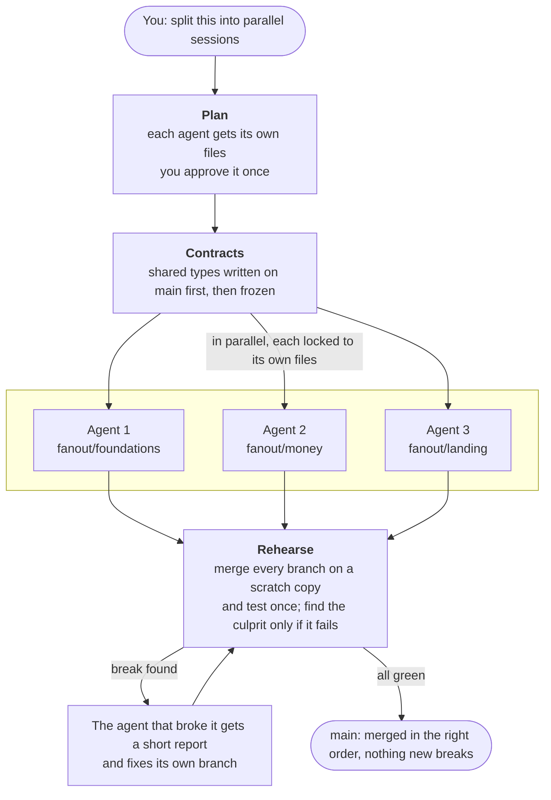

<p align="center">
  <picture>
    <source media="(prefers-color-scheme: dark)" srcset="assets/logo-dark.svg">
    
  </picture>
</p>

<p align="center"><b>Parallel coding agents, merged without breaking main.<br>Each branch passes on its own, then the merge fails. fanout catches that before you merge.</b></p>

<p align="center">
  <a href="https://github.com/Breadstick-Crumbs/fanout/actions/workflows/test.yml"></a>
  
  
  
  <a href="LICENSE"></a>
</p>

<p align="center"></p>
<p align="center"><sub>Recorded with <code>fanout demo</code>: real Claude Code sessions, with nothing about fanout in their tasks.</sub></p>

You run several agents, each in its own worktree and branch. Every branch passes its tests. Then you merge, and the build goes red: one agent renamed a function another was calling, or two built the same feature. fanout runs underneath your sessions and catches that before main, while the agents are still working, so you don't pay for the work twice.

## Highlights

- **Branches that pass alone but break together are caught before main.** fanout merges every session's branch, runs your tests, and sends any failure back to the agent that caused it. On our benchmark: 0 merge conflicts and 0 repair commits on `main`, against 2 conflicts and 4 repair commits in every run without it.
- **Each session hears about changes it needs, while it works.** When another session commits a change to code yours has read or edited, it gets the diff and builds on the new version, instead of finding out when the build fails.
- **The same task, in other words, is done once.** A session about to build what another already has is stopped before its first change, and says which session has it. "Add a dark mode toggle" and "users want a night theme" count as the same work: 40 of 40 held-out pairs right.
- **Works with what you already use.** Worktrees, orchestrators and Claude's session messaging keep working; fanout adds the checks they don't do. Nothing to set up: install the plugin and it switches on when two sessions share a repo. Using Conductor, claude-squad or Paradev? [Here's how](docs/orchestrators.md).
- **Claude Code, Codex, or both,** plus any agent that reads `AGENTS.md`.
- **One big job split across agents,** when you want it: `fanout run` gives each agent its own files, freezes shared interfaces, and tests every branch merged together before anything reaches `main`.
- **No dependencies.** Node 18+ and git.

## Try it

See it work in two minutes, with no install. It makes a throwaway repo and runs three real sessions (about $0.10 on your Claude account):

```bash
npx github:Breadstick-Crumbs/fanout demo
```

Then use it. In Claude Code:

```
/plugin marketplace add Breadstick-Crumbs/fanout
/plugin install fanout@fanout
```

That's all. Open sessions as you do now (worktrees, the desktop app's sessions). A new session is told what the others are doing, its task is claimed on its first edit, and work another session already has is refused.

**Codex, or any agent that reads `AGENTS.md`:** run `npx github:Breadstick-Crumbs/fanout init` once in the repo. No Claude account needed; see [Claims](#claims).

**See every session at once:**

```bash
npx github:Breadstick-Crumbs/fanout
```

Every checkout of the repo, what each is doing and has changed, and the files two of them are both changing, with a dry-run merge to show whether they'd conflict.

**Split one job across agents.** Write the goal as one `##` section per part, naming its files in backticks:

```md
## currency
Add `src/money.mjs`: format prices in the user's currency.

## receipt
Add `src/receipt.mjs`, built on `src/money.mjs`: print the items and the total.
```

```bash
npx github:Breadstick-Crumbs/fanout run --goal-file TASKS.md
```

fanout drafts the plan from the sections (no AI call), shows it, and asks once. Then it runs one agent per section in parallel, tests their branches together, sends any break back to the agent that caused it, and merges into your current branch. Inside Claude Code you can just ask *"split this into parallel sessions"*.

## The problem

Running agents in parallel is easy. Merging their work is not:

- Two agents edit the same file, and one overwrites the other.
- One agent renames a function another is calling. Git merges cleanly and the build breaks anyway.
- Every agent regenerates the same file (codegen output, a lockfile) and they all conflict.
- You end up as the merge queue, fixing things by hand after every round.

fanout prevents these up front and catches whatever slips through before `main`.

## How it works



1. **Plan.** Who owns which files, and the merge order. You approve it. That's the only question you get.
2. **Contracts.** Shared interfaces (types, function signatures) are committed first, so every agent builds against the real thing.
3. **Sessions.** Each agent works on its own branch in its own folder. If it touches a file it doesn't own, it's stopped. A session that builds on others is tested against their real code as soon as they and it are done, and a failure goes straight back to it.
4. **Rehearse.** Every branch is merged on a scratch copy and your tests run once. If something breaks, fanout finds the branch that did it, and that agent gets the failing tests and fixes it.
5. **Merge.** Everything merges into `main` in order.

You only hear about problems if the same agent fails twice.

## Install

**Claude Code**

```
/plugin marketplace add Breadstick-Crumbs/fanout
/plugin install fanout@fanout
```

**Codex**

```bash
codex plugin marketplace add Breadstick-Crumbs/fanout
codex plugin add fanout@fanout
```

That gives Codex the fanout skill. In Codex, out-of-lane work is caught when it's committed (by fanout's git hook, and by `fanout run`, which reverts it), not at the moment of the edit: Codex 0.164 lists plugin hooks as removed and skips hooks you haven't trusted, and it often writes files through the shell, which an edit hook would miss anyway. In Claude Code, edits are blocked as they happen.

**Any other agent**

```bash
git clone https://github.com/Breadstick-Crumbs/fanout
cp -r fanout/skills/fanout ~/.agents/skills/     # Codex
cp -r fanout/skills/fanout ~/.claude/skills/     # Claude Code
```

The git hook (`install-git-hook`, below) enforces the plan no matter which agent commits.

## The plan

Your agent (or `fanout run`) writes it to `.fanout/plan.md`. You read it and approve it.

```md
test: npm test
regen: src/gen/** via npm run codegen

## foundations
task: per-country visibility in the database and shared types
owns: src/lib/types.ts, src/server/db/**
exposes: src/lib/types.ts
done: per-country visibility works; typecheck passes

## money
task: show prices in the user's currency
agent: codex
owns: src/lib/present.ts, src/components/MatchCard.tsx
uses: src/lib/types.ts
done: no hard-coded currency left
```

| Field | Meaning |
|---|---|
| `## name` | One session: one agent, one branch (`fanout/name`). |
| `task` | One line: what this session builds. |
| `owns` | The only files this session may change. Globs work. No two sessions may own the same file. |
| `exposes` | Files others depend on (types, APIs). Written on `main` first, then frozen. |
| `uses` | Contracts this session depends on. It merges after whoever exposes them. |
| `after` | Extra merge-order dependencies, if needed. |
| `agent` | Optional. Which agent runs this session (`claude`, `codex`, or any command). |
| `model` | Optional. The model for this session's agent. |
| `done` | What finished looks like. |
| `check` | Optional. A command that proves `done` on the merged code (a grep, a script, a request). Rehearse runs it after the test passes; a failure goes back to this session. Worth it when the test is only a lint or a build. |
| `test` | Your test command, run after every merge during rehearsal. |
| `regen` | Generated files nobody owns, and the command that rebuilds them after merging. |

**Writing the goal as sections.** With one `## name` section per part and the files in backticks, `fanout run` drafts the plan without AI. A file goes to the section that adds or changes it; other sections that mention it build against it. Text above the first section can set the plan-wide lines: a sentence saying files are generated, naming them (a glob like `css/*-rtl.css` works) and a command in backticks, becomes a `regen:` line, and a sentence naming a test command (``Test with `bash tools/check.sh`.``) becomes the `test:` line; without one, `npm test` is used when `package.json` has a test script. The draft can only see the files the goal names, so it flags any name a section uses from a file another session owns (JavaScript exports, PHP functions), and an agent checks just those and writes the shared interfaces. With no flags and nothing shared, no planning agent runs at all. Each session gets its own sections in full, plus the lines from other sections that describe the functions it builds on.

## Claims

How sessions you open yourself (any agent, any worktree) keep out of each other's way, with no plan.

**When it's on.** By itself, in any repo where two or more checkouts were used in the last day. `fanout init` turns it on for good and writes the `AGENTS.md` block; `git config fanout.claims false` turns it off for a repo.

**In Claude Code, nothing to run:**
- **At start,** a session is told what the other sessions are doing.
- **On its first edit,** its task is claimed for it: what you asked it to do, taken from the conversation.
- **The same work is refused.** A new claim is compared with every live one by a Sonnet call (about $0.012, once per session; it starts in the background when you send the request, so the first edit usually finds the answer ready; a session that edits straight away waits for the rest, about 15 seconds at most). The claim is visible to other sessions while it's being checked, and of two claims for the same work the newer one yields, so two sessions that start together don't both go ahead. If it's the same work, whatever the wording ("add a dark mode toggle" and "users want a night theme they can turn on"), the session is stopped and says which session already has it. Work in the same area isn't the same work ("add tax to checkout" and "add discount codes to checkout"). On 40 labelled pairs written by a separate agent and never used to tune it, the check got all 40 right; matching words got 20 ([results](bench/RESULTS.md#claims-telling-the-same-task-from-different-work-v023)).
- **Shared files aren't blocked.** When another session is also changing a file (`package.json`, a shared stylesheet), the agent is told who, the first time, and carries on. A file someone claimed by name (`fanout claim <name> "<task>" <files>`) is locked for everyone else.
- **Told when another session's commit changes your code.** When another session (or `main`) commits a change to a file this session has read or edited, the session gets the diff and is asked to build against the new version. In a test where ignoring the change meant a certain break, sessions told this way adapted 3 times out of 3; with no notice the merged code failed every time ([results](bench/RESULTS.md#notices-between-sessions-v026)). `FANOUT_NOTICES=off` or `git config fanout.notices false` turns notices off.
- **Edits through the shell count too.** Sessions that edit with shell commands (the desktop app's auto mode does) are claimed and checked after each command, not only through Edit and Write.

**For Codex and other agents,** the `AGENTS.md` block asks for three commands: `fanout start "<task>"` before changing anything (shows the others, claims the task, same check; run again just before the first edit, so two sessions that started at once find each other), `fanout inbox` before committing and before finishing (the notices a Claude Code session gets after each tool call: changes other sessions committed since it last looked, with the diff), and `fanout done` after committing (tests the branch merged with the other sessions' commits and says whose merge broke it; it and the git hook print new notices too). After `fanout init` the git hook refuses a commit from a session that never ran `fanout start`, and commits of locked files whichever agent makes them.

- **The check runs on Claude or Codex,** whichever is signed in (Claude first; `FANOUT_CLAIM_JUDGE_AGENT=codex` to choose). Every answer Codex gave on the held-out pairs was right (52 of 52 over two runs); when its account is rate-limited the check gives up after 45s and the agent compares the tasks itself ([results](bench/RESULTS.md#claims-on-codex-v025)).
- **Inside Codex's sandbox there's no network,** so no model can be asked from there. `fanout start` then lists the other sessions' tasks and the agent compares them itself. Tried with two Codex sessions given the same work: the second read the list, released its claim, and stopped without changing anything.
- **Codex in a worktree can't commit from its sandbox** (it can't write the worktree's git index, which sits outside the folder). That's Codex's limit, not fanout's. The commit-time rule applies when Codex can commit: in the main checkout, or with the sandbox loosened.
- **Grok Build** runs Claude Code-style hooks, and fanout's guard accepts its field names, so its edits should be checked as they happen (not tried here: no Grok account).

**What claims are:** a small record per session (its task, branch, locked files and the files it has changed) on a git ref, `refs/fanout/state`. Every worktree of the repo sees a new claim at once, and none of it shows up in anyone's diff. A claim ends when its branch merges (a squash or rebase merge counts: once main has its changes), its worktree is removed, or after a day with no activity.

```bash
fanout                    # every session: what it's doing, what it changed, overlaps
fanout start "<task>"     # claim this session's task (agents without hooks)
fanout inbox              # changes other sessions committed since you last looked (agents without hooks)
fanout demo               # claims and notices with real sessions in a throwaway repo (~2 min, ~$0.10)
fanout done               # test this branch merged with the others' work
fanout claims             # every claim; fanout release <name> ends one early
fanout log                # the last 7 days: each refusal and notice, to check by hand (--days 30)
```

Tried with real Sonnet sessions and nothing about fanout in their instructions: a session given work another already had stopped without changing anything, both when it started after the other (told at start) and when both started at once (stopped at its first edit). Sessions with other work weren't held up ([results](bench/RESULTS.md#claims-telling-the-same-task-from-different-work-v023)).

## What it catches

| Problem | What fanout does |
|---|---|
| Two sessions own the same file | `check` refuses the plan: `CLASH a <-> b: src/x.ts` |
| A session edits a file it doesn't own | Blocked on the spot. |
| A session changes a shared interface | Blocked. Interfaces are frozen during the fan-out. |
| A session edits a generated file | Blocked. It's rebuilt after merging. |
| Branches merge cleanly but break together | `rehearse` reports `BROKE after money` with the failing output. |
| A real merge conflict | `rehearse` reports `CONFLICT merging b: x.txt` before `main`. |
| A flaky test, or tests that already fail on `main` | `rehearse` reruns before blaming anyone and reports `FLAKY` or `BASE FAILS` instead of pointing at an innocent branch. |
| Tests that need `.env` or another gitignored file | `rehearse` names the files its scratch copy is missing. List them in `.worktreeinclude` and they're copied in. |
| An agent without hooks (Cursor, scripts) | The git pre-commit hook refuses the commit. |

| A session agent... | `fanout run`... |
|---|---|
| crashes or hits its budget | retries it once, then stops and keeps its folder so you can look |
| finishes but changes nothing | flags it and carries on; stops if no session changed anything |
| already has commits from an earlier run | skips it, so you can run again after a stop |
| would run on a CLI that's signed out | stops before any agent starts, with one line saying how to sign in |

## Commands

Your agent runs these. You can too (`npx github:Breadstick-Crumbs/fanout <command>`, or `node skills/fanout/fanout.mjs <command>` in a clone):

```bash
fanout                    # every session: what it's doing and changed, and which files two are both changing
fanout start "<task>"     # claim this session's task; fanout done tests it merged with the others' work
fanout run ["goal" | --goal-file f]   # split a job: plan, agents, rehearse, fix, merge (fanout run --help)
fanout init               # claims on for good, git hook, AGENTS.md block for agents without hooks
fanout claim / claims / release   # claim a task by name and lock its files, see every claim, end one
fanout check              # is the plan safe? prints the merge order
fanout verify             # in a session's folder: anything outside its lane?
fanout rehearse           # merge every branch on a scratch copy, test once
fanout status             # each session: branch, commits, files, anything flagged; during a run, its agent state and cost
fanout install-git-hook   # enforce the plan on every commit
fanout log                # past runs and rehearsals; the last 7 days of claims, refusals and notices, and the hook's cost
```

## Does it work?

**Sessions you open yourself** ([results](bench/RESULTS.md#claims-telling-the-same-task-from-different-work-v023)):
- **Same work in other words:** on 40 labelled task pairs written by a separate agent and held out from tuning, the check got 40 of 40 right (Sonnet; Codex got every one it answered, 52 of 52 over two runs). Shared words got 20 of 40, no better than chance.
- **Real sessions given the same work stopped without changing anything:** Sonnet and Codex, started one after the other or at the same moment, with nothing about fanout in their tasks.
- **Notices:** sessions were built to break unless told of another session's change. When the notice was sent as hook feedback, the session adapted 3 times out of 3. Sent as plain added context, the same notice was ignored 4 times out of 4. With no notice at all, the merged code failed every time ([details](bench/RESULTS.md#notices-between-sessions-v026)).

**Splitting one job with `fanout run`:** the same four overlapping tasks, four parallel agents, with and without fanout ([full results](bench/RESULTS.md)):

| | Without fanout (4 runs) | With fanout (3 runs) |
|---|---|---|
| Conflicts merging into `main` | 2 every run | 0 |
| Merges that broke tests | 1 every run | 0 |
| Repair commits on `main` | 4 every run | 0 |
| Claude cost per run | $0.59–$0.63 | $0.50–$0.92 |

Breaks still happened with fanout, but `rehearse` caught them before `main` and the agent that caused each one fixed it. It's a small benchmark of the project's own tasks. Rerun it with `node bench/run.mjs both`.

On a real WordPress theme (four pages moved to a new design, one session each, Sonnet), `fanout run` went from a one-paragraph goal to four tested, merge-ready branches in about 7 minutes for $1.16, with no conflicts. One Sonnet agent did the same job in 4 minutes for $0.64. At that size, one agent wins ([details](bench/RESULTS.md#real-project-four-theme-pages-v016)).

## When to use it

Parallel agents aren't free. Each one loads and reads the code on its own, so splitting work only pays when the work is big enough.

**Use one agent** unless each part is substantial. On our six-feature benchmark (21 hidden tests, passed by every setup), one Sonnet agent finished in about 1m 40s for $0.25; six agents with fanout took about 2m 45s. Each parallel agent pays its own start-up and reading time, roughly a minute, so parts need to take several minutes each before splitting saves time.

On a bigger job, splitting does pay. On our six-module spreadsheet benchmark (34 hidden tests, minutes per module), `fanout run` with four Sonnet sessions took a median of 3m 59s against 5m 44s for one Sonnet agent, at about 15% more cost ($0.72 against $0.62; three runs each, and the ranges overlap) ([details](bench/RESULTS.md#repeats-with-the-new-defaults-v021)).

**Use fanout** when:
- you already run several sessions on one repo (the desktop app's sessions, worktrees, a teammate). Run `fanout overlap` before anyone merges or deploys. This is where real use found the most value: two sessions about to edit the same footer file, one of them with uncommitted changes in the main checkout;
- the job is big enough that one agent would take a long time, and it splits into parts with their own files;
- several agents touch shared code, where a clean merge can still break the build;
- you run agents headless or in CI, or mix Claude Code and Codex, and nobody is watching each merge.

Even when you don't split the work, `rehearse` and the edit guard cost nothing to run.

**Limits:**
- Evidence so far comes from the project's own fixtures, a few runs each, and one real project. `fanout log` keeps the record from real use so it can be checked.
- Tested on Linux, macOS and Windows in CI.
- It keeps sessions' work apart, not their environments: ports and database servers are shared. Gitignored files like `.env` reach fanout's own checkouts only when listed in `.worktreeinclude`.
- The same-work check takes about 15 seconds. It runs while a session reads the code, so a session that edits straight away waits for what's left.
- Two sessions on the same branch count as one session.
- Codex can't commit from a worktree inside its own sandbox, so the commit-time checks only apply where it can commit.

## Compared with

| | Worktrees by hand | A merge queue or CI | fanout |
|---|---|---|---|
| Each agent gets its own folder and branch | Yes | No | Yes |
| Stops an agent editing another's files | No | No | Yes, as it happens |
| Freezes shared types while agents work | No | No | Yes |
| Finds branches that merge cleanly but break together | After merging | After merging | Before `main` |
| Sends the break back to the agent that caused it | No, you fix it | No, you fix it | Yes |
| Spots sessions you didn't plan editing the same files | No | No | `fanout overlap` |
| Stops two sessions doing the same task | No | No | Claims |

fanout runs before your CI, not instead of it. It runs under orchestrators like Conductor, claude-squad and Paradev too ([setup](docs/orchestrators.md)).

Conflict predictors like Clash dry-run a merge of each pair of worktrees and warn on overlapping lines. fanout does that too (`fanout overlap`), then runs your tests on all the branches merged, so it also catches merges that are clean in git and broken in the build, and work two sessions both started.

## FAQ

**How do I run multiple Claude Code (or Codex) agents in parallel without merge conflicts?**
Ask your agent to "split this into parallel sessions", or run `fanout run "<goal>"`. Each agent gets its own git worktree and its own files, so two agents never edit the same file, and every branch is tested together before it reaches `main`.

**Do I need to configure anything?**
No. The plan is the only file, and your agent writes it. The defaults are the ones that did best on the benchmark; the [options](#options) are there if you need them.

**How is this different from Claude Code's agent teams and `claude -w`?**
Agent teams start teammates from one lead session and coordinate them from there; `claude -w` gives a session its own worktree. fanout is for the sessions you open yourself, whenever you open them, in Claude Code, Codex or anything that reads `AGENTS.md`. It refuses the same work described in other words, tells a session when another one's commit changes code it uses, and tests the branches merged together before `main`. They combine: a `claude -w` session is one more worktree to fanout.

**Does it get in the way of normal work?**
With one session, no: claims stay off and `fanout run` only acts on branches named `fanout/*`. With two or more sessions active in a repo, claims switch on. The same-work check runs in the background from the moment you send a request, and a hook runs after each tool call: about 0.2s when nothing has changed, on Windows. `git config fanout.claims false` turns claims off for a repo. In your main checkout `fanout run` commits only its own files (the contracts and regenerated files), so another session's uncommitted work stays out; the checkout has to be clean when a run starts.

**What does it run, and what leaves my machine?**
- **Hooks (Claude Code):** before an edit (the guard), after a tool call (claims for shell edits, and notices), and at session start. Each is `node fanout.mjs <hook>` on your machine, reading git.
- **Sent to a model:** only for the same-work check, through your own signed-in `claude` CLI (or `codex`). It sends your latest request to the session (up to 600 characters), plus the other live sessions' tasks and the files they claimed. `FANOUT_CLAIM_JUDGE=off` turns the check off; sessions then get the list and compare the tasks themselves.
- **Nothing else:** no telemetry, no server. Details in [PRIVACY.md](PRIVACY.md).
- **Written:** claims on the git ref `refs/fanout/state`; the event log and per-checkout state in `.git/`; `fanout run`'s plan and lanes in `.fanout/` (git-ignored), with copies of the files `.worktreeinclude` lists. The git hook is installed only by `fanout init` or `fanout install-git-hook`.

**Will it burn tokens?**
The same-work check costs about $0.012, once per session. Everything else fanout checks is a plain script with no AI call, and a failure report is a few lines, not a full log. Running several agents does cost more than one, so split work only when it's big enough. Planning is the largest single cost of a `fanout run`: a goal written as sections skips most of it, and inside Claude Code your own session plans for free. Sessions on a cheaper model (`--session-model haiku`) cut a run's cost about 4× on our benchmark, but lost a hidden test or two.

**Can I mix Claude Code and Codex?**
Yes. Sessions are just git branches: give a session `agent: codex` in the plan, or let `fanout run --mix` choose. Codex sessions took 2–3× as long as Claude ones on our benchmark, so mixing saves Claude spend and quota rather than time.

**My tests need `.env` (or a local database file). Does that work?**
Yes, with one file. fanout tests in fresh git checkouts, which have only tracked files, so list the gitignored files your project needs in `.worktreeinclude` at the repo root, one per line in `.gitignore` syntax:

```
.env
.env.local
config/secrets.json
```

They're copied from your checkout into `rehearse`'s scratch copy (fresh on every run) and into each `fanout run` session's folder. Only files that match and are gitignored are copied, never tracked ones. Claude Code reads the same file for its own worktrees, including the desktop app's parallel sessions, so you set it up once. Without it, a run that fails only because a file is missing says so and names the file. A database server on localhost is shared by every session, as it is today; fanout doesn't isolate it.

**What if two tasks need the same file?**
Give it to one session. If others depend on it, make it a contract (`exposes` / `uses`). If it's generated, list it under `regen`.

**What doesn't it do?**
It isn't CI. It won't fix flaky tests or speed up a slow suite. It makes sure what your agents hand to CI already works together.

## Options

You shouldn't need these to start. `fanout run` options:

| Option | What it does |
|---|---|
| `--yes` | Start without asking to approve the plan. |
| `--goal-file TASKS.md` | Read the goal from a file. |
| `--agent claude\|codex\|"<cmd>"` | Which agent runs the sessions (default `claude`). Any command works: it gets the brief on stdin and runs in the session's folder. A session's `agent:` line wins. |
| `--no-merge` | Stop when everything passes, before merging. |
| `--model m` / `--session-model m` | The planner's model / the sessions' model. A session's `model:` line wins. |
| `--mix` | Three sessions in Claude (those others build on first, then plan order), the rest in Codex. Shown with the plan. |
| `--max-sessions 4` | Most sessions to plan. Above about four, one account's agents slow each other down (six ran at about half speed). |
| `--budget usd` | Spending cap per Claude agent run. |
| `--fixes 2` | Fix rounds per session before the run stops for you. |
| `--full-tests` | Let sessions write full test suites (by default they keep their own tests short, since rehearse tests the merged result). |
| `--review` | Have an agent review the whole drafted plan, for goals that may hide dependencies they don't name in backticks. |
| `--no-draft` | Always plan with an agent, even for a goal in sections. |

Environment variables:

| Variable | What it does |
|---|---|
| `FANOUT_USER_SETTINGS=1` | Start Claude session agents with your user settings. By default they load only the project's (faster and cheaper: no personal hooks, plugins or global `CLAUDE.md`), and fall back to yours if a start fails. |
| `FANOUT_CODEX_EFFORT` | Codex sessions' reasoning effort: `low` by default (2–3× faster than Codex's default on our benchmark, same score), or `minimal`, `medium`, `high`, `default`. |
| `FANOUT_CODEX_TIER=fast` | Codex's Fast tier: about a fifth quicker in our test, using more of your Codex quota. |
| `git config fanout.claims true\|false` | Claims on or off for a repo, whatever the number of active sessions (`fanout init` sets `true`). `git config fanout.test "<cmd>"` sets the test `fanout done` runs (default: the plan's, else `npm test`). |
| `FANOUT_CLAIM_JUDGE=off` | Don't check new claims for the same work (no model call; the agent gets the others listed to compare itself). `FANOUT_CLAIM_JUDGE_AGENT=claude\|codex` picks the CLI (default: Claude if signed in, else Codex). `FANOUT_CLAIM_JUDGE_MODEL` picks the model (Claude default `sonnet`, where `haiku` is cheaper but missed a third of the held-out duplicates; Codex default: your Codex model). `FANOUT_CLAIM_JUDGE_EFFORT` sets Codex's reasoning effort for it (default `low`). |
| `FANOUT_TRACE_DIR` | Save each Claude agent's full event stream there, to see where its time went. |

## Development

```bash
npm test
```

Node's built-in test runner. No dependencies.

## License

MIT. See [LICENSE](LICENSE).
