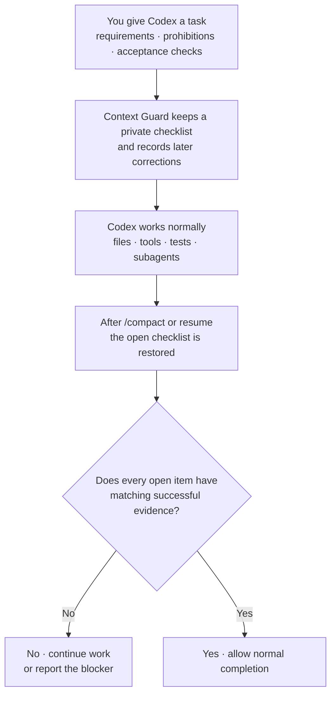

# Context Guard

[](https://github.com/GreenLv/codex-context-guard/actions/workflows/ci.yml)
[](https://github.com/GreenLv/codex-context-guard/actions/workflows/hol-plugin-scanner.yml)
[](https://hol.org/registry/plugins/gerui-lv%2Fcontext-guard)
[](https://github.com/GreenLv/codex-context-guard/releases/latest)
[](LICENSE)

[简体中文](README.zh-CN.md) | [Introduction](https://greenlv.github.io/blogs/protecting-context-in-long-running-agent-tasks/) | [Changelog](CHANGELOG.md)

Context Guard keeps important requirements from disappearing during a long Codex task. It restores a private checklist when a task is compacted or resumed, and checks recorded evidence before accepting a completion claim.

It works beside Codex Plan, Goal, memories, subagents, worktrees and the transcript. Ordinary edits, commits and pushes use Codex’s existing permissions.

> **0.17.1 — 2026-11-09.** Upgrade to the stable marketplace entry and
> optionally copy private task state from a different identity on the same
> machine. The migration tool previews changes by default and preserves the
> existing state when two sessions have the same ID but different contents.
> Finish work that still needs the old runtime before changing your daily
> installation. Read the [release notes](docs/releases/v0.17.1.md) and the
> [upgrade guide](docs/UPGRADE_0_17_1.md).

> **0.17.0 — 2026-11-06.** Planning-only requests no longer inherit a file-modification duty from history, advice or negation; the Desktop `aggregated_output` terminal result is accepted with identity and exit-code bindings intact; an unrelated oversized transcript row no longer disables later terminal evidence; and session retention cleanup returns under a new versioned contract — preview by default, policy-gated quarantine with restore, purge only after a grace period. Read the [release notes](docs/releases/v0.17.0.md), [upgrade boundaries](docs/SESSION_STORAGE.md) and [acceptance record](docs/LOCAL_ACCEPTANCE.md) before changing an installation. The marketplace identity switches from the experimental `codex-context-guard-v016` to the stable `codex-context-guard` in this line; see the [stable identity contract](tools/validation/STABLE_MARKETPLACE_IDENTITY.md).

> **0.16.1 — 2026-11-03.** File names and paths containing acceptance words no longer create extra duties. This version also adds an explicit historical-coverage release gate, completes plugin listing metadata and keeps session retention cleanup disabled. Read the [release notes](docs/releases/v0.16.1.md), [upgrade boundaries](docs/SESSION_STORAGE.md) and [acceptance record](docs/LOCAL_ACCEPTANCE.md) before changing an installation.

> **0.16.0 — 2026-11-01.** The previous version strengthened credential redaction and private-state permissions and moved installation to the official Codex marketplace. Its [release notes](docs/releases/v0.16.0.md) describe that upgrade.

## Install with Codex

**0.17.1 — 2026-11-09.** Follow the commands below for a fresh install.
If Context Guard is already installed, first identify the entry it uses and
follow the matching upgrade route. The stable entry is
`context-guard@codex-context-guard`. [Release ZIP](https://github.com/GreenLv/codex-context-guard/releases/tag/v0.17.1) ·
[Upgrade guide](docs/UPGRADE_0_17_1.md)

Download the named ZIP from the GitHub Release assets into a new directory:

```shell
gh release download v0.17.1 --repo GreenLv/codex-context-guard --pattern context-guard-0.17.1.zip
```

Extract the release ZIP into a stable directory you control and keep that
directory: official marketplace refreshes still use it. Do not register a Git
checkout or GitHub's automatically generated source ZIP as the marketplace.

On Windows use `py -3` in place of `python3` in the Python commands below.
Codex CLI with plugin support and a host that loads lifecycle Hooks are also
required. From the stable extracted directory, first inspect the official status:

```shell
codex plugin list --json
```

If the original `context-guard@codex-context-guard` is enabled and unfinished
tasks depend on it, stop here until those tasks finish. If you cannot switch now,
keep the current setup, or arrange a separately configured HOME; this version
does not establish automatic old-task continuation.

If 0.16.x is already installed under the experimental marketplace identity,
this procedure is an identity switch, not an in-place upgrade.
Registering the stable `codex-context-guard` marketplace and installing from it
are official operations on the new identity; they do not migrate private state
and they may remove the old experimental cache. Finish work that depends on the
existing runtime or use a separately configured HOME for new work. Preserve any
versioned cache and review the new HOME's Hooks normally.

Only when `context-guard@codex-context-guard` is absent, register and install:

```shell
codex plugin marketplace add .
codex plugin add context-guard@codex-context-guard --json
codex plugin list --json
```

Keep the first add response: its `installedPath` identifies the cache to inspect.
`plugin list` reports identity, version, enabled/installed flags and marketplace
source, but does not provide that path. Require exactly one matching record,
version `0.17.1`, both flags true, and this stable extracted directory as source.
Compare every release file by replacing the quoted example with the complete
`installedPath` value, keeping the quotes for paths containing spaces:

```shell
python3 scripts/artifact_identity.py --compare-to "/path/from/installedPath"
```

If the target was already installed, perform that same status, identity and
full-file comparison, then stop. Do not register or add again. Missing installation
readback, an ambiguous identity, a wrong version/source or any file drift is an
error; stop rather than guess a path or reinstall. A direct repeated `plugin add`
can recreate cache objects. Only the complete check-first procedure can have a
second no-op; CLI add itself is not claimed idempotent. The native gate compares
all HOME paths, modes and file bytes at the end, not the absence of intermediate
writes; synthetic old-cache objects additionally retain their identities.

The project installer, transaction rollback, archive repair and automatic
interpreter binding are removed. Codex owns installation. Preserve existing versioned caches and daily configuration throughout the
upgrade. A new marketplace name alone does not prove preservation or old-task
continuation. Before trusting the new Hooks, inspect the experimental
`context-guard@codex-context-guard-v016` entry again. If it remains enabled, first
finish every task that depends on it, then use the official Plugins UI to disable
only that experimental identity while keeping
`context-guard@codex-context-guard` enabled. Do not remove the old plugin or
delete its cache. Do not trust both
Hook sets as an upgrade procedure. Desktop loading may require a client restart;
then start a new Codex CLI task with the same `CODEX_HOME` and project and open
`/hooks`. For each of the nine Context Guard events, compare its displayed
source with `<installedPath>/hooks/hooks.json` from the saved add response,
then review and trust it through the normal interface. Stop if an entry is
missing, its source differs, or the interface does not show the source.
The [Hook browser](https://learn.chatgpt.com/docs/hooks) lists definitions and
trust; it does not prove that a Hook executed or that Desktop loaded it.
Host-specific switching and old-task observations are recorded separately in
[local acceptance](docs/LOCAL_ACCEPTANCE.md).

### Python and upgrades

Existing `<CODEX_HOME>/context-guard/interpreter.conf` bindings are still read
and runtime-validated, but this version does not create them. A bad binding
fails visibly. After PATH discovery fails, the POSIX launcher probes fixed global
locations: Homebrew (`/opt/homebrew/bin` or `/usr/local/bin`, including Python
3.10–3.14 version names), `/opt/anaconda3/bin`, and Python.framework. Each fallback
must pass an isolated Python 3.10+ probe with an exact response. It never searches
personal directories or writes a binding; other locations still need PATH or a
valid explicit binding. Windows still uses its PATH/launcher route or binding;
startup and missing-interpreter discovery avoid scanning unrelated PowerShell modules. Restricted-PATH tests do not establish
actual GUI restart behavior on either platform.

Finish old work under its original runtime before changing its selected plugin.
An old cache alone does not pin old task Hooks. No session or trust data is
migrated; separate-HOME and old-task results bind their exact host and artifact.
See [upgrade boundaries](docs/SESSION_STORAGE.md) and [installation changes](docs/INSTALLER_REMOVAL.md).

## Try it

In a fresh task, activate Context Guard:

```text
$context-guard
```

Then inspect the protected state:

```text
context-guard status
context-guard diagnose
```

For a recovery check, use it on a non-trivial synthetic task, run `/compact`, and confirm that the same open requirements return immediately afterward.

For a worked example, follow the [Context Guard walkthrough on HOL](https://hol.org/blog/context-guard-codex-compaction-evidence-workflow): define a document’s requirements, compact the task, then check the recovered requirements and finished document.

## What it protects

- Requirements, acceptance criteria, prohibitions, and later corrections keep stable task-local identities.
- Compaction and resume restore the open checklist instead of relying only on a conversational summary.
- Successful tool evidence must match the named file, URL, image, or other requested result before it can close an item.
- A delivered answer is not a completed task. A natural answer actually delivered to a pure question closes that item as `answered` and never replays after compaction; an execution obligation always needs evidence; an unknown delivery state is never presented as completion.
- Images and other multimodal inputs keep only hashes and bounded metadata. When the user asks for an image change, completion evidence can be tied to an inspection of the changed image rather than merely to a successful tool call.
- Ambiguous output remains `unknown`; damaged or unverifiable private state blocks completion verification.
- Exports are explicit and redacted. Image bytes, credentials, and raw transcript content are not copied into the requirement ledger.

Automatic checks are used only when the request names a concrete target, such as a file, URL, edited image, or complete object list. If Context Guard cannot verify a result exactly, it leaves the item open instead of guessing. Waiting for the user, an external result, or a later turn does not close unfinished requirements.

## Who decides what

- You decide the task and which changes are allowed.
- Repository instructions and selected Skills define the adopted workflow, but cannot grant new authority.
- Codex Plan describes the model's current steps; Context Guard can keep a read-only reference but does not edit the plan.
- Tool, file, image, UI, and public-page readbacks establish facts. They do not by themselves decide whether an action is authorized.

From version 0.13 the responsibilities split like this:

- **You and the executing agent decide execution.** Whether an edit, commit, push, tag, or publication is within your authorization is judged by the main executing agent from the real conversation, repository rules, and host permissions — not by a Context Guard prompt. A Context Guard allow was never authorization, and the product now says so explicitly.
- **Context Guard owns correctness continuity.** It recovers requirements and constraints across compaction and resume, keeps task state continuous, checks completion claims against matching deterministic evidence, tracks whether a requested answer was actually delivered, and protects its own private control state. These checks are fail-closed and never ask you to re-authorize ordinary work.
- **An explicitly adopted release execution contract owns precise identity actions.** Only after an explicit adoption or an explicit `context-guard release` declaration do tier-A actions — tags, registry publish/yank, GitHub Releases — require an exact one-shot action ticket.

Context Guard does not grant permissions or replace platform approval, and specialized tools outside Hook coverage remain outside its view.

## Protection levels

Context Guard's checks follow the active protection level. Skills, repository instructions, or installing the plugin can suggest a level, but only you can turn on a stricter one.

| Level | How it turns on | What it does |
| --- | --- | --- |
| **Standard** (default) | Activating the guard | Recovers your requirements after compaction and resume, keeps task state continuous, checks completion honestly against deterministic evidence, and tracks answer delivery. No execution approvals and no repeated authorization asks: ordinary edits, commits, pushes, status questions, and compaction never trigger a Context Guard prompt. |
| **Strict** | You explicitly ask for strict evidence protection | Standard, plus enforced proof obligations for the current work unit — useful for formal deliverables and multi-image work. Strict never implies release or Git gating. |
| **Release** | Only an explicitly adopted release execution contract or an explicit `context-guard release` declaration | Standard, plus candidate-closure, publication-readiness, and exact one-shot tickets for covered tier-A identity actions (tags, registry publish/yank, GitHub Releases). Having a tag or release authorized never follows automatically from anything else. |
| **Observe** | Maintainer or canary configuration | Records bounded what-it-would-have-done results, without blocking anything. |

Everything else stays open by design: local edits, tests, ordinary commits, reads, searches, and dry-runs need no additional Context Guard approval, and turning the guard `off` stops all gating while prompt journaling continues. When a normal action is allowed, nothing appears on screen; when an action is refused — a release-contract ticket failure or an integrity failure — you get one short actionable reason.

## How it works



Codex still owns the work and its native planning state. Context Guard carries the checklist across context boundaries and, when project instructions have been adopted explicitly, restores their unfinished phases and plan reference before checking completion.

## Everyday example: write a technical design document without losing decisions

Suppose the task is:

```text
Write docs/design/checkout-v2.md.

- Keep the approved API and data-flow decisions unchanged.
- Do not change the rollout date or add infrastructure commitments.
- Follow the RFC template.
- Give every recommendation a source link or a "to verify" label.
```

After research, edits, diagrams, and `/compact`, Context Guard restores those same items. A passing Markdown check cannot close the whole task: the approved decisions, RFC template, source links, and prohibited commitments each still need matching evidence.

This example explains the contract boundary; it does not claim that Context Guard can decide whether the design itself is sound.

The same boundary applies to routine execution. After you say “finish the changes, commit and push” (完成修改，提交并推送), ordinary edits, commits, pushes, status questions, and compaction proceed without any Context Guard re-authorization, before and after a `/compact`. A reply that claims the whole task is complete still needs matching evidence for everything still open.

## What you may see in a guarded task

| ID | Meaning |
| --- | --- |
| `R001` | A requirement captured for this task. |
| `A003` | An acceptance item checked independently. |
| `E####` | A successful evidence record that may close a compatible item. |

These are task-local identifiers, not GitHub issues or global task numbers. They may appear in progress text but the private ledger is not printed in the final reply.

## When Context Guard asks Codex to continue

When an open requirement still lacks matching evidence and the reply claims the whole task is complete, Context Guard may ask Codex to continue with this standard redacted message:

```text
[Context Guard continuation] The task is not yet safely complete.
```

The message is normal when requested work is still open. If it is unexpected, ask Codex what remains and run `context-guard status` or `context-guard diagnose`. The default feedback names only the current work unit's pending-item count, one reason, and one next step — never the full historical ID list — and a turn can be corrected at most once; after that, unresolved work stays pending and the turn ends safely. Waiting for the user, an external result, or an explicitly deferred step ends the turn silently without closing unfinished requirements. Ordinary endings need no commands: when a reply verifiably completes the unit, the guard binds the unique successful evidence itself.

An old task is not guaranteed to keep its original Hook after an in-place upgrade. Follow [session storage and upgrades](docs/SESSION_STORAGE.md) before switching versions; if an old Hook path is missing, see [Versioning](docs/VERSIONING.md) for recovery guidance.

## User controls

| Command | Purpose |
| --- | --- |
| `$context-guard` or `context-guard on` | Activate recovery and completion gating. |
| `context-guard off` | Disable gating while preserving prompt journaling. |
| `context-guard standard\|strict\|release\|observe` | Select a protection level explicitly; `release` does not authorize a publication action. |
| `context-guard adopt <project-relative-json>` | Explicitly adopt one validated project execution contract. |
| `context-guard status` | Show protected-state counts without raw prompts. |
| `context-guard diagnose` | Show bounded diagnostics without raw prompts or replies. |
| `context-guard export <path>` | Write an explicit redacted handoff in the current project. |
| `context-guard rollover <directory>` | Validate prepared successor input and write a non-overwriting handoff plus hash manifest. |

Read [Successor Pack Input](skills/context-guard/references/successor-pack.md) before using `rollover`. It never creates or authorizes another task.

## Private data and retention

Runtime data is stored under Codex-managed `PLUGIN_DATA`. Prompt bodies, task state, evidence summaries, and recovery files remain local runtime data and are not part of this repository.

SessionEnd saves current state and, when active, recovery content. In 0.17.0, session retention maintenance returns under a new versioned contract while SessionEnd itself still runs no sweep: `cleanup --data-dir <root>` previews by default and never touches session data without an explicitly enabled retention policy plus an apply bound to an exact manifest. Eligible ended sessions (30 days by default) move to recoverable quarantine with a restore command; a restore moves an object back only after proving it complete, and permanent purge runs only after a further 7-day grace period and leaves expiring tombstones. Scheduled maintenance is opt-in and never touches a scheduler entry it does not own. Active, resumable, unfinished, busy-locked, partial, legacy, linked and out-of-scope objects are protected with a named reason. Cleanup also preserves objects whose creation identity cannot be verified; creation-time support is required for automatic cleanup. Keep active tasks, session data, lifecycle locks and existing plugin caches intact. The disabled-cleanup era and the restoration conditions are tracked in [Retention cleanup follow-up](docs/RETENTION_CLEANUP_FOLLOWUP.md).

 Redacted exports are created only when requested, never overwrite an existing file, and omit raw prompts, transcripts, credentials, authorization headers, URL query values, URL userinfo, and plugin-private paths; the documented redaction domain is listed in [Privacy](docs/PRIVACY.md). Direct CLI fallback state lives under the active `CODEX_HOME` when no plugin data directory is provided.

## Update and uninstall

Do not run `git pull` in the extracted release directory. Obtain a separately
named published artifact for a later version and follow that version's upgrade
instructions after finishing dependent tasks. Never overwrite a consumed cache
or refresh an old marketplace as part of installing this version.

Removal deletes the selected plugin's cache. Do not remove it while any active
task may depend on it. After those tasks finish, the commands below target only
the stable identity. Preservation of real 0.15.1 cache objects remains
unverified:

```shell
codex plugin remove context-guard@codex-context-guard
codex plugin marketplace remove codex-context-guard
```

The experimental `codex-context-guard-v016` entry left by 0.16.x keeps its own
cache and its own removal commands; do not remove it while any task or cache
still depends on it.

Private runtime data is separate; this procedure does not migrate or delete it.

## Documentation

- [Architecture](docs/ARCHITECTURE.md)
- [Privacy](docs/PRIVACY.md)
- [Compatibility](docs/COMPATIBILITY.md)
- [Versioning](docs/VERSIONING.md)
- [Local acceptance](docs/LOCAL_ACCEPTANCE.md)
- [Changelog](CHANGELOG.md)

## Validation

```shell
python3 scripts/validate_public_repo.py .
python3 scripts/audit_public_tree.py .
python3 scripts/run_current_behavior_suite.py
python3 scripts/check_phase3_transition.py
python3 scripts/context_guard.py self-test
ruff check .
python3 -m compileall -q scripts tests tools
git diff --check
```

The current-behavior runner discovers every current `test_*.py` module except the byte-frozen 0.11.x observation baseline. The transition audit runs that historical baseline separately and succeeds only when its exact fixed/inverted manifest matches; running the frozen file as an ordinary all-pass suite would intentionally report failures and unexpected successes.

The Hook runtime uses only the Python standard library. CI covers Ubuntu, macOS, and Windows on Python 3.10–3.14; CI does not substitute for native Hook trust or installed lifecycle evidence.

## Explicit non-goals

- Context Guard checks only results it can verify deterministically. It cannot establish that arbitrary text or images are correct, and it does not replace tests or human review.
- It provides no security sandbox, transcript backup, cloud sync or agent scheduling. Codex continues to own Plan, Goal and execution.
- It grants no permissions. Publication still needs release-readiness checks, user and host authorization, and public readback.

Its recovery and completion contract does not depend on a model or agent host providing its own context protection. The [architecture](docs/ARCHITECTURE.md) explains the protocol and Codex adapter.

Only the user who started the root task can adopt project workflow and plan references with `context-guard adopt <project-relative-json>`. Adoption leaves Codex Plan unchanged and grants no authority. Installing a Skill or mentioning a plan does not adopt it. Release controls require explicit selection, as described above.

## Contributing and security

See [CONTRIBUTING.md](CONTRIBUTING.md). Report sensitive issues through GitHub Private Vulnerability Reporting as described in [SECURITY.md](SECURITY.md).

Licensed under the [Apache License 2.0](LICENSE).
