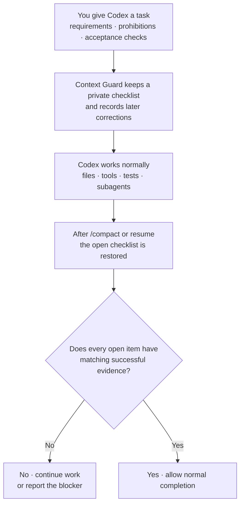

# Context Guard

[](https://github.com/GreenLv/codex-context-guard/actions/workflows/ci.yml)
[](https://github.com/GreenLv/codex-context-guard/actions/workflows/hol-plugin-scanner.yml)
[](https://hol.org/registry/plugins/gerui-lv%2Fcontext-guard)
[](https://github.com/GreenLv/codex-context-guard/releases/latest)
[](LICENSE)

[简体中文](README.zh-CN.md) | [Introduction](https://greenlv.github.io/blogs/protecting-context-in-long-running-agent-tasks/) | [Changelog](CHANGELOG.md)

Context Guard helps Codex remember what you asked for in a long task. After `/compact` or a resume, it brings back the requirements that are still open. When Codex says the whole task is done, Context Guard checks for evidence that matches those requirements.

For example, if you ask Codex to edit one file and run a test, a successful file read or an unrun test still leaves work open. Ordinary edits, commits and pushes use Codex's existing permissions.

**Latest release: 0.17.3.** Finish tasks that still need the old plugin before switching. The upgrade guide explains how to update the stable entry and keep your cleanup settings. [release notes](docs/releases/v0.17.3.md) · [upgrade guide](docs/UPGRADE_0_17_3.md)

## Install with Codex

You need Python 3.10 or newer and a Codex client that can load plugins and their automatic scripts (Hooks). Run `codex plugin list --json` first. If any Context Guard entry is already installed, use the [0.17.3 upgrade guide](docs/UPGRADE_0_17_3.md) for that entry. The steps here are for a fresh installation.

1. Download `context-guard-0.17.3.zip` from the [release assets](https://github.com/GreenLv/codex-context-guard/releases/tag/v0.17.3). Verify the published SHA-256, extract the ZIP into a directory you control, and keep it there as the marketplace source. The release ZIP includes the file list used for verification.
2. From that directory, register the marketplace and install Context Guard:

   ```shell
   codex plugin marketplace add .
   codex plugin add context-guard@codex-context-guard --json
   codex plugin list --json
   ```

3. Check that the list has one `context-guard@codex-context-guard` entry at `0.17.3`, installed and enabled, with the extracted directory as its marketplace source. Save the `installedPath` from the add response. To compare the installed files, replace the quoted example with that full path. On Windows, use `py -3` in place of `python3`.

   ```shell
   python3 scripts/artifact_identity.py --compare-to "/path/from/installedPath"
   ```

4. Start a fresh Codex CLI task with the same configuration directory. Open `/hooks` and check that the nine Context Guard Hooks come from `<installedPath>/hooks/hooks.json` before trusting them. If a source is missing or differs, stop and check the installation. Then try the plugin in the client you actually use. Desktop may need a restart to load the new entry.

If a new task cannot find Python or still loads the old version, see [compatibility](docs/COMPATIBILITY.md) and [the upgrade guide](docs/UPGRADE_0_17_3.md). For a repeat check, inspect the installed entry and compare the files again. Repeating `plugin add` can recreate cache files.

## Try it

In a fresh task, activate Context Guard:

```text
$context-guard
```

Then inspect the protected state:

```text
context-guard status
context-guard diagnose
```

To try recovery, give a new task two or three requirements and leave one open. Run `/compact`, then ask Codex to list what is still open. Check that it remembers the same requirement.

For a worked example, follow the [Context Guard walkthrough on HOL](https://hol.org/blog/context-guard-codex-compaction-evidence-workflow): define a document’s requirements, compact the task, then check the recovered requirements and finished document.

## What it protects

- Requirements, acceptance criteria, prohibitions, and later corrections keep stable task-local identities.
- Compaction and resume restore the open checklist instead of relying only on a conversational summary.
- Successful tool evidence must match the named file, URL, image, or other requested result before it can close an item.
- A delivered answer is not a completed task. A natural answer actually delivered to a pure question closes that item as `answered` and never replays after compaction; an execution obligation always needs evidence; an unknown delivery state is never presented as completion.
- Images and other multimodal inputs keep only hashes and bounded metadata. When the user asks for an image change, completion evidence can be tied to an inspection of the changed image rather than merely to a successful tool call.
- Ambiguous output remains `unknown`; damaged or unverifiable private state blocks completion verification.
- Exports are explicit and redacted. Image bytes, credentials, and raw transcript content are not copied into the requirement ledger.

Context Guard can require specific proof for a named file, URL, edited image or complete list of objects. It keeps those checks open when the proof is missing. For requests it cannot check in that way, it reports `legacy_fallback` and uses the more general completion check. Waiting for the user, an external result, or a later turn keeps unfinished requirements open.

## Who decides what

- You decide the task and which changes are allowed.
- Repository instructions and selected Skills define the adopted workflow, but cannot grant new authority.
- Codex Plan describes the model's current steps; Context Guard can keep a read-only reference but does not edit the plan.
- Tool, file, image, UI, and public-page readbacks establish facts. They do not by themselves decide whether an action is authorized.

From version 0.13 the responsibilities split like this:

- **You and the executing agent decide execution.** Whether an edit, commit, push, tag, or publication is within your authorization is judged by the main executing agent from the real conversation, repository rules, and host permissions — not by a Context Guard prompt. A Context Guard allow was never authorization, and the product now says so explicitly.
- **Context Guard owns correctness continuity.** It recovers requirements and constraints across compaction and resume, keeps task state continuous, checks completion claims against matching deterministic evidence, tracks whether a requested answer was actually delivered, and protects its own private control state. These checks are fail-closed and never ask you to re-authorize ordinary work.
- **An explicitly adopted release execution contract owns precise identity actions.** Only after an explicit adoption or an explicit `context-guard release` declaration do tier-A actions — tags, registry publish/yank, GitHub Releases — require an exact one-shot action ticket.

Context Guard does not grant permissions or replace platform approval, and specialized tools outside Hook coverage remain outside its view.

## Protection levels

Context Guard's checks follow the active protection level. Skills, repository instructions, or installing the plugin can suggest a level, but only you can turn on a stricter one.

| Level | How it turns on | What it does |
| --- | --- | --- |
| **Standard** (default) | Activating the guard | Recovers your requirements after compaction and resume, keeps task state continuous, checks completion honestly against deterministic evidence, and tracks answer delivery. No execution approvals and no repeated authorization asks: ordinary edits, commits, pushes, status questions, and compaction never trigger a Context Guard prompt. |
| **Strict** | You explicitly ask for strict evidence protection | Standard, plus enforced proof obligations for the current work unit — useful for formal deliverables and multi-image work. Strict never implies release or Git gating. |
| **Release** | Only an explicitly adopted release execution contract or an explicit `context-guard release` declaration | Standard, plus candidate-closure, publication-readiness, and exact one-shot tickets for covered tier-A identity actions (tags, registry publish/yank, GitHub Releases). Having a tag or release authorized never follows automatically from anything else. |
| **Observe** | Maintainer or canary configuration | Records bounded what-it-would-have-done results, without blocking anything. |

Everything else stays open by design: local edits, tests, ordinary commits, reads, searches, and dry-runs need no additional Context Guard approval, and turning the guard `off` stops all gating while prompt journaling continues. When a normal action is allowed, nothing appears on screen; when an action is refused — a release-contract ticket failure or an integrity failure — you get one short actionable reason.

## How it works



Codex still owns the work and its native planning state. Context Guard carries the checklist across context boundaries and, when project instructions have been adopted explicitly, restores their unfinished phases and plan reference before checking completion.

## Everyday example: write a technical design document without losing decisions

Suppose the task is:

```text
Write docs/design/checkout-v2.md.

- Keep the approved API and data-flow decisions unchanged.
- Do not change the rollout date or add infrastructure commitments.
- Follow the RFC template.
- Give every recommendation a source link or a "to verify" label.
```

After research, edits, diagrams, and `/compact`, Context Guard restores those same items. A passing Markdown check cannot close the whole task: the approved decisions, RFC template, source links, and prohibited commitments each still need matching evidence.

This example explains the contract boundary; it does not claim that Context Guard can decide whether the design itself is sound.

The same boundary applies to routine execution. After you say “finish the changes, commit and push” (完成修改，提交并推送), ordinary edits, commits, pushes, status questions, and compaction proceed without any Context Guard re-authorization, before and after a `/compact`. A reply that claims the whole task is complete still needs matching evidence for everything still open.

## What you may see in a guarded task

| ID | Meaning |
| --- | --- |
| `R001` | A requirement captured for this task. |
| `A003` | An acceptance item checked independently. |
| `E####` | A successful evidence record that may close a compatible item. |

These are task-local identifiers, not GitHub issues or global task numbers. They may appear in progress text but the private ledger is not printed in the final reply.

## When Context Guard asks Codex to continue

When an open requirement still lacks matching evidence and the reply claims the whole task is complete, Context Guard may ask Codex to continue with this standard redacted message:

```text
[Context Guard continuation] The task is not yet safely complete.
```

The message is normal when requested work is still open. If it is unexpected, ask Codex what remains and run `context-guard status` or `context-guard diagnose`. The default feedback names only the current work unit's pending-item count, one reason, and one next step — never the full historical ID list — and a turn can be corrected at most once; after that, unresolved work stays pending and the turn ends safely. Waiting for the user, an external result, or an explicitly deferred step ends the turn silently without closing unfinished requirements. Ordinary endings need no commands: when a reply verifiably completes the unit, the guard binds the unique successful evidence itself.

An old task is not guaranteed to keep its original Hook after an in-place upgrade. Follow [session storage and upgrades](docs/SESSION_STORAGE.md) before switching versions; if an old Hook path is missing, see [Versioning](docs/VERSIONING.md) for recovery guidance.

## User controls

| Command | Purpose |
| --- | --- |
| `$context-guard` or `context-guard on` | Activate recovery and completion gating. |
| `context-guard off` | Disable gating while preserving prompt journaling. |
| `context-guard standard\|strict\|release\|observe` | Select a protection level explicitly; `release` does not authorize a publication action. |
| `context-guard adopt <project-relative-json>` | Explicitly adopt one validated project execution contract. |
| `context-guard status` | Show protected-state counts without raw prompts. |
| `context-guard diagnose` | Show bounded diagnostics without raw prompts or replies. |
| `context-guard export <path>` | Write an explicit redacted handoff in the current project. |
| `context-guard rollover <directory>` | Validate prepared successor input and write a non-overwriting handoff plus hash manifest. |

Read [Successor Pack Input](skills/context-guard/references/successor-pack.md) before using `rollover`. It never creates or authorizes another task.

## Private data and retention

Context Guard stores its task records locally in the plugin data directory. It writes a redacted handoff only on request and preserves any file already at the destination. [Privacy](docs/PRIVACY.md) lists what redaction covers. Direct CLI commands use the active `CODEX_HOME` when no plugin data directory is supplied.

Since 0.17.2, ending a session can start automatic cleanup of Context Guard’s own session records. Codex chats and session history stay untouched. Eligible sessions that ended more than 30 days ago can move to recoverable quarantine. After at least seven days there, a later maintenance pass can permanently delete them. Your disabled policy, custom period, quarantine-only setting or durable opt-out takes precedence. A damaged policy never authorizes deletion. From the extracted release directory, `python3 scripts/context_guard.py cleanup --data-dir "/path/to/plugin-data"` previews what maintenance would do. Add `--policy show` to see the active policy and last automatic attempt. Scheduled maintenance is an additional opt-in.

Active, unfinished, resumable and old-format sessions stay protected. Cleanup also keeps directories whose identity it cannot verify. [Session storage and cleanup](docs/SESSION_STORAGE.md) explains the commands, how to restore a quarantined session, and why a scan may report unfinished work.

## Update and uninstall

Do not run `git pull` in the extracted release directory. Obtain a separately
named published artifact for a later version and follow that version's upgrade
instructions after finishing dependent tasks. Never overwrite a consumed cache
or refresh an old marketplace as part of installing this version.

Removal deletes the selected plugin's cache. Finish tasks that depend on it
before removing the stable entry:

```shell
codex plugin remove context-guard@codex-context-guard
codex plugin marketplace remove codex-context-guard
```

The experimental `codex-context-guard-v016` entry left by 0.16.x keeps its own
cache and its own removal commands; do not remove it while any task or cache
still depends on it.

Private runtime data is separate; this procedure does not migrate or delete it.

## Documentation

- [Upgrade to 0.17.3](docs/UPGRADE_0_17_3.md)
- [Session storage and cleanup](docs/SESSION_STORAGE.md)
- [Documentation map](docs/README.md)
- [Changelog](CHANGELOG.md)

## Validation

See [Contributing](CONTRIBUTING.md) for commands and [Local acceptance](docs/LOCAL_ACCEPTANCE.md) for the platforms and versions tested. CI covers Ubuntu, macOS and Windows across Python 3.10–3.14. The acceptance record reports installed Hook behavior separately.

## Explicit non-goals

- Context Guard checks only results it can verify deterministically. It cannot establish that arbitrary text or images are correct, and it does not replace tests or human review.
- It provides no security sandbox, transcript backup, cloud sync or agent scheduling. Codex continues to own Plan, Goal and execution.
- It grants no permissions. Publication still needs release-readiness checks, user and host authorization, and public readback.

Its recovery and completion contract does not depend on a model or agent host providing its own context protection. The [architecture](docs/ARCHITECTURE.md) explains the protocol and Codex adapter.

Only the user who started the root task can adopt project workflow and plan references with `context-guard adopt <project-relative-json>`. Adoption leaves Codex Plan unchanged and grants no authority. Installing a Skill or mentioning a plan does not adopt it. Release controls require explicit selection, as described above.

## Contributing and security

See [CONTRIBUTING.md](CONTRIBUTING.md). Report sensitive issues through GitHub Private Vulnerability Reporting as described in [SECURITY.md](SECURITY.md).

Licensed under the [Apache License 2.0](LICENSE).
