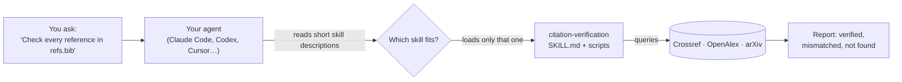

<div align="center">


# Research Agent Skills

### Turn any AI agent into a research co-scientist

**<!-- count -->280+<!-- /count --> open-source agent skills that take Claude Code, Codex, Cursor, Gemini CLI, Copilot or any Agent Skills harness from the research question to the accepted paper: literature, hypotheses, experimental design, analysis in AI, ML, biology, chemistry, medicine and physics, writing, citation checks and peer review.**

[](https://skills.sh/kalarislabs/research-agent-skills)
[](#skill-catalog)
[](https://github.com/KalarisLabs/research-agent-skills/stargazers)
[](https://hits.sh/github.com/KalarisLabs/research-agent-skills/)
[](https://github.com/KalarisLabs/research-agent-skills/commits/main)
[](LICENSE)

[](https://github.com/KalarisLabs/research-agent-skills/actions/workflows/validate.yml)
[](https://github.com/KalarisLabs/research-agent-skills/actions/workflows/skill-security.yml)
[](benchmarks/README.md)
[](https://securityscorecards.dev/viewer/?uri=github.com/KalarisLabs/research-agent-skills)
[](https://www.bestpractices.dev/projects/15771)

**Works with**

[](#install)
[](#install)
[](#install)
[](#install)
[](#install)
[](#install)
[](#install)
[](#works-in-any-harness)

```bash
npx skills add KalarisLabs/research-agent-skills
```

<sub>One command via <a href="https://skills.sh/kalarislabs/research-agent-skills">skills.sh</a> · no account · pick all skills or only the ones you need · not on npm</sub>

[Install](#install) · [Proof](#proof-a-whole-brain-study-run-end-to-end-with-these-skills) · [Who it's for](#built-for-researchers) · [Benchmarks](#measured-not-claimed) · [Skills](#skill-catalog) · [skills.sh](https://skills.sh/kalarislabs/research-agent-skills) · [Docs](https://docs.kalarislabs.com/research-agent-skills) · [FAQ](#faq)

</div>

---

**Research Agent Skills**, maintained by **[Kalaris Labs](https://github.com/KalarisLabs)**, is a free, open-source library of
[agent skills](https://agentskills.io) that gives your AI agent the methods of a careful scientist. Each skill is a folder
with a `SKILL.md` playbook, reference material and tested scripts. Your agent loads one only when the task needs it, so
the same agent can search the literature in the morning, design an experiment at noon and answer reviewers at night.

### From assistant to co-scientist

An assistant drafts what you ask for. A co-scientist works through the research itself and checks its own output.
The skills cover every stage:

| Stage | Your agent can | Skills |
|---|---|---|
| **Question** | Generate and stress-test hypotheses, find gaps | [`hypothesis-generation`](skills/hypothesis-generation/SKILL.md), [`scientific-brainstorming`](skills/scientific-brainstorming/SKILL.md), [`scientific-critical-thinking`](skills/scientific-critical-thinking/SKILL.md) |
| **Literature** | Search papers and databases, run PRISMA reviews | [`literature-review`](skills/literature-review/SKILL.md), [`paper-lookup`](skills/paper-lookup/SKILL.md), [`systematic-review-prisma`](skills/systematic-review-prisma/SKILL.md), [`database-lookup`](skills/database-lookup/SKILL.md) |
| **Design** | Plan experiments, size samples, pre-register | [`experimental-design`](skills/experimental-design/SKILL.md), [`statistical-power`](skills/statistical-power/SKILL.md) |
| **Analysis** | Analyze data with field-standard tools | [`statistical-analysis`](skills/statistical-analysis/SKILL.md), [`scanpy`](skills/scanpy/SKILL.md), [`rdkit`](skills/rdkit/SKILL.md), [`astropy`](skills/astropy/SKILL.md), [`pydicom`](skills/pydicom/SKILL.md), [`pytorch-lightning`](skills/pytorch-lightning/SKILL.md) and 150+ more |
| **Writing** | Draft, visualize and remove AI slop | [`scientific-writing`](skills/scientific-writing/SKILL.md), [`scientific-visualization`](skills/scientific-visualization/SKILL.md), [`unslop-academic-writing`](skills/unslop-academic-writing/SKILL.md) |
| **Verification** | Check every reference and reproducibility claim | [`citation-verification`](skills/citation-verification/SKILL.md), [`reproducibility-statement`](skills/reproducibility-statement/SKILL.md) |
| **Submission** | Format for the venue, prepare arXiv, write grants | [`venue-templates`](skills/venue-templates/SKILL.md), [`arxiv-submission`](skills/arxiv-submission/SKILL.md), [`research-grants`](skills/research-grants/SKILL.md) |
| **Review** | Review papers and answer reviewers | [`peer-review`](skills/peer-review/SKILL.md), [`rebuttal-and-response-to-reviewers`](skills/rebuttal-and-response-to-reviewers/SKILL.md) |
| **Autonomy** | Run supervised, multi-step research loops | [`autoresearch`](skills/autoresearch/SKILL.md) |

It is built against the three ways AI research help goes wrong:

1. **AI slop.** `unslop-academic-writing` finds stock phrasing ("delves into", "pivotal role"), empty emphasis, stacked hedges and
   monotone rhythm, then rewrites toward specific, evidence-backed prose in the author's own voice.
2. **Hallucinated citations.** `citation-verification` checks every reference against Crossref, OpenAlex and arXiv. On our labeled
   benchmark it flagged every fabricated and corrupted reference and passed every correct one.
3. **Outdated venue rules.** Journal skills make the agent read the current author guidelines before formatting, instead of trusting memory.

### How it works



Installed skills cost almost nothing until used: the agent sees one short description per skill and opens the
full playbook only for the task at hand.

## Proof: a whole-brain study, run end to end with these skills

<a href="https://github.com/KalarisLabs/fly-brain-resuscitation"></a>

**[Reviving a model fly brain](https://github.com/KalarisLabs/fly-brain-resuscitation)** is a Kalaris Labs preprint on anoxia, brain death and resuscitation in a
connectome-constrained simulation of the whole adult *Drosophila* brain (139,255 neurons). Claude worked through
Research Agent Skills and Kalaris Labs Myriad from the first hypothesis to the finished paper, under the author's
direction (disclosed in the paper; Claude is not an author).

| Stage | What the agent produced | How the skills shaped it |
|---|---|---|
| **Question** | 6 preregistered hypotheses, each with rival explanations, discriminating predictions and falsification thresholds, frozen before any simulation ran | [`hypothesis-generation`](skills/hypothesis-generation/SKILL.md) v2.2 workflow, cited in the [preregistration](https://github.com/KalarisLabs/fly-brain-resuscitation/blob/main/docs/HYPOTHESES.md) |
| **Literature** | 82 Crossref-verified sources and an 81-row parameter table, with 6 values flagged `UNVERIFIED` instead of guessed | [`citation-verification`](skills/citation-verification/SKILL.md) rule: 2 DOIs that resolved to the wrong papers were caught and discarded ([bibliography](https://github.com/KalarisLabs/fly-brain-resuscitation/blob/main/docs/lit/bibliography.md)) |
| **Experiments** | 3,487 analysed condition-seed simulation runs: network structure in 4 connectomes (FAFB, BANC, MANC, MCNS), dynamics in 2 (FAFB, MCNS) | Preregistered analysis plan; graded reperfusion (H3) was **falsified**, direction reversed, and reported as such |
| **Output** | 30-page paper, supplement, 19 figures, narrated explainer videos, unit-tested code | Every headline claim tied to its source results file, number and confidence level in [`KEY_CLAIMS.json`](https://github.com/KalarisLabs/fly-brain-resuscitation/blob/main/paper/KEY_CLAIMS.json) |

<table>
<tr>
<td width="50%" align="center"><a href="https://github.com/KalarisLabs/fly-brain-resuscitation"></a><br/><sub><b>Abrupt reoxygenation:</b> after 180 s of anoxia the model is trapped in a self-sustained K⁺-coupled high-activity state (48/48 FAFB parameter sets, 5/5 MCNS runs; confidence high)</sub></td>
<td width="50%" align="center"><a href="https://github.com/KalarisLabs/fly-brain-resuscitation"></a><br/><sub><b>20-second total activity block at reperfusion:</b> the stimulus-response map returns (FAFB FII<sub>norm</sub> 1.001 / 0.953 at 30 / 180 s anoxia; confidence high)</sub></td>
</tr>
</table>

<sub><b>Scope:</b> all results are predictions of a simplified simulation (connectome-constrained LIF neurons and
phenomenological metabolism, constants not fitted to <i>Drosophila</i>). They are not evidence about living tissue,
clinical brain death or human resuscitation, and resuscitation of a brain-dead organism has not been demonstrated.
Claims and numbers follow the study's <a href="https://github.com/KalarisLabs/fly-brain-resuscitation/blob/main/paper/KEY_CLAIMS.json">KEY_CLAIMS.json</a>;
see also its <a href="https://github.com/KalarisLabs/fly-brain-resuscitation/blob/main/docs/LIMITATIONS.md">limitations</a>.</sub>

## Install

One command with the open [skills.sh](https://skills.sh/kalarislabs/research-agent-skills) CLI. It needs Node.js 18+
and no account, and works with the agents above plus about 70 others (Cline, Goose, Roo, Zed, Warp and more).

```bash
npx skills add KalarisLabs/research-agent-skills
```

That opens a picker for skills and agents. To skip the picker:

| I want to… | Run |
|---|---|
| **Install every skill** for every agent I use | `npx skills add KalarisLabs/research-agent-skills --all` |
| **Install specific skills** | `npx skills add KalarisLabs/research-agent-skills --skill citation-verification apa7` |
| See every skill before choosing | `npx skills add KalarisLabs/research-agent-skills --list` |
| Install for one agent only | add `--agent claude-code` (or `codex`, `cursor`, `gemini-cli`, `github-copilot`, …) |
| Install for all my projects | add `--global` (default is the current project) |
| Skip confirmation prompts | add `--yes` |
| Update installed skills later | `npx skills update` |

Then ask your agent in plain language, for example *"Verify every reference in refs.bib"* or
*"Unslop this introduction without changing any claims"*. The agent loads the right skill on its own.

Choose a starting skill for your field:

| Researcher | Start with |
|---|---|
| Academia across disciplines | `npx skills add KalarisLabs/research-agent-skills --skill scientific-writing` |
| Machine learning | `npx skills add KalarisLabs/research-agent-skills --skill ml-paper-writing` |
| Artificial intelligence | `npx skills add KalarisLabs/research-agent-skills --skill evaluating-llms-harness` |
| Biology and bioinformatics | `npx skills add KalarisLabs/research-agent-skills --skill scanpy` |
| Chemistry and materials | `npx skills add KalarisLabs/research-agent-skills --skill rdkit` |
| Medicine and clinical research | `npx skills add KalarisLabs/research-agent-skills --skill clinical-reports` |
| Physics and astronomy | `npx skills add KalarisLabs/research-agent-skills --skill astropy` |

**Field bundles in Claude Code.** The repository is also a Claude Code plugin marketplace with curated bundles:

```text
/plugin marketplace add KalarisLabs/research-agent-skills
/plugin install biology-research@research-agent-skills
```

Bundles: `research-essentials`, `ml-research`, `ai-research`, `biology-research`, `chemistry-research`,
`medicine-research`, `physics-research`, plus one plugin per category (for example `literature-review`).
[Browse all categories](catalog/skills.json) when you need a specialist skill.

<details>
<summary><b>Other installation methods</b></summary>

| Method | Command |
|---|---|
| GitHub CLI | `gh skill install KalarisLabs/research-agent-skills` |
| macOS / Linux, checksum-verified release | `curl -fsSL https://raw.githubusercontent.com/KalarisLabs/research-agent-skills/main/install.sh \| sh` |
| Windows, checksum-verified release | `irm https://raw.githubusercontent.com/KalarisLabs/research-agent-skills/main/install.ps1 \| iex` |
| A field bundle (standalone, no Node.js needed) | `curl -fsSL https://raw.githubusercontent.com/KalarisLabs/research-agent-skills/main/install.sh \| RAS_BUNDLE=biology-research sh` |

The standalone installers verify pinned release downloads with SHA-256. Full guide: [Installation](docs/getting-started/installation.md).

**Not on npm.** There is no `research-agent-skills` package on the npm registry. `npx skills` is the
open [skills.sh](https://skills.sh) CLI, which reads this GitHub repository directly. Any npm package
claiming to be this project is not ours.

</details>

### Works in any harness

The skills follow the open [Agent Skills specification](https://agentskills.io/specification): plain folders with a
`SKILL.md` file, no SDK, no server, no lock-in. Every skill passes the specification's reference validator.

| Harness | How |
|---|---|
| Claude Code, Codex, Cursor, Gemini CLI, GitHub Copilot, OpenCode, Windsurf, Cline, Goose, Amp, Roo, Zed, Warp and about 60 more | `npx skills add KalarisLabs/research-agent-skills --agent <name>` |
| Claude Code plugin marketplace | `/plugin marketplace add KalarisLabs/research-agent-skills` |
| Any other harness that reads skills | Copy `skills/<name>/` into its skills directory (often `.agents/skills/`) |
| Agents without skill support | Point the agent at `skills/<name>/SKILL.md`; it is plain Markdown with scripts beside it |

Tool permissions and advanced metadata may vary by harness.

## Built for researchers

| You are... | Start with |
|---|---|
| **A PhD or master's student** writing a thesis, dissertation or first paper | `scientific-writing`, `unslop-academic-writing`, `literature-review`, `apa7` or your journal's skill · [Thesis guide](docs/guides/thesis-and-dissertation.md) |
| **A researcher or PI** submitting manuscripts and grants | journal-format skills, `abstract-and-title`, `cover-letter-to-editor`, `rebuttal-and-response-to-reviewers`, `research-grants` · [Paper guide](docs/guides/write-a-research-paper.md) |
| **Running a systematic review or meta-analysis** | `systematic-review-prisma`, `citation-verification`, `statistical-analysis` · [Review guide](docs/guides/systematic-review.md) |
| **An ML / AI researcher** | `ml-paper-writing` (NeurIPS, ICML, ICLR, ACL, AAAI templates), `arxiv-submission`, and the `ml-*` categories |
| **In biology, chemistry, medicine, physics or earth science** | 100+ database and analysis skills · [Skills by field](docs/guides/by-field.md) |
| **A librarian or research software engineer** | `reference-manager-interop` (Zotero, Mendeley, EndNote), `paper-corpus-rag`, `research-knowledge-graph`, `research-skill-creator` |

### Find an agent skill for your research task

| Research task | Start here |
|---|---|
| Search papers and build a literature review | [`literature-review`](skills/literature-review/SKILL.md), [`research-lookup`](skills/research-lookup/SKILL.md), [literature-review skills](catalog/lists/literature-review.txt) |
| Discover papers in Firecrawl's hosted Research Index | [`firecrawl-research-index`](skills/firecrawl-research-index/SKILL.md) searches indexed papers, reads relevant passages, and follows citations; access is currently free with limits ([provider docs](https://docs.firecrawl.dev/features/research)) |
| Plan and report a systematic review or meta-analysis | [`systematic-review-prisma`](skills/systematic-review-prisma/SKILL.md), [`statistical-analysis`](skills/statistical-analysis/SKILL.md), [systematic review guide](docs/guides/systematic-review.md) |
| Draft or revise a research paper, thesis or grant | [`scientific-writing`](skills/scientific-writing/SKILL.md), [`unslop-academic-writing`](skills/unslop-academic-writing/SKILL.md), [`research-grants`](skills/research-grants/SKILL.md), [writing guide](docs/guides/write-a-research-paper.md) |
| Check citations, BibTeX and reference libraries | [`citation-verification`](skills/citation-verification/SKILL.md), [`bibtex-hygiene`](skills/bibtex-hygiene/SKILL.md), [`reference-manager-interop`](skills/reference-manager-interop/SKILL.md) |
| Prepare a journal or conference submission | [journal format skills](catalog/lists/journal-formats.txt), [`arxiv-submission`](skills/arxiv-submission/SKILL.md), [`rebuttal-and-response-to-reviewers`](skills/rebuttal-and-response-to-reviewers/SKILL.md) |
| Analyze data and report reproducible methods | [data science skills](catalog/lists/data-science-and-ml.txt), [`scientific-visualization`](skills/scientific-visualization/SKILL.md), [`reproducibility-statement`](skills/reproducibility-statement/SKILL.md) |

### Explore scientific agent skills by discipline

| Field | Example skills | Browse |
|---|---|---|
| Bioinformatics and genomics | [`scanpy`](skills/scanpy/SKILL.md), [`scvi-tools`](skills/scvi-tools/SKILL.md), [`pydeseq2`](skills/pydeseq2/SKILL.md) | [Life sciences](catalog/lists/life-sciences.txt) |
| Chemistry, materials and drug discovery | [`rdkit`](skills/rdkit/SKILL.md), [`deepchem`](skills/deepchem/SKILL.md), [`pymatgen`](skills/pymatgen/SKILL.md) | [Chemistry and drug discovery](catalog/lists/chemistry-and-drug-discovery.txt) |
| Clinical, biomedical and health research | [`pydicom`](skills/pydicom/SKILL.md), [`pyhealth`](skills/pyhealth/SKILL.md), [`clinical-reports`](skills/clinical-reports/SKILL.md) | [Clinical and health](catalog/lists/clinical-and-health.txt) |
| Physics, astronomy and earth science | [`astropy`](skills/astropy/SKILL.md), [`qiskit`](skills/qiskit/SKILL.md), [`geopandas`](skills/geopandas/SKILL.md) | [Physical sciences](catalog/lists/physical-sciences.txt) |
| Psychology and social science | [`apa7`](skills/apa7/SKILL.md), [`experimental-design`](skills/experimental-design/SKILL.md), [`statistical-power`](skills/statistical-power/SKILL.md) | [Research essentials](catalog/lists/research-essentials.txt) |
| AI and machine learning research | [`ml-paper-writing`](skills/ml-paper-writing/SKILL.md), [`pytorch-fsdp2`](skills/pytorch-fsdp2/SKILL.md), [`evaluating-llms-harness`](skills/evaluating-llms-harness/SKILL.md) | [ML training](catalog/lists/ml-training.txt) |

For more workflows and installation choices, see [skills by field](docs/guides/by-field.md).

## What you can ask

```text
"Draft the Results section from results/ and the figures in figs/, then unslop it."
"Verify every reference in refs.bib and tell me which ones don't exist."
"Reformat this manuscript for Cell: Summary, Highlights, eTOC blurb and STAR Methods."
"Run a PRISMA 2020 systematic review on exercise and depression: search strings, dedup, flow diagram."
"Write a point-by-point response to these three reviewers within the rebuttal limit."
"Build a citation graph of my Zotero library and find the papers that bridge the two clusters."
"Check my LaTeX source before I upload it to arXiv."
"Analyze this scRNA-seq dataset with scanpy and write the methods section."
```

## Measured, not claimed

Every skill is scored on a static quality rubric and a trigger-routing suite, and task outcomes are measured for the
original skills. Every chart below is rendered from the committed results in
[`benchmarks/results/`](benchmarks/results/) by [`benchmarks/charts.py`](benchmarks/charts.py), and CI fails if a chart
drifts from its data. Methodology and caveats: [benchmarks/README.md](benchmarks/README.md).

<picture><source media="(prefers-color-scheme: dark)" srcset="PUBLIC/benchmarks/task-outcomes-dark.svg" /></picture>

<table>
<tr>
<td width="50%"><picture><source media="(prefers-color-scheme: dark)" srcset="PUBLIC/benchmarks/slop-dark.svg" /></picture></td>
<td width="50%"><picture><source media="(prefers-color-scheme: dark)" srcset="PUBLIC/benchmarks/citations-dark.svg" /></picture></td>
</tr>
<tr>
<td width="50%"><picture><source media="(prefers-color-scheme: dark)" srcset="PUBLIC/benchmarks/routing-dark.svg" /></picture></td>
<td width="50%"><picture><source media="(prefers-color-scheme: dark)" srcset="PUBLIC/benchmarks/quality-dark.svg" /></picture></td>
</tr>
</table>

<details>
<summary><b>The same numbers as a table</b></summary>

| Check | Result |
|---|---|
| Static quality rubric (structure, triggers, verification rules, tests) | Original skills: mean **95.5/100** · all skills: 95.3 |
| Trigger routing: 50 reviewed prompts, including near misses | hit@3 **1.00**, hit@1 1.00; false-trigger 0.12 |
| Citation verification on 18 labeled references (real, corrupted, fabricated) | precision **1.00**, recall **1.00** |
| No-slop writing: model abstracts with vs without `unslop-academic-writing` (pilot) | slop index **83% lower**, clean share 68% → 89% |
| Task outcomes with vs without skill, blind LLM judge (pilot, 23 tasks) | skill wins **21/23**, mean score 7.4 vs 4.3 |

</details>

Model-based results are pilots (small samples, one small model as answerer and judge). Quality and routing gates run
on every pull request, so a weak or overlapping skill can't be merged silently.

## Featured skills

| Skill | What it does |
|---|---|
| [`unslop-academic-writing`](skills/unslop-academic-writing/SKILL.md) | Removes AI slop from papers, theses and grants: linter plus rewrite playbook, in your voice |
| [`citation-verification`](skills/citation-verification/SKILL.md) | Detects fabricated or mismatched references via Crossref, OpenAlex and arXiv |
| [`scientific-writing`](skills/scientific-writing/SKILL.md) | IMRaD manuscripts for any field, with reporting guidelines (CONSORT, STROBE, PRISMA) |
| [`ml-paper-writing`](skills/ml-paper-writing/SKILL.md) | Publication-ready ML papers with official NeurIPS, ICML, ICLR, ACL, AAAI and COLM LaTeX templates |
| [`systematic-review-prisma`](skills/systematic-review-prisma/SKILL.md) | Protocol → search → dedup → screening → PRISMA 2020 flow diagram and checklist |
| [`rebuttal-and-response-to-reviewers`](skills/rebuttal-and-response-to-reviewers/SKILL.md) | Triage reviews, then write journal responses or length-limited conference rebuttals |
| [`abstract-and-title`](skills/abstract-and-title/SKILL.md) | Abstracts to word limits, titles, keywords, highlights, significance statements |
| [`venue-templates`](skills/venue-templates/SKILL.md) | Journal, conference, poster and grant templates with verification-first compliance |
| [`paper-corpus-rag`](skills/paper-corpus-rag/SKILL.md) | Ask questions over your own PDFs and get answers citing the exact passage |
| [`firecrawl-research-index`](skills/firecrawl-research-index/SKILL.md) | Discover arXiv and biomedical papers in Firecrawl's hosted index, inspect records, and read question-matched passages |
| [`research-knowledge-graph`](skills/research-knowledge-graph/SKILL.md) | Citation, author and topic graphs exported to NetworkX, Neo4j, Gephi, Obsidian and graphify |
| [`database-lookup`](skills/database-lookup/SKILL.md) | One interface to 100+ public scientific databases |
| [`research-skill-creator`](skills/research-skill-creator/SKILL.md) | Turn your lab's workflows into tested, secure skills |

## Journal and venue formats

Nature · Nature Communications · Scientific Reports · Science · Science Advances · Cell · Neuron · Cell Reports ·
IEEE Transactions · IEEE Access · ACM (sigconf, acmsmall: CHI, KDD, SIGGRAPH) · Elsevier (elsarticle, CAS) ·
Springer LNCS · PLOS ONE · PLOS Biology · APA 7th edition · arXiv · NeurIPS · ICML · ICLR · ACL/ARR · AAAI ·
COLM · OSDI/NSDI/ASPLOS/SOSP · NIH and NSF grants · conference posters and slides.

## Skill catalog

Grouped by category and generated from [`catalog/skills.json`](catalog/skills.json). The
[documentation directory](docs/skills/) has a page per skill.

<!-- catalog:start -->

<details><summary><b>research-writing</b> (15) · Scientific and research paper writing, grants, peer review, critical appraisal</summary>

| Skill | What it does |
|---|---|
| [`abstract-and-title`](skills/abstract-and-title/SKILL.md) | Write and sharpen research paper titles, abstracts (structured and unstructured), keywords, highlights, significance statements, graphical-abstract text and la… |
| [`cover-letter-to-editor`](skills/cover-letter-to-editor/SKILL.md) | Write journal submission cover letters, presubmission inquiries, transfer requests, and reviewer suggestion or exclusion lists that help a manuscript get past… |
| [`dhdna-profiler`](skills/dhdna-profiler/SKILL.md) | Extract cognitive patterns and thinking fingerprints from any text. |
| [`markdown-mermaid-writing`](skills/markdown-mermaid-writing/SKILL.md) | Writes scientific documents and documentation as markdown with embedded Mermaid diagrams as the canonical, git-diffable source format. |
| [`market-research-reports`](skills/market-research-reports/SKILL.md) | Build evidence-traceable market research reports and assumption-driven market sizing or forecast scenarios. |
| [`ml-paper-writing`](skills/ml-paper-writing/SKILL.md) | Write publication-ready ML/AI papers for NeurIPS, ICML, ICLR, ACL, AAAI, COLM. |
| [`peer-review`](skills/peer-review/SKILL.md) | Prepare evidence-bounded, constructive peer-review drafts and structured manuscript assessments. |
| [`rebuttal-and-response-to-reviewers`](skills/rebuttal-and-response-to-reviewers/SKILL.md) | Plan and write responses to peer review, including journal "response to reviewers" letters for revise-and-resubmit, conference rebuttals under strict length li… |
| [`reproducibility-statement`](skills/reproducibility-statement/SKILL.md) | Prepare the reproducibility, transparency and open-science parts of a paper, including data and code availability statements, reproducibility checklists (NeurI… |
| [`research-grants`](skills/research-grants/SKILL.md) | Guides writing of competitive research grant proposals for NSF, NIH, DOE, DARPA, and Taiwan NSTC. |
| [`scholar-evaluation`](skills/scholar-evaluation/SKILL.md) | Provide qualitative-first, evidence-traceable developmental review of scholarly works and audit low-stakes research-assessment rubrics with optional local qual… |
| [`scientific-critical-thinking`](skills/scientific-critical-thinking/SKILL.md) | Evaluate scientific claims and evidence quality. |
| [`scientific-writing`](skills/scientific-writing/SKILL.md) | Draft, revise, and audit scientific manuscripts or reports with explicit evidence provenance, reporting-guideline coverage, authorship accountability, confiden… |
| [`systems-paper-writing`](skills/systems-paper-writing/SKILL.md) | Provides paragraph-level structural blueprints for 10-12 page systems papers targeting OSDI, SOSP, ASPLOS, NSDI, and EuroSys. |
| [`unslop-academic-writing`](skills/unslop-academic-writing/SKILL.md) | Remove AI slop from research writing so papers, theses, grant proposals, reviews and rebuttals read as written by a careful human expert. |

</details>

<details><summary><b>journal-formats</b> (11) · Journal, conference and venue formatting: LaTeX templates, submission checklists</summary>

| Skill | What it does |
|---|---|
| [`acm-sigconf`](skills/acm-sigconf/SKILL.md) | Format ACM conference papers and journal articles with the acmart LaTeX class (sigconf, sigplan, acmsmall, acmlarge, acmtog, manuscript/review/anonymous modes)… |
| [`apa7`](skills/apa7/SKILL.md) | Format papers, theses and references in APA Style 7th edition for psychology, education, social sciences, nursing and business, covering student vs professiona… |
| [`arxiv-submission`](skills/arxiv-submission/SKILL.md) | Prepare and post preprints to arXiv without processing failures or leaks, covering TeX source packaging (.bbl, figures, case-sensitive paths), stripping privat… |
| [`cell-press`](skills/cell-press/SKILL.md) | Prepare manuscripts for Cell Press journals (Cell, Molecular Cell, Neuron, Immunity, Cell Reports, Cell Systems, iScience, Cell Metabolism, Current Biology and… |
| [`elsevier-cas`](skills/elsevier-cas/SKILL.md) | Prepare submissions to Elsevier journals (including The Lancet family style notes, Cell-independent Elsevier titles, and thousands of society journals) using t… |
| [`ieee-transactions`](skills/ieee-transactions/SKILL.md) | Format and submit papers to IEEE journals (Transactions, Journals, Letters, IEEE Access) and IEEE conferences using the IEEEtran LaTeX class or Word templates,… |
| [`nature-portfolio`](skills/nature-portfolio/SKILL.md) | Prepare manuscripts for Nature and Nature Portfolio journals (Nature, Nature Communications, Nature Methods, Nature Biotechnology, Scientific Reports and other… |
| [`plos`](skills/plos/SKILL.md) | Prepare manuscripts for PLOS journals (PLOS ONE, PLOS Biology, PLOS Computational Biology, PLOS Genetics, PLOS Medicine, PLOS Pathogens, PLOS Neglected Tropica… |
| [`science-aaas`](skills/science-aaas/SKILL.md) | Prepare manuscripts for Science and the Science family of journals (Science, Science Advances, Science Translational Medicine, Science Robotics, Science Immuno… |
| [`springer-lncs`](skills/springer-lncs/SKILL.md) | Format papers for Springer Lecture Notes in Computer Science (LNCS) and related proceedings series (LNAI, LNBI, CCIS) and Springer Nature journals using the ll… |
| [`venue-templates`](skills/venue-templates/SKILL.md) | Prepare journal manuscripts, conference papers, research posters, and grant documents using venue-specific formatting guidance and bundled LaTeX scaffolds. |

</details>

<details><summary><b>literature-review</b> (18) · Literature search, systematic reviews, citation management and reference managers</summary>

| Skill | What it does |
|---|---|
| [`bgpt-paper-search`](skills/bgpt-paper-search/SKILL.md) | Search scientific papers and retrieve structured experimental data extracted from full-text studies via the BGPT MCP server. |
| [`bibtex-hygiene`](skills/bibtex-hygiene/SKILL.md) | Clean, deduplicate and validate BibTeX/BibLaTeX bibliographies before submission. |
| [`citation-management`](skills/citation-management/SKILL.md) | Searches OpenAlex, PubMed, and Google Scholar, extracts metadata from DOIs, PMIDs, PMCIDs, arXiv IDs, and URLs via CrossRef, PubMed, and arXiv, then formats, d… |
| [`citation-verification`](skills/citation-verification/SKILL.md) | Verify that every reference in a manuscript really exists and matches its metadata, catching hallucinated, corrupted or mismatched citations before submission. |
| [`exa-search`](skills/exa-search/SKILL.md) | Web toolkit powered by Exa, tuned for scientific and technical content. |
| [`firecrawl-research-index`](skills/firecrawl-research-index/SKILL.md) | Query Firecrawl Research Index paper endpoints for topic discovery, source metadata, question-matched passages, and citation-neighbor expansion. |
| [`liteparse`](skills/liteparse/SKILL.md) | Local document and PDF parsing that returns spatial text with bounding boxes. |
| [`literature-review`](skills/literature-review/SKILL.md) | Runs systematic literature reviews by searching PubMed, arXiv, bioRxiv, and Semantic Scholar (plus web search via parallel-cli), screening studies, extracting… |
| [`markitdown`](skills/markitdown/SKILL.md) | Converts documents to Markdown with Microsoft MarkItDown (Python API, markitdown CLI, markitdown-ocr plugin, markitdown-mcp server), covering PDF, Word, PowerP… |
| [`open-notebook`](skills/open-notebook/SKILL.md) | Self-hosted, open-source alternative to Google NotebookLM for AI-powered research and document analysis. |
| [`paper-lookup`](skills/paper-lookup/SKILL.md) | Search 18 scholarly APIs for papers, preprints, citations, open-access full text, repository records, and journal OA status, and return results with reproducib… |
| [`paperclip`](skills/paperclip/SKILL.md) | Search and read full-text biomedical papers, FDA/PMDA/EMA regulatory documents, clinical trial registries, and UniProt/PDB/ChEMBL entries with the Paperclip CL… |
| [`paperzilla`](skills/paperzilla/SKILL.md) | Chat with your agent about projects, recommendations, and canonical papers in Paperzilla. |
| [`parallel-web`](skills/parallel-web/SKILL.md) | Runs the parallel-cli tool for web workflows: web search, URL and PDF extraction, deep research reports, structured data enrichment of supplied rows, FindAll e… |
| [`pyzotero`](skills/pyzotero/SKILL.md) | Reads and writes Zotero libraries from Python with pyzotero 1.13.0 and the Zotero Web API v3: items, collections, tags, attachments, saved searches, full-text… |
| [`reference-manager-interop`](skills/reference-manager-interop/SKILL.md) | Move and sync reference libraries between Zotero, Mendeley, EndNote, JabRef, Paperpile and writing tools (LaTeX/BibTeX, Word, Google Docs, Pandoc, Quarto, Over… |
| [`research-lookup`](skills/research-lookup/SKILL.md) | Compile current scholarly evidence for a scientific manuscript or research brief. |
| [`systematic-review-prisma`](skills/systematic-review-prisma/SKILL.md) | Plan, run and report systematic reviews and meta-analyses to PRISMA 2020 standards. |

</details>

<details><summary><b>ideation-and-design</b> (12) · Hypothesis generation, experimental design, statistics planning, validation</summary>

| Skill | What it does |
|---|---|
| [`analytical-method-validation`](skills/analytical-method-validation/SKILL.md) | Plans and evaluates analytical method validation, verification, and transfer using Python scripts (plan_validation, check_response, check_accuracy_precision, c… |
| [`brainstorming-research-ideas`](skills/brainstorming-research-ideas/SKILL.md) | Guides researchers through structured ideation frameworks to discover high-impact research directions. |
| [`consciousness-council`](skills/consciousness-council/SKILL.md) | Run a multi-perspective Mind Council deliberation on any question, decision, or creative challenge. |
| [`creative-thinking-for-research`](skills/creative-thinking-for-research/SKILL.md) | Applies cognitive science frameworks for creative thinking to CS and AI research ideation. |
| [`experimental-design`](skills/experimental-design/SKILL.md) | Design experiments and studies BEFORE data is collected — choosing a design, randomizing, blocking, and laying out treatment combinations so results are interp… |
| [`hypogenic`](skills/hypogenic/SKILL.md) | Plans and audits use of ChicagoHAI HypoGeniC/HypoRefine for LLM-assisted hypothesis generation from labeled text datasets. |
| [`hypothesis-generation`](skills/hypothesis-generation/SKILL.md) | Formulate evidence-bounded scientific questions, candidate hypotheses, rival explanations, causal or associational claims, discriminating predictions, measurem… |
| [`iso-standards-readiness`](skills/iso-standards-readiness/SKILL.md) | Prepares and structurally reviews readiness evidence for ISO management-system and laboratory-competence standards - ISO 13485 medical device QMS, ISO 14971 de… |
| [`relsa-severity-assessment`](skills/relsa-severity-assessment/SKILL.md) | Multivariate severity assessment and humane endpoint prediction for laboratory animal studies using the RELSA (RELative Severity Assessment) score and ARIMA-ba… |
| [`scientific-brainstorming`](skills/scientific-brainstorming/SKILL.md) | Facilitates evidence-aware scientific ideation with independent generation, structured discussion, explicit assumptions, transparent evaluation, adversarial re… |
| [`statistical-power`](skills/statistical-power/SKILL.md) | Sample-size and statistical power calculations for planning studies. |
| [`uncertainty-and-units`](skills/uncertainty-and-units/SKILL.md) | Track physical units and propagate measurement uncertainty in scientific calculations using pint and uncertainties. |

</details>

<details><summary><b>data-science-and-ml</b> (30) · Data analysis, statistics and machine learning libraries</summary>

| Skill | What it does |
|---|---|
| [`aeon`](skills/aeon/SKILL.md) | This skill should be used for time series machine learning tasks including classification, regression, clustering, forecasting, anomaly detection, segmentation… |
| [`dask`](skills/dask/SKILL.md) | Distributed computing for larger-than-RAM pandas/NumPy workflows. |
| [`datalad`](skills/datalad/SKILL.md) | Retrieve, version, and publish scientific datasets with DataLad and git-annex, and capture computational provenance with datalad run, rerun, and containers-run. |
| [`exploratory-data-analysis`](skills/exploratory-data-analysis/SKILL.md) | Perform bounded, local exploratory analysis of explicitly supported scientific files. |
| [`get-available-resources`](skills/get-available-resources/SKILL.md) | Detect host inventory and effective CPU, memory, disk, scheduler, container, and accelerator limits when a user asks for resource-aware planning or before a cl… |
| [`hugging-science`](skills/hugging-science/SKILL.md) | Use when the user is doing AI/ML work in a scientific domain such as biology, chemistry, physics, astronomy, climate, genomics, materials, medicine, ecology, e… |
| [`lamindb`](skills/lamindb/SKILL.md) | Use when working with LaminDB, the open-source lineage-native lakehouse for biological datasets and models. |
| [`matlab`](skills/matlab/SKILL.md) | Designs, reviews, and migrates MATLAB R2026a and GNU Octave numerical code, covering functions with arguments blocks, arrays and indexing, tables and timetable… |
| [`modal`](skills/modal/SKILL.md) | Modal is a serverless cloud platform for running Python on demand, including on-demand GPUs. |
| [`networkx`](skills/networkx/SKILL.md) | Create, analyze, and visualize complex networks and graphs in Python with NetworkX. |
| [`optimize-for-gpu`](skills/optimize-for-gpu/SKILL.md) | GPU-accelerates scientific Python on NVIDIA hardware and verifies that the result is correct and faster. |
| [`polars`](skills/polars/SKILL.md) | High-performance DataFrame library for Python ETL, analytics, and pandas migration. |
| [`pufferlib`](skills/pufferlib/SKILL.md) | Version-aware guidance for PufferLib reinforcement-learning environments, vectorization, policies, PuffeRL training, evaluation, and safe checkpoint review. |
| [`pymc`](skills/pymc/SKILL.md) | Builds, fits, checks, and compares Bayesian models in Python with PyMC and ArviZ. |
| [`pymoo`](skills/pymoo/SKILL.md) | Solves single- and multi-objective optimization problems in Python with pymoo, using NSGA-II, NSGA-III, MOEA/D, SPEA2, RVEA, GA, DE and PSO. |
| [`pytorch-lightning`](skills/pytorch-lightning/SKILL.md) | Organizes PyTorch training code with the lightning package (PyTorch Lightning): LightningModule, LightningDataModule, Trainer, callbacks such as ModelCheckpoin… |
| [`scikit-learn`](skills/scikit-learn/SKILL.md) | Covers classical machine learning in Python with scikit-learn (sklearn): classification and regression estimators, clustering and dimensionality reduction, pre… |
| [`scikit-survival`](skills/scikit-survival/SKILL.md) | Builds, evaluates, and audits right-censored survival analysis workflows with scikit-survival (sksurv): Cox PH, Coxnet, IPC ridge, survival trees, forests, boo… |
| [`shap`](skills/shap/SKILL.md) | Explain and audit machine-learning predictions with SHAP. |
| [`simpy`](skills/simpy/SKILL.md) | Builds, tests, and analyzes bounded process-based discrete-event simulations in Python with SimPy 4.1.2: Environment, Timeout, Process, AnyOf/AllOf conditions,… |
| [`stable-baselines3`](skills/stable-baselines3/SKILL.md) | Production-ready reinforcement learning algorithms (PPO, SAC, DQN, TD3, DDPG, A2C) with scikit-learn-like API. |
| [`statistical-analysis`](skills/statistical-analysis/SKILL.md) | Guided statistical analysis for research data - test selection, assumption checking, effect sizes, power analysis, Bayesian alternatives, and APA-formatted rep… |
| [`statsmodels`](skills/statsmodels/SKILL.md) | Statistical models library for Python. |
| [`sympy`](skills/sympy/SKILL.md) | Use when you need exact symbolic math in Python — algebra, calculus, equation solving, symbolic linear algebra, or code generation via lambdify/LaTeX. |
| [`timesfm-forecasting`](skills/timesfm-forecasting/SKILL.md) | Zero-shot time series forecasting with Google's TimesFM foundation model. |
| [`torch-geometric`](skills/torch-geometric/SKILL.md) | PyTorch Geometric (PyG) for graph neural networks — node/link/graph classification, message passing (GCN, GAT, GraphSAGE, GIN), heterogeneous graphs, neighbor… |
| [`transformers`](skills/transformers/SKILL.md) | Hugging Face Transformers for loading Hub models, running pipeline inference, text generation, and Trainer fine-tuning on NLP, vision, audio, and multimodal ta… |
| [`umap-learn`](skills/umap-learn/SKILL.md) | Reduces and embeds high-dimensional data with umap-learn (UMAP) in Python, including 2D/3D visualization, supervised and semi-supervised UMAP, DensMAP, Aligned… |
| [`vaex`](skills/vaex/SKILL.md) | Processes and analyzes tabular datasets too large for RAM using Vaex, a Python library for lazy, out-of-core DataFrames over memory-mapped HDF5 and Arrow files… |
| [`zarr-python`](skills/zarr-python/SKILL.md) | Guides use of Zarr-Python 3 for storing chunked, compressed N-dimensional arrays and groups, with local, in-memory, ZIP, and fsspec-backed S3/GCS/HTTP stores,… |

</details>

<details><summary><b>visualization-and-presentation</b> (11) · Figures, schematics, posters, slides and talks</summary>

| Skill | What it does |
|---|---|
| [`academic-plotting`](skills/academic-plotting/SKILL.md) | Generates publication-quality figures for ML papers from research context. |
| [`generate-image`](skills/generate-image/SKILL.md) | Generate or edit images with AI models through the OpenRouter Image API (Gemini, Seedream, Recraft, GPT-Image, Riverflow). |
| [`infographics`](skills/infographics/SKILL.md) | Generates infographics from natural-language prompts using Nano Banana Pro image generation, with optional Perplexity Sonar research for facts and a Gemini 3.6… |
| [`latex-posters`](skills/latex-posters/SKILL.md) | Creates research posters in LaTeX with beamerposter, tikzposter, or baposter, covering page sizes (A0, A1, 36x48 inch), multi-column layouts, color schemes, fi… |
| [`matplotlib`](skills/matplotlib/SKILL.md) | Low-level plotting library for full customization. |
| [`pptx-posters`](skills/pptx-posters/SKILL.md) | Create and audit editable scientific posters in macro-free PowerPoint (.pptx) from author-approved local content and assets. |
| [`presenting-conference-talks`](skills/presenting-conference-talks/SKILL.md) | Generates conference presentation slides (Beamer LaTeX PDF and editable PPTX) from a compiled paper with speaker notes and talk script. |
| [`scientific-schematics`](skills/scientific-schematics/SKILL.md) | Generates publication-style scientific diagrams as raster PNG images from a natural-language prompt, using Nano Banana 2 via OpenRouter, then scores each image… |
| [`scientific-slides`](skills/scientific-slides/SKILL.md) | Build slide decks and presentations for research talks. |
| [`scientific-visualization`](skills/scientific-visualization/SKILL.md) | Create and audit truthful, accessible, publication-ready scientific figures with Matplotlib, Seaborn, or Plotly. |
| [`seaborn`](skills/seaborn/SKILL.md) | Statistical visualization with pandas integration. |

</details>

<details><summary><b>knowledge-and-rag</b> (7) · Vector databases, embeddings, RAG and knowledge graphs over research corpora</summary>

| Skill | What it does |
|---|---|
| [`chroma`](skills/chroma/SKILL.md) | Open-source embedding database for AI applications. |
| [`faiss`](skills/faiss/SKILL.md) | Facebook's library for efficient similarity search and clustering of dense vectors. |
| [`paper-corpus-rag`](skills/paper-corpus-rag/SKILL.md) | Build grounded question answering and retrieval-augmented generation (RAG) over your own collection of research papers, with answers that cite the exact paper… |
| [`pinecone`](skills/pinecone/SKILL.md) | Guides use of Pinecone, a managed serverless vector database, through its Python client and the LangChain and LlamaIndex integrations. |
| [`qdrant-vector-search`](skills/qdrant-vector-search/SKILL.md) | High-performance vector similarity search engine for RAG and semantic search. |
| [`research-knowledge-graph`](skills/research-knowledge-graph/SKILL.md) | Turn a bibliography or literature corpus into a knowledge graph of papers, authors, venues, topics and citation links, then analyze it (citation clusters, key… |
| [`sentence-transformers`](skills/sentence-transformers/SKILL.md) | Generates sentence, text, and image embeddings locally with the Python sentence-transformers (SBERT) library, using pre-trained Hugging Face models such as all… |

</details>

<details><summary><b>scientific-databases</b> (12) · Programmatic access to public scientific databases and APIs</summary>

| Skill | What it does |
|---|---|
| [`bioservices`](skills/bioservices/SKILL.md) | Unified Python interface to 40+ bioinformatics services. |
| [`cellxgene-census`](skills/cellxgene-census/SKILL.md) | Query the CZ CELLxGENE Census programmatically for versioned public single-cell and spatial transcriptomics data. |
| [`database-lookup`](skills/database-lookup/SKILL.md) | Query documented public database APIs with explicit endpoints, filters, pagination, and provenance. |
| [`depmap`](skills/depmap/SKILL.md) | Query the Cancer Dependency Map (DepMap) for cancer cell line gene dependency scores (CRISPR Chronos), drug sensitivity data, and gene effect profiles. |
| [`genomic-coordinates`](skills/genomic-coordinates/SKILL.md) | Convert genomic intervals between coordinate conventions, normalise and compare variant representations, and detect assembly or contig-naming mismatches before… |
| [`gget`](skills/gget/SKILL.md) | Queries 20+ bioinformatics databases and analysis services through the gget CLI and Python package, covering Ensembl gene search, info and sequences (ref, sear… |
| [`imaging-data-commons`](skills/imaging-data-commons/SKILL.md) | Query and download public cancer imaging data from NCI Imaging Data Commons. |
| [`ncats-arax`](skills/ncats-arax/SKILL.md) | Queries the NCATS Translator ARAX production API for bounded, typed, provenance-rich one-hop and endpoint-pinned two-hop biomedical knowledge-graph relationshi… |
| [`onekgpd`](skills/onekgpd/SKILL.md) | Query the 1000 Genomes Project dataset (3,202 whole-genome-sequenced individuals, GRCh38) at the level of individual participants. |
| [`ontology-term-resolution`](skills/ontology-term-resolution/SKILL.md) | Resolve free-text scientific labels to ontology term IDs and validate existing CURIEs against the EBI Ontology Lookup Service (OLS4). |
| [`pytdc`](skills/pytdc/SKILL.md) | Uses the PyTDC package (import tdc, Therapeutics Data Commons) to discover therapeutic ML tasks from tdc.metadata, plan and load approved datasets, apply task-… |
| [`usfiscaldata`](skills/usfiscaldata/SKILL.md) | Query the U.S. |

</details>

<details><summary><b>life-sciences</b> (33) · Genomics, single-cell, proteomics, neuroscience and systems biology</summary>

| Skill | What it does |
|---|---|
| [`13c-metabolic-flux`](skills/13c-metabolic-flux/SKILL.md) | Estimates intracellular metabolic fluxes from steady-state carbon-13 isotope-tracing measurements using validated atom maps, mfapy isotope simulation, constrai… |
| [`alphagenome`](skills/alphagenome/SKILL.md) | Look up precomputed AlphaGenome Atlas effects for any GRCh38 single-nucleotide variant (AVI score with Phred and 18 SHAP feature attributions, plus raw and qua… |
| [`anndata`](skills/anndata/SKILL.md) | Data structure for annotated matrices in single-cell analysis. |
| [`arboreto`](skills/arboreto/SKILL.md) | Infer gene regulatory networks (GRNs) from gene expression data using scalable algorithms (GRNBoost2, GENIE3). |
| [`bids`](skills/bids/SKILL.md) | Organizes, queries, validates, and converts neuroscience and biomedical datasets using the Brain Imaging Data Structure (BIDS) standard, covering MRI, PET, EEG… |
| [`biopython`](skills/biopython/SKILL.md) | Provides Biopython (Bio.Seq, Bio.SeqIO, Bio.Align, Bio.Entrez, Bio.Blast, Bio.PDB, Bio.Phylo, Bio.motifs, Bio.SeqUtils, Bio.Restriction) for sequence handling,… |
| [`bulk-rnaseq`](skills/bulk-rnaseq/SKILL.md) | End-to-end bulk RNA-seq orchestrator — takes raw FASTQ reads through QC and trimming (FastQC, fastp/Trim Galore), alignment and quantification (STAR, Salmon, f… |
| [`cobrapy`](skills/cobrapy/SKILL.md) | Runs constraint-based metabolic modeling with COBRApy (Python, import cobra) on genome-scale models in SBML, JSON, YAML, or MATLAB format. |
| [`deeptools`](skills/deeptools/SKILL.md) | Runs deepTools command-line programs on NGS alignment data: bamCoverage and bamCompare for BAM to bigWig/bedGraph with RPGC, CPM, RPKM or BPM normalization, mu… |
| [`esm`](skills/esm/SKILL.md) | Covers the EvolutionaryScale/Biohub `esm` Python SDK: ESM3 generative protein design (sequence, structure and function tracks, chain-of-thought), ESMC embeddin… |
| [`etetoolkit`](skills/etetoolkit/SKILL.md) | Analyze, manipulate, compare, annotate, and visualize phylogenetic or other hierarchical trees with ETE 4. |
| [`flowio`](skills/flowio/SKILL.md) | Read, inspect, and write Flow Cytometry Standard (FCS) 2.0, 3.0, and 3.1 files with FlowIO. |
| [`folklore-variant-evidence`](skills/folklore-variant-evidence/SKILL.md) | Retrieve ClinGen gene-disease validity assertions for a public gene or disease, and review source-linked public evidence and literature for one supported GRCh3… |
| [`geniml`](skills/geniml/SKILL.md) | Plans and audits local genomic-interval machine learning workflows with Geniml (0.8.4) and Gtars: validates BED files against chromosome sizes and assembly con… |
| [`genomic-intelligence`](skills/genomic-intelligence/SKILL.md) | Predict regulatory features, gene structure, and expression directly from DNA sequence using Genomic Intelligence's hosted transformer DNA language models — no… |
| [`gtars`](skills/gtars/SKILL.md) | Inspects and plans work with Gtars, the Rust/Python/CLI toolkit for genomic intervals: BED RegionSet set algebra (reduce, setdiff, intersect, closest, cluster,… |
| [`matchms`](skills/matchms/SKILL.md) | Process, clean, compare, and search tandem mass spectra with matchms. |
| [`neurokit2`](skills/neurokit2/SKILL.md) | Use NeuroKit2 to build or audit reproducible research workflows for physiological time-series preprocessing, event/interval analysis, multimodal alignment, var… |
| [`neuropixels-analysis`](skills/neuropixels-analysis/SKILL.md) | Analyze Neuropixels extracellular recordings end-to-end with SpikeInterface. |
| [`nextflow`](skills/nextflow/SKILL.md) | Build, run, and debug Nextflow data pipelines and nf-core workflows end to end. |
| [`pacsomatic`](skills/pacsomatic/SKILL.md) | Operator toolkit for nf-core/pacsomatic matched tumor-normal workflows from BAM inputs. |
| [`pathogen-variant-surveillance`](skills/pathogen-variant-surveillance/SKILL.md) | Query live pathogen genomic surveillance data through the GenSpectrum LAPIS API to find which viral lineages are circulating now, how fast they are growing, an… |
| [`pathway-enrichment`](skills/pathway-enrichment/SKILL.md) | Run pathway and gene-set enrichment analysis on gene lists or ranked gene data, then interpret the results. |
| [`polars-bio`](skills/polars-bio/SKILL.md) | Python library polars-bio for genomic interval operations and bioinformatics file I/O on Polars DataFrames, built on Arrow and DataFusion. |
| [`pydeseq2`](skills/pydeseq2/SKILL.md) | Runs differential expression analysis on bulk RNA-seq count data with PyDESeq2, the Python port of DESeq2. |
| [`pyopenms`](skills/pyopenms/SKILL.md) | Complete mass spectrometry analysis platform. |
| [`pysam`](skills/pysam/SKILL.md) | Python/HTSlib workflows for genomic files. |
| [`scanpy`](skills/scanpy/SKILL.md) | Standard single-cell RNA-seq analysis pipeline. |
| [`scikit-bio`](skills/scikit-bio/SKILL.md) | Python library scikit-bio for biological sequence and community-ecology analysis: DNA/RNA/protein sequences, pair_align alignment, phylogenetic trees (NJ, UPGM… |
| [`scvelo`](skills/scvelo/SKILL.md) | Performs RNA velocity analysis with scVelo on single-cell RNA-seq AnnData objects that have spliced and unspliced layers (from velocyto, STARsolo, kallisto/bus… |
| [`scvi-tools`](skills/scvi-tools/SKILL.md) | Trains and applies scvi-tools probabilistic deep generative models (scVI, scANVI, totalVI, MultiVI, PeakVI, DestVI, Solo, CellAssign, MrVI and others) on AnnDa… |
| [`tiledbvcf`](skills/tiledbvcf/SKILL.md) | Stores and queries genomic variant data in TileDB-VCF datasets using the tiledbvcf Python API and CLI (create, store, export, list, stat). |
| [`waypoint-bio`](skills/waypoint-bio/SKILL.md) | Use when working with Outpost Bio's open microbiome foundation models - the Waypoint checkpoints (Waypoint-6m, Waypoint-45m, Waypoint-170m), the Atlas pretrain… |

</details>

<details><summary><b>chemistry-and-drug-discovery</b> (12) · Cheminformatics, molecular modelling, protein design and pharmacology</summary>

| Skill | What it does |
|---|---|
| [`adaptyv`](skills/adaptyv/SKILL.md) | How to use the Adaptyv Bio Foundry API and Python SDK for protein experiment design, submission, and results retrieval. |
| [`datamol`](skills/datamol/SKILL.md) | Wraps RDKit through the datamol Python library (import datamol as dm) for molecular cheminformatics, returning native rdkit.Chem.Mol objects. |
| [`deepchem`](skills/deepchem/SKILL.md) | Molecular ML with diverse featurizers and pre-built datasets. |
| [`diffdock`](skills/diffdock/SKILL.md) | DiffDock and DiffDock-L molecular docking. |
| [`medchem`](skills/medchem/SKILL.md) | Filters and triages small-molecule libraries with the Python medchem library (datamol-io, v2.0.5) on top of RDKit and datamol. |
| [`molecular-dynamics`](skills/molecular-dynamics/SKILL.md) | Runs and analyzes molecular dynamics simulations using OpenMM and MDAnalysis. |
| [`molfeat`](skills/molfeat/SKILL.md) | Converts SMILES strings or RDKit/datamol molecules into numerical features using molfeat (0.11.0), which provides calculators, scikit-learn compatible transfor… |
| [`pkpd-modeling`](skills/pkpd-modeling/SKILL.md) | Pharmacokinetic and pharmacodynamic modelling and simulation - non-compartmental analysis, compartmental and population PK, PK/PD and exposure-response, TMDD,… |
| [`rdkit`](skills/rdkit/SKILL.md) | Guides use of RDKit (Python) for reading and writing SMILES, MOL/SDF, and InChI, computing descriptors (MW, LogP, TPSA), generating Morgan/MACCS/atom-pair fing… |
| [`rowan`](skills/rowan/SKILL.md) | Rowan is a cloud-native molecular modeling and medicinal-chemistry workflow platform with a Python API. |
| [`tamarind`](skills/tamarind/SKILL.md) | Access a collection of open-source molecular design and structural biology tools on the Tamarind Bio platform, via its REST API or MCP server — no local GPUs r… |
| [`torchdrug`](skills/torchdrug/SKILL.md) | Build and troubleshoot TorchDrug 0.2.1 workflows for molecular graphs, property prediction, self-supervised pretraining, molecule generation, retrosynthesis, p… |

</details>

<details><summary><b>clinical-and-health</b> (7) · Clinical research, medical imaging, pathology and health data</summary>

| Skill | What it does |
|---|---|
| [`clinical-decision-support`](skills/clinical-decision-support/SKILL.md) | Prepare and validate research-only clinical decision-support evaluation, evidence-profile, cohort, survival, biomarker/model, privacy, and governance artifacts. |
| [`clinical-reports`](skills/clinical-reports/SKILL.md) | Generates fail-closed draft JSON templates and runs local deterministic structure and consistency checks for clinical reports: CARE case reports, radiology, pa… |
| [`histolab`](skills/histolab/SKILL.md) | Extracts tiles and preprocesses H&E whole slide images with the histolab Python library (OpenSlide), covering slide inspection, tissue masks (TissueMask, Bigge… |
| [`pathml`](skills/pathml/SKILL.md) | Covers local, research-only computational pathology with PathML 3.0.5: loading and tiling whole-slide images (OpenSlide, Bio-Formats), preprocessing and QC pip… |
| [`pydicom`](skills/pydicom/SKILL.md) | Reads, inspects, writes, and transforms local DICOM files with pydicom 3.x (dcmread, dcmwrite, pydicom.pixels), including metadata, transfer syntaxes, compress… |
| [`pyhealth`](skills/pyhealth/SKILL.md) | Builds clinical deep-learning pipelines with PyHealth using its Dataset → Task → Model → Trainer → Metrics pattern. |
| [`treatment-plans`](skills/treatment-plans/SKILL.md) | Format and structurally validate local treatment-plan documentation after clinical decisions have already been supplied and verified by authorized licensed pro… |

</details>

<details><summary><b>physical-sciences</b> (10) · Physics, astronomy, quantum computing, materials and earth science</summary>

| Skill | What it does |
|---|---|
| [`astropy`](skills/astropy/SKILL.md) | Core Python library for astronomy and astrophysics workflows that need Astropy APIs, including units/quantities, coordinates, FITS I/O, tables, time systems, W… |
| [`cirq`](skills/cirq/SKILL.md) | Google quantum computing framework. |
| [`fluidsim`](skills/fluidsim/SKILL.md) | Plan, configure, inspect, restart, and analyze bounded FluidSim computational-fluid-dynamics simulations with explicit numerical-validity and HPC safety checks. |
| [`geomaster`](skills/geomaster/SKILL.md) | Provides geospatial and Earth observation workflows using GeoPandas, Rasterio, GDAL, Xarray, Shapely, Laspy, PDAL, Google Earth Engine, and STAC/Planetary Comp… |
| [`geopandas`](skills/geopandas/SKILL.md) | Guidance and local audit CLIs for Python workflows using GeoPandas 1.1.4 GeoSeries and GeoDataFrame for planar vector data: CRS handling, geometry validity and… |
| [`openpiv`](skills/openpiv/SKILL.md) | Particle Image Velocimetry (PIV) analysis with OpenPIV. |
| [`pennylane`](skills/pennylane/SKILL.md) | Hardware-agnostic quantum ML framework with automatic differentiation. |
| [`pymatgen`](skills/pymatgen/SKILL.md) | Analyzes, validates, converts, and transforms crystal structures and molecules with pymatgen. |
| [`qiskit`](skills/qiskit/SKILL.md) | Build, simulate, transpile, and execute quantum circuits with Qiskit and IBM Quantum Runtime. |
| [`qutip`](skills/qutip/SKILL.md) | Simulate and audit closed and open quantum-system models with QuTiP 5, including deterministic, trajectory, steady-state, spectral, and phase-space workflows. |

</details>

<details><summary><b>lab-automation</b> (11) · Lab platforms, ELNs, liquid handlers and manufacturing integrations</summary>

| Skill | What it does |
|---|---|
| [`benchling-integration`](skills/benchling-integration/SKILL.md) | Benchling Python SDK and REST API integration for registry entities, inventory, ELN entries, workflows, Benchling Apps, and Data Warehouse queries. |
| [`dnanexus-integration`](skills/dnanexus-integration/SKILL.md) | Build and operate reproducible genomics workloads on DNAnexus with the dx CLI, dxpy, apps/applets, native workflows, dxCompiler, and Nextflow. |
| [`fictiv`](skills/fictiv/SKILL.md) | Drives the Fictiv on-demand manufacturing web app (app.fictiv.com) in the user's browser, since there is no public API. |
| [`ginkgo-cloud-lab`](skills/ginkgo-cloud-lab/SKILL.md) | Submit and manage protocols on Ginkgo Bioworks Cloud Lab (cloud.ginkgo.bio), a web-based interface for autonomous lab execution on Reconfigurable Automation Ca… |
| [`lab-hardware-cad`](skills/lab-hardware-cad/SKILL.md) | Design custom laboratory hardware as parametric build123d models and export fabrication-ready STEP, STL, and DXF files - microfluidic chips and molds, optomech… |
| [`labarchive-integration`](skills/labarchive-integration/SKILL.md) | Securely integrate with the official LabArchives ELN REST-like API and Inventory API v1. |
| [`latchbio-integration`](skills/latchbio-integration/SKILL.md) | Build, register, debug, and operate bioinformatics workflows on Latch using the Python SDK, CLI, Latch Data and Registry, Nextflow, Snakemake, programmatic exe… |
| [`omero-integration`](skills/omero-integration/SKILL.md) | Securely inspect and automate microscopy data workflows against OMERO.server with omero-py, BlitzGateway, OMERO CLI, tables, annotations, ROIs, rendering, and… |
| [`opentrons-integration`](skills/opentrons-integration/SKILL.md) | Author, review, migrate, simulate, and troubleshoot official Opentrons Python Protocol API v2 protocols for Flex and OT-2 robots. |
| [`protocolsio-integration`](skills/protocolsio-integration/SKILL.md) | Reads, validates, and exports protocols.io data using the documented REST v3/v4 endpoints and the official MCP endpoint, and builds non-executing mutation plan… |
| [`pylabrobot`](skills/pylabrobot/SKILL.md) | Develop and review PyLabRobot lab-automation resources, liquid-handling plans, offline simulations, and supported-device integrations. |

</details>

<details><summary><b>research-automation</b> (9) · Autonomous research loops, agent harnesses and research artifacts</summary>

| Skill | What it does |
|---|---|
| [`ara-compiler`](skills/ara-compiler/SKILL.md) | Compiles any research input — PDF papers, GitHub repositories, experiment logs, code directories, or raw notes — into a complete Agent-Native Research Artifact… |
| [`ara-research-manager`](skills/ara-research-manager/SKILL.md) | Records research provenance at the end of a coding or research session by scanning the conversation and writing decisions, experiments, dead ends, pivots, clai… |
| [`ara-rigor-reviewer`](skills/ara-rigor-reviewer/SKILL.md) | Performs ARA Seal Level 2 semantic epistemic review of an Agent-Native Research Artifact directory, reading PAPER.md, logic/claims.md, logic/experiments.md, an… |
| [`arbor`](skills/arbor/SKILL.md) | Autonomously improve a real artifact (code, training recipe, agent harness, data pipeline, prompt) against an objective and an evaluator, using Hypothesis Tree… |
| [`autoresearch`](skills/autoresearch/SKILL.md) | Orchestrates end-to-end autonomous AI research projects using a two-loop architecture. |
| [`autoskill`](skills/autoskill/SKILL.md) | Observe the user's screen via screenpipe, detect repeated research workflows, match them against existing research-agent-skills, and draft new skills (or compo… |
| [`pi-agent`](skills/pi-agent/SKILL.md) | Build with and use Pi, the minimal terminal coding harness. |
| [`research-agent-skills`](skills/research-agent-skills/SKILL.md) | Navigate the Research Agent Skills collection by Kalaris Labs for academia across AI, machine learning, biology, chemistry, medicine, physics, and academic wri… |
| [`research-skill-creator`](skills/research-skill-creator/SKILL.md) | Create, improve and test agent skills for research workflows (paper writing, lab protocols, analysis pipelines, domain databases) that meet the Agent Skills sp… |

</details>

<details><summary><b>ml-training</b> (32) · Model architectures, tokenization, fine-tuning, post-training, distributed training, optimization</summary>

| Skill | What it does |
|---|---|
| [`awq-quantization`](skills/awq-quantization/SKILL.md) | Activation-aware weight quantization for 4-bit LLM compression with 3x speedup and minimal accuracy loss. |
| [`axolotl`](skills/axolotl/SKILL.md) | Provides guidance for fine-tuning large language models with Axolotl, covering YAML training configs, LoRA and QLoRA, preference training with DPO, KTO, ORPO a… |
| [`deepspeed`](skills/deepspeed/SKILL.md) | Covers DeepSpeed for distributed deep learning training and I/O: ZeRO optimization stages, pipeline parallelism, FP16/BF16/FP8 training, 1-bit Adam, sparse att… |
| [`distributed-llm-pretraining-torchtitan`](skills/distributed-llm-pretraining-torchtitan/SKILL.md) | Provides PyTorch-native distributed LLM pretraining using torchtitan with 4D parallelism (FSDP2, TP, PP, CP). |
| [`fine-tuning-with-trl`](skills/fine-tuning-with-trl/SKILL.md) | Fine-tune LLMs using reinforcement learning with TRL - SFT for instruction tuning, DPO for preference alignment, PPO/GRPO for reward optimization, and reward m… |
| [`gguf-quantization`](skills/gguf-quantization/SKILL.md) | GGUF format and llama.cpp quantization for efficient CPU/GPU inference. |
| [`gptq`](skills/gptq/SKILL.md) | Quantizes LLMs to 4-bit (also 3-bit) with GPTQ using group-wise quantization (group size 128 by default), via AutoGPTQ and transformers. |
| [`grpo-rl-training`](skills/grpo-rl-training/SKILL.md) | Guides GRPO (Group Relative Policy Optimization) fine-tuning of language models with the TRL library, including GRPOTrainer configuration, composing multiple r… |
| [`hqq-quantization`](skills/hqq-quantization/SKILL.md) | Half-Quadratic Quantization for LLMs without calibration data. |
| [`huggingface-accelerate`](skills/huggingface-accelerate/SKILL.md) | Wraps existing PyTorch training scripts with HuggingFace Accelerate (Accelerator class, accelerate config, accelerate launch) so the same code runs on CPU, sin… |
| [`huggingface-tokenizers`](skills/huggingface-tokenizers/SKILL.md) | Provides the HuggingFace Tokenizers library (Rust core with Python and Node.js bindings) for training and using BPE, WordPiece, and Unigram tokenizers. |
| [`implementing-llms-litgpt`](skills/implementing-llms-litgpt/SKILL.md) | Implements and trains LLMs using Lightning AI's LitGPT with 20+ pretrained architectures (Llama, Gemma, Phi, Qwen, Mistral). |
| [`llama-factory`](skills/llama-factory/SKILL.md) | Guides fine-tuning of large language models with LLaMA-Factory, covering the WebUI no-code interface, training across 100+ supported models, quantized QLoRA at… |
| [`mamba-architecture`](skills/mamba-architecture/SKILL.md) | Explains how to use Mamba selective state-space models (state-spaces/mamba package, Mamba-1 with d_state=16 and Mamba-2 with multi-head structure and d_state=1… |
| [`miles-rl-training`](skills/miles-rl-training/SKILL.md) | Provides guidance for enterprise-grade RL training using miles, a production-ready fork of slime. |
| [`ml-training-recipes`](skills/ml-training-recipes/SKILL.md) | Battle-tested PyTorch training recipes for all domains — LLMs, vision, diffusion, medical imaging, protein/drug discovery, spatial omics, genomics. |
| [`nanogpt`](skills/nanogpt/SKILL.md) | Provides nanoGPT, Karpathy's minimal PyTorch GPT implementation (model.py and train.py), with workflows for training character-level Shakespeare on CPU, reprod… |
| [`openrlhf-training`](skills/openrlhf-training/SKILL.md) | High-performance RLHF framework with Ray+vLLM acceleration. |
| [`optimizing-attention-flash`](skills/optimizing-attention-flash/SKILL.md) | Enables Flash Attention for transformer models using PyTorch native scaled_dot_product_attention (PyTorch 2.2+) or the flash-attn library, including multi-quer… |
| [`peft-fine-tuning`](skills/peft-fine-tuning/SKILL.md) | Fine-tunes LLMs with Hugging Face PEFT, using LoRA, QLoRA, IA3, AdaLoRA, prefix tuning, and prompt tuning so that under 1% of parameters are trained. |
| [`pytorch-fsdp2`](skills/pytorch-fsdp2/SKILL.md) | Adds PyTorch FSDP2 (fully_shard) to training scripts with correct init, sharding, mixed precision/offload config, and distributed checkpointing. |
| [`pytorch-lightning-distributed`](skills/pytorch-lightning-distributed/SKILL.md) | High-level PyTorch framework with Trainer class, automatic distributed training (DDP/FSDP/DeepSpeed), callbacks system, and minimal boilerplate. |
| [`quantizing-models-bitsandbytes`](skills/quantizing-models-bitsandbytes/SKILL.md) | Quantizes LLMs to 8-bit or 4-bit for 50-75% memory reduction with minimal accuracy loss. |
| [`ray-train`](skills/ray-train/SKILL.md) | Distributed training orchestration across clusters. |
| [`rwkv-architecture`](skills/rwkv-architecture/SKILL.md) | Covers the RWKV (Receptance Weighted Key Value) architecture, an RNN/Transformer hybrid with O(n) inference and no KV cache, including RWKV-7, its parallel GPT… |
| [`sentencepiece`](skills/sentencepiece/SKILL.md) | Language-independent tokenizer treating text as raw Unicode. |
| [`simpo-training`](skills/simpo-training/SKILL.md) | Simple Preference Optimization for LLM alignment. |
| [`slime-rl-training`](skills/slime-rl-training/SKILL.md) | Provides guidance for LLM post-training with RL using slime, a Megatron+SGLang framework. |
| [`torchforge-rl-training`](skills/torchforge-rl-training/SKILL.md) | Provides guidance for PyTorch-native agentic RL using torchforge, Meta's library separating infra from algorithms. |
| [`training-llms-megatron`](skills/training-llms-megatron/SKILL.md) | Trains large language models (2B-462B parameters) with NVIDIA Megatron-Core using tensor, pipeline, sequence, context, and expert parallelism, plus FP8 on H100… |
| [`unsloth`](skills/unsloth/SKILL.md) | Provides guidance on fine-tuning large language models with Unsloth, a library for faster, lower-memory training using LoRA and QLoRA, based on its official do… |
| [`verl-rl-training`](skills/verl-rl-training/SKILL.md) | Provides guidance for training LLMs with reinforcement learning using verl (Volcano Engine RL). |

</details>

<details><summary><b>ml-evaluation-and-safety</b> (11) · Evaluation harnesses, interpretability and safety/alignment</summary>

| Skill | What it does |
|---|---|
| [`constitutional-ai`](skills/constitutional-ai/SKILL.md) | Anthropic's method for training harmless AI through self-improvement. |
| [`evaluating-code-models`](skills/evaluating-code-models/SKILL.md) | Evaluates code generation models across HumanEval, MBPP, MultiPL-E, and 15+ benchmarks with pass@k metrics. |
| [`evaluating-llms-harness`](skills/evaluating-llms-harness/SKILL.md) | Evaluates LLMs across 60+ academic benchmarks (MMLU, HumanEval, GSM8K, TruthfulQA, HellaSwag). |
| [`llamaguard`](skills/llamaguard/SKILL.md) | Classifies LLM prompts and responses as safe or unsafe using Meta's LlamaGuard (7B v1, 8B v2 and v3) across six categories: violence and hate, sexual content,… |
| [`nemo-evaluator-sdk`](skills/nemo-evaluator-sdk/SKILL.md) | Evaluates LLMs across 100+ benchmarks from 18+ harnesses (MMLU, HumanEval, GSM8K, safety, VLM) with multi-backend execution. |
| [`nemo-guardrails`](skills/nemo-guardrails/SKILL.md) | Adds runtime safety rails to LLM applications with NVIDIA NeMo Guardrails, configured through Colang 2.0 flows. |
| [`nnsight-remote-interpretability`](skills/nnsight-remote-interpretability/SKILL.md) | Provides guidance for interpreting and manipulating neural network internals using nnsight with optional NDIF remote execution. |
| [`prompt-guard`](skills/prompt-guard/SKILL.md) | Classifies text with Meta's Prompt Guard, an 86M-parameter model loaded from HuggingFace, into BENIGN, INJECTION or JAILBREAK labels to detect prompt injection… |
| [`pyvene-interventions`](skills/pyvene-interventions/SKILL.md) | Provides guidance for performing causal interventions on PyTorch models using pyvene's declarative intervention framework. |
| [`sparse-autoencoder-training`](skills/sparse-autoencoder-training/SKILL.md) | Provides guidance for training and analyzing Sparse Autoencoders (SAEs) using SAELens to decompose neural network activations into interpretable features. |
| [`transformer-lens-interpretability`](skills/transformer-lens-interpretability/SKILL.md) | Provides guidance for mechanistic interpretability research using TransformerLens to inspect and manipulate transformer internals via HookPoints and activation… |

</details>

<details><summary><b>ml-inference-and-ops</b> (13) · Inference serving, GPU infrastructure, MLOps and observability</summary>

| Skill | What it does |
|---|---|
| [`experiment-tracking-swanlab`](skills/experiment-tracking-swanlab/SKILL.md) | Tracks ML experiments with SwanLab, an open-source tool covering swanlab.init, config and metric logging, scalar charts, and media logging (images, audio, text… |
| [`lambda-labs-gpu-cloud`](skills/lambda-labs-gpu-cloud/SKILL.md) | Reserved and on-demand GPU cloud instances for ML training and inference. |
| [`langsmith-observability`](skills/langsmith-observability/SKILL.md) | LLM observability platform for tracing, evaluation, and monitoring. |
| [`llama-cpp`](skills/llama-cpp/SKILL.md) | Runs LLM inference on CPU, Apple Silicon, and consumer GPUs without NVIDIA hardware. |
| [`mlflow`](skills/mlflow/SKILL.md) | Tracks machine learning experiments and manages model lifecycles with MLflow, covering mlflow.log_param, log_metric and log_artifact, autologging for scikit-le… |
| [`modal-serverless-gpu`](skills/modal-serverless-gpu/SKILL.md) | Serverless GPU cloud platform for running ML workloads. |
| [`phoenix-observability`](skills/phoenix-observability/SKILL.md) | Open-source AI observability platform for LLM tracing, evaluation, and monitoring. |
| [`serving-llms-vllm`](skills/serving-llms-vllm/SKILL.md) | Serves LLMs with high throughput using vLLM's PagedAttention and continuous batching. |
| [`sglang`](skills/sglang/SKILL.md) | Fast structured generation and serving for LLMs with RadixAttention prefix caching. |
| [`skypilot-multi-cloud-orchestration`](skills/skypilot-multi-cloud-orchestration/SKILL.md) | Multi-cloud orchestration for ML workloads with automatic cost optimization. |
| [`tensorboard`](skills/tensorboard/SKILL.md) | Logs and views ML training data in TensorBoard using PyTorch SummaryWriter and TensorFlow/Keras callbacks: scalars, images, text, histograms, model graphs, emb… |
| [`tensorrt-llm`](skills/tensorrt-llm/SKILL.md) | Optimizes LLM inference with NVIDIA TensorRT for maximum throughput and lowest latency. |
| [`weights-and-biases`](skills/weights-and-biases/SKILL.md) | Logs and tracks machine learning experiments with Weights & Biases (W&B, wandb): metrics, hyperparameters, checkpoints, sweeps, artifacts with lineage, model r… |

</details>

<details><summary><b>llm-applications</b> (9) · Agent frameworks, prompt engineering and structured generation</summary>

| Skill | What it does |
|---|---|
| [`autogpt-agents`](skills/autogpt-agents/SKILL.md) | Autonomous AI agent platform for building and deploying continuous agents. |
| [`crewai-multi-agent`](skills/crewai-multi-agent/SKILL.md) | Multi-agent orchestration framework for autonomous AI collaboration. |
| [`dspy`](skills/dspy/SKILL.md) | Builds and optimizes language model programs with DSPy (Stanford NLP), using Signatures, modules (Predict, ChainOfThought, ReAct, ProgramOfThought) and optimiz… |
| [`evolving-ai-agents`](skills/evolving-ai-agents/SKILL.md) | Provides guidance for automatically evolving and optimizing AI agents across any domain using LLM-driven evolution algorithms. |
| [`guidance`](skills/guidance/SKILL.md) | Constrains LLM output during generation with Guidance (Microsoft Research), using regex, select() choices, context-free grammars, token healing, and @guidance… |
| [`instructor`](skills/instructor/SKILL.md) | Extracts structured, validated data from LLM responses using the Instructor Python library with Pydantic response models, including nested models, enums, custo… |
| [`langchain`](skills/langchain/SKILL.md) | Framework for building LLM-powered applications with agents, chains, and RAG. |
| [`llamaindex`](skills/llamaindex/SKILL.md) | Data framework for building LLM applications with RAG. |
| [`outlines`](skills/outlines/SKILL.md) | Generates guaranteed-valid structured output from LLMs with Outlines (dottxt.ai), constraining token sampling via finite state machines for JSON schemas, Pydan… |

</details>

<details><summary><b>multimodal-and-emerging</b> (18) · Vision, audio, robotics, data processing and emerging techniques</summary>

| Skill | What it does |
|---|---|
| [`audiocraft-audio-generation`](skills/audiocraft-audio-generation/SKILL.md) | PyTorch library for audio generation including text-to-music (MusicGen) and text-to-sound (AudioGen). |
| [`blip-2-vision-language`](skills/blip-2-vision-language/SKILL.md) | Explains how to use Salesforce BLIP-2 (Q-Former bridging a frozen image encoder and an LLM such as OPT or FlanT5) through HuggingFace Transformers and LAVIS fo… |
| [`clip`](skills/clip/SKILL.md) | OpenAI's model connecting vision and language. |
| [`evaluating-cosmos-policy`](skills/evaluating-cosmos-policy/SKILL.md) | Evaluates NVIDIA Cosmos Policy on LIBERO and RoboCasa simulation environments. |
| [`fine-tuning-openvla-oft`](skills/fine-tuning-openvla-oft/SKILL.md) | Fine-tunes and evaluates OpenVLA-OFT and OpenVLA-OFT+ policies for robot action generation with continuous action heads, LoRA adaptation, and FiLM conditioning… |
| [`fine-tuning-serving-openpi`](skills/fine-tuning-serving-openpi/SKILL.md) | Fine-tune and serve Physical Intelligence OpenPI models (pi0, pi0-fast, pi0.5) using JAX or PyTorch backends for robot policy inference across ALOHA, DROID, an… |
| [`knowledge-distillation`](skills/knowledge-distillation/SKILL.md) | Compress large language models using knowledge distillation from teacher to student models. |
| [`llava`](skills/llava/SKILL.md) | Large Language and Vision Assistant. |
| [`long-context`](skills/long-context/SKILL.md) | Extend context windows of transformer models using RoPE, YaRN, ALiBi, and position interpolation techniques. |
| [`model-merging`](skills/model-merging/SKILL.md) | Merge multiple fine-tuned models using mergekit to combine capabilities without retraining. |
| [`model-pruning`](skills/model-pruning/SKILL.md) | Reduce LLM size and accelerate inference using pruning techniques like Wanda and SparseGPT. |
| [`moe-training`](skills/moe-training/SKILL.md) | Train Mixture of Experts (MoE) models using DeepSpeed or HuggingFace. |
| [`nemo-curator`](skills/nemo-curator/SKILL.md) | GPU-accelerated data curation for LLM training. |
| [`ray-data`](skills/ray-data/SKILL.md) | Scalable data processing for ML workloads. |
| [`segment-anything-model`](skills/segment-anything-model/SKILL.md) | Foundation model for image segmentation with zero-shot transfer. |
| [`speculative-decoding`](skills/speculative-decoding/SKILL.md) | Accelerate LLM inference using speculative decoding, Medusa multiple heads, and lookahead decoding techniques. |
| [`stable-diffusion-image-generation`](skills/stable-diffusion-image-generation/SKILL.md) | Generates images with Stable Diffusion models (SD 1.5, SDXL, SD 3.0, Flux) through the HuggingFace Diffusers library, covering text-to-image, image-to-image, i… |
| [`whisper`](skills/whisper/SKILL.md) | Transcribes and translates audio with OpenAI's Whisper (openai-whisper Python package and whisper CLI), covering model sizes from tiny to large plus turbo, lan… |

</details>

<!-- catalog:end -->

## Documentation

- **Getting started:** [Installation](docs/getting-started/installation.md) · [Quickstart](docs/getting-started/quickstart.md)
- **Guides:** [Write a research paper with AI](docs/guides/write-a-research-paper.md) · [Thesis and dissertation](docs/guides/thesis-and-dissertation.md) · [No-slop academic writing](docs/guides/no-slop-academic-writing.md) · [Systematic reviews](docs/guides/systematic-review.md) · [Skills by field](docs/guides/by-field.md)
- **Reference:** [CLI](cli/README.md) · [Architecture](docs/reference/architecture.md) · [Benchmarks](benchmarks/README.md) · [Security](SECURITY.md) · [Contributing](CONTRIBUTING.md)
- **For AI search and agents:** [`llms.txt`](llms.txt) · [`llms-full.txt`](llms-full.txt) (every skill with tags) · [`catalog/skills.json`](catalog/skills.json)

### Find us on

| Where | What you get |
|---|---|
| [Documentation](https://docs.kalarislabs.com/research-agent-skills) | Guides by research task and field, plus one page per skill |
| [skills.sh](https://skills.sh/kalarislabs/research-agent-skills) | Browse and install individual skills with `npx skills add` |
| [Skills Directory](https://www.skillsdirectory.com/authors/kalarislabs) | Independent security grades for each skill |
| [SkillsMP](https://skillsmp.com) | Indexes every public `SKILL.md`, searchable by task |
| [Awesome Scientific Skills](https://github.com/InternScience/Awesome-Scientific-Skills) · [Agent Skill Index](https://github.com/heilcheng/awesome-agent-skills) · [Awesome Claude Skills](https://github.com/BehiSecc/awesome-claude-skills) | Curated lists (submissions pending) |
| Claude Code plugin marketplace | `/plugin marketplace add KalarisLabs/research-agent-skills` |

## Security

Skills are instructions and code that your agent runs with your permissions, so they are treated like software
dependencies. Every pull request runs spec validation, a prompt-injection and payload linter over all files, the Cisco
AI Defense skill-scanner, CodeQL, Semgrep, Bandit, secret scanning and dependency review. Scripts may only contact reviewed
domains. Releases are checksummed, signed and attested, and the installer detects tampered files. Details and
vulnerability reporting: [SECURITY.md](SECURITY.md).

## FAQ

<details><summary><b>Can AI write my research paper?</b></summary>

It can make you much faster at outlining, drafting from your results, editing, formatting and reference checking.
You remain the author: every claim, number and citation must be yours and verified. Disclose AI assistance as your venue requires.
</details>

<details><summary><b>How do I stop AI from inventing citations?</b></summary>

Never accept references written from memory. Export them from publishers or Crossref, then run `citation-verification`.
</details>

<details><summary><b>How do I make AI-assisted writing not sound like AI?</b></summary>

Use `unslop-academic-writing`. It fixes vague content before word choice and calibrates to a sample of your own writing.
It improves clarity. It is not a way to hide AI use.
</details>

<details><summary><b>Is it free? Can I use it at my university or company?</b></summary>

Yes. MIT license. Some skills document third-party software or bundle publisher templates with their own licenses
(see [THIRD_PARTY_NOTICES.md](THIRD_PARTY_NOTICES.md)).
</details>

<details><summary><b>How do I install Claude Code skills for academic research?</b></summary>

Run `npx skills add KalarisLabs/research-agent-skills` and pick skills, or add `--all` for everything. The same command
installs into Codex, Cursor, Gemini CLI, GitHub Copilot, OpenCode, Windsurf and about 70 other agents. In Claude Code
you can also use `/plugin marketplace add KalarisLabs/research-agent-skills`. See [Install](#install).
</details>

<details><summary><b>Is there an npm package?</b></summary>

No. `npx skills` is the open skills.sh CLI, which installs straight from this GitHub repository. There is no
`research-agent-skills` package on the npm registry, and any package using that name is not ours.
</details>

<details><summary><b>Which AI tools does it work with?</b></summary>

Any agent that supports the open [Agent Skills](https://agentskills.io) format: Claude Code, OpenAI Codex, Cursor,
Gemini CLI, GitHub Copilot, OpenCode, Windsurf, Cline, Goose, Amp and more. Skills are plain folders with a `SKILL.md`,
so nothing is locked to one vendor.
</details>

<details><summary><b>Can it help with a systematic review or meta-analysis?</b></summary>

Yes. `systematic-review-prisma` covers protocol, search strings, deduplication, screening and the PRISMA 2020 flow
diagram; `statistical-analysis` and `citation-verification` cover pooling and reference checks.
</details>

More in the [FAQ](docs/faq.md).

## Contributing

Researchers are welcome to contribute skills for their field. Start with [CONTRIBUTING.md](CONTRIBUTING.md) and the
[`research-skill-creator`](skills/research-skill-creator/SKILL.md) skill. `make check` runs everything CI runs.
See also [GOVERNANCE.md](GOVERNANCE.md) and [SUPPORT.md](SUPPORT.md).

[](https://github.com/KalarisLabs/research-agent-skills/graphs/contributors)

## Citation

If Research Agent Skills helped your work, please cite it ("Cite this repository" on GitHub uses [CITATION.cff](CITATION.cff)):

```bibtex
@software{chowdhury_research_agent_skills_2026,
  author  = {Chowdhury, Sayan and {Kalaris Labs}},
  title   = {Research Agent Skills: AI agent skills for academic writing and scientific research},
  year    = {2026},
  version = {1.1.1},
  url     = {https://github.com/KalarisLabs/research-agent-skills},
  license = {MIT}
}
```

## License

[MIT](LICENSE) © 2026 Kalaris Labs. Portions of some skills are adapted from third-party MIT-licensed projects, and
their notices are in [THIRD_PARTY_NOTICES.md](THIRD_PARTY_NOTICES.md).

---

<div align="center">

**Created by [Sayan Chowdhury](https://github.com/saynchowdhury) · [Kalaris Labs](https://github.com/KalarisLabs)**

If this saves you time, please ⭐ the repository so other researchers can find it.

[](https://github.com/KalarisLabs/research-agent-skills/stargazers)

Sponsored by [Mintlify](https://mintlify.com) for documentation.

<a href="https://mintlify.com"></a>

[](https://star-history.com/#KalarisLabs/research-agent-skills&Date)

</div>
