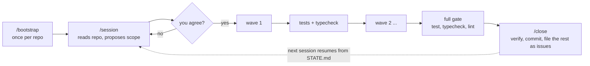
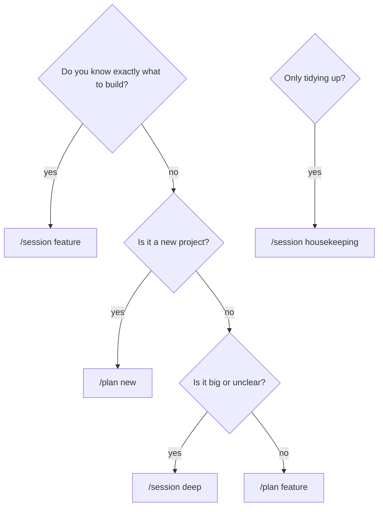
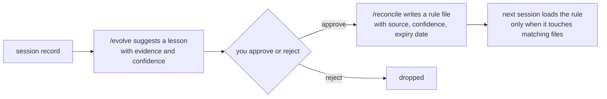
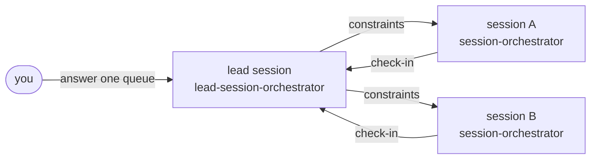

<picture>
  <source media="(prefers-color-scheme: dark)" srcset="site/brand/a3-terminalmodule/mark-on-dark.svg">
  
</picture>

# Session Orchestrator

**Your coding agents get an agreed plan, a check after each round of changes and a handover to the next session.**

You say what you want. Your agent suggests a plan. You say yes. It works in small rounds, checks each round and writes down what is done. The next session starts from there.

A free, MIT-licensed workflow plugin for Claude Code, Codex CLI, Cursor IDE and Pi. It runs on your machine and writes plain text into your repository. No account, no server. It is built for one person running a coding agent on a git repository, possibly in several sessions at once, and runs on top of your agent instead of replacing it.

**[Install](#install)** · **[Website](https://session-orchestrator.com)** ([Deutsch](https://session-orchestrator.com/de)) · **[User guide](docs/USER-GUIDE.md)** · **[Add-on for parallel sessions](#add-on-lead-session-orchestrator)** · [Changelog](CHANGELOG.md)

[](https://github.com/Kanevry/session-orchestrator/actions/workflows/test.yml)
[](CHANGELOG.md)
[](LICENSE)
[](https://session-orchestrator.com)

<br clear="left">


*Plan, Go, Close: one person directs, the agents work at separate stations. AI-generated illustration, not a product screenshot.*

## Why

On their own, coding agents drift from the plan, overwrite each other's files and call work done before it is checked.

| Without it | With it |
|---|---|
| You paste your working rules into every session | `/session` reads git, issues and the last session first |
| Two agents edit the same file | Each agent gets a declared file list; overlaps are rejected |
| "Done" before the tests ran | Tests and typecheck run after each implementation wave |
| A crash loses the plan | `STATE.md` records each wave; the next `/session` offers to resume |

## How it works

- **`/session`** reads your repository, your open issues and the last session, proposes what to work on, and waits for your correction. Nothing changes in your code until you agree.
- **`/go`** runs the agreed work in waves of parallel agents, each with its own list of files. After each implementation wave your tests and typecheck run, and failures become fix tasks for the next wave.
- **`/close`** runs the full test, typecheck and lint gate, checks every planned item against what happened, commits, and files the rest as GitLab or GitHub issues for next time.



### What do you want to do?

| Situation | Type | You get |
|---|---|---|
| A new project idea | `/plan new` | Research, decisions, a PRD and issues (needs `plan-baseline-path` in the Session Config) |
| A feature that is not clear yet | `/plan feature` | A bounded plan with acceptance criteria |
| A feature that is clear | `/session feature`, then `/go`, then `/close` | The agreed change, checked, committed, leftovers as issues |
| A big or unclear change | `/session deep` | It looks first, then builds |
| Tidy up | `/session housekeeping` | A short maintenance pass |
| Look back on a phase | `/plan retro` | What worked, what to change |
| The same mistakes keep coming back | `/evolve`, then `/reconcile` | Lessons you approve become rules |

All 30 commands, by situation: [session-orchestrator.com/commands](https://session-orchestrator.com/commands)

#### Which command?



## It learns, with your yes



This loop is real today: lessons come from your own session records, and a rule exists only after you approved its lesson. It never trains a model and never changes itself without your approval.

<details>
<summary>What it writes into your repository</summary>

All of it plain text, all of it local: `.orchestrator/bootstrap.lock` (written by `/bootstrap`), `.orchestrator/session.lock` and `current-session.json` (which session owns this working copy), `.orchestrator/metrics/*.jsonl` (append-only session and learning records, shared by all four tools), `.orchestrator/steering/` (stable context loaded each session) and `STATE.md` (wave progress, in the tool's own folder: `.claude/`, `.codex/`, `.cursor/` or `.pi/`).

</details>

## Install

You need Node.js 24 or later, a git repository and one of Claude Code, Codex CLI, Cursor IDE or Pi. In Claude Code:

```text
/plugin marketplace add Kanevry/session-orchestrator
/plugin install session-orchestrator@kanevry
```

| Platform | Install |
|---|---|
| **Claude Code** | The two commands above. Current Claude Code installs the Node dependencies with the plugin; on older versions [check them once](docs/install.md#claude-code-check-the-node-dependencies). |
| **Codex CLI** | `git clone` this repository, `npm install`, then `node scripts/codex-install.mjs` ([guide](docs/codex-setup.md)). |
| **Cursor IDE** | `git clone` this repository, `npm install`, then `node scripts/cursor-install.mjs /path/to/your/project` ([guide](docs/cursor-setup.md)). |
| **Pi** | `npm install -g --ignore-scripts @earendil-works/pi-coding-agent`, then `pi install npm:session-orchestrator` ([guide](docs/pi-setup.md)). |

Optional extras, upgrade and uninstall: [docs/install.md](docs/install.md). On Claude Code, `/plugin install so-hud@kanevry` adds a status line and gates that refuse secret-printing commands and ask before pushes to `main`, merges, releases, publishes and deploys ([so-hud](mods/so-hud/README.md)).

## First session

1. **Run `/bootstrap --fast --no-interview` once in your project.** It writes `.orchestrator/bootstrap.lock` and a Session Config into your instruction file (`CLAUDE.md` on Claude Code and Cursor, `AGENTS.md` on Codex CLI and Pi).
2. **Set the three gate commands** in that Session Config to what your project actually uses, for example `test-command: npm test`, `typecheck-command: npm run typecheck`, `lint-command: npm run lint`. Every other key is optional: [template](docs/session-config-template.md) · [reference](docs/session-config-reference.md).
3. **Run `/session feature`** and describe the task. The agent reads the repository and presents a scope. Correct it, then run **`/go`** and, when the work is done, **`/close`**.

On Codex the commands are `$session-orchestrator:bootstrap`, `$session-orchestrator:session feature`, `$session-orchestrator:go` and `$session-orchestrator:close` ([Codex usage](docs/codex-setup.md#usage)). In headless Claude Code (`claude -p`), use `/session-orchestrator:session` and `/session-orchestrator:plan`; the bare names are reserved there.

## What you get

| What | How |
|---|---|
| Errors stop at the next check | Each wave runs your tests and typecheck; lint and the full suite run before the commit. `/debug` looks for the root cause before a fix. |
| Agents keep to their files | Overlapping file lists are rejected before dispatch. A guard has 13 blocking and 4 warning rules for destructive commands (hard reset, `rm -rf`, force-push, `DROP TABLE`, …), see [`.orchestrator/policy/blocked-commands.json`](.orchestrator/policy/blocked-commands.json). |
| Pick up where you stopped | A crash or a second session in the same folder does not cost you the work: `STATE.md` and a heartbeat lock keep the thread. |
| Audit and test on demand | `/test` drives web and macOS flows, `/ux-grill` audits a running web app, `/repo-audit` and `/harness-audit` score a repository, `/test-audit` removes tests that catch nothing. |
| Longer runs | `/autopilot` chains sessions and stops on any of 10 kill-switches; `/dispatcher` and `/portfolio` work across repositories. |

Every skill, command, agent and hook: [docs/components.md](docs/components.md). What changed lately: [CHANGELOG.md](CHANGELOG.md).

## Platform support

| | Claude Code | Codex CLI | Cursor IDE | Pi |
|---|---|---|---|---|
| Commands | Native slash commands | Skills (`$session-orchestrator:<name>`) | Native slash commands | Prompt templates |
| Parallel agents | Yes | Yes | One after another | One after another |
| Destructive-command guard | Hook | Hook | Bridge for supported commands | Bridge for supported commands |
| File-scope guard | Hook (blocks in `strict`) | Instructions only | Bridge (blocks in `strict`) | Bridge (blocks in `strict`) |
| Quality gates | Full | Full | Full | Full |
| Lead Inbox pane (add-on) | Yes (mod) | Sessions are led; the pane runs in Claude Code | Not documented | Not documented |

All four share the same skills, commands and scripts; only the hooks differ, because each coding tool fires different events. Codex edits files through `apply_patch`, which the scope guard does not read ([why](docs/codex-setup.md#which-pretooluse-guards-run-on-codex--the-reason-corrected)). On Codex the agents use `gpt-6.1-sol`; change the `model` line in `.codex-plugin/agents/*.toml` if you have no access to it. Event-coverage limits: [Cursor](docs/cursor-setup.md), [Pi](docs/pi-setup.md).

## Add-on: lead-session-orchestrator

Running three or four sessions side by side? Then a job shows up that no single session can do: deciding which one goes next, and answering the questions they all ask you at the same time. That is what [lead-session-orchestrator](https://www.npmjs.com/package/lead-session-orchestrator) is for. One lead session sits above your sessions, prepares the decisions and puts them into one queue for you. Session-orchestrator makes one session good (plan, waves, gates, handover); lead-session-orchestrator keeps several of them in line.



What you get on top:

- **One inbox instead of a row of terminals.** Open questions from every session land in one queue; in Claude Code the Inbox mod shows it in a side pane.
- **Written rules for what needs no asking.** A signed authority file per repository lists what is free, what needs your yes and what never happens. Anything not on the list asks you.
- **Checks before a run and before a merge.** Busy repository, low disk or memory, a pipeline that is not green on this exact commit: the lead refuses. It also refuses when it cannot measure.
- **A trail you can check.** Decisions and merges go into an append-only, hash-chained log.

Install with `npm i -g lead-session-orchestrator`, then run `navigator --help`. Each works on its own. Together they talk only through files, and a session never waits for the lead. Worth knowing before you try it: version 0.x, GitLab only for now, tested on macOS. Setup: [npm page](https://www.npmjs.com/package/lead-session-orchestrator) · [session-orchestrator.com/lead](https://session-orchestrator.com/lead).

The Inbox pane is a Claude Code mod in the same npm package (early access, not sandboxed, Claude Code 2.1.296 or newer). Add it once from a shell, then type `/inbox` in a new Claude Code session:

```sh
claude plugin marketplace add "$(npm root -g)/lead-session-orchestrator"
claude plugin install owner-inbox@navigator-mods
```

## Documentation and support

[User guide](docs/USER-GUIDE.md) (one session walked through, config, troubleshooting, FAQ) · [Install, upgrade, uninstall](docs/install.md) · [Components](docs/components.md) · [Telemetry](docs/telemetry.md) (off unless you turn it on) · [Contributing](CONTRIBUTING.md) · [Security](SECURITY.md) · [All docs](docs/README.md)

Provided as-is: a community project with best-effort maintenance and no SLA. Questions, ideas and bugs go to [Issues](https://github.com/Kanevry/session-orchestrator/issues). Independent, and not affiliated with or endorsed by Anthropic, OpenAI or Cursor. The method behind it is taught at [agenticbuilders.at](https://agenticbuilders.at); the plugin is free and does not need the courses.

## License

[MIT](LICENSE) · [Privacy policy](https://session-orchestrator.com/datenschutz) · [npm](https://www.npmjs.com/package/session-orchestrator)
