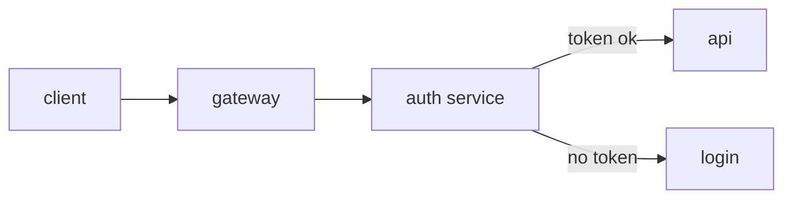

# Drawing a diagram

````sh
stickypane note write how-auth-works --open <<'EOF'
---
title: How a request is authorised
---

The gateway asks auth for every request; only `api` sees the user id.
EOF
````

Shapes: note, with a ```mermaid block. The board draws `flowchart`
(`graph`), `sequenceDiagram` and `erDiagram`; a diagram it cannot draw
keeps its source, so it is never lost.

## How

- Draw what the reader would otherwise rebuild in their head: the boxes
  and the arrows between them. Put the one sentence the picture cannot
  say under it.
- Name the boxes with the names in the code (`auth service`, `store.Apply`)
  so the user can find them.
- One diagram per note, ten boxes or fewer. A bigger system is two notes,
  one linked from the other with `[[name]]` (`connecting-notes`).
- When the explanation changes, rewrite the same note: `stickypane note
  cat how-auth-works`, then `note write` it again.
- `${CLAUDE_PLUGIN_ROOT}/rules/writing-notes.md` has how to word a note;
  `${CLAUDE_PLUGIN_ROOT}/rules/touching-the-board.md` applies.

## Recipes

- `references/a-schema-change.md`: tables and their relations before a migration.
- `references/a-reproduction-path.md`: the calls that lead to a bug, in order.
