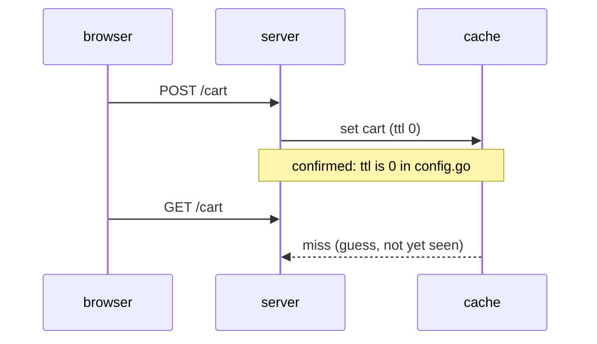

# A reproduction path

Shapes: note with a sequenceDiagram.

````sh
stickypane note write bug-path --open <<'EOF'
---
title: Why the cart empties
---

EOF
````

Mark each step confirmed (you saw it in a log or a test) or a guess, in
a `Note over` line. Update the note as guesses become facts.

Done when: every step is marked, and the confirmed ones say where you
saw them.
