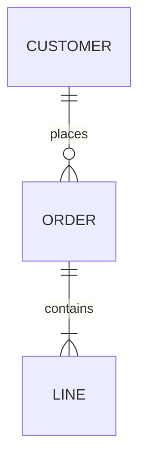

# A schema change

Shapes: note with an erDiagram.

````sh
stickypane note write schema-change --open <<'EOF'
---
title: Orders get a customer
---

New: `order.customer_id`, not null. 4,210 old orders get the guest customer.
EOF
````

Draw the tables as they will be, and say under the diagram what is new
and what happens to the rows already there. The migration itself is an
action hard to undo: `approving-a-risky-action`.

Done when: every table and column the migration touches is in the
diagram or the line under it.
