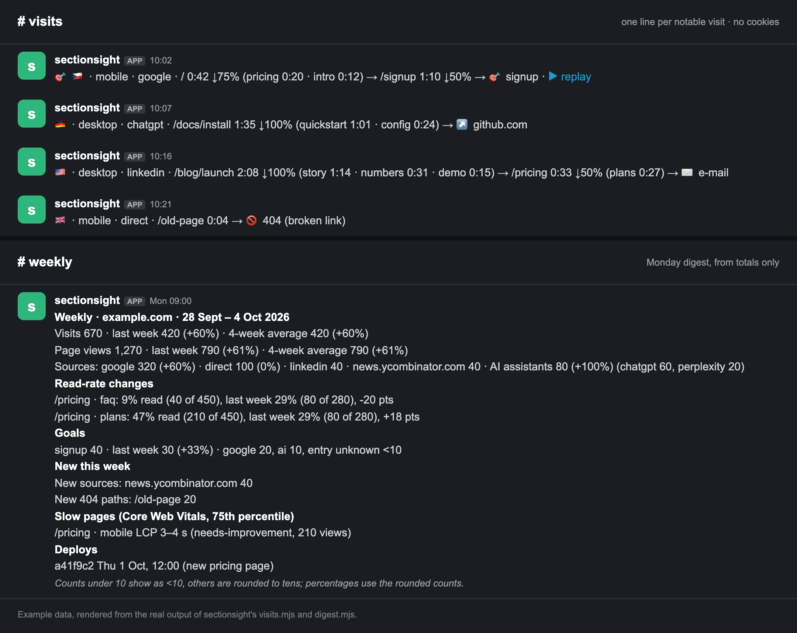
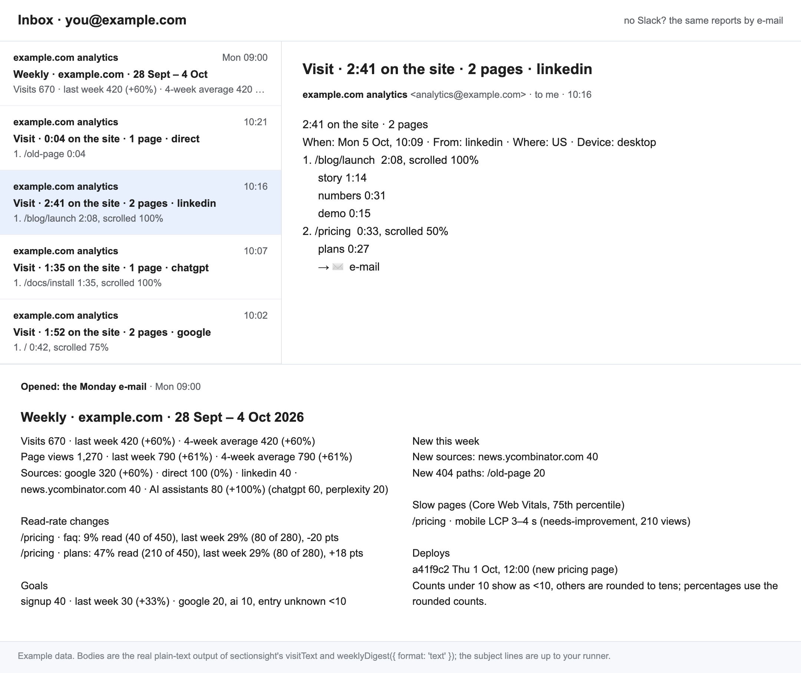
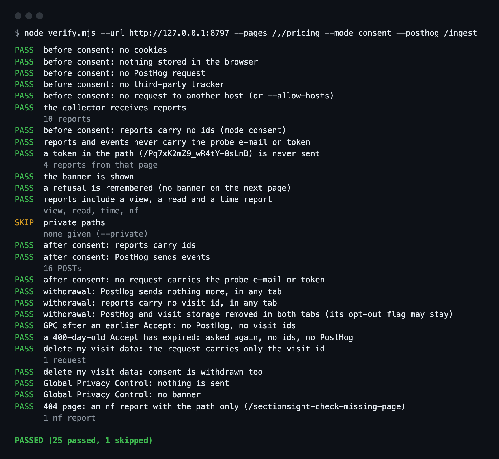

# sectionsight

An agent skill that sets up website analytics that respect visitors, and
proves it in a real browser.



Ask your coding agent to *"add privacy-first analytics to this site"*. It
then does this:

- **asks** the owner about the few decisions only they can make: the
  consent model, where data lives, retention, private pages;
- **builds** a cookieless tracker that measures what people actually read:
  active seconds per page section and whether it was read; scroll depth, CTA and goal clicks, form submits (never their content),
  dead and rage clicks, copies, prints and video plays, and 404 pages
  (including which ones came from broken links on the site itself; a
  link checker in CI covers images and files); and,
  opt-in, the site's own JavaScript errors (scrubbed, counted per page,
  never tied to a visit) and Core Web Vitals (LCP, CLS, INP, TTFB as
  buckets, with the section that was slow). A same-origin collector stores
  the data;
- **adds**, if wanted:
  - a consent banner designed around the EDPB Cookie Banner Taskforce
    report and CNIL guidance;
  - PostHog session replay that runs only after consent;
  - one Slack (or e-mail) line per notable visit;
  - a weekly "what changed" digest from the totals: this week against last
    week and the 4-week average with the counts beside every percentage,
    small counts rounded (under 10 shows as `<10`), sections whose read
    rate moved, goals by source, new sources, outbound hosts, 404 paths
    and JavaScript errors, slow pages, deploys, and, if the owner counts
    them, the consent banner's accept rate, which shows what share of visitors
    the per-visit rows cover;
  - optional, in the tracker: `data-strip-utm` removes campaign tags from
    the address bar once read (including on Next.js's App and Pages routers);
  - deploy markers from CI, so the digest lists deploys and health alerts
    say "after deploy <sha>";
  - AI visibility: visits from AI assistants (ChatGPT, Perplexity, Claude,
    Gemini, Copilot and others) grouped, AI crawlers counted on the server
    from a vendored snapshot of the ai.robots.txt list (which pages, which
    response status, which fetches were made live for a user's question; never an
    IP or a user agent), and Search Console's daily top queries and pages
    without the `googleapis` package;
  - health and anomaly alerts to an ops channel: failed writes behind the
    collector's silent 204, a form that is sent but never confirmed (its
    backend is broken), and, on sites with steady traffic, hours without a
    visit, a day far below or far above the usual, a goal that stopped,
    404 spikes and new broken links, new or spiking JavaScript errors, each
    compared with the same weekday and hours of earlier weeks;
- **enforces what it promises about data:**
  - retention enforced for every store without a TTL (files, SQL), with the
    oldest stored day shown to the owner, and the bot's own Slack lines
    deleted after N days;
  - "Delete my visit data" in the reopened banner: the collector deletes
    that visit's rows, and consent is withdrawn; helpers to export or
    delete a visit on request;
- **drafts** the privacy-page text for what was actually built;
- **verifies** it with a headless browser:
  - nothing stored and no ids before consent;
  - no e-mail or token from the query string, and no token-like path
    segment, in any report, PostHog event or recording;
  - private pages silent;
  - a withdrawal stops every open tab;
  - Global Privacy Control honoured;
  - "Delete my visit data" sends the visit id and nothing else;
  - with errors on, an error whose message holds the probe e-mail and
    token is reported scrubbed and without ids;
  - with consent counts on, the banner's reports carry no ids, including
    the Accept;
  - and, read-only, the things that quietly break: CTA links pointing
    where they should, pages that must (or must not) be indexable
    (meta robots, `X-Robots-Tag`, robots.txt), a sitemap whose URLs
    answer, and a privacy page that names every service the data goes to;
- **keeps checking** in CI: a GitHub Actions workflow runs the same check on
  every pull request (blocking or warning, as the owner chooses) and every
  night against production, without writing data, from one shared config
  file.

```text
🎯 🇨🇿 · mobile · google · / 0:42 ↓75% (pricing 0:20 · intro 0:12) → /signup 1:10 → 🎯 signup · ▶ replay
```

No Slack? The same reports go out by e-mail as plain text:



## Why

Cookieless analytics tools count page views. None of the ~80 open-source
analytics tools reviewed for this project measures time per page
*section*. None keeps totals for everyone (except browsers that send
Global Privacy Control or Do Not Track, which are not counted at all) but per-visit rows (reports
stored with a random visit id) only for people who said yes. And none
comes with a test that proves the privacy claims for the setup it builds.

The closest is PostHog's `cookieless_mode: 'on_reject'`, which counts
people who decline with a daily server-side hash.

Consent auditors do exist, and they work well alongside this skill:
[consentdiff](https://github.com/Elijas121/consentdiff),
[ecom-cookie-audit](https://github.com/kgelster/ecom-cookie-audit) and
[gdpr-cookie-scanner](https://github.com/Slashgear/gdpr-cookie-scanner)
audit an existing site. This skill builds the setup, then proves it with
its own browser check.

The pitfalls found in adversarial reviews of this code, each with its
fix, are in
[`references/gotchas.md`](skills/sectionsight/references/gotchas.md).

The browser check, run against the test fixture:



## What the check does not prove

- **What a server forwards.** It sees what the browser sends. A rewrite
  that passes the visitor's Cookie or Referer on to a vendor looks the same
  from the browser; `references/verify.md` has the manual check.
- **Names and short codes in paths.** Token-like path segments become
  `[id]`, but a slug that names a person (`/u/jane-doe`), a code under 10
  characters or an 8-digit id cannot be told from an ordinary slug. Only
  the private-path list protects those pages.
- **Pages it did not visit.** It covers the pages, private paths and probes
  you give it.
- **Legal validity.** Whether the banner text, the legal basis or the
  retention satisfy a regulator is for the owner and their counsel.

## Install

**Claude Code**

```text
/plugin marketplace add Majny/sectionsight
/plugin install sectionsight@kubadvorak
```

**Gemini CLI**

```text
gemini extensions install https://github.com/Majny/sectionsight
```

**Codex** reads the same repository as a plugin (`.codex-plugin/plugin.json`).

**Other agents (Cursor, Copilot…).** The skill follows the
open [Agent Skills](https://agentskills.io) format. Copy
`skills/sectionsight/` to wherever your agent loads skills from.

## What is inside

```text
skills/sectionsight/
  SKILL.md                  the workflow the agent follows
  references/               decisions, recipes, tracker, collector, consent, PostHog,
                            notifications, alerts, AI visibility, privacy policy,
                            verification, gotchas
  assets/
    k.js                    the tracker (no dependencies; ~16 KB gzipped source, ~9.5 KB minified+gzipped)
    collector.mjs           the endpoint (Fetch API: Next.js, Workers, Node, Bun, Deno)
                            and stores: files, MongoDB, SQL (Postgres, SQLite, D1),
                            Analytics Engine, memory
    visits.mjs              visits → Slack lines / e-mail text, posted once
    digest.mjs              the weekly "what changed" digest, from the totals
    health.mjs              health and anomaly alerts for an ops channel
    crawlers.mjs            AI crawler counts (crawlers-list.mjs: the ai.robots.txt snapshot)
    gsc.mjs                 Search Console's daily top queries and pages
    retention.mjs           retention enforced, its status, old Slack lines deleted
    dsar.mjs                a visitor's own rows: export, delete
    consent.js              the banner
    consent.css             its default look, for a CSP without a nonce
    posthog-guard.mjs       PostHog: consent-gated, URLs cleaned, safe withdrawal
    posthog-proxy.mjs       same-origin proxy with a header allowlist
    ci/privacy-check.yml    GitHub Actions: verify on pull requests and nightly
    ci/links.yml            GitHub Actions: lychee link check (internal on PRs, external weekly)
    ci/deploy-marker.yml    GitHub Actions: mark production deploys for the digest and alerts
  scripts/verify.mjs        the browser check (Playwright)
  scripts/update-crawlers.mjs  refreshes the vendored AI crawler list
```

You can also use the assets without an agent; each file explains itself.

## Development

The repo has no lockfile on purpose: Claude Code installs a plugin's npm
dependencies when it finds one, and the skill itself needs none. The dev
dependencies are pinned to exact versions in `package.json`.

```bash
npm install && npx playwright install chromium
npm test   # 165 tests (the real-Mongo one skips without SECTIONSIGHT_MONGO_MODULES): unit tests, and browser tests against test/fixture with real posthog-js 1.438.3
# mongoStore against a real mongod too (mongodb-memory-server, installed elsewhere):
SECTIONSIGHT_MONGO_MODULES=/path/with/node_modules node --test test/mongo.test.mjs
```

The browser tests run `verify.mjs` against a fixture site, under a
production-like name, in all three consent models. Fifteen negative controls
prove that the checks fail when they should:
- a careless page (cookies, storage, PostHog before consent, leaked e-mail);
- a tracker left running on a private page;
- PostHog without the guard's `before_send`;
- a URL written into the text of the recorded page, found inside the
  compressed recording;
- a tracker that reports a token-like path segment as it is;
- IndexedDB and Cache Storage written before consent;
- a storage write 7 s after load, caught only with `--settle`;
- a site whose CTA, indexing, robots.txt and sitemap are broken;
- a "Delete my visit data" request that also carries the page URL, as a
  field or in its query;
- an error report whose message reaches the collector unscrubbed;
- consent counts that carry the visit id;
- a collector that answers 500 to every report;
- a hydration error on the page;
- a banner style blocked by the page's Content Security Policy;
- a privacy page that does not name a processor.

## Not legal advice

The skill describes what is stored with and without consent, and leaves the
legal decisions to the site owner. It never claims compliance. Have the
privacy text reviewed.

## License

MIT © [Jakub Dvořák](https://kubadvorak.com).
