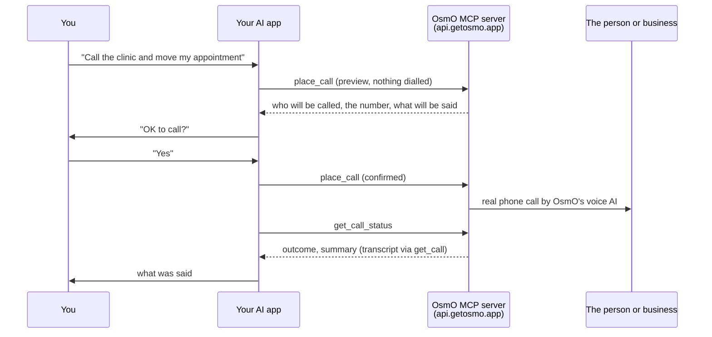

<p align="center">
  
</p>

<h1 align="center">OsmO Phone Calls</h1>

<p align="center">
  <b>Let your AI make real phone calls for you.</b><br>
  Ask ChatGPT, Claude, Cursor, Codex, Gemini CLI, Grok or any MCP client to call a shop, clinic,
  restaurant or helpline. OsmO's voice AI makes the call and brings back
  the answer, a summary and the transcript.
</p>

<p align="center">
  <a href="https://registry.modelcontextprotocol.io/v0.1/servers/app.getosmo%2Fphone-calls/versions/latest"></a>
  <a href="https://glama.ai/mcp/connectors/app.getosmo/phone-calls"></a>
  <a href="https://chatgpt.com/plugins/plugin_asdk_app_6ad0ed3277688191b90bd9dafe5d6cd9"></a>
  <a href="https://clawhub.ai/getosmo/osmo-phone-calls"></a>
  <a href="LICENSE"></a>
</p>

<p align="center">
  <a href="https://cursor.com/en/install-mcp?name=osmo&config=eyJ1cmwiOiJodHRwczovL2FwaS5nZXRvc21vLmFwcC9tY3AifQ=="></a>
  <a href="https://vscode.dev/redirect/mcp/install?name=osmo&config=%7B%22type%22%3A%22http%22%2C%22url%22%3A%22https%3A%2F%2Fapi.getosmo.app%2Fmcp%22%7D"></a>
  <a href="https://insiders.vscode.dev/redirect/mcp/install?name=osmo&config=%7B%22type%22%3A%22http%22%2C%22url%22%3A%22https%3A%2F%2Fapi.getosmo.app%2Fmcp%22%7D&quality=insiders"></a>
  <a href="https://chatgpt.com/plugins/plugin_asdk_app_6ad0ed3277688191b90bd9dafe5d6cd9"></a>
</p>

```
You:   Call the pharmacy on Main Street and ask if they're open until 9 tonight.
AI:    I'll call Main Street Pharmacy (+1 555 0100) and ask whether they're open until 9 tonight. OK?
You:   Yes.
AI:    (OsmO places the call, then reports what the pharmacy said, with a summary and transcript.)
```

*This is an illustration of the flow, not a recorded conversation. The number is a placeholder.*

**New users get 50 free credits** at [getosmo.app/login](https://getosmo.app/login), in the US, Canada,
the UK and Australia. An answered call uses 3 credits, however long it is. A call nobody answers is
free. With free credits, OsmO calls businesses and toll-free numbers; calling your contacts and scheduling calls need an OsmO app plan.

## Contents

- [How it works](#how-it-works)
- [Connect your AI](#connect-your-ai)
- [Example prompts](#example-prompts)
- [What it can and can't do](#what-it-can-and-cant-do)
- [Cost](#cost)
- [Safety and privacy](#safety-and-privacy)
- [Tools](#tools)
- [What's in this repo](#whats-in-this-repo)
- [Authentication and network](#authentication-and-network)
- [Support, security and license](#support-security-and-license)

## How it works



There is nothing to install or run on your machine. Your AI app connects to OsmO's hosted MCP server.
You sign in once in the browser with your phone number and a one-time code. There is no API key.

## Connect your AI

Every app uses the same server URL: **`https://api.getosmo.app/mcp`** (Streamable HTTP, OAuth).
When you first connect, the app opens OsmO's sign-in page. Enter your phone number and the
one-time code **there**, never in the chat.

The "Guide" column links to OsmO's own step-by-step page for that app.

| App | How to connect | Guide |
|---|---|---|
| **ChatGPT** | Plugins → search **OsmO** → Connect, or open the [OsmO listing](https://chatgpt.com/plugins/plugin_asdk_app_6ad0ed3277688191b90bd9dafe5d6cd9) | [guide](https://getosmo.app/ai-calls/chatgpt-phone-calls-setup) |
| **Claude** (web, desktop, mobile) | Customize → Connectors → **+ Add** → Add custom connector → URL `https://api.getosmo.app/mcp` | [guide](https://getosmo.app/ai-calls/claude-phone-calls-setup) |
| **Claude Code** | `claude mcp add --transport http osmo https://api.getosmo.app/mcp`, then `/mcp` to sign in. Or the plugin (MCP + skill), [below](#claude-code-plugin) | [guide](https://getosmo.app/ai-calls/claude-phone-calls-setup) |
| **Cursor** | Click **Install in Cursor** above, or add [`mcp.json`](mcp.json) to `.cursor/mcp.json` or `~/.cursor/mcp.json` | [guide](https://getosmo.app/ai-calls/cursor-phone-calls-setup) |
| **VS Code** (GitHub Copilot) | Click **Install in VS Code** above, or run **MCP: Add Server** and choose HTTP, or add the JSON [below](#vs-code) | [guide](https://getosmo.app/ai-calls/copilot-phone-calls-setup) |
| **Codex** (CLI, IDE) | `codex mcp add osmo --url https://api.getosmo.app/mcp`, then `codex mcp login osmo`. Or the plugin, [below](#codex-plugin) | [guide](https://getosmo.app/ai-calls/codex-phone-calls-setup) |
| **Gemini CLI** | `gemini extensions install https://github.com/Mountainheads-Private-limited/osmo-ai-plugins`, then `/mcp auth osmo` | [guide](https://getosmo.app/ai-calls/gemini-phone-calls-setup) |
| **Grok** (grok.com) | grok.com/connectors → New Connector → Custom → URL `https://api.getosmo.app/mcp` | [guide](https://getosmo.app/ai-calls/grok-phone-calls-setup) |
| **Grok Build** | `grok mcp add --transport http osmo https://api.getosmo.app/mcp` | [guide](https://getosmo.app/ai-calls/grok-build-phone-calls-setup) |
| **Perplexity** (Pro, Max, Enterprise) | Plugins → Add custom → Add MCP connector → Remote → URL `https://api.getosmo.app/mcp` | [guide](https://getosmo.app/ai-calls/perplexity-phone-calls-setup) |
| **OpenClaw** | `openclaw skills install @getosmo/osmo-phone-calls`, then the two commands [below](#openclaw) | [ClawHub](https://clawhub.ai/getosmo/osmo-phone-calls) |
| **Hermes** | add the YAML [below](#hermes), then `hermes mcp login osmo` | — |
| **Cline, Windsurf, OpenCode, any MCP client** | add a remote (Streamable HTTP) server with the URL above and OAuth sign-in. Cline: see [`llms-install.md`](llms-install.md) | — |

We have not tested the rows with no guide (OpenClaw, Hermes, Cline, Windsurf, OpenCode) end to end
ourselves. Those rows follow each client's own documented syntax. If a command is out of date for
your version, please [open an issue](https://github.com/Mountainheads-Private-limited/osmo-ai-plugins/issues).

### Claude Code plugin

The plugin adds the MCP server **and** the `osmo-phone-calls` skill, which tells the AI to confirm
before every call. Inside Claude Code:

```
/plugin marketplace add Mountainheads-Private-limited/osmo-ai-plugins
/plugin install osmo@osmo
```

On recent Claude Code versions this works in one step:
`/plugin install osmo --marketplace Mountainheads-Private-limited/osmo-ai-plugins`.
Then type `/mcp`, pick `osmo` and sign in. Install either the plugin or the `claude mcp add` server,
not both, so Claude doesn't see two copies of the tools.

### Codex plugin

The plugin carries the MCP server and the skill. In your shell:

```sh
codex plugin marketplace add Mountainheads-Private-limited/osmo-ai-plugins
codex plugin add osmo@osmo
codex mcp login osmo
```

### VS Code

`.vscode/mcp.json` (workspace) or your user `mcp.json`:

```json
{
  "servers": {
    "osmo": {
      "type": "http",
      "url": "https://api.getosmo.app/mcp"
    }
  }
}
```

### Cursor

`~/.cursor/mcp.json` or `.cursor/mcp.json`:

```json
{
  "mcpServers": {
    "osmo": {
      "url": "https://api.getosmo.app/mcp"
    }
  }
}
```

### OpenClaw

```sh
openclaw skills install @getosmo/osmo-phone-calls
openclaw mcp set osmo '{"url":"https://api.getosmo.app/mcp","transport":"streamable-http","auth":"oauth"}'
openclaw mcp login osmo
```

### Hermes

`~/.hermes/config.yaml`, then `hermes mcp login osmo`:

```yaml
mcp_servers:
  osmo:
    url: "https://api.getosmo.app/mcp"
    auth: oauth
```

### OpenCode

`opencode.json` (follows OpenCode's documented remote-server syntax; not yet tested by us):

```json
{
  "mcp": {
    "osmo": {
      "type": "remote",
      "url": "https://api.getosmo.app/mcp"
    }
  }
}
```

## Example prompts

- "Call the pharmacy on Main Street and ask if they're open until 9."
- "Call my dentist and move my appointment to next Tuesday afternoon."
- "Find the customer-care number for my airline and ask about my refund."
- "Get me a table for 4 at Luigi's on Friday at 8 pm."
- "Ask the hardware store on Elm Street if they have a 10 mm socket set in stock."

## What it can and can't do

> With free credits, OsmO calls businesses and toll-free numbers; calling your contacts and scheduling calls need an OsmO app plan.

**With any account, including free credits:**

- Book, reschedule or cancel an appointment or a table.
- Ask a shop, clinic or restaurant about opening hours, prices, stock or an order.
- Get through a company's phone menu to customer service.
- Call listed businesses (shops, clinics, restaurants, helplines) and toll-free numbers, up to 5 in
  one go.
- Find a business near you, or a company's customer-care number, in your own country.
- Report the outcome, a summary and the transcript of every call it made.

**With an OsmO app plan** ([iOS](https://apps.apple.com/us/app/osmo-ai-phone-assistant/id6761623744),
[Android](https://play.google.com/store/apps/details?id=com.osmo.aicallassistant)):

- Call your saved contacts and people who called you in the last 30 days, for example to pass a
  message.
- Schedule a call for later, and list or cancel scheduled calls.
- Tell you who called your OsmO number and what they wanted, and change your call-screening rules
  and settings.

**It can't or won't:**

- Call emergency services. Dial your local emergency number yourself.
- Send text messages or email.
- Call personal numbers found on the web.
- Need card numbers, bank PINs, passwords or sign-in codes typed into the chat. None of its tools
  take them, the skill tells your AI never to ask for them, and the sign-in code goes on OsmO's own page.
- Dial anything before you say yes.

Calls come from the OsmO number for your country. The voice AI speaks English, Spanish and Hindi.

## Cost

| | |
|---|---|
| New users (US, Canada, UK, Australia) | 50 free credits when you sign in at [getosmo.app/login](https://getosmo.app/login). No card. Calls businesses and toll-free numbers. |
| An answered call | 3 credits, however long it is |
| A call nobody answers | free |
| Contacts, scheduled calls, screening | need an OsmO app plan. Signing in to the app ends any free credits you have left. |
| After the free credits | keep calling with a plan in the OsmO app ([iOS](https://apps.apple.com/us/app/osmo-ai-phone-assistant/id6761623744), [Android](https://play.google.com/store/apps/details?id=com.osmo.aicallassistant)) |

If your free credits run out, the tools say so and point you to the OsmO app
([getosmo.app/app](https://getosmo.app/app)).

## Safety and privacy

- **You confirm every call.** `place_call` first returns a preview: who will be called, the number,
  what will be said and when. Nothing is dialled until your AI sends it back with your approval.
  Changing or deleting a setting or rule works the same way.
- **Sign-in happens on OsmO's page,** not in the chat. Never paste the one-time code into a chat. No
  API key or password is stored in this repo or in your AI app's config.
- **One host.** Everything goes to `https://api.getosmo.app` over HTTPS. This repo has no scripts,
  hooks or executable code.
- **Annotations.** Every tool declares MCP annotations (`readOnlyHint`, `destructiveHint`,
  `openWorldHint`). Tools that place calls are marked destructive and open-world, so well-behaved
  clients ask before running them.
- **Disconnect** by removing OsmO from your AI app's connector settings. If you use the OsmO app,
  also open the Sharing card → Connect AI apps → Disconnect. If you only use OsmO from AI apps,
  email team@getosmo.app with the mobile number you signed in with and we will end the access.

Read the [privacy policy](https://getosmo.app/privacy) and [terms](https://getosmo.app/terms).

## Tools

The server's `tools/list` is the source of truth. This is what a standard MCP client (Claude,
Cursor, Codex, Gemini CLI, Grok and others) gets today: 27 tools. ChatGPT is served the release its
directory review approved, so its tool text can differ slightly.

| Tool | What it does | Changes something? |
|---|---|---|
| `place_call` | Call one number, or up to 5. Returns a preview first. Calling contacts and booking for later need an OsmO app plan. | yes, after you confirm |
| `get_call_status` | Progress and result of a call OsmO placed | no |
| `cancel_scheduled_call` | Cancel a call booked for later (OsmO app plan) | yes, after you confirm |
| `list_scheduled_calls` | Calls booked for later (OsmO app plan) | no |
| `list_calls` / `list_recent_calls` | Your calls, newest first, with summaries | no |
| `get_call` | One call: summary, transcript, recording link | no |
| `find_business` | Businesses near a place, with phone numbers (Google Maps listings) | no |
| `find_customer_care` | A company's customer-care numbers in your country | no |
| `find_contact` | People in your call history | no |
| `search_contacts` | Your phone book (contacts synced by the OsmO app) | no |
| `get_settings` / `update_settings` | Call settings: answering, alerts, VIP and block lists | update: yes, after you confirm |
| `get_assistant` / `update_assistant` | Which assistant voice and language answers your calls | update: yes, after you confirm |
| `list_rules` / `add_rule` / `update_rule` / `delete_rule` | Call-screening rules | add, update, delete: yes, after you confirm |
| `get_facts` | What your assistant tells callers (website, documents) | no |
| `get_connections` | Whether Google Calendar, Calendly and Google Drive are connected | no |
| `list_bookings` | Bookings your call assistant took | no |
| `list_chats` / `get_chat` | Your chats with OsmO in the app | no |
| `get_account_status` | Credits left (free-credit accounts), or plan, OsmO number and forwarding status (app accounts) | no |
| `osmo_support` | Help answers: forwarding codes, plans, privacy | no |
| `osmo_help` | What this integration can and can't do | no |

## What's in this repo

This repo holds the **client side** only, under the MIT license. The OsmO server is a hosted
service; its code is not in this repo.

| Path | For |
|---|---|
| [`skills/osmo-phone-calls/SKILL.md`](skills/osmo-phone-calls/SKILL.md) | Agent Skill. Tells the AI to confirm before calling, report only what the call result says, and never ask for codes. Published on [ClawHub](https://clawhub.ai/getosmo/osmo-phone-calls). |
| [`.claude-plugin/`](.claude-plugin) | Claude Code plugin + marketplace (MCP server + skill) |
| [`.codex-plugin/plugin.json`](.codex-plugin/plugin.json) | Codex plugin (MCP server + skill) |
| [`.cursor-plugin/plugin.json`](.cursor-plugin/plugin.json), [`mcp.json`](mcp.json) | Cursor plugin and MCP config |
| [`gemini-extension.json`](gemini-extension.json), [`GEMINI.md`](GEMINI.md) | Gemini CLI extension |
| [`llms-install.md`](llms-install.md) | Install steps written for AI agents (Cline and others) |
| [`server.json`](server.json) | Official MCP Registry metadata (`app.getosmo/phone-calls`) |

## Authentication and network

- `https://api.getosmo.app/mcp`: hosted MCP (Streamable HTTP)
- `https://api.getosmo.app/.well-known/oauth-protected-resource/mcp` and
  `/.well-known/oauth-authorization-server`: discovery
- `https://api.getosmo.app/mcp/oauth/authorize`, `/token`, `/register`, `/revoke`: OAuth 2.1 with
  PKCE and dynamic client registration
- `https://api.getosmo.app/mcp/oauth/connect`: the sign-in page (phone number + one-time code)

Scopes advertised by the server: `osmo.help`, `calls.read`, `calls.write`, `offline_access`.

## Support, security and license

- Help: [getosmo.app/support](https://getosmo.app/support.html) or **team@getosmo.app**
- Security reports: see [SECURITY.md](SECURITY.md)
- Improving a client config or the skill: see [CONTRIBUTING.md](CONTRIBUTING.md)
- License: MIT for the files in this repo ([LICENSE](LICENSE)). Using OsmO is governed by the
  [OsmO terms](https://getosmo.app/terms) and [privacy policy](https://getosmo.app/privacy).

If OsmO makes a call you'd rather not make yourself, a ⭐ on this repo helps other people find it.
