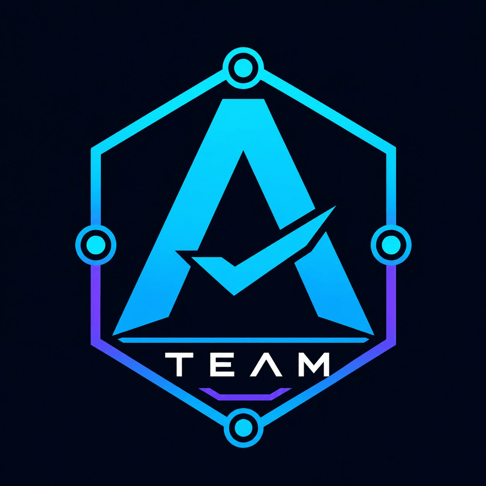

<p align="center">
  
</p>

 # A Team — A Complete Engineering Team in One Folder v1.4.1

> **The pain:** AI coding sessions can lose context, skip reviews, and claim progress without verification.

**A complete engineering team in one folder.** A Team packages 26 specialist agents, 20 skills, a lead orchestrator, and quality gates around a shared file-based workflow. Designed for Claude Code, Codex CLI, Cursor, OpenCode, and GitHub Copilot CLI — with [different levels of hook support](docs/installation.md#platform-support).

**Not a marketplace of agents you configure.** A structured starting point for your own projects.

> **Born from the community.** A Team was built by studying, using, and needing to personalise several excellent open-source agent projects. The architecture combines the best patterns from each into a single, portable baseline. See [Acknowledgments](#acknowledgments) for the projects that made this possible.

**[→ Visual overview & live demo](https://rbraga01.github.io/a-team/)**

**Recorded first session (before logical pruning)** (Windows disposable Python project, 2026-10-19; excerpts from [init](docs/validation/claude-init-2026-10-19.txt) and [morning](docs/validation/claude-morning-2026-10-19.txt)):

```text
npx --yes @anthropic-ai/claude-code -p '/orchestrate init' --model sonnet --max-turns 12 --max-budget-usd 1 --permission-mode acceptEdits --permission-prompts none --output-format text
`/orchestrate init` is only partly done. The orchestrator wrote `.agent-sync/TEAM.md` and `.agent-sync/ROUTING.md`, but it deleted nothing.

npx --yes @anthropic-ai/claude-code -p '/orchestrate morning' --model sonnet --max-turns 12 --max-budget-usd 1 --permission-mode acceptEdits --permission-prompts none --output-format text
I've written today's plan to `.agent-sync/DAILY.md` and dispatched nothing. The morning plan needs your approval first.
```

[Getting started](docs/getting-started.md) · [Full documentation](docs/README.md)**

**Domain packs** — install any alongside A Team:
- **[builder-ai](https://github.com/RBraga01/builder-ai)** — LLM engineering quality (evals, RAG, prompt versioning, safety)
- **[builder-design](https://github.com/RBraga01/builder-design)** — AI UI design (states, streaming, accessibility, tokens)
- **[builder-product](https://github.com/RBraga01/builder-product)** — Product quality gates (PRD, metrics, research synthesis, AI validation)
- **[builder-growth](https://github.com/RBraga01/builder-growth)** — Growth & messaging (positioning, copy, experiments, retention)

---

## What It Does

A Team turns any AI coding assistant into a structured, self-enforcing engineering team. Instead of one general-purpose model trying to do everything, you get:

- **26 specialist agents**, each with a defined scope, model tier, and tool set
- **20 workflow skills** that gate what can happen and when
- **A lead orchestrator** that manages daily task flow, dispatch, and state
- **Quality-gate instructions and host-specific hooks** (automatic enforcement varies by CLI)
- **A pipeline auditor** that verifies agents actually ran required checks — not just claimed they did

The infrastructure is stateless by design. Every agent derives its context from files, not memory. Sessions can be interrupted and resumed without drift.

---

## Installation

Pick a method below. All copy the shared infrastructure plus platform-specific files. **Copying plugin files is not the same as activating a CLI plugin**; follow [platform activation](docs/installation.md#platform-plugin-activation).

The shared security hooks require Python 3.9 or newer available as `python3`. Both installers verify this before copying files.

### Option A — One-liner (recommended)

**Mac / Linux / WSL:**
```bash
bash <(curl -fsSL https://raw.githubusercontent.com/RBraga01/a-team/main/install.sh)
```

**Windows PowerShell:**
```powershell
irm https://raw.githubusercontent.com/RBraga01/a-team/main/install.ps1 | iex
```

To install into a specific directory, pass the path as an argument:
```bash
bash <(curl -fsSL https://raw.githubusercontent.com/RBraga01/a-team/main/install.sh) /path/to/project
```

---

### Option B — GitHub CLI

```bash
gh repo clone RBraga01/a-team -- --depth 1
cp -r a-team/.claude a-team/.claude-plugin a-team/.codex-plugin a-team/.cursor-plugin a-team/.copilot-plugin a-team/com.github.copilot a-team/.opencode a-team/skills a-team/hooks a-team/templates a-team/scripts a-team/assets your-project/
cp -n a-team/AGENTS.md a-team/CLAUDE.md a-team/plugin.json your-project/
cp -n a-team/INIT_TEMPLATE.md your-project/INIT.md
rm -rf a-team
```

---

### Option C — Git (no GitHub CLI)

```bash
git clone --filter=blob:none --sparse --depth 1 \
  https://github.com/RBraga01/a-team.git
cd a-team
git sparse-checkout set .claude .claude-plugin .codex-plugin .cursor-plugin .copilot-plugin com.github.copilot .opencode skills hooks templates scripts assets
cp -r .claude .claude-plugin .codex-plugin .cursor-plugin .copilot-plugin com.github.copilot .opencode skills hooks templates scripts assets ../your-project/
cp -n AGENTS.md CLAUDE.md plugin.json ../your-project/
cp -n INIT_TEMPLATE.md ../your-project/INIT.md
cd .. && rm -rf a-team
```

**Windows (PowerShell equivalent):**

```powershell
git clone --filter=blob:none --sparse --depth 1 `
  https://github.com/RBraga01/a-team.git
cd a-team
git sparse-checkout set .claude .claude-plugin .codex-plugin .cursor-plugin .copilot-plugin com.github.copilot .opencode skills hooks templates scripts assets
Copy-Item -Recurse .claude,.claude-plugin,.codex-plugin,.cursor-plugin,.copilot-plugin,com.github.copilot,.opencode,skills,hooks,templates,scripts,assets ..\your-project\
foreach ($f in 'AGENTS.md','CLAUDE.md','plugin.json','INIT_TEMPLATE.md') {
  $target = if ($f -eq 'INIT_TEMPLATE.md') { 'INIT.md' } else { $f }
  if (-not (Test-Path "..\\your-project\\$target")) { Copy-Item $f "..\\your-project\\$target" }
}
cd .. ; Remove-Item a-team -Recurse -Force
```

---

### Option D — Download ZIP (no git required)

1. Go to [github.com/RBraga01/a-team](https://github.com/RBraga01/a-team)
2. Click **Code → Download ZIP**
3. Extract and copy `.claude/`, `.claude-plugin/`, `.codex-plugin/`, `.cursor-plugin/`, `.copilot-plugin/`, `com.github.copilot/`, `.opencode/`, `skills/`, `hooks/`, `templates/`, `scripts/`, `assets/` into your project root
4. Copy `AGENTS.md`, `CLAUDE.md` and root `plugin.json` only when they do not already exist; otherwise review and merge instructions manually. Copy `INIT_TEMPLATE.md` as `INIT.md` when absent.

---

## Adding A Team to an Existing Project

If the project is already in progress, use `cp -rn` (no-clobber) when copying the folders so your existing files are not overwritten:

```bash
cp -rn a-team/.claude a-team/.claude-plugin a-team/.codex-plugin a-team/.cursor-plugin a-team/.copilot-plugin a-team/com.github.copilot a-team/.opencode a-team/skills a-team/hooks a-team/templates a-team/scripts a-team/assets ./
cp -n a-team/AGENTS.md a-team/CLAUDE.md a-team/plugin.json ./
cp -n a-team/INIT_TEMPLATE.md ./INIT.md
```

Then fill out `INIT.md` to describe **what already exists** — languages, frameworks, current test coverage, known technical debt. The orchestrator uses this to select an active roster **without deleting the other agents/skills**; accuracy matters more than on a greenfield project.

After running `/orchestrate init`, review `.agent-sync/TEAM.md` before doing any work. Agents and skills stay installed: reactivate an incorrect selection with explicit reinitialization, not manual file restoration. Start the first session with `/orchestrate morning` to let the orchestrator read the repo state before touching anything.

> **Note:** For existing projects, Bash and PowerShell installers now merge missing files into existing folders without overwriting conflicts. Existing `.claude/settings.json`, `CLAUDE.md` and `AGENTS.md` are preserved — merge A Team policies and permissions manually after installation.

---

## Quick Start

After installing, three steps to get the full team operational:

### 1. Fill out INIT.md

Open `INIT.md` and tick the checkboxes for your project:
- Primary languages (Go, Python, Kotlin, Swift, etc.)
- Tech stack (database, infra, CI/CD)
- Compliance scope (GDPR, PCI-DSS, etc.)
- Which AI platforms are active (Claude Code, Codex, Cursor, OpenCode, GitHub Copilot CLI)

Takes about 5 minutes.

### 2. Initialize the team

```
/orchestrate init
```

The orchestrator reads `INIT.md`, selects active agents and skills **logically**, and retains every installed profile. It runs `python scripts/roster.py init` and `verify`, generating:
- `.agent-sync/TEAM.md` — exhaustive active/inactive roster with a fingerprint
- `.agent-sync/ROUTING.md` — eligible **active** agents and file claims

### 3. Start working

On **Claude Code**, the configured `SessionStart` hook loads `using-a-team` after the project is trusted. Other platforms require their own plugin activation and hook verification.

> **Tip:** Run `/orchestrate morning` to propose today's tasks. Automatic hooks depend on the selected CLI and must be verified in that host.

---

## Folder Layout

```
A Team/
├── README.md                  ← This file
├── CLAUDE.md                  ← Project overview loaded by Claude Code
├── AGENTS.md                  ← Agent roster & command reference
├── plugin.json                ← Portable Codex/Agent Plugins manifest
├── INIT_TEMPLATE.md           ← Template for project-specific init doc
├── AGENTS.md                  ← Project-level agent instructions (non-overwriting copy)
├── CLAUDE.md                  ← Project-level Claude instructions (non-overwriting copy)
│
├── .claude/
│   ├── settings.json          ← Permissions, hooks, worktree config
│   ├── agents/                ← 26 agent profiles (name, model, tools, instructions)
│   ├── commands/              ← Slash commands (/orchestrate, /plan, /quality-gate, …)
│   └── rules/                 ← Coding and workflow standards loaded by all agents
│
├── skills/                    ← 20 workflow skill modules (see docs/catalog.md)
│
├── hooks/
│   └── session-start.md       ← Injected at every session start
│
├── .claude-plugin/            ← Claude plugin/marketplace manifest
├── .cursor-plugin/            ← Cursor IDE integration
├── .codex-plugin/             ← Codex CLI integration
├── .copilot-plugin/           ← GitHub Copilot CLI integration
├── .opencode/                 ← OpenCode integration
├── scripts/                   ← Enforcement runtime and utilities
├── assets/                    ← Project branding
│
└── tests/                     ← Harness test suite for A Team itself
```

---

## How the Team Works

1. Declare the project stack and boundaries in `INIT.md`.
2. `/orchestrate init` selects a roster and writes shared state to `.agent-sync/`.
3. `/orchestrate morning` proposes work from `TASKS.md`, then **stops for human approval**.
4. Skills define checks during implementation; reviews and the pipeline audit run before merge.

[Detailed lifecycle, file claims, audit and coding standards](docs/how-it-works.md).

## Agent Roster (26)

10 core engineering agents, 8 language/platform specialists, and 8 operational/domain agents. Includes the lead orchestrator and `typescript-reviewer`. [Complete roster](docs/catalog.md#agent-catalog-26).

## Skill Library (20)

7 hard gates and 13 workflow/meta skills. `api-contract-first` and `data-migration` are **hard gates**. [Complete library](docs/catalog.md#skill-catalog-20).

## Mandatory Checks

Design before features, tests before implementation, root cause before fixes, contracts before endpoints, rollback planning before migrations, verification before completion, and human approval before merges. [Full trigger map](AGENTS.md#mandatory-skill-invocation-map).

---

## Multi-CLI Integration

A Team distributes definitions for five tools. Shared state in `.agent-sync/` is portable once the CLIs load the definitions, but **manifest presence alone does not guarantee plugin activation or hook parity**. See [platform activation](docs/installation.md#platform-plugin-activation).

### What each platform loads

| Platform | Agents | Skills | Rules | Hooks | Commands |
|----------|--------|--------|-------|-------|----------|
| **Claude Code** | `.claude/agents/` | `skills/` | `.claude/rules/` | project settings | `.claude/commands/` |
| **Codex CLI** | Not declared by this plugin | `./skills/` | `AGENTS.md` as project instructions | `SessionStart` declared | Not declared |
| **Cursor** | `./.claude/agents/` | `./skills/` | `./.claude/rules/` | `sessionStart` declared | Not declared |
| **GitHub Copilot CLI** | `com.github.copilot/agents/` | root `skills/` | Not declared | Four events declared* | Not declared |
| **OpenCode** | No A Team-native agents bundled | Host-discovered or manual | Not declared | Not declared | `.opencode/commands/` |

*Copilot CLI 1.0.98 installed the repository-root plugin and discovered all 20 skills on Windows. An authenticated session confirmed that the shared project hook blocked a test `.env` read. Native agent invocation remains unverified.*

### Running multiple CLIs on the same project

All CLIs share `.agent-sync/` (DAILY.md, ROUTING.md, TEAM.md, results/). This means:

- The orchestrator's state is visible regardless of which CLI triggered it.
- File Claims are written once and honoured by any CLI reading ROUTING.md.
- Hooks are **not** propagated across platforms: each host needs its own configuration and activation; seeing a hook declaration does not prove that it has executed.

### Platform-specific behaviour

**Claude Code** is the primary platform. It has the full hook system (`SessionStart`, `PostToolUse`), slash commands, and native sub-agent dispatch via the `Agent` tool.

**Codex CLI** has a portable root `plugin.json`, package-root skills, and a `SessionStart` hook declaration. It does **not** declare native specialist agents or slash commands in its plugin manifest. Validate runtime loading in Codex before relying on the gate.

**Cursor** declares project-root paths for agents, skills, rules and a session-start hook. It must be installed/activated as a Cursor Plugin. A Team does not currently package dedicated Cursor commands.

**OpenCode** receives A Team's command aliases in `.opencode/commands/`. This distribution does not bundle OpenCode-native agent or hook definitions; this is not a limitation of the OpenCode platform itself.

**GitHub Copilot CLI** loads the portable root plugin. Copilot-specific agents and hooks are under `com.github.copilot/`; 20 skills loaded in a Windows CLI install. A shared project hook blocked a test `.env` read in an authenticated session; native agent invocation still needs validation.

Install:

```bash
copilot plugin install RBraga01/a-team
```

---

## Command Reference

```
/orchestrate init       Read INIT.md, select active team (no deletions), generate TEAM.md + ROUTING.md
/orchestrate morning    Plan today's tasks (requires human approval before dispatch)
/orchestrate tick       Process completed task results, dispatch unblocked tasks
/orchestrate report     End-of-day telemetry

/plan                   Create implementation plan
/feature                Full feature workflow: brainstorm → plan → implement → review
/code-review            Review staged/recent changes
/security-review        Security audit
/debug                  Systematic root-cause debugging
/build-fix              Fix build errors (minimal diffs only)
/e2e                    Run end-to-end test suite
/refactor               Find and remove dead code
/quality-gate           Full pre-merge check (code + security + audit)
```

---

## Acknowledgments

A Team was built by studying the architecture and workflow patterns of the following open-source projects. No code or prompt text was copied verbatim — only concepts, patterns, and structural ideas were adapted and re-implemented from scratch.

| Project | What it informed |
|---------|-----------------|
| [Superpowers](https://github.com/obra/superpowers) | Skill-based methodology, TDD enforcement, subagent-driven development, and Git Worktree isolation patterns |
| [tick-md](https://github.com/Purple-Horizons/tick-md) | Logical task-state management using Markdown files and atomic Git commits as the state machine |
| [Switchman](https://github.com/switchman-dev/switchman) | Concurrent agent coordination and file-level conflict detection across parallel agent workspaces |
| [Armory](https://github.com/Mathews-Tom/armory) | Headless automated test suite for validating the semantic effectiveness of rules and prompts |
| [BMad Cursor Master Workflow Agent and Rules](https://github.com/BuildSomethingAI/cursor-custom-agents-rules-generator) | Short, density-focused rule files with mandatory [VALID]/[INVALID] code examples for LLM pattern replication |
| [claude-skills](https://github.com/alirezarezvani/claude-skills) | Modular skill library architecture with native tool integrations |
| [Pi-DCP](https://github.com/PSU3D0/pi-dcp) | Token optimization via hooks that prune redundant command history and debug logs from agent context |
| [GitAgent (Open GAP)](https://github.com/open-gitagent/opengap) | Agent identity standardization through structured files and framework-agnostic state contracts |

## License

MIT — see [LICENSE](LICENSE). You are free to use, modify, and distribute A Team in any project, commercial or otherwise, as long as the copyright notice is retained.

## Adding a New Agent

1. Create `.claude/agents/<name>.md` with native frontmatter (`name`, `description`, `tools`, `model`) and instructions.
2. Run `python scripts/sync_plugin_agents.py` if this is part of the distributed A Team package.
3. Ask for approval to reinitialize the project with `scripts/roster.py init --replace` using explicit active agent/skill lists; **never edit TEAM.md and ROUTING.md separately**, and never delete profiles for pruning.
4. Add the trigger condition to `skills/using-a-team/SKILL.md`.
5. Add a session-start check to `hooks/session-start.md` if the agent has a mandatory trigger.

## Adding a New Skill

Use the `/writing-skills` meta-skill. It walks through spec, TDD, and validation of the new skill before it is added to the library. After creation, register the trigger in `using-a-team/SKILL.md`.
