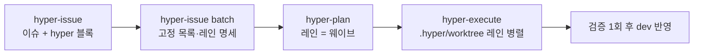

# Hypercore Agent Skills

<p align="center">
  
</p>

> Claude Code · Codex · Cursor · Antigravity에서 그대로 쓰는 한국어 우선 AI 에이전트 스킬 모음.

Hypercore는 코드베이스 분석부터 릴리스까지의 반복 작업을 한 번에 줄여주는 20개 스킬을 한 패키지로 제공합니다. 각 스킬은 트리거, 워크플로, 검증 게이트가 명시되어 있어 어떤 CLI에서 호출해도 같은 의도로 동작합니다.

- **표준 설치**: 모든 지원 런타임에서 `npx skills` 하나로 설치하고 관리.
- **다중 CLI**: Claude Code, Codex, Cursor, Antigravity에서 동일하게 사용.
- **한국어 우선**: 모든 스킬에 한국어 사양이 정렬되어 있으며 영어 원본도 함께 유지.
- **검증 가능한 결과물**: 각 스킬은 evidence/validation/stop-condition 계약을 따라 결과를 남깁니다.

[Vercel Skills](https://github.com/vercel-labs/skills) 구조 위에 만들어졌습니다.

## 호환성

Hypercore의 표준 설치·관리 경로는 [Vercel Skills CLI](https://github.com/vercel-labs/skills)의 원격 소스 규약입니다. Claude Code, Codex, Cursor 등 런타임 선택은 `npx skills`의 `--agent` 옵션으로 처리합니다. 저장소 루트의 `.codex-plugin/plugin.json`은 [awesome-codex-plugins](https://github.com/hashgraph-online/awesome-codex-plugins) 목록 등록용 Codex 플러그인 설명서이며 같은 `skills/`를 가리킵니다. 별도 marketplace adapter는 제공하지 않습니다.

| 런타임 | 설치 예시 | 비고 |
|---|---|---|
| Claude Code | `npx skills add alpoxdev/hypercore -a claude-code -g` | `-g` 생략 시 프로젝트 설치 |
| Codex CLI | `npx skills add alpoxdev/hypercore -a codex -g` | project/global 모두 `.agents/skills` canonical 경로 사용 |
| Cursor | `npx skills add alpoxdev/hypercore -a cursor -g` | `npx skills` 표준 대상 |
| 기타 | `npx skills add alpoxdev/hypercore -g` | CLI가 지원하는 agent에 한함 |

스킬별 실행 호환은 아래 [스킬 카탈로그](#스킬-카탈로그)의 **호환** 컬럼 또는 각 `SKILL.md`의 `compatibility` 필드에서 확인합니다.

## 설치 및 수명주기

모든 스킬을 사용자 전역에 설치 (`--skill '*'`가 스킬 전체 선택. agent를 지정하지 않고 `-y`를 주면 대상은 순서대로 정해집니다. agent 안에서 실행하면 그 agent와 universal agent, Eve가 설치돼 있으면 Eve만, 감지된 agent가 없으면 CLI가 아는 agent 전체, 그 밖에는 감지된 agent와 universal agent입니다. 특정 agent만 원하면 `-a`로 지정합니다):

```bash
npx skills add alpoxdev/hypercore --skill '*' -g -y
```

스킬과 agent 두 축을 각각 고를 수 있고, 둘 다 와일드카드(`'*'`)와 이름 나열을 받습니다:

```bash
npx skills add alpoxdev/hypercore --skill '*' -a claude-code codex -g -y   # 모든 스킬 → 지정 agent
npx skills add alpoxdev/hypercore --skill hyper-git hyper-documentation -g -y     # 스킬 여러 개 나열
npx skills add alpoxdev/hypercore --all -g                                 # 모든 스킬 → 모든 agent
```

`--all`은 `--skill '*' --agent '*' -y`의 축약형입니다. 스킬 전체 설치가 목적이라면 `--skill '*'`를 쓰세요 — `--all`은 agent 감지를 무시하고 CLI가 아는 agent 전체(2026-11-04 기준 79개)를 대상으로 삼아, 쓰지 않는 agent의 홈 디렉터리까지 만들고 전역 설치를 지원하지 않는 agent(Eve, PromptScript)에는 실패 줄만 남깁니다.

`-g`/`--global`을 생략하면 현재 프로젝트에만 설치됩니다. `--copy`는 설치 시 독립 복사본을 만들며, 생략 시 CLI가 대상 조합에 따라 canonical copy 또는 symlink를 선택합니다.

`remove`도 `--all`을 받습니다 — 전역 스킬 전체를 지우려면 `npx skills remove --all -g`입니다. 주의: `remove --all`은 `-y`를 포함하므로 확인 프롬프트 없이 바로 지웁니다(2026-11-04 `vercel-labs/skills` 소스 기준). 스킬 이름과 함께 쓰면 거부되고, `remove`의 `-a`는 `'*'`를 받지 않으니 agent는 이름으로 지정합니다.

설치 후에는 같은 CLI로 전체 수명주기를 관리합니다:

```bash
npx skills list -g
npx skills update -g
npx skills remove hyper-git -g
npx skills use alpoxdev/hypercore --skill hyper-git
npx skills find hypercore --owner alpoxdev
npx skills init my-skill
```

`update`는 원격 source 정보가 기록된 lock에 의존합니다. 로컬 경로로 설치한 항목은 lock에 `sourceType: local`로 남아 `update`가 건너뛰고, 기존 plugin 설치나 수동 복사에는 lock 항목 자체가 없으므로, `update`로 관리하려면 아래처럼 원격 source로 다시 설치해야 합니다. `remove`는 lock이 없어도 설치 디렉터리를 찾아 지웁니다(2026-11-04 `vercel-labs/skills` 소스 기준).

### 기존 plugin 또는 lock 없는 설치 마이그레이션

1. 기존 스킬을 백업하고 사용 중인 runtime의 plugin/marketplace 설치를 제거합니다.
2. 실제 원격 source를 지정해 원하는 scope와 agent로 다시 설치합니다.
3. `npx skills list -g --json`과 project `skills-lock.json` 또는 global `.skill-lock.json`에서 source가 `alpoxdev/hypercore`인지 확인합니다.
4. 이후 `update`와 `remove`를 실행합니다.

```bash
npx skills add alpoxdev/hypercore -a codex --skill '*' -g -y
npx skills list -g --json
npx skills update -g
```

Codex는 universal agent이므로 project에서는 `<cwd>/.agents/skills`, global에서는 `$HOME/.agents/skills`가 canonical 설치 경로입니다. `$CODEX_HOME/skills`는 primary 설치/list 경로가 아닙니다. Claude+Codex를 함께 설치할 때 Codex는 canonical 경로를 사용하고 Claude 경로에는 CLI가 symlink를 만들 수 있습니다.

`skills` lock은 `--copy` 설치 방식을 기록하고 `update`는 그 방식을 그대로 복원합니다(2026-11-04 `vercel-labs/skills` 소스 기준). 전역 lock은 마지막으로 고른 agent 집합도 기록하지만 이는 다음 `add`의 기본 선택값일 뿐이므로, `update`가 원래 agent 조합 전체를 보존한다고 보장하지는 않습니다. 특정 topology가 필요하면 같은 remote source를 원하는 옵션으로 다시 `add`하세요. 부분 `remove` 뒤 provenance 보존도 보장하지 않습니다. 일부 agent만 제거해 남은 파일이 있더라도 계속 update 관리하려면 remote source로 다시 설치해야 합니다.

### 소스에서 직접 사용

레포를 클론해 그대로 가져다 써도 됩니다 (스킬에는 빌드 단계가 없습니다. 마크다운 문서와 bash 스크립트, 그리고 HTML·CSS·JSON 같은 정적 asset과 eval fixture를 그대로 씁니다):

```bash
git clone https://github.com/alpoxdev/hypercore.git
# 원하는 스킬 디렉터리를 자신의 프로젝트로 복사
cp -R hypercore/skills/hyper-git your-project/.claude/skills/
```

## 빠른 사용 예시

설치 후 자연어로 호출하거나 슬래시 명령으로 시작합니다.

```text
/hyper-git            # 변경 사항을 그룹별로 커밋하고 푸시까지 한 번에 (worktree·issue·workflow 모드도 포함)
/hyper-documentation  # README·AGENTS.md·런북·규칙 팩·재사용 프롬프트 중 요청한 문서를 골라 생성/리팩터 (CLAUDE.md는 만들지 않음)
/hyper "<작업>"         # 상황에 맞는 hyper 스킬 체인(리서치·아키텍처·계획·실행 등)을 골라 처음부터 끝까지 실행
/hyper-research "<주제>"  # 출처가 있는 다중 소스 리서치 보고서
/hyper-plan "<작업>"    # 결정이 끝난 작업 계획을 쓰고 기본으로 hyper-execute까지 이어서 실행
/hyper-execute <slug>  # .hyper/plans 계획을 웨이브별 worktree에서 검증하며 실행
/hyper-mass "<작업>"    # 의존성이 있는 하위 작업을 단계별 DAG로 병렬 실행
/hyper-mcp "<작업>"     # MCP 서버·클라이언트 구축, 점검·수정, 새 판 이전, 호스트 연결, 레지스트리 준비를 검증까지
/hyper-database "<작업>" # 엔진을 감지해 스키마 설계·무중단 마이그레이션·쿼리·인덱스 튜닝·엔진 선택·DBA 운영을 근거 게이트로 검증
/hyper-design "<작업>"   # AI 티 없는 화면 디자인·리디자인·연출 화면(mockup)과 generic 패턴 점검·정리를 정석 수치와 독립 검토로 검증
/hyper-browsing "<대상>"  # 403·WAF·챌린지·JavaScript·사라진 페이지처럼 평범한 요청으로 안 열리는 페이지 내용을 단계 사다리로 가져오고 출처·종료 상태까지 기록
/prd-maker "<아이디어>"  # 다이어그램·플로우·와이어프레임을 포함한 기획 패키지
/hyper-deploy "<작업>"   # Railway·Cloudflare·Docker·Compose·VPS 배포 전 점검·첫 설정·배포·설정 변경·실패 진단과 수정을 플랫폼 최종 상태로 검증
```

자연어로도 트리거됩니다 — 예: "이 프로젝트 README 다시 써줘"·"이 저장소에 맞는 AGENTS.md 만들어줘" → `hyper-documentation`, "방금 변경 사항 커밋하고 푸시"·"이슈 42로 워크트리 만들어줘"·"dev, main에 머지하고 푸시" → `hyper-git`.

## hyper 사용법

`hyper`는 작업만 말하면 필요한 단계 스킬을 골라 순서대로 실행하는 진입점입니다. 실행하면 먼저 `워크플로: <단계> -> ...` 한 줄로 고른 체인과 근거를 보여 주고, 진행 기록을 `.hyper/workflows/<slug>.md`에 남깁니다.

### 자주 쓰는 체인

| 요청 예 | 체인 |
|---|---|
| "결제 재시도 기능 추가해줘" | `hyper-plan` -> `hyper-execute` |
| "폴더 구조 리팩토링해줘" | `hyper-architecture` -> `hyper-plan` -> `hyper-execute` |
| "상태관리 라이브러리 비교해서 적용까지" | `hyper-research` -> `hyper-plan` -> `hyper-execute` |
| "이 버그들 이슈로 등록해줘" | `hyper-issue` -> `hyper-plan` -> `hyper-execute` (등록부터 레인 작업까지 자동) |
| "이 버그 이슈 등록만 해줘" | `hyper-issue` |
| "label:bug 이슈들 배치로 돌려줘" | `hyper-issue` -> `hyper-plan` -> `hyper-execute` |
| "스킬 만들고 dev에 머지·푸시" | `hyper-skill` -> `hyper-git` |
| "결제 버그 고치고 staging에 배포까지" | `hyper-plan` -> `hyper-execute` -> `hyper-deploy` |
| "배포 실패했어, 로그 보고 고쳐줘" | `hyper-deploy` |
| "고객사 피드백 반영하고 dev, main에 머지·푸시" | `hyper-feedback` -> `hyper-git` (큰 항목이 있으면 `hyper-feedback` -> `hyper-plan` -> `hyper-execute`) |

### 전달 방식

| 말하는 법 | 결과 |
|---|---|
| (아무 말 없음) | 로컬 반영만, 푸시 없음 |
| "PR까지" / `--make-pr` | 웨이브별 PR 생성, 병합은 하지 않음 |
| "머지까지" / `--ship` | PR 생성 후 CI 확인, 병합까지 |
| "계획만" / `--plan-only` | 계획 파일만 쓰고 멈춤 |
| "이어서" | 마지막으로 멈춘 단계부터 재개 |

### 이슈 배치 흐름

여러 작업을 한 번에 처리할 때는 이슈를 먼저 남기고 배치로 돌립니다. `hyper`에 "이슈로 등록해줘"라고 하거나 `hyper-issue #1~3`처럼 이슈 번호를 적으면 등록(또는 번호 읽기), 레인 나누기, 레인별 작업까지 한 번에 진행합니다. 작업 없이 기록이나 명세만 원하면 "등록만", "레인만"이라고 말합니다.



- 이슈 제목과 본문은 새 세션의 에이전트가 읽기 쉽도록 커밋 메시지처럼 영어로 씁니다. 실행 보고와 배치 명세는 한국어입니다.
- 이슈 본문 `## Scope`의 `hyper:` 블록(`touches`, `depends_on`, `conflicts_with`, `verify`)으로 겹침을 판정하므로 배치 때 코드를 다시 조사하지 않습니다.
- 같은 파일을 쓰는 이슈는 한 레인에서 순서대로, 서로 겹치지 않는 레인만 병렬로 실행합니다(기본 최대 4개).
- 워크트리는 저장소 안 `.hyper/worktree/`에 만들고, `.hyper/`가 `.gitignore`에 없으면 먼저 추가합니다.
- 반영 방식은 기본 `merge`이며, 선형 이력이 필요하면 `--land cherry-pick`을 씁니다.
- 서로 다른 파일을 건드리는 작업이 3건 이상일 때 배치가 이득입니다. 1~2건이면 `hyper-plan` 한 번이 더 쌉니다.

## 스킬 카탈로그

용도별 분류입니다. 같은 스킬이 둘 이상의 그룹에 어울릴 수 있습니다.

### 스킬·문서 작성

| 스킬 | 설명 | 호환 |
|------|------|------|
| `hyper-skill` | 유지보수하기 쉬운 Codex/AI 에이전트 스킬 생성 및 리팩터링 | All |
| `hyper-documentation` | 요청한 산출물에 맞춰 네 모드 중 하나로 작업: `readme`(코드베이스 기반 README), `agents-md`(영어 `AGENTS.md` + 한국어 `AGENTS.ko.md`, `CLAUDE.md`는 만들지 않음), `prompt`(재사용 프롬프트·템플릿/팩·eval 픽스처), `docs`(AI가 읽기 좋은 문서·런북·룰 팩) | All |
| `prd-maker` | 증거 기반 Living PRD + 다이어그램·플로우·와이어프레임 생성·갱신 | All |

### 아키텍처 가드

| 스킬 | 설명 | 호환 |
|------|------|------|
| `hyper-architecture` | 저장소의 스택(Next.js, TanStack Start, Vite + TanStack Router, Astro, Expo, Lynx, Hono, Axum, Tauri, Rust CLI·WASM·MCP 서버)을 감지해 같은 스킬 안의 스택별 가이드(`stacks/<스택>/core.md`)로 아키텍처를 잡고, 언어별 공통 셋업(oxlint·Prettier, rustfmt·clippy)과 스택별 성능 규칙을 측정 기반으로 적용 | All; 번들 검증 스크립트는 bash 3.2+ & jq 1.6+ |

### 빌드 · 배포 · 릴리스

| 스킬 | 설명 | 호환 |
|------|------|------|
| `hyper-deploy` | 저장소 파일로 배포 대상(Railway, Cloudflare Workers, Docker 이미지, docker-compose, VPS·Kamal·Coolify·Dokploy)을 감지해 같은 스킬 안의 대상별 가이드로 배포 전 lint·타입·빌드 점검, 첫 배포 설정, 배포, 설정 변경, 실패한 배포의 로그 진단·수정·재배포를 처리. 성공은 플랫폼의 최종 상태와 헬스 체크로만 판정하고, 프로덕션 롤백·데이터·삭제·비용·DNS·방화벽 변경은 명시 승인 후에만 실행하며 `.hyper/deploy/` 보고서까지 저장 | 점검 스크립트는 Node.js·Rust·Python 툴체인과 bash 3.2+ & jq 1.6+; 배포는 대상 CLI(railway, wrangler·cf, docker·compose·buildx, kamal·ssh)와 환경 변수 자격 증명 |

### Git 워크플로

| 스킬 | 설명 | 호환 |
|------|------|------|
| `hyper-git` | Git 작업을 네 모드로 처리: `commit`(논리 단위 커밋 + 자동 푸시 + `&& <branch>` 전파), `worktree`(`.hyper/worktree/<이름>` 생성·진입·정리·복구), `issue`(`gh issue` 조회·등록·댓글·종료, 이슈에서 브랜치·워크트리 생성), `workflow`(브랜치 전략 제안, PR 생성, 지정 브랜치 병합 후 푸시). 게시·보호 브랜치 병합은 사용자가 요청할 때만 | bash 3.2+ & git; issue·workflow 모드는 인증된 `gh` |

### 계획 · 실행 오케스트레이션

| 스킬 | 설명 | 호환 |
|------|------|------|
| `hyper` | 작업만 말하면 hyper-research·hyper-issue·hyper-seo·hyper-architecture·hyper-database·hyper-mcp·hyper-design·hyper-feedback·hyper-imagegen·hyper-plan·hyper-execute·hyper-mass·hyper-skill·hyper-documentation·hyper-git·hyper-deploy 중 필요한 것만 골라 체인을 짜고 처음부터 끝까지 실행(예: 리팩토링 → architecture → plan → execute, 스킬 만들기 → research → skill, 스킬 만들고 머지·푸시 → skill → git, 런북 정리 → documentation, MCP 서버 만들기 → mcp, 화면 디자인 → design, 고객·기획자 변경 요청 → feedback(큰 항목은 → plan), 스키마 설계 → database, 이미지 한 장 → imagegen, 이슈 배치 → issue → plan → execute, 인터넷 검색 리서치 → research(막힌 출처는 hyper-browsing 동반), 기능 고치고 배포 → plan → execute → deploy, 배포 실패 고치기 → deploy) | 스킬 불러오기 필요; 단계별 요구 사항 따름 |
| `hyper-plan` | 탐색 후 결정이 끝난 작업 계획(`.hyper/plans/`)을 쓰고, 사용자가 막지 않으면 실행 단계로 자동 연결 | All |
| `hyper-execute` | 계획의 체크박스를 웨이브별 worktree에서 위임·검증·병합하며 끝까지 실행, 선택적 PR 전달 | git worktree; 하위 에이전트 선택 |
| `hyper-issue` | 확정된 발견이나 결정된 작업을 새 세션 에이전트가 읽는 영어 이슈로 등록하고, 열린 이슈 묶음이나 `#1~3` 같은 번호를 서로 겹치지 않는 작업 레인으로 묶어 배치 매니페스트 생성. 작업까지 원하면 `hyper`에 넘겨 레인별로 실행(스킬 자체는 구현하지 않음) | 인증된 이슈 트래커 CLI(`gh`); 쓰기 권한이 없으면 본문을 디스크에 초안으로 남김; 레인 실행에는 `hyper` 스킬 |
| `hyper-mass` | 의존 순서가 있는 하위 작업을 그래프로 정의해 단계별 병렬 실행, 재시도·수정·재개 지원 | All |

### 리서치 · 디버깅 · QA

| 스킬 | 설명 | 호환 |
|------|------|------|
| `hyper-research` | 질문을 축으로 나눠 확장 웨이브로 수렴시키고, 고위험 주장을 게이트로 검증한 다중 출처 마크다운 리서치 보고서. 평범한 요청으로 안 열리는 출처는 막힌 페이지 접근 기능(예: `hyper-browsing`)으로 열고 출처 표시를 남김 | All |
| `hyper-browsing` | 평범한 요청으로 안 열리는 페이지의 내용을 tier 0 공식 엔드포인트 → 1 헤드리스 요청 격자 → 2 아카이브 사본 → 3 자체 브라우저 → 4 연결 브라우저 순서로 가져오고, HTTP 200을 성공으로 보지 않는 네 증명 층과 출처 표시(`live`·`api`·`reader`·`snapshot`·`rendered`)로 검증해 `.hyper/browsing/` 보고서에 시도 기록과 다이제스트를 남김. 로그인 벽·유료 벽·CAPTCHA 풀이·쿠키 복사·프록시는 사용자가 요청해도 경계를 보고 | curl 셸; jq·curl_cffi·yt-dlp·브라우저 자동화는 선택(없으면 해당 tier `skipped`) |
| `hyper-feedback` | 사용자·고객사·기획자의 변경 요청(피드백, 불만, 티켓, 회의 메모, 문구)을 원자 항목으로 나누고, 복제본·로케일·다른 채널·테스트·문서까지 9개 영향 위치 점검표로 수정할 곳을 모두 찾아 바로 반영·검증. 해석이 크게 갈리거나 되돌릴 수 없는 변경일 때만 묻고, 스키마·라우트·API 계약처럼 직접 수정 범위를 넘는 항목은 `.hyper/feedback/`에 브리프로 남김 | All |
| `hyper-design` | 새 화면 디자인, 기존 UI 리디자인, 히어로·데모용 연출 화면(mockup), AI형 generic 패턴 점검·정리를 디자인 브리프·생동감 다이얼→정석 수치(WCAG 2.2·플랫폼·KRDS)와 대비 계산→정적 검출기→독립 검토→증거 기반 납품 게이트 순서로 처리하고 `.hyper/design/`에 브리프와 보고서 저장 | Bash 3.2+ & jq 1.6+; browser optional |

### 콘텐츠 · SEO

| 스킬 | 설명 | 호환 |
|------|------|------|
| `hyper-seo` | SEO / AEO / GEO / LLMO 통합 감사와 최적화 리포트, 점수 개선 루프, 새 홈페이지 출시 세팅 계획(검색·AI 크롤러 정책·등록·측정) | All |
| `hyper-imagegen` | 관찰된 이미지 기능으로 이미지를 생성하고, 미지원 환경에서는 실행 가능한 프롬프트를 안전하게 저장 | Capability-based |

### 도메인 도구

| 스킬 | 설명 | 호환 |
|------|------|------|
| `hyper-database` | 저장소에서 DB 엔진(PostgreSQL, MySQL/MariaDB, SQLite, Redis, Valkey, MongoDB, DynamoDB, Cassandra/ScyllaDB, 분산·서버리스 SQL)을 감지해 같은 스킬 안의 엔진별 가이드로 데이터 모델·스키마 설계, 무중단 마이그레이션, 쿼리·인덱스 튜닝, 엔진 선택, DBA 운영(백업·복구, 복제·장애 조치, 커넥션 풀, 보안, 업그레이드, 모니터링)을 처리하고 `.hyper/database/` 보고서까지 저장 | bash 3.2+ & jq 1.6+(감지 스크립트); 실행 검증은 엔진 클라이언트·일회용 DB |
| `hyper-mcp` | MCP(Model Context Protocol) 서버·클라이언트 구축, 보안·규격 점검과 수정, 2026-07-28 판 이전, 호스트 MCP 설정 연결, 레지스트리 메타데이터 준비를 MCP Inspector 검증과 `.hyper/mcp/` 보고서까지 처리 | 대상 언어 도구 모음; MCP Inspector는 Node.js 22.19+ |
| `jev-maker` | TypeSafe Jev(System One) 판단 모델용 질문, 호출 코드, 템플릿, 평가 세트 생성과 코드 감사, 연결 설정 | bash 3.2+ · jq (선택); 네트워크와 API 키는 승인된 실호출에만 |

총 20개 스킬. 기획·마케팅·비즈니스용 스킬(blog-maker, instagram-card-maker, korean-writer, storyboard-maker, tone-manner-maker)은 [Hypercore Business](https://github.com/alpoxdev/hypercore-business)로 옮겼습니다. 새 스킬은 `skills/<이름>/` 디렉터리를 추가하기만 하면 됩니다 — 자세한 형태는 [스킬 만들기](#스킬-만들기) 참고.

## 시나리오 예시

**1) 기존 프로젝트의 README가 오래됐을 때**

```text
이 저장소를 꼼꼼히 읽고 README를 다시 써줘
```

`hyper-documentation`의 `readme` 모드가 매니페스트, 진입점, 스크립트, 라이선스, 기존 문서를 스캔해 프로젝트 형태(CLI/라이브러리/플러그인 등)에 맞는 섹션을 골라 작성합니다. 명령·API를 지어내지 않고, 모르는 부분은 `<!-- TODO -->`로 표시합니다.

**2) 모은 변경사항을 안전하게 출고**

```text
/hyper-git ALL
```

변경을 논리 단위로 묶어 Conventional Commit으로 나눠 커밋하고, 모든 커밋이 성공한 뒤에만 자동으로 푸시합니다. `main`/`master`에 대한 force push는 차단됩니다.

**3) 배포 전 점검**

```text
/hyper-deploy "배포 전 점검만 해줘"
```

lint, typecheck, build 같은 프로젝트 게이트를 재현하고, 실패가 있으면 원인을 추적해서 고쳐 다시 검증합니다. 같은 스킬로 배포·설정 변경·실패 진단까지 이어서 맡길 수 있고, 점검 통과는 배포 승인이 아닙니다.

**4) 새 스킬 만들기**

```text
/hyper-skill "내가 자주 쓰는 워크플로를 스킬로 만들어줘"
```

`hyper-skill`이 트리거 디자인, 리소스 배치, 검증 체크리스트까지 갖춘 스킬 폴더를 만들어 냅니다.

## 프로젝트 구조

```text
hypercore/
├── .codex-plugin/         # Codex 플러그인 설명서 (awesome-codex-plugins 등록용, skills/를 가리킴)
├── assets/                # 플러그인 아이콘, README 이미지 등 저장소 수준 정적 asset
├── instructions/          # 프로젝트 LLM 작업 베이스 (context/harness/loop/graph/mcp/sourcing/validation 등)
├── scripts/               # source/lifecycle 검증 및 보조 스크립트
└── skills/                # 20개 스킬의 단일 원본 (각 폴더에 SKILL.md / SKILL.ko.md)
```

스킬 한 개의 표준 구조:

```text
skills/<name>/
├── SKILL.md               # 영어 정본 — 트리거, 워크플로, 검증
├── SKILL.ko.md            # 한국어 번역
├── rules/                 # 재사용 가능한 정책/체크리스트 (옵션)
├── references/            # 외부 도큐먼트, 스키마, 깊은 디테일 (옵션)
├── scripts/               # 결정적 실행 헬퍼 (옵션)
└── assets/                # 출력 템플릿/리소스 (옵션)
```

## 스킬 만들기

직접 스킬을 만들고 싶다면:

1. `/hyper-skill "<설명>"` — 빈 폴더부터 lean한 `SKILL.md`까지 한 번에.
2. 영어 정본(`SKILL.md`) 옆에 한국어 번역(`SKILL.ko.md`)을 함께 유지하세요.
3. PR이 반영되면 `npx skills add alpoxdev/hypercore --list`로 저장소의 `skills/` 원격 source에서 발견되는지 확인합니다.

세부 설계 가이드는 [`skills/hyper-skill/SKILL.md`](skills/hyper-skill/SKILL.md)와 [`instructions/`](instructions/)를 참고하세요.

## 인스트럭션 베이스

`instructions/` 폴더에는 모든 스킬이 따르는 공통 작업 원칙이 정리되어 있습니다.

문서는 `skills/`와 동일하게 **이중 언어 쌍**으로 관리합니다 — `X.md`가 영어, `X.ko.md`가 한국어입니다. 한쪽만 고치면 안 되며, 두 파일은 같은 계약을 담아야 합니다.

| 영역 | 위치 | 목적 |
|---|---|---|
| Context Engineering | [`instructions/context-engineering/`](instructions/context-engineering/) | 프롬프트·컨텍스트·도구 지시를 런타임 중립으로 설계 |
| Harness Engineering | [`instructions/harness-engineering/`](instructions/harness-engineering/) | 프롬프트·에이전트·도구 사용을 테스트 가능한 하네스로 관리 |
| Loop Engineering | [`instructions/loop-engineering/`](instructions/loop-engineering/) | 멈춤 조건이 있는 자율 에이전트 루프(목표·시간·이벤트 기반) 설계 |
| Graph Engineering | [`instructions/graph-engineering/`](instructions/graph-engineering/) | 다단계·다중 에이전트 작업을 노드·간선·상태의 그래프로 설계 |
| MCP | [`instructions/mcp/`](instructions/mcp/) | MCP 2026-07-28 판 기준 서버·클라이언트 제작, 호스트 연결, 보안·검증 기준 |
| Sourcing | [`instructions/sourcing/`](instructions/sourcing/) | 자료 조사·검색·출처 검증 기준 |
| Validation | [`instructions/validation/`](instructions/validation/) | 작업 완료 전 검증 기준 |

자세한 적용 순서는 [`instructions/README.ko.md`](instructions/README.ko.md) (영어: [`instructions/README.md`](instructions/README.md)).

## 개발

빌드와 테스트가 필요한 것은 `scripts/` 검증(`bash scripts/verify.sh`)입니다. 스킬은 마크다운 문서, bash 스크립트, 정적 asset, eval fixture를 그대로 쓰므로 빌드 단계가 없습니다.

```bash
bash scripts/verify.sh                                                     # 저장소 전체 검증
bash scripts/validate-skills-corpus.sh --root skills --only <스킬> --json   # 스킬 하나의 구조 검증
```

새 스킬을 추가했을 때:

1. [README의 스킬 표](#스킬-카탈로그)와 `npx skills add alpoxdev/hypercore --list` 결과를 갱신·확인.
2. `bash scripts/validate-skills-corpus.sh --root skills --only <스킬> --json`과 `bash scripts/verify.sh`로 구조를 검증.

## 기여

PR 환영합니다. 작업 흐름:

1. 이슈를 열거나 기존 이슈에 의도를 적습니다 (한국어/영어 모두 환영).
2. 새 브랜치에서 변경 후 `hyper-git`으로 Conventional Commits를 생성합니다.
3. 스킬 변경은 `SKILL.md`(영어 정본)와 `SKILL.ko.md`(한국어 번역)을 함께 갱신합니다.
4. 가능하면 `bash scripts/verify.sh` 검증 결과를 PR 본문에 첨부해 주세요.
5. 큰 구조 변경은 [AGENTS.md](AGENTS.md)의 작업 원칙(작은 변경, 요청 범위 준수, 전역 환경 비의존)을 따릅니다.

## 라이선스

[MIT](LICENSE) © alpoxdev.

## 감사

- [Vercel Skills](https://github.com/vercel-labs/skills) — 패키지 구조와 `npx skills add` 워크플로의 기반.
- Claude Code · Codex · Cursor · Antigravity 팀의 agent skill 생태계.
- 모든 컨트리뷰터 — 자세한 목록은 [GitHub Contributors](https://github.com/alpoxdev/hypercore/graphs/contributors).
