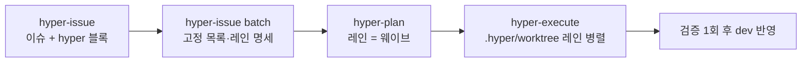

# Hypercore Agent Skills

<p align="center">
  
</p>

> Claude Code · Codex · Cursor · Antigravity에서 그대로 쓰는 한국어 우선 AI 에이전트 스킬 모음.

Hypercore는 코드베이스 분석부터 릴리스까지의 반복 작업을 한 번에 줄여주는 31개 스킬을 한 패키지로 제공합니다. 각 스킬은 트리거, 워크플로, 검증 게이트가 명시되어 있어 어떤 CLI에서 호출해도 같은 의도로 동작합니다.

- **설치 경로 두 가지**: 모든 런타임은 `npx skills`, Claude Code는 마켓플레이스 플러그인으로도 설치합니다. 한 환경에는 한 경로만 씁니다([선택 기준](#claude-code-플러그인-마켓플레이스)).
- **다중 CLI**: Claude Code, Codex, Cursor, Antigravity에서 동일하게 사용.
- **한국어 우선**: 모든 스킬에 한국어 사양이 정렬되어 있으며 영어 원본도 함께 유지.
- **검증 가능한 결과물**: 각 스킬은 evidence/validation/stop-condition 계약을 따라 결과를 남깁니다.

[Vercel Skills](https://github.com/vercel-labs/skills) 구조 위에 만들어졌습니다.

## 호환성

Hypercore의 표준 설치·관리 경로는 [Vercel Skills CLI](https://github.com/vercel-labs/skills)의 원격 소스 규약입니다. Claude Code, Codex, Cursor 등 런타임 선택은 `npx skills`의 `--agent` 옵션으로 처리합니다. Claude Code만 쓴다면 저장소 자체가 마켓플레이스이므로 `/plugin` 설치도 가능합니다([Claude Code 플러그인](#claude-code-플러그인-마켓플레이스)). 저장소 루트의 `.codex-plugin/plugin.json`은 [awesome-codex-plugins](https://github.com/hashgraph-online/awesome-codex-plugins) 목록 등록용 Codex 플러그인 설명서이고, `.claude-plugin/`은 Claude Code 플러그인·마켓플레이스 설명서, `.cursor-plugin/plugin.json`은 Cursor 플러그인 설명서입니다. 세 설명서 모두 같은 `skills/`를 가리키며 다른 mirror adapter는 제공하지 않습니다.

omp, Horon, jcode는 `npx skills`의 agent 대상 표에 없어 `-a omp`처럼 이름을 주면 `Invalid agents`로 실패합니다. 이 셋은 같은 프로젝트 `.agents/skills`에 쓰는 `-a codex`로 설치하고, 전역 설치(`-g`) 대신 프로젝트 단위로 두는 편이 안전합니다.

| 런타임 | 설치 예시 | 비고 |
|---|---|---|
| Claude Code | `npx skills add alpoxdev/hypercore -a claude-code -g` | `-g` 생략 시 프로젝트 설치. 스킬 이름은 `/hyper-git` |
| Claude Code (플러그인) | `claude plugin marketplace add alpoxdev/hypercore` → `claude plugin install hypercore@alpoxdev` | 위와 택일. 스킬 이름은 `/hypercore:hyper-git` |
| Codex CLI | `npx skills add alpoxdev/hypercore -a codex -g` | project/global 모두 `.agents/skills` canonical 경로 사용 |
| Cursor | `npx skills add alpoxdev/hypercore -a cursor -g` | `npx skills` 표준 대상 |
| Cursor (플러그인) | 팀 marketplace: Dashboard → Plugins & MCPs → Add Marketplace → Import from Repo에 `https://github.com/alpoxdev/hypercore` 입력. 로컬 시험: 저장소를 `~/.cursor/plugins/local/hypercore`에 복사한 뒤 Developer: Reload Window | 위와 택일. 팀 marketplace는 Teams·Enterprise 요금제 전용. 로컬 폴더는 심링크가 아니라 복사본이어야 함(바깥을 가리키는 심링크는 건너뜀). Cursor Marketplace 공개 등록은 별도 심사 |
| omp | `npx skills add alpoxdev/hypercore -a codex` | `npx skills` 대상 표에 없어 `-a omp`는 `Invalid agents: omp`로 실패합니다. 프로젝트 `.agents/skills`에 설치하면 omp가 읽습니다(2026-11-10 omp 1대에서 프로젝트 사본 로딩 확인) |
| Horon | `npx skills add alpoxdev/hypercore -a codex` | omp와 같은 이유로 `-a codex`를 씁니다. 프로젝트 `.agents/skills` 사본을 Horon이 읽는 것을 확인했습니다(2026-11-10) |
| pi | `npx skills add alpoxdev/hypercore -a pi` | `npx skills` 표준 대상. 프로젝트 `.agents/skills`에 설치 |
| jcode | `npx skills add alpoxdev/hypercore -a codex` | omp·Horon과 같은 프로젝트 `.agents/skills` 경로. jcode의 로딩은 이 기기에 없어 미확인(`not_run`) |
| 기타 | `npx skills add alpoxdev/hypercore -g` | CLI가 지원하는 agent에 한함 |

스킬별 실행 호환은 아래 [스킬 카탈로그](#스킬-카탈로그)의 **호환** 컬럼 또는 각 `SKILL.md`의 `compatibility` 필드에서 확인합니다.

## Claude Code 플러그인 (마켓플레이스)

이 저장소는 `.claude-plugin/marketplace.json`으로 마켓플레이스 `alpoxdev`를 제공하고, 그 안의 플러그인 `hypercore`(`.claude-plugin/plugin.json`)가 루트의 `skills/`를 그대로 읽습니다(Claude Code 공식 문서 2026-11-09 기준).

```bash
claude plugin marketplace add alpoxdev/hypercore
claude plugin install hypercore@alpoxdev            # 기본 scope는 user. 프로젝트에 고정하려면 --scope project
claude plugin details hypercore                     # Skills (31) 확인
claude plugin update hypercore@alpoxdev
claude plugin uninstall hypercore@alpoxdev
claude plugin marketplace remove alpoxdev           # 마켓플레이스와 그 플러그인을 함께 제거
```

세션 안에서는 `/plugin marketplace add alpoxdev/hypercore`와 `/plugin install hypercore@alpoxdev`를 씁니다. 설치 뒤 스킬은 `/hypercore:<스킬>` 형식으로 호출하며, 플러그인을 켠 환경에서만 보입니다.

동작 규칙:

- **업데이트는 버전 단위입니다.** `plugin.json`이 `version`을 고정하므로 사용자는 그 문자열이 바뀐 릴리스에서만 새 사본을 받습니다. 서드파티 마켓플레이스의 자동 업데이트는 기본으로 꺼져 있으므로 `claude plugin marketplace update alpoxdev`로 카탈로그를 갱신한 뒤 `claude plugin update hypercore@alpoxdev`를 실행하거나, `/plugin`의 Marketplaces에서 auto-update를 켭니다. 업데이트는 재시작 후 적용됩니다.
- **버전의 정본은 `.claude-plugin/plugin.json`입니다.** `.codex-plugin/plugin.json`, `.cursor-plugin/plugin.json`과 같은 값이어야 하며(`bash scripts/check-plugin-manifests.sh`가 검사) 마켓플레이스 항목에는 `version`을 쓰지 않습니다.
- **플러그인 사본에 `skills/` 외 파일도 들어갑니다.** 마켓플레이스 항목의 source가 저장소 루트(`./`)라서 `instructions/`, `scripts/` 등 추적 파일 전체(약 17MB)가 캐시에 복사됩니다. Claude Code에는 제외 목록 기능이 없고, 로드되는 구성 요소는 `skills/`뿐입니다.

### `npx skills`와 플러그인 중 하나만 고르기

두 경로를 함께 설치하면 같은 스킬이 `/hyper-git`와 `/hypercore:hyper-git`로 두 번 로드됩니다. 이름 충돌로 실패하지는 않지만 스킬 목록과 description이 두 벌 실려 컨텍스트를 두 배로 쓰고(플러그인만 켜도 항상 실리는 분량이 약 4.1k 토큰으로 측정됨), 업데이트 경로가 둘이라 버전이 어긋날 수 있습니다.

| 상황 | 권장 경로 |
|---|---|
| Claude Code만 쓰고 버전 단위 업데이트·제거를 `claude plugin`으로 관리하고 싶다 | 플러그인 |
| Codex, Cursor, Antigravity도 함께 쓰거나 같은 설치를 여러 agent에 맞추고 싶다 | `npx skills` |
| 스킬 일부만 고르거나(`--skill hyper-git`) 프로젝트마다 다르게 설치하고 싶다 | `npx skills` (플러그인은 스킬 31개를 통째로 설치) |
| 스킬을 `/hyper-git`처럼 접두어 없이 부르고 싶다 | `npx skills` |

한 경로에서 다른 경로로 옮길 때는 먼저 기존 설치를 제거합니다. `npx skills`에서 플러그인으로 옮기려면 아래 [설치 및 수명주기](#설치-및-수명주기)의 `remove`로 hypercore 스킬을 지운 뒤 위 플러그인 명령을 실행합니다. 플러그인에서 `npx skills`로 옮기려면 `claude plugin uninstall hypercore@alpoxdev`를 실행한 뒤 아래 설치 절차를 따릅니다.

## 설치 및 수명주기

모든 스킬을 사용자 전역에 설치 (`--skill '*'`가 스킬 전체 선택. agent를 지정하지 않고 `-y`를 주면 대상은 순서대로 정해집니다. agent 안에서 실행하면 그 agent와 universal agent, Eve가 설치돼 있으면 Eve만, 감지된 agent가 없으면 CLI가 아는 agent 전체, 그 밖에는 감지된 agent와 universal agent입니다. 특정 agent만 원하면 `-a`로 지정합니다):

```bash
npx skills add alpoxdev/hypercore --skill '*' -g -y
```

스킬과 agent 두 축을 각각 고를 수 있고, 둘 다 와일드카드(`'*'`)와 이름 나열을 받습니다:

```bash
npx skills add alpoxdev/hypercore --skill '*' -a claude-code codex -g -y   # 모든 스킬 → 지정 agent
npx skills add alpoxdev/hypercore --skill hyper-git hyper-documentation -g -y     # 스킬 여러 개 나열
npx skills add alpoxdev/hypercore --all -g                                 # 모든 스킬 → 모든 agent
```

`--all`은 `--skill '*' --agent '*' -y`의 축약형입니다. 스킬 전체 설치가 목적이라면 `--skill '*'`를 쓰세요 — `--all`은 agent 감지를 무시하고 CLI가 아는 agent 전체(2026-11-04 기준 79개)를 대상으로 삼아, 쓰지 않는 agent의 홈 디렉터리까지 만들고 전역 설치를 지원하지 않는 agent(Eve, PromptScript)에는 실패 줄만 남깁니다.

`-g`/`--global`을 생략하면 현재 프로젝트에만 설치됩니다. `--copy`는 설치 시 독립 복사본을 만들며, 생략 시 CLI가 대상 조합에 따라 canonical copy 또는 symlink를 선택합니다.

`remove`도 `--all`을 받습니다 — 전역 스킬 전체를 지우려면 `npx skills remove --all -g`입니다. 주의: `remove --all`은 `-y`를 포함하므로 확인 프롬프트 없이 바로 지웁니다(2026-11-04 `vercel-labs/skills` 소스 기준). 스킬 이름과 함께 쓰면 거부되고, `remove`의 `-a`는 `'*'`를 받지 않으니 agent는 이름으로 지정합니다.

설치 후에는 같은 CLI로 전체 수명주기를 관리합니다:

```bash
npx skills list -g
npx skills update -g
npx skills remove hyper-git -g
npx skills use alpoxdev/hypercore --skill hyper-git
npx skills find hypercore --owner alpoxdev
npx skills init my-skill
```

`update`는 원격 source 정보가 기록된 lock에 의존합니다. 로컬 경로로 설치한 항목은 lock에 `sourceType: local`로 남아 `update`가 건너뛰고, 수동 복사에는 lock 항목 자체가 없으므로, `update`로 관리하려면 아래처럼 원격 source로 다시 설치해야 합니다. Claude Code 플러그인은 이 lock과 무관하게 `claude plugin update`로 관리합니다. `remove`는 lock이 없어도 설치 디렉터리를 찾아 지웁니다(2026-11-04 `vercel-labs/skills` 소스 기준).

### 수동 복사 또는 lock 없는 설치 마이그레이션

1. 기존 스킬을 백업하고 수동으로 복사한 스킬 디렉터리나 다른 경로(Claude Code 플러그인 포함)의 설치를 제거합니다.
2. 실제 원격 source를 지정해 원하는 scope와 agent로 다시 설치합니다.
3. `npx skills list -g --json`과 project `skills-lock.json` 또는 global `.skill-lock.json`에서 source가 `alpoxdev/hypercore`인지 확인합니다.
4. 이후 `update`와 `remove`를 실행합니다.

```bash
npx skills add alpoxdev/hypercore -a codex --skill '*' -g -y
npx skills list -g --json
npx skills update -g
```

Codex는 universal agent이므로 project에서는 `<cwd>/.agents/skills`, global에서는 `$HOME/.agents/skills`가 canonical 설치 경로입니다. `$CODEX_HOME/skills`는 primary 설치/list 경로가 아닙니다. Claude+Codex를 함께 설치할 때 Codex는 canonical 경로를 사용하고 Claude 경로에는 CLI가 symlink를 만들 수 있습니다.

`skills` lock은 `--copy` 설치 방식을 기록하고 `update`는 그 방식을 그대로 복원합니다(2026-11-04 `vercel-labs/skills` 소스 기준). 전역 lock은 마지막으로 고른 agent 집합도 기록하지만 이는 다음 `add`의 기본 선택값일 뿐이므로, `update`가 원래 agent 조합 전체를 보존한다고 보장하지는 않습니다. 특정 topology가 필요하면 같은 remote source를 원하는 옵션으로 다시 `add`하세요. 부분 `remove` 뒤 provenance 보존도 보장하지 않습니다. 일부 agent만 제거해 남은 파일이 있더라도 계속 update 관리하려면 remote source로 다시 설치해야 합니다.

### 소스에서 직접 사용

레포를 클론해 그대로 가져다 써도 됩니다 (스킬에는 빌드 단계가 없습니다. 마크다운 문서와 bash 스크립트, 그리고 HTML·CSS·JSON 같은 정적 asset과 eval fixture를 그대로 씁니다):

```bash
git clone https://github.com/alpoxdev/hypercore.git
# 원하는 스킬 디렉터리를 자신의 프로젝트로 복사
cp -R hypercore/skills/hyper-git your-project/.claude/skills/
```

## 빠른 사용 예시

설치 후 자연어로 호출하거나 슬래시 명령으로 시작합니다.

```text
/hyper-git            # 변경 사항을 그룹별로 커밋하고 푸시까지 한 번에 (worktree·issue·workflow 모드도 포함)
/hyper-documentation  # README·AGENTS.md·런북·규칙 팩·재사용 프롬프트 중 요청한 문서를 골라 생성/리팩터 (CLAUDE.md는 만들지 않음)
/hyper "<작업>"         # 상황에 맞는 hyper 스킬 체인(리서치·아키텍처·계획·실행 등)을 골라 처음부터 끝까지 실행
/hyper-research "<주제>"  # 출처가 있는 다중 소스 리서치 보고서
/hyper-plan "<작업>"    # 결정이 끝난 작업 계획을 쓰고 기본으로 hyper-execute까지 이어서 실행
/hyper-debate "<작업>"  # 대립형 계획을 명시적으로 요청했을 때만 다섯 관점·세 라운드 토론 뒤 승인 한 번으로 계획 작성
/hyper-execute <slug>  # .hyper/plans 계획을 웨이브별 worktree에서 검증하며 실행
/hyper-mass "<작업>"    # 의존성이 있는 하위 작업을 단계별 DAG로 병렬 실행
/hyper-mcp "<작업>"     # MCP 서버·클라이언트 구축, 점검·수정, 새 판 이전, 호스트 연결, 레지스트리 준비를 검증까지
/hyper-decision "<작업>" # 타입 판단을 돌려주는 decision API의 질문·호출 코드·평가·감사·경로 설정을 방언별 검사기로 확인
/hyper-database "<작업>" # 엔진을 감지해 스키마 설계·무중단 마이그레이션·쿼리·인덱스 튜닝·엔진 선택·DBA 운영을 근거 게이트로 검증
/hyper-design "<작업>"   # AI 티 없는 화면 디자인·리디자인·연출 화면(mockup)과 generic 패턴 점검·정리를 정석 수치와 독립 검토로 검증
/hyper-browsing "<대상>"  # 403·WAF·챌린지·JavaScript·사라진 페이지처럼 평범한 요청으로 안 열리는 페이지 내용을 단계 사다리로 가져오고 출처·종료 상태까지 기록
/hyper-frontend "<작업>" # 웹 프런트엔드 구현·수정·레퍼런스 맞춤·브라우저 점검을 스크롤 소유권, 상태 매트릭스, 렌더링 증거 라벨로 검증
/hyper-prd "<아이디어>"  # 웹·iOS·Android·데스크톱 PRD를 `prd.md` 한 파일로, 규모별 질문 상한과 테스트 가능한 요구사항까지
/hyper-deploy "<작업>"   # Railway·Cloudflare·Docker·Compose·VPS 배포 전 점검·첫 설정·배포·설정 변경·실패 진단과 수정을 플랫폼 최종 상태로 검증
/hyper-google-analytics "<작업>"  # GA4 점검·탑재·속성 설정·데이터 분석·수집 진단을 네트워크 요청과 read-back으로 검증
/hyper-google-tagmanager "<작업>"  # GTM 점검·사이트 탑재·컨테이너 설정·발화 검증·추적 오류 진단·데이터 분석을 요청 증거와 게시 승인 게이트로 처리
/hyper-diagram "<대상>"  # 구조도·플로차트·시퀀스·ERD·상태·클래스·트리·마인드맵·타임라인·일정표·계층 구조를 자동 배치 HTML+JPG(요청 시 1쪽 PDF)로 그리고 겹침·잘림 검사까지
/hyper-data "<질문>"    # CSV·Parquet·JSON·내보내기 데이터셋을 설치된 엔진(DuckDB·Polars)으로 계산해 답부터 쓰고, 쿼리·행 수·소요 시간·입력 digest까지 기록
/hyper-loop "<목표들>"  # 서로 의존하는 여러 목표를 기준별 증거와 작업 트리 지문으로 묶어 끝까지 실행, 코드가 바뀌면 증거를 stale로 표시하고 최종 게이트로 마감
/hyper-debug "<실패>"    # 스택 트레이스·실패하는 테스트·크래시·가끔 실패하는 테스트를 재현하고 토글로 원인을 증명, 요청하면 최소 수정까지
/hyper-review "<대상>"  # 지정한 diff·브랜치·PR·작업 트리를 리뷰하고 통과·실패·판정 불가로 판정. 기본은 파일을 고치지 않고, 수정까지 요청할 때만 블로커를 고침
/hyper-cleanup "<작업>"  # 동작을 바꾸지 않고 코드·테스트·주석의 군더더기를 분류해 삭제·재사용·플랫폼·제자리 단순화 사다리로 정리하고, 지운 테스트마다 복원한 변이로 증명
```

자연어로도 트리거됩니다 — 예: "이 프로젝트 README 다시 써줘"·"이 저장소에 맞는 AGENTS.md 만들어줘" → `hyper-documentation`, "방금 변경 사항 커밋하고 푸시"·"이슈 42로 워크트리 만들어줘"·"dev, main에 머지하고 푸시" → `hyper-git`.

## hyper 사용법

`hyper`는 작업만 말하면 필요한 단계 스킬을 골라 순서대로 실행하는 진입점입니다. 실행하면 먼저 `워크플로: <단계> -> ...` 한 줄로 고른 체인과 근거를 보여 주고, 진행 기록을 `.hyper/workflows/<slug>.md`에 남깁니다.

### 자주 쓰는 체인

| 요청 예 | 체인 |
|---|---|
| "결제 재시도 기능 추가해줘" | `hyper-plan` -> `hyper-execute` |
| "폴더 구조 리팩토링해줘" | `hyper-architecture` -> `hyper-plan` -> `hyper-execute` |
| "상태관리 라이브러리 비교해서 적용까지" | `hyper-research` -> `hyper-plan` -> `hyper-execute` |
| "이 버그들 이슈로 등록해줘" | `hyper-issue` -> `hyper-plan` -> `hyper-execute` (등록부터 레인 작업까지 자동) |
| "이 버그 이슈 등록만 해줘" | `hyper-issue` |
| "label:bug 이슈들 배치로 돌려줘" | `hyper-issue` -> `hyper-plan` -> `hyper-execute` |
| "스킬 만들고 dev에 머지·푸시" | `hyper-skill` -> `hyper-git` |
| "결제 버그 고치고 staging에 배포까지" | `hyper-plan` -> `hyper-execute` -> `hyper-deploy` |
| "배포 실패했어, 로그 보고 고쳐줘" | `hyper-deploy` |
| "라벨만 돌려주는 GPT 호출을 결정 모델로 바꿀 질문과 호출 코드" | `hyper-decision` |
| "고객사 피드백 반영하고 dev, main에 머지·푸시" | `hyper-feedback` -> `hyper-git` (큰 항목이 있으면 `hyper-feedback` -> `hyper-plan` -> `hyper-execute`) |
| "표가 길어지면 푸터가 밀려나, 본문만 스크롤되게 고쳐줘" | `hyper-frontend` (새 모습까지 정해야 하면 `hyper-design` -> `hyper-frontend`) |
| "사이트에 GA4 달아줘" | `hyper-google-analytics` (GA4 달고 dev에 머지·푸시 → `hyper-google-analytics` -> `hyper-git`) |
| "사이트에 GTM 달고 구매 이벤트 태그까지" | `hyper-google-tagmanager` (GA4 속성 설정까지 바꾸면 `hyper-google-analytics` -> `hyper-google-tagmanager`) |
| "이 CSV에서 지역별 매출 집계해줘" | `hyper-data` |
| "이 목표 세 개 다 끝날 때까지 돌려줘" | `hyper-loop` (머지·푸시까지면 `hyper-loop` -> `hyper-git`) |
| "이 테스트 가끔 실패하는데 원인 찾아서 고쳐줘" | `hyper-debug` (수정이 여러 파일에 걸치면 `hyper-debug` -> `hyper-plan` -> `hyper-execute`) |
| "이 브랜치 변경만 리뷰해줘. 고치지는 말고 판정만" | `hyper-review` (수정까지 요청하면 `review-and-fix`) |
| "src/pricing/ 군더더기랑 죽은 코드 정리해줘, 동작은 그대로" | `hyper-cleanup` (전달까지면 `hyper-cleanup` -> `hyper-git`) |

### 전달 방식

| 말하는 법 | 결과 |
|---|---|
| (아무 말 없음) | 로컬 반영만, 푸시 없음 |
| "PR까지" / `--make-pr` | 웨이브별 PR 생성, 병합은 하지 않음 |
| "머지까지" / `--ship` | PR 생성 후 CI 확인, 병합까지 |
| "계획만" / `--plan-only` | 계획 파일만 쓰고 멈춤 |
| "이어서" | 현재 브랜치에 맞는 열린 이어받기 메모(`.hyper/handoff/`)가 있으면 먼저 읽고, 마지막으로 멈춘 단계부터 재개 |

### 이슈 배치 흐름

여러 작업을 한 번에 처리할 때는 이슈를 먼저 남기고 배치로 돌립니다. `hyper`에 "이슈로 등록해줘"라고 하거나 `hyper-issue #1~3`처럼 이슈 번호를 적으면 등록(또는 번호 읽기), 레인 나누기, 레인별 작업까지 한 번에 진행합니다. 작업 없이 기록이나 명세만 원하면 "등록만", "레인만"이라고 말합니다.



- 이슈 제목과 본문은 새 세션의 에이전트가 읽기 쉽도록 커밋 메시지처럼 영어로 씁니다. 실행 보고와 배치 명세는 한국어입니다.
- 이슈 본문 `## Scope`의 `hyper:` 블록(`touches`, `depends_on`, `conflicts_with`, `verify`)으로 겹침을 판정하므로 배치 때 코드를 다시 조사하지 않습니다.
- 같은 파일을 쓰는 이슈는 한 레인에서 순서대로, 서로 겹치지 않는 레인만 병렬로 실행합니다(기본 최대 4개).
- 워크트리는 저장소 안 `.hyper/worktree/`에 만들고, `.hyper/`가 `.gitignore`에 없으면 먼저 추가합니다.
- 반영 방식은 기본 `merge`이며, 선형 이력이 필요하면 `--land cherry-pick`을 씁니다.
- 서로 다른 파일을 건드리는 작업이 3건 이상일 때 배치가 이득입니다. 1~2건이면 `hyper-plan` 한 번이 더 쌉니다.

## 스킬 카탈로그

용도별 분류입니다. 같은 스킬이 둘 이상의 그룹에 어울릴 수 있습니다.

### 스킬·문서 작성

| 스킬 | 설명 | 호환 |
|------|------|------|
| `hyper-skill` | 유지보수하기 쉬운 Codex/AI 에이전트 스킬 생성 및 리팩터링 | All |
| `hyper-documentation` | 요청한 산출물에 맞춰 다섯 모드 중 하나로 작업: `readme`(코드베이스 기반 README), `agents-md`(영어 `AGENTS.md` + 한국어 `AGENTS.ko.md`, `CLAUDE.md`는 만들지 않음), `prompt`(재사용 프롬프트·템플릿/팩·eval 픽스처), `docs`(AI가 읽기 좋은 문서·런북·룰 팩), `memory`(에이전트 메모리 파일: 색인·주제 파일 구조, 크기 예산, 저장 금지 항목, 갱신·만료·삭제 규칙) | All |
| `hyper-prd` | 웹·iOS·Android·데스크톱 PRD를 `prd.md` 한 파일로 작성·갱신·검토 — 규모별 질문 상한, EARS 테스트 가능한 요구사항, 인수 시나리오, 핸드오프 블록 | All |

### 아키텍처 가드

| 스킬 | 설명 | 호환 |
|------|------|------|
| `hyper-architecture` | 저장소의 스택(Next.js, TanStack Start, Vite + TanStack Router, Astro, Expo, Lynx, Hono, Axum, Tauri, Electron, Rust CLI·WASM·MCP 서버)을 감지해 같은 스킬 안의 스택별 가이드(`stacks/<스택>/core.md`)로 아키텍처를 잡고, 언어별 공통 셋업(oxlint·Prettier, rustfmt·clippy)과 스택별 성능 규칙을 측정 기반으로 적용 | All; 번들 검증 스크립트는 bash 3.2+ & jq 1.6+ |

### 빌드 · 배포 · 릴리스

| 스킬 | 설명 | 호환 |
|------|------|------|
| `hyper-deploy` | 저장소 파일로 배포 대상(Railway, Cloudflare Workers, Docker 이미지, docker-compose, VPS·Kamal·Coolify·Dokploy)을 감지해 같은 스킬 안의 대상별 가이드로 배포 전 lint·타입·빌드 점검, 첫 배포 설정, 배포, 설정 변경, 실패한 배포의 로그 진단·수정·재배포를 처리. 성공은 플랫폼의 최종 상태와 헬스 체크로만 판정하고, 프로덕션 롤백·데이터·삭제·비용·DNS·방화벽 변경은 명시 승인 후에만 실행하며 `.hyper/deploy/` 보고서까지 저장 | 점검 스크립트는 Node.js·Rust·Python 툴체인과 bash 3.2+ & jq 1.6+; 배포는 대상 CLI(railway, wrangler·cf, docker·compose·buildx, kamal·ssh)와 환경 변수 자격 증명 |

### Git 워크플로

| 스킬 | 설명 | 호환 |
|------|------|------|
| `hyper-git` | Git 작업을 네 모드로 처리: `commit`(논리 단위 커밋 + 자동 푸시 + `&& <branch>` 전파), `worktree`(`.hyper/worktree/<이름>` 생성·진입·정리·복구), `issue`(`gh issue` 조회·등록·댓글·종료, 이슈에서 브랜치·워크트리 생성), `workflow`(브랜치 전략 제안, PR 생성, 지정 브랜치 병합 후 푸시). 게시·보호 브랜치 병합은 사용자가 요청할 때만 | bash 3.2+ & git; issue·workflow 모드는 인증된 `gh` |

### 계획 · 실행 오케스트레이션

| 스킬 | 설명 | 호환 |
|------|------|------|
| `hyper` | 작업만 말하면 hyper-research·hyper-issue·hyper-seo·hyper-google-analytics·hyper-google-tagmanager·hyper-architecture·hyper-database·hyper-mcp·hyper-decision·hyper-design·hyper-frontend·hyper-feedback·hyper-debug·hyper-review·hyper-cleanup·hyper-data·hyper-handoff·hyper-imagegen·hyper-plan·hyper-debate·hyper-execute·hyper-mass·hyper-loop·hyper-skill·hyper-documentation·hyper-git·hyper-deploy 중 필요한 것만 골라 체인을 짜고 처음부터 끝까지 실행(예: 리팩토링 → architecture → plan → execute, 스킬 만들기 → research → skill, 스킬 만들고 머지·푸시 → skill → git, 런북 정리 → documentation, MCP 서버 만들기 → mcp, 화면 디자인 → design, 레이아웃·상태 버그 수정 → frontend, 고객·기획자 변경 요청 → feedback(큰 항목은 → plan), 실패 원인 찾기 → debug(여러 파일 수정은 → plan), 여러 목표 끝까지 → loop, 데이터셋 질문 → data, 이어받기 메모 → handoff, 스키마 설계 → database, 이미지 한 장 → imagegen, 이슈 배치 → issue → plan → execute, 인터넷 검색 리서치 → research(막힌 출처는 hyper-browsing 동반), 기능 고치고 배포 → plan → execute → deploy, 배포 실패 고치기 → deploy) | 스킬 불러오기 필요; 단계별 요구 사항 따름 |
| `hyper-plan` | 탐색 후 결정이 끝난 작업 계획(`.hyper/plans/`)을 쓰고, 사용자가 막지 않으면 실행 단계로 자동 연결 | All |
| `hyper-debate` | 사용자가 대립형 계획을 직접 요청했을 때만 다섯 고정 관점(회의론·검증자·조사자·설계자·창의)이 세 라운드(발견→공격·유지→방어·정련·철회)로 계획의 전제를 따지고, `.hyper/debate/<slug>/` 영수증에 근거와 판정을 남긴 뒤 통찰 묶음 한 번의 승인으로 살아남은 발견만 `.hyper/plans/<slug>.md` 결정 완료 계획으로 씁니다. 하위 에이전트가 없으면 순차 실행으로 줄어든 사실을 보고합니다 | All; 병렬 하위 에이전트 선택(Sources) |
| `hyper-execute` | 계획의 체크박스를 웨이브별 worktree에서 위임·검증·병합하며 끝까지 실행, 선택적 PR 전달 | git worktree; 하위 에이전트 선택 |
| `hyper-issue` | 확정된 발견이나 결정된 작업을 새 세션 에이전트가 읽는 영어 이슈로 등록하고, 열린 이슈 묶음이나 `#1~3` 같은 번호를 서로 겹치지 않는 작업 레인으로 묶어 배치 매니페스트 생성. 작업까지 원하면 `hyper`에 넘겨 레인별로 실행(스킬 자체는 구현하지 않음) | 인증된 이슈 트래커 CLI(`gh`); 쓰기 권한이 없으면 본문을 디스크에 초안으로 남김; 레인 실행에는 `hyper` 스킬 |
| `hyper-mass` | 의존 순서가 있는 하위 작업을 그래프로 정의해 단계별 병렬 실행, 재시도·수정·재개 지원 | All |
| `hyper-loop` | 서로 의존하는 여러 목표를 `.hyper/loop/`의 목표·장부·최종 게이트로 끝까지 실행. 기준마다 증거를 git tree·diff 해시·미추적 파일 지문에 묶어 코드가 바뀌면 stale로 표시하고, 같은 실패 3회면 멈추며, 모든 기준이 새 증거로 덮였을 때만 완료. 푸시·병합·PR은 하지 않음 | bash 3.2+ & jq 1.6+ & git |
| `hyper-handoff` | 컨텍스트가 차거나 세션·에이전트·머신이 바뀔 때 긴 대화 대신 `.hyper/handoff/<slug>/memo.md` 한 장으로 이어서 일하게 함. 메모에 사용자의 원 요청을 그대로, 지금 하는 일과 이유, 끝난 일(검증 증거 또는 unverified), 다음 단계, 계획과 완료 조건, 위치, 작성 시점의 HEAD와 미커밋 파일 수를 담고, 대화를 못 본 읽는 쪽이 고정된 여섯 질문에 메모만으로 답하는지 확인(보완 최대 2회). 새 세션은 메모만 읽고 세 줄로 되풀이한 뒤 저장소 상태로 검증하고 이어받음. 메모 내용은 증거일 뿐 권한이 아니어서 푸시·배포·삭제 같은 동작은 지금 세션의 사용자 지시가 있을 때만 진행. 메모 경로는 git 무시 대상이라 푸시로 옮겨지지 않음. 비밀 값은 쓰지 않음 | 파일 읽기·쓰기와 셸; 읽는 쪽으로 하위 에이전트 선택(없으면 자체 점검으로 기록) |

### 리서치 · 디버깅 · QA

| 스킬 | 설명 | 호환 |
|------|------|------|
| `hyper-data` | CSV·Parquet·JSON·스프레드시트·DB 내보내기 데이터셋에 대한 질문을 계산해서 답함. 먼저 설치된 엔진(DuckDB·Polars·pyarrow·matplotlib)을 탐지하고 없으면 설치하지 않고 전제 조건으로 보고, 여유 메모리 기준으로 한 번에 읽을지 스트리밍·제자리 쿼리를 할지 정하며, 요청한 것만 답하고 차트는 요청할 때만 시간대·부분 구간·CJK 글꼴을 확인해 그림. `.hyper/data/` 보고서에 답, 쿼리, 행 수, 소요 시간, 입력 digest 저장 | bash 3.2+ & jq; 계산은 Python의 duckdb·polars 또는 `duckdb` CLI |
| `hyper-research` | 질문을 축으로 나눠 확장 웨이브로 수렴시키고, 고위험 주장을 게이트로 검증한 다중 출처 마크다운 리서치 보고서. 평범한 요청으로 안 열리는 출처는 막힌 페이지 접근 기능(예: `hyper-browsing`)으로 열고 출처 표시를 남김 | All |
| `hyper-browsing` | 평범한 요청으로 안 열리는 페이지의 내용을 tier 0 공식 엔드포인트 → 1 헤드리스 요청 격자 → 2 아카이브 사본 → 3 자체 브라우저 → 4 연결 브라우저 순서로 가져오고, HTTP 200을 성공으로 보지 않는 네 증명 층과 출처 표시(`live`·`api`·`reader`·`snapshot`·`rendered`)로 검증해 `.hyper/browsing/` 보고서에 시도 기록과 다이제스트를 남김. 로그인 벽·유료 벽·CAPTCHA 풀이·쿠키 복사·프록시는 사용자가 요청해도 경계를 보고 | curl 셸; jq·curl_cffi·yt-dlp·브라우저 자동화는 선택(없으면 해당 tier `skipped`) |
| `hyper-feedback` | 사용자·고객사·기획자의 변경 요청(피드백, 불만, 티켓, 회의 메모, 문구)을 원자 항목으로 나누고, 복제본·로케일·다른 채널·테스트·문서까지 9개 영향 위치 점검표로 수정할 곳을 모두 찾아 바로 반영·검증. 해석이 크게 갈리거나 되돌릴 수 없는 변경일 때만 묻고, 스키마·라우트·API 계약처럼 직접 수정 범위를 넘는 항목은 `.hyper/feedback/`에 브리프로 남김 | All |
| `hyper-debug` | 스택 트레이스·실패하는 테스트·크래시·잘못된 출력·가끔 실패하는 테스트를 가장 작은 재현부터 잡고, 서로 다른 축의 가설 2개 이상을 구별하는 관찰로 좁혀 원인을 토글(넣으면 실패, 빼면 통과)로 증명. 요청하면 빨강→초록 순서로 최소 수정, 넣었던 계측은 모두 제거. 재시도 래퍼·sleep 늘리기·격리·테스트 삭제는 금지 수정으로 막고 `.hyper/debug/` 기록 저장 | All |
| `hyper-review` | 이미 있는 변경(diff·커밋 범위·브랜치·PR·작업 트리)을 리뷰하고 판정함. 리더가 실제 표면에서 QA 매트릭스를 채우고 독립 읽기 전용 리뷰어 한 명이 여덟 항목 루브릭·테스트 품질 게이트·냄새 트리거를 적용하며, 판정을 내용 정체성(`HEAD`+diff·미추적 파일 SHA-256)에 묶어 이후 변경을 stale로 표시. 기본은 파일을 고치지 않고, 명시적으로 요청할 때만 확인된 블로커를 수정. `.hyper/review/` 보고서 저장 | All |
| `hyper-cleanup` | 이미 동작하는 코드의 동작 보존 정리. 아홉 가지 슬롭 분류와 분류별 KEEP 예외로 후보를 이름 붙이고, 삭제·재사용·플랫폼·제자리 단순화 사다리에 배치하며, 첫 수정 전에 기준 명령으로 동작을 잠그고, 지운 테스트나 합친 테스트마다 소스 변이를 넣어 판정한 뒤 SHA-256으로 바이트 동일 복원을 확인. `.hyper/cleanup/` 보고서를 `Result:` 줄로 마감 | bash 3.2+ & jq; 변이 증명은 `shasum` |
| `hyper-design` | 새 화면 디자인, 기존 UI 리디자인, 히어로·데모용 연출 화면(mockup), AI형 generic 패턴 점검·정리를 디자인 브리프·생동감 다이얼→정석 수치(WCAG 2.2·플랫폼·KRDS)와 대비 계산→정적 검출기→독립 검토→증거 기반 납품 게이트 순서로 처리하고 `.hyper/design/`에 브리프와 보고서 저장 | Bash 3.2+ & jq 1.6+; browser optional |
| `hyper-frontend` | 웹 프런트엔드 구현·수정·스크린샷·라이브 페이지 맞춤·실제 브라우저 점검. 스크롤 소유권 이름 붙이기→상태 매트릭스→모션 목적 지도와 reduced-motion→캡처 매트릭스에서 `static`·`rendered`·`not verified` 증거 라벨 순서로 처리하고 `.hyper/frontend/`에 보고서 저장. 시각 방향·감사는 `hyper-design` | 브라우저 optional |

### 콘텐츠 · SEO

| 스킬 | 설명 | 호환 |
|------|------|------|
| `hyper-seo` | SEO / AEO / GEO / LLMO 통합 감사와 최적화 리포트, 점수 개선 루프, 새 홈페이지 출시 세팅 계획(검색·AI 크롤러 정책·등록·측정) | All |
| `hyper-google-analytics` | GA4 점검·탑재·속성 설정·Data API 분석·수집 진단을 코드·실제 `/g/collect` 요청·속성 read-back으로 검증하고, 영구적인 필터·보존 변경은 승인 뒤에 두며 `.hyper/google-analytics/` 보고서까지 저장 | bash 3.2+ & curl; Data·Admin API는 `analytics.readonly`/`analytics.edit` 자격 증명 |
| `hyper-google-tagmanager` | Google Tag Manager를 웹사이트에 탑재(현재 공식 스니펫, Next.js·Nuxt·Astro·SvelteKit·Vite·WordPress 등 프레임워크별 위치, SPA page_view, CSP nonce, 동의 기본값 순서)하고, 저장소·서버 응답 페이지·컨테이너 내보내기 JSON을 번들 스크립트 3개로 점검하며, dataLayer·태그·트리거·변수·이커머스·Consent Mode v2 설정, Preview·네트워크 요청으로 발화 검증, 중복 집계·동의 순서·빈 컨테이너 같은 오류 진단, 컨테이너 상태와 GA4 수신 데이터 분석까지 처리. 컨테이너 게시·삭제·권한·라이브 동의 변경은 명시 승인 후에만 실행하고 `.hyper/gtm/` 보고서 저장 | bash 3.2+ & jq 1.6+ & curl; 렌더링 검증은 브라우저 자동화, 컨테이너 API는 사용자가 준 자격 증명 |
| `hyper-imagegen` | 관찰된 이미지 기능으로 이미지를 생성하고, 미지원 환경에서는 실행 가능한 프롬프트를 안전하게 저장 | Capability-based |
| `hyper-diagram` | 어떤 구조든 타입(architecture·flowchart·dataflow·sequence·state·erd·class·tree·mindmap·timeline·gantt·layers)을 골라 JSON spec으로 쓰면 ELK 자동 배치·종류별 색·자동 범례·밝게/어둡게 전환이 있는 단독 HTML과 2배 JPG를 만들고, 요청하면 1쪽 벡터 PDF까지. 노드 겹침·글자 넘침·선이 상자를 지나는지·PDF 쪽수를 검사하고 JPG를 직접 본 뒤 전달 | bash 3.2+ & jq; Chromium 계열 브라우저(Playwright headless shell 등); 그래프 타입은 elkjs 0.12.1을 처음 한 번 내려받아 SHA-256 확인 |

### 도메인 도구

| 스킬 | 설명 | 호환 |
|------|------|------|
| `hyper-database` | 저장소에서 DB 엔진(PostgreSQL, MySQL/MariaDB, SQLite, Redis, Valkey, MongoDB, DynamoDB, Cassandra/ScyllaDB, 분산·서버리스 SQL)을 감지해 같은 스킬 안의 엔진별 가이드로 데이터 모델·스키마 설계, 무중단 마이그레이션, 쿼리·인덱스 튜닝, 엔진 선택, DBA 운영(백업·복구, 복제·장애 조치, 커넥션 풀, 보안, 업그레이드, 모니터링)을 처리하고 `.hyper/database/` 보고서까지 저장 | bash 3.2+ & jq 1.6+(감지 스크립트); 실행 검증은 엔진 클라이언트·일회용 DB |
| `hyper-mcp` | MCP(Model Context Protocol) 서버·클라이언트 구축, 보안·규격 점검과 수정, 2026-07-28 판 이전, 호스트 MCP 설정 연결, 레지스트리 메타데이터 준비를 MCP Inspector 검증과 `.hyper/mcp/` 보고서까지 처리 | 대상 언어 도구 모음; MCP Inspector는 Node.js 22.19+ |
| `hyper-decision` | 글 대신 타입 판단(예/아니오 확률, 선택, 점수, 이미지 상자)을 돌려주는 decision API(TypeSafe Jev, OpenAI Decisions, Perplexity, Liquid, Cloudflare Clef, Vercel AI SDK·AI Gateway, OpenRouter, 범용 LLM 에뮬레이션)용 적합성 판정, 방언별 질문, 호출 코드, 요청 템플릿, 평가 계획, 라벨 전용 LLM 호출 감사, 경로 설정. 경로를 네 층으로 나눠 확률을 돌려주는지 밝히고 방언별 오프라인 요청 검사기로 확인 | bash 3.2+ · jq (선택); 네트워크와 API 키는 승인된 실호출에만 |

총 31개 스킬. 기획·마케팅·비즈니스용 스킬(blog-maker, instagram-card-maker, korean-writer, storyboard-maker, tone-manner-maker)은 [Hypercore Business](https://github.com/alpoxdev/hypercore-business)로 옮겼습니다. 새 스킬은 `skills/<이름>/` 디렉터리를 추가하기만 하면 됩니다 — 자세한 형태는 [스킬 만들기](#스킬-만들기) 참고.

## 시나리오 예시

**1) 기존 프로젝트의 README가 오래됐을 때**

```text
이 저장소를 꼼꼼히 읽고 README를 다시 써줘
```

`hyper-documentation`의 `readme` 모드가 매니페스트, 진입점, 스크립트, 라이선스, 기존 문서를 스캔해 프로젝트 형태(CLI/라이브러리/플러그인 등)에 맞는 섹션을 골라 작성합니다. 명령·API를 지어내지 않고, 모르는 부분은 `<!-- TODO -->`로 표시합니다.

**2) 모은 변경사항을 안전하게 출고**

```text
/hyper-git ALL
```

변경을 논리 단위로 묶어 Conventional Commit으로 나눠 커밋하고, 모든 커밋이 성공한 뒤에만 자동으로 푸시합니다. `main`/`master`에 대한 force push는 차단됩니다.

**3) 배포 전 점검**

```text
/hyper-deploy "배포 전 점검만 해줘"
```

lint, typecheck, build 같은 프로젝트 게이트를 재현하고, 실패가 있으면 원인을 추적해서 고쳐 다시 검증합니다. 같은 스킬로 배포·설정 변경·실패 진단까지 이어서 맡길 수 있고, 점검 통과는 배포 승인이 아닙니다.

**4) 새 스킬 만들기**

```text
/hyper-skill "내가 자주 쓰는 워크플로를 스킬로 만들어줘"
```

`hyper-skill`이 트리거 디자인, 리소스 배치, 검증 체크리스트까지 갖춘 스킬 폴더를 만들어 냅니다.

## 프로젝트 구조

```text
hypercore/
├── .claude-plugin/        # Claude Code 플러그인(plugin.json)과 마켓플레이스(marketplace.json) 설명서, skills/를 가리킴
├── .codex-plugin/         # Codex 플러그인 설명서 (awesome-codex-plugins 등록용, skills/를 가리킴)
├── .cursor-plugin/        # Cursor 플러그인 설명서 (plugin.json, 기본 위치의 skills/를 읽음)
├── assets/                # 플러그인 아이콘, README 이미지 등 저장소 수준 정적 asset
├── instructions/          # 프로젝트 LLM 작업 베이스 (context/harness/loop/graph/mcp/sourcing/validation 등)
├── scripts/               # source/lifecycle/plugin manifest 검증 및 보조 스크립트
└── skills/                # 31개 스킬의 단일 원본 (각 폴더에 SKILL.md / SKILL.ko.md)
```

스킬 한 개의 표준 구조:

```text
skills/<name>/
├── SKILL.md               # 영어 정본 — 트리거, 워크플로, 검증
├── SKILL.ko.md            # 한국어 번역
├── rules/                 # 재사용 가능한 정책/체크리스트 (옵션)
├── references/            # 외부 도큐먼트, 스키마, 깊은 디테일 (옵션)
├── scripts/               # 결정적 실행 헬퍼 (옵션)
└── assets/                # 출력 템플릿/리소스 (옵션)
```

## 스킬 만들기

직접 스킬을 만들고 싶다면:

1. `/hyper-skill "<설명>"` — 빈 폴더부터 lean한 `SKILL.md`까지 한 번에.
2. 영어 정본(`SKILL.md`) 옆에 한국어 번역(`SKILL.ko.md`)을 함께 유지하세요.
3. PR이 반영되면 `npx skills add alpoxdev/hypercore --list`로 저장소의 `skills/` 원격 source에서 발견되는지 확인합니다.

세부 설계 가이드는 [`skills/hyper-skill/SKILL.md`](skills/hyper-skill/SKILL.md)와 [`instructions/`](instructions/)를 참고하세요.

## 인스트럭션 베이스

`instructions/` 폴더에는 모든 스킬이 따르는 공통 작업 원칙이 정리되어 있습니다.

문서는 `skills/`와 동일하게 **이중 언어 쌍**으로 관리합니다 — `X.md`가 영어, `X.ko.md`가 한국어입니다. 한쪽만 고치면 안 되며, 두 파일은 같은 계약을 담아야 합니다.

| 영역 | 위치 | 목적 |
|---|---|---|
| Context Engineering | [`instructions/context-engineering/`](instructions/context-engineering/) | 프롬프트·컨텍스트·도구 지시를 런타임 중립으로 설계 |
| Harness Engineering | [`instructions/harness-engineering/`](instructions/harness-engineering/) | 프롬프트·에이전트·도구 사용을 테스트 가능한 하네스로 관리 |
| Loop Engineering | [`instructions/loop-engineering/`](instructions/loop-engineering/) | 멈춤 조건이 있는 자율 에이전트 루프(목표·시간·이벤트 기반) 설계 |
| Graph Engineering | [`instructions/graph-engineering/`](instructions/graph-engineering/) | 다단계·다중 에이전트 작업을 노드·간선·상태의 그래프로 설계 |
| MCP | [`instructions/mcp/`](instructions/mcp/) | MCP 2026-07-28 판 기준 서버·클라이언트 제작, 호스트 연결, 보안·검증 기준 |
| Sourcing | [`instructions/sourcing/`](instructions/sourcing/) | 자료 조사·검색·출처 검증 기준 |
| Validation | [`instructions/validation/`](instructions/validation/) | 작업 완료 전 검증 기준 |

자세한 적용 순서는 [`instructions/README.ko.md`](instructions/README.ko.md) (영어: [`instructions/README.md`](instructions/README.md)).

## 개발

빌드와 테스트가 필요한 것은 `scripts/` 검증(`bash scripts/verify.sh`)입니다. 스킬은 마크다운 문서, bash 스크립트, 정적 asset, eval fixture를 그대로 쓰므로 빌드 단계가 없습니다.

```bash
bash scripts/verify.sh                                                     # 저장소 전체 검증
bash scripts/validate-skills-corpus.sh --root skills --only <스킬> --json   # 스킬 하나의 구조 검증
```

GitHub Actions는 아래 시점에 검사를 돌립니다. 검사 내용은 `scripts/`에 있고 워크플로는 그 스크립트를 부르기만 합니다.

| 워크플로 (잡) | 언제 | 무엇을 |
|---|---|---|
| `verify.yml` (`verify`) | `dev`·`main` 대상 PR과 푸시, 수동 실행 | `bash scripts/verify.sh` 전체(shellcheck, 테스트, corpus, parity, standards, 수명주기, 플러그인 설명서) |
| `verify.yml` (`sources`) | 같음 | `bash scripts/check-sources.sh --offline`(날짜 표기, 300줄 제한) |
| `verify.yml` (`plugin-manifests`) | 같음 | `bash scripts/check-plugin-manifests.sh`와 `claude plugin validate .`(로그인 없이 동작) |
| `codex-plugin-scanner.yml` (`scan`) | `dev`·`main` 대상 PR과 푸시 | Codex 플러그인 품질 검사 |
| `links.yml` (`links`) | 매주 월요일, 수동 실행 | `bash scripts/check-sources.sh --strict`(외부 링크 포함). 링크 상태는 PR과 상관없이 바뀌므로 병합을 막지 않습니다 |

`.github/dependabot.yml`은 매주 GitHub Actions 고정 버전을 갱신하는 PR을 `dev`로 엽니다.

새 스킬을 추가했을 때:

1. [README의 스킬 표](#스킬-카탈로그)와 `npx skills add alpoxdev/hypercore --list` 결과를 갱신·확인.
2. `bash scripts/validate-skills-corpus.sh --root skills --only <스킬> --json`과 `bash scripts/verify.sh`로 구조를 검증.

### 버전과 릴리스

저장소 전체가 SemVer 버전 하나를 씁니다. 정본은 `.claude-plugin/plugin.json`의 `version`이고 `.codex-plugin`, `.cursor-plugin` 설명서가 같은 값을 따릅니다. 버전은 `dev`에서만 올립니다.

1. `dev`에서 `bash scripts/bump-version.sh minor`(또는 `major`, `patch`, `X.Y.Z`)를 실행합니다. 세 설명서를 같은 값으로 바꾸고 `check-plugin-manifests.sh`로 확인합니다. 지금보다 낮거나 같은 버전, 잘못된 인자는 파일을 바꾸지 않고 exit 1로 끝납니다. 커밋·태그·푸시는 하지 않습니다.
2. 바뀐 설명서를 커밋하고 `dev` → `main` PR을 병합합니다.
3. `main`에 푸시되면 `.github/workflows/release.yml`이 태그 `v<버전>`과 GitHub Release(변경 내역 자동 생성)를 만듭니다. 태그와 릴리스가 이미 있으면 아무것도 만들지 않고 성공으로 끝납니다.

`release.yml`은 저장소 변수 `RELEASE_ENABLED`가 `true`일 때만 돕니다. 켜기 전에는 `main` 병합이 태그나 릴리스를 만들지 않습니다. 켜는 명령은 `gh variable set RELEASE_ENABLED --body true`이고, 켠 뒤 Actions의 Release를 수동 실행(`workflow_dispatch`)하면 지금 버전의 첫 릴리스가 만들어집니다.

## 기여

PR 환영합니다. 작업 흐름:

1. 이슈를 열거나 기존 이슈에 의도를 적습니다 (한국어/영어 모두 환영).
2. 새 브랜치에서 변경 후 `hyper-git`으로 Conventional Commits를 생성합니다.
3. 스킬 변경은 `SKILL.md`(영어 정본)와 `SKILL.ko.md`(한국어 번역)을 함께 갱신합니다.
4. 가능하면 `bash scripts/verify.sh` 검증 결과를 PR 본문에 첨부해 주세요.
5. 큰 구조 변경은 [AGENTS.md](AGENTS.md)의 작업 원칙(작은 변경, 요청 범위 준수, 전역 환경 비의존)을 따릅니다.

## 라이선스

[MIT](LICENSE) © alpoxdev.

## 감사

- [Vercel Skills](https://github.com/vercel-labs/skills) — 패키지 구조와 `npx skills add` 워크플로의 기반.
- Claude Code · Codex · Cursor · Antigravity 팀의 agent skill 생태계.
- 모든 컨트리뷰터 — 자세한 목록은 [GitHub Contributors](https://github.com/alpoxdev/hypercore/graphs/contributors).
