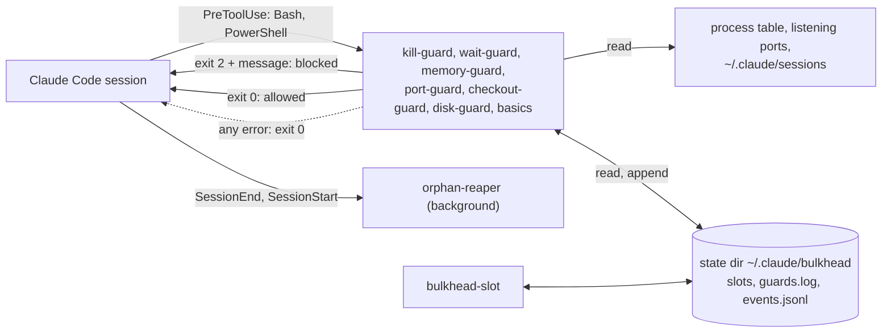

<h1 align="center">claude-bulkhead</h1>

<p align="center">
  <strong>Stop Claude Code from running <code>rm -rf $DIR/</code> when <code>$DIR</code> is empty, <code>pkill node</code> on your other dev servers, taking their ports, and committing another session's edits with <code>git add -A</code>.</strong>
</p>

<p align="center">Hooks that know which processes, ports and git trees belong to which Claude Code session and subagent, so they block only what would hurt something else, and tell Claude the safe command to run instead.</p>

<p align="center">Windows, macOS and Linux. No tmux, no sudo, no background daemon, no network calls, no dependencies. Also guards Codex, Gemini CLI, Copilot CLI, Cursor and six more agents.</p>

<p align="center">
  <a href="https://www.npmjs.com/package/claude-bulkhead"></a>
  <a href="https://github.com/dooly6276/claude-bulkhead/actions/workflows/test.yml"></a>
  <a href="#install"></a>
  <a href="docs/other-agents.md"></a>
  <br>
  
  
  
  <a href="LICENSE"></a>
</p>

<p align="center">
  
</p>

<p align="center"><sub><a href="README.ko.md">한국어</a> | <a href="README.zh-CN.md">简体中文</a> | <a href="README.ja.md">日本語</a> | <a href="README.es.md">Español</a> | <a href="README.pt-BR.md">Português (Brasil)</a></sub></p>

## Install

First, with nothing installed, see what it would have stopped in your own sessions:

```
npx -y claude-bulkhead scan --since 30d --share
```

It only reads the transcripts in `~/.claude/projects` and sends nothing.

Then install the plugin inside Claude Code:

```
/plugin marketplace add dooly6276/claude-bulkhead
/plugin install bulkhead@bulkhead
```

Once installed, the same report runs inside Claude Code:

```
/bulkhead:scan 30d
```

Other agents load the same guards as a plugin:

| Agent | Install |
|---|---|
| Copilot CLI | `copilot plugin marketplace add dooly6276/claude-bulkhead`, then `copilot plugin install bulkhead@bulkhead` |
| Cursor | `git clone https://github.com/dooly6276/claude-bulkhead ~/.cursor/plugins/local/bulkhead`, then **Developer: Reload Window** |
| opencode | add `"plugin": ["claude-bulkhead"]` to `opencode.json` |
| Gemini CLI | `gemini extensions install https://github.com/dooly6276/claude-bulkhead` |
| Codex | `codex plugin marketplace add dooly6276/claude-bulkhead`, then `codex plugin add bulkhead@bulkhead`, then approve the hook with `/hooks` |

For the others (Windsurf, Droid, Devin, Cline, Amp), see [Codex, Gemini and other agents](#codex-gemini-and-other-agents).

Node 18 or later must be on `PATH` (the native Claude Code installer does not install it; check with `node --version`).

| Install | What you get |
|---|---|
| The plugin (above) | The guards, which run on every Bash, PowerShell, Read and Edit call; the slash commands `/bulkhead:scan`, `status`, `log`, `doctor`, `reap`, `remote`; the skill that teaches Claude the safe habits. This is the part that protects you. |
| `npm install -g claude-bulkhead` (optional) | The `bulkhead` command in your own terminal (`status`, `top`, `explain`, `allow`, `worktree`, `scan`, `doctor`), the status line, `bulkhead-slot`, and `bulkhead setup <agent>` for Codex, Gemini and the others. `npx claude-bulkhead status` works without installing. |

Unsure whether it is working? `bulkhead doctor` runs a harmless command through each guard and shows that it was blocked, and how long it took.

## What it stops

| Without bulkhead | With bulkhead |
|---|---|
| An agent restarts its dev server with `pkill node`, and every other worktree's server dies with it. | kill-guard blocks the command and tells the agent how to find and stop its own PID. |
| Two sessions share a checkout. One runs `git add -A && git commit`, and the other one's half-finished edits ship in that commit. | checkout-guard blocks it and asks for the file names. |
| Two worktrees run `npm run dev`. The second moves to 3001, but its agent keeps testing `localhost:3000` and sees the other branch. | port-guard blocks the second start and names a free port. |
| Three sessions start `next build`, `npm test` and Playwright in the same minute, and the machine freezes. | memory-guard blocks heavy commands when RAM is low. Through `bulkhead-slot`, the third job waits in a queue until there is room. |

<details>
<summary>Six more</summary>

| Without bulkhead | With bulkhead |
|---|---|
| A session checks out another branch in a tree that a second session is editing. | checkout-guard blocks it and suggests `git worktree add`. |
| A session exits, and its dev servers, test workers and watchers keep running and holding RAM and ports. | orphan-reaper stops them within seconds of the session exiting. |
| A subagent polls in the foreground for ten minutes. The session cannot answer you, and the prompt cache expires. | wait-guard blocks the loop and asks for `run_in_background: true`. |
| An agent wants to know what is using disk space and runs ten `du` at once over your home folder. Every session's builds and `git status` crawl for minutes. | disk-guard blocks it and asks for one folder at a time. |
| A "clean up the worktrees" task runs `git worktree remove` on a worktree a second session is still working in. | checkout-guard blocks it and names the session that is still there. |
| A cleanup runs `rm -rf "$BUILD_DIR"/*` with `BUILD_DIR` unset, which is `rm -rf /*`, or `rm -rf .git` and the repository's history is gone. | basics blocks it and gives the safe form, `rm -rf "${BUILD_DIR:?}"/*`. |

</details>

With a single session, kill-guard, memory-guard, wait-guard, disk-guard and basics (no `rm -rf ~`, no `rm -rf $D/` that turns into `rm -rf /` when `D` is empty, no `rm -rf .git`, no force-push to `main`, no `reset --hard` over uncommitted work) still apply. port-guard and checkout-guard act once a second session or subagent is alive.

## What is it?

<p align="center">
  <picture>
    <source media="(prefers-color-scheme: light)" srcset="docs/hero-light.svg">
    
  </picture>
</p>

Claude Code hooks are small programs that Claude Code runs before every shell command, and that can stop the command and tell Claude why. bulkhead is a set of them. Before each Bash or PowerShell call it checks the command against what the other sessions on the machine are doing: which processes and ports belong to which session, how much RAM is left, and which git tree each session works in. When the command would hurt another session, it is blocked, and Claude gets a message with the safer command to run instead. Claude reads it and carries on, usually without asking you.

## Do you need it? Ask your transcripts

You do not have to guess. Claude Code keeps every session's transcript in `~/.claude/projects`, and `bulkhead scan` replays the shell commands in them against the guards: how many sessions you really run at once, and how often they already did the things bulkhead blocks.

<p align="center">
  <picture>
    <source media="(prefers-color-scheme: light)" srcset="docs/scan-light.svg">
    
  </picture>
</p>

```
/plugin install bulkhead@bulkhead      # then, inside Claude Code:
/bulkhead:scan 30d
```

It only reads, masks anything that looks like a secret before printing, and sends nothing anywhere. port-guard and the low-RAM check are not replayed, because transcripts do not record which ports and how much RAM were in use; checkout-guard is rebuilt from which sessions were active in the same git tree at that minute. `bulkhead scan --share` prints a 5 to 8 line summary with counts only (no paths, no commands) that you can paste into a post or a chat, and `--explain 1` shows one example in full with the part that matched. Details: [docs/commands.md](docs/commands.md#bulkhead-scan).

## Why this exists

A common way to speed up work with Claude Code is to run several sessions on one repository, each in its own git worktree, each with its own subagents. git keeps the branches apart. The machine does not: every session shares the same ports, the same process table and the same RAM. That is where they collide.

- Two worktrees of the same app both run `npm run dev`. The second one fails on port 3000, or quietly moves to 3001 while its agent keeps testing `localhost:3000` and sees the other branch.
- An agent restarts its own server with `pkill node` or `taskkill /IM node.exe` and takes down the dev servers and test runs of every other worktree, and sometimes its own session.
- Three sessions start `npm test`, `next build` and a Playwright run in the same minute, and the machine stops responding.
- A session ends and the dev servers it started keep running.

The Claude Code tracker has many reports of exactly this:

- [#13941](https://github.com/anthropics/claude-code/issues/13941): asked to restart a dev server, Claude ran `taskkill //IM node.exe` or `pkill node` and killed its own session.
- [#34754](https://github.com/anthropics/claude-code/issues/34754): `taskkill //F //IM python.exe` killed two long-running simulations, after the user had marked their PIDs as off limits.
- [#43225](https://github.com/anthropics/claude-code/issues/43225): asked to restart one bot, Claude force-killed every Python process on the machine, about 20 services.
- [#53229](https://github.com/anthropics/claude-code/issues/53229): told to stop only unused dev servers, an agent also killed a gateway and a Postgres process it had not identified.
- [#15487](https://github.com/anthropics/claude-code/issues/15487): 24 subagent processes saturated a 4 GB VPS until it had to be rebooted; a commenter froze a 24 GB Mac the same way.
- [#11502](https://github.com/anthropics/claude-code/issues/11502) and [#25180](https://github.com/anthropics/claude-code/issues/25180): processes started by agents outlive them, 60 Node processes in one report and 550 pytest workers in the other.

claude-bulkhead is a set of small hooks that block or clean up each of these. Each one can be turned off on its own. The name is from the bulkhead pattern: one compartment taking on water should not sink the ship.

## What it does

| | |
|---|---|
| **[kill-guard](docs/guards/kill-guard.md)**<br>Blocks `pkill node`, `taskkill /IM`, `Stop-Process -Name` and other kills by program name, and mass kills (`docker system prune`, `pkill -u`, `adb kill-server`) while another session is alive. Kills of your own processes by PID pass; `kill <pid>` of another session's process does not. | **[port-guard](docs/guards/port-guard.md)**<br>Blocks starting a dev server on a port another session already serves, and killing that session's server by port. |
| **[memory-guard and bulkhead-slot](docs/guards/memory-guard.md)**<br>Blocks heavy commands when RAM is low, and queues heavy jobs against one RAM budget shared by every session. | **[checkout-guard](docs/guards/checkout-guard.md)**<br>Blocks `git checkout`, `stash`, `reset --hard`, `git add -A` and similar when another live session works in the same tree, and deleting a folder another session works in. |
| **[wait-guard](docs/guards/wait-guard.md)**<br>Blocks foreground sleep loops longer than 3 minutes, which make the next request rewrite the whole prompt cache. | **[orphan-reaper](docs/guards/orphan-reaper.md)**<br>When a session exits, stops the dev servers, test workers, watchers and headless browsers it left running. Keep one on purpose with `BULKHEAD_KEEP=1`; tunnels and databases are kept already. |
| **[disk-guard](docs/guards/disk-guard.md)**<br>Blocks `du -sh ~`, `find /` without `-maxdepth`, and disk scans run in parallel, which stall the disk every session shares. | **[`bulkhead scan`](#do-you-need-it-ask-your-transcripts)**<br>Replays your past Claude Code transcripts against the guards: what they would have stopped, and how many sessions ran at once. |
| **[basics](docs/guards/basics.md)**<br>Blocks `rm -rf` at a root, home or a folder directly in it, force-pushes to `main`, resets that would lose uncommitted work, and commits authored as Claude. | **[`bulkhead status`, `top`, `log`, `doctor`](#see-what-is-running)**<br>Shows every session, its RAM, its ports, queued jobs, and what the guards have blocked. |
| **[edit-guard](docs/guards/edit-guard.md)** <sup>new</sup><br>Tells the agent when another live session edited the same file in the last 30 minutes, in this tree or another worktree of the repository. Advisory by default, no server. | **[secrets-guard](docs/guards/secrets-guard.md)** <sup>new, off by default</sup><br>Blocks reading or printing `.env`, private keys, cloud credentials and the whole environment, by the Read tool or a shell command, while `.env.example`, `ls ~/.ssh` and `.pub` files pass. |
| **[`bulkhead explain` and `bulkhead allow`](#when-it-blocks-something-you-meant)** <sup>new</sup><br>See what every guard would say about a command before it runs, and let one blocked command through once with the code in the block message. Claude cannot approve its own blocks. | **[`bulkhead worktree`](#worktrees-in-one-step)** <sup>new</sup><br>A new worktree in one step, with your `.env` files copied, dependencies installed and its own stable port; `prune` removes merged ones, squash merges included, and never one a session works in. |
| **[Auto-queue](docs/commands.md#auto-queue)** <sup>new</sup><br>With `memoryGuard.autoQueue`, heavy commands are not refused but put in line: the hook wraps them in `bulkhead-slot`, and they start when there is room. | **[Codex, Gemini and other agents](#codex-gemini-and-other-agents)** <sup>new</sup><br>The same guards for Codex, Gemini CLI, Copilot CLI, Cursor, Windsurf, Droid, Devin, Cline, opencode and Amp, set up with `bulkhead setup <agent>`. |
| **[Status line](#status-line)**<br>`3 sessions  2 heavy  9.1 GB free` in the Claude Code status line, in about 100 ms. | **[Config and slash commands](#configuration)**<br>Per-machine and per-project config with allow lists, plus `/bulkhead:scan`, `/bulkhead:status`, `/bulkhead:log`, `/bulkhead:doctor` and `/bulkhead:reap`. |

Optional: **[`bulkhead remote`](#run-heavy-jobs-on-another-machine-optional)** runs a test suite, a build or a browser run on another machine over SSH, when this one has no RAM to spare.

## More demos


A scripted run of `bulkhead status`, port-guard, kill-guard and wait-guard, recorded with [docs/demo.sh](docs/demo.sh). The two sessions are stand-in processes named `claude`; everything printed comes from the hook scripts and `bulkhead status`. The recording at the top of this page is a real Claude Code session; how it was made is in [docs/demo.tape](docs/demo.tape).

## Quick start

1. Install the plugin as above and start a new Claude Code session.
2. See what it would have caught: run `/bulkhead:scan 30d`, or `bulkhead scan` in the Bash tool. It reads your last month of transcripts and changes nothing.
3. Check the setup. Inside Claude Code run `/bulkhead:doctor`, or run `bulkhead doctor` in the Bash tool. Every line should say `OK`. A `WARN` or `FAIL` line names the guard and the reason. The Enforcement section at the end proves the hooks block: it runs the installed hook with a canary command and checks the exit code, the message and the latency, and it flags `disableAllHooks`, a disabled plugin or a missing `node`.
4. Open a terminal next to your sessions and run `npx claude-bulkhead top` (or `bulkhead top` after `npm install -g claude-bulkhead`) to watch sessions, RAM, ports and heavy jobs live. Press `q` to quit.

After that there is nothing to do. The guards run on every Bash and PowerShell call. To see what they stopped, run `bulkhead log` or `/bulkhead:log`; `bulkhead log --summary` counts blocks per guard on your machine. To change a threshold or allow a command, see [docs/configuration.md](docs/configuration.md). All commands are listed in [docs/commands.md](docs/commands.md).

## Worktrees in one step

When another session works in your tree, checkout-guard sends the agent to a worktree. A plain worktree has no `.env`, no `node_modules` and the same dev server port as the main checkout. `bulkhead worktree add` fixes those three:

```
$ bulkhead worktree add fix-login
created ~/dev/shop-fix-login on new branch fix-login from HEAD
copied .env (default set)
pnpm install --frozen-lockfile: done in 14.2s
wrote PORT=3800 to .env.local
next: cd ~/dev/shop-fix-login && claude
```

It copies the files named in `.worktreeinclude` (the file Claude Code reads too) or a safe default set of `.env` files, never `node_modules`, build output or anything over 5 MB; installs with the project's lockfile; and gives the worktree a port that stays the same every time. `bulkhead worktree list` shows each worktree with its branch, state, live session and port. `bulkhead worktree prune` lists the ones that are merged, clean and unused, and removes them with `--yes` using `git worktree remove` and `git branch -d`, never `--force`, never a live session's folder. Details in [docs/commands.md](docs/commands.md#bulkhead-worktree).

## Run heavy jobs on another machine (optional)

When several sessions run test suites and builds at once, one machine runs out of RAM: memory-guard blocks the commands, or bulkhead-slot makes them queue (automatically, with `memoryGuard.autoQueue`). If you have a second machine that is mostly idle, `bulkhead remote` runs the heavy command there instead.

<p align="center">
  
</p>

```
bulkhead remote add buildbox dev@192.168.1.20 --ssh-option=IdentityFile=~/.ssh/buildbox
bulkhead remote run -- npm test
```

```
[bulkhead remote] buildbox: 3f2a1c9 already there, 3 changed files (24 KB), 1 deleted
[bulkhead remote] buildbox  copy a  /home/dev/bulkhead-remote/acme-web-3f9a1c  port 7172
...test output...
[bulkhead remote] exit 0 after 1m 12s (copy a)
```

- **What is sent.** The current commit as a git bundle (only the commits the remote does not have yet) and your uncommitted changes, deletions included. Ignored files stay here unless you name them with `--files`. Nothing outside the repository is sent.
- **Where it runs.** In one of up to 8 copies of the repository on the remote, so parallel runs do not share a working tree. `node_modules` is kept between runs. Each run gets its own port in `$BULKHEAD_PORT`.
- **Room.** Locks on the remote hold a copy and a job slot, and `--gb=N` waits until N GB is free there. When there is no room within `--wait` minutes, it exits 3.
- **Cleanup.** When the command ends, or the SSH connection drops (Ctrl-C, a tool timeout), everything it started on the remote is stopped, including a server left on its port.
- **The remote** needs only an SSH server, `bash`, `git` and `tar`. Linux, macOS and Windows with Git for Windows all work.

`bulkhead remote fetch PATH` brings files back from the copy the last run used, and `bulkhead remote status` shows each remote's free RAM and running jobs. In Claude Code, `/bulkhead:remote <command>` runs a command there in the background. Setup, options and exit codes: [docs/remote.md](docs/remote.md).

## How it works



Each guard is a separate Node script with no dependencies. Claude Code pipes the tool call to it as JSON. The guard reads the command text, and only when the command matches does it look further: at the process table, the listening ports, the session files Claude Code keeps in `~/.claude/sessions`, free RAM, or `git status`. A block is exit code 2 with a message that tells Claude what to do instead. Any error inside a guard lets the call through, so a broken guard never stops your work.

Every session on the machine shares one state directory. bulkhead-slot keeps its RAM reservations there, and every block is recorded there. More detail, including the state directory layout and how sessions are found on each OS, is in [docs/architecture.md](docs/architecture.md).

## Guards

Each guard has a page with the exact commands it blocks, what passes, the message Claude sees, and its limits. The short version:

<details>
<summary><strong>kill-guard</strong>: kills by program name</summary>

Blocks `taskkill /IM`, `taskkill /FI` without a PID, `Stop-Process -Name`, `Get-Process node | Stop-Process`, `pkill`, `killall`, `kill $(pgrep node)`, `wmic ... delete` and similar when they target a program other sessions share, such as `node`, `python`, `java`, `chrome`, `git` or `vite`. Kills by PID and by project path pass. Kills by port pass too, unless another session owns the port; port-guard checks those. Claude is told how to find its own PIDs.

Turn off: `BULKHEAD_DISABLE=kill-guard`. Details: [docs/guards/kill-guard.md](docs/guards/kill-guard.md).
</details>

<details>
<summary><strong>port-guard</strong>: ports owned by another session</summary>

Blocks starting a dev server (`npm run dev`, `next dev`, `vite`, `uvicorn`, `rails s` and more) on a port that another Claude session's process tree is listening on, and suggests a free port. It also blocks kill-by-port commands such as `npx kill-port 3000`, `fuser -k 3000/tcp` and `lsof -ti :3000 | xargs kill` when another session owns that port.

Turn off: `BULKHEAD_DISABLE=port-guard`. Details: [docs/guards/port-guard.md](docs/guards/port-guard.md).
</details>

<details>
<summary><strong>memory-guard and bulkhead-slot</strong>: RAM</summary>

memory-guard blocks heavy commands (test runners, `next build`, `tsc`, Gradle, the Android emulator, Playwright, `cargo test`, `docker build` and similar) when free RAM is under 3 GB, or under 15% of RAM on machines with less than 20 GB. `bulkhead-slot run --gb=4 -- <command>` waits until the shared RAM budget has room, runs the command, and frees the slot when it exits.

Turn off: `BULKHEAD_DISABLE=memory-guard`. Details: [docs/guards/memory-guard.md](docs/guards/memory-guard.md).

With `"memoryGuard": { "autoQueue": true }`, nobody has to remember the slot: memory-guard rewrites every heavy command (tests, builds, browser runs, container builds) to run through `bulkhead-slot`, so all sessions wait in one fair queue instead of being blocked. A waiting job prints its position every 30 seconds, and `bulkhead status` shows which session and project each queued job belongs to. With `"memoryGuard": { "subagents": true }`, a new subagent is not started while memory pressure is critical. See [docs/commands.md](docs/commands.md#auto-queue).
</details>

<details>
<summary><strong>checkout-guard</strong>: two sessions in one git tree</summary>

Blocks `git checkout <branch>`, `switch`, `stash`, `reset --hard`, `clean -f`, `rebase`, `merge`, `restore .` and a dirty `pull` when another live session works in the same tree, and suggests `git worktree add`. Also blocks `git add -A`, `git add .` and `git commit -a` there (`stage-all`; `git add -A src/` and `git add -n` pass), which would sweep the other session's half-finished edits into your commit, and `rm -rf` or `git worktree remove` of a folder another live session works in (`remove-session-dir`). On Windows it blocks `git worktree remove --force` on a worktree that holds junctions, which git has followed into the main checkout.

Turn off: `BULKHEAD_DISABLE=checkout-guard`, or one rule with `BULKHEAD_DISABLE=stage-all` or `remove-session-dir`. Details: [docs/guards/checkout-guard.md](docs/guards/checkout-guard.md).
</details>

<details>
<summary><strong>disk-guard</strong>: whole-disk and parallel scans</summary>

Blocks `du`, `ncdu`, `dust`, `ls -R`, `Get-ChildItem -Recurse` and `dir /s` over the whole drive, the home folder or every user's home (`du -sh ~`, `du -sh ~/*`, `ncdu /`), `find /` and `find ~` without `-maxdepth`, and disk scans run in parallel wherever they point: `xargs -P 10 du`, GNU `parallel`, `du ... &` in a loop, `ForEach-Object -Parallel`. One folder at a time passes (`du -sh node_modules`, `du -sh ~/Library/Caches`).

Turn off: `BULKHEAD_DISABLE=disk-guard`. Details: [docs/guards/disk-guard.md](docs/guards/disk-guard.md).
</details>

<details>
<summary><strong>wait-guard</strong>: long foreground waits</summary>

Blocks a foreground command whose sleeps can add up to more than 180 seconds. The prompt cache expires after about five minutes without a request, so a subagent polling in the foreground rewrites the whole context every time it wakes. Claude is told to run the loop with `run_in_background: true`. Sleeps in a background job (`sleep 600 &`) pass. With the default 120 second tool timeout a wait cannot pass the default limit, so it blocks only when the call raises the timeout.

Turn off: `BULKHEAD_DISABLE=wait-guard`, or raise the limit with `BULKHEAD_WAIT_MAX_SEC`. Details: [docs/guards/wait-guard.md](docs/guards/wait-guard.md).
</details>

<details>
<summary><strong>orphan-reaper</strong>: processes left by sessions that exited</summary>

When a session exits, a hidden background waiter stops what it started from its tool shells and left running: dev servers and anything else listening on a port, test runners and their workers (Vitest, Jest, Playwright, pytest and xdist, `cargo test`, `go test` and more), watchers such as `tsc --watch` and nodemon, builds such as `next build`, and headless browsers. A pass at session start catches what a crash left behind. Editors, terminals, shared daemons such as Gradle or adb, and anything you started yourself are never touched. `bulkhead reap --dry-run` shows what it would stop and why. Something you started on purpose to stay up is kept with `BULKHEAD_KEEP=1 <command>` (ssh tunnels, cloudflared, ngrok, Jupyter, Redis, Postgres, MySQL, MongoDB and Docker are kept without it), and the next session tells you in one line what was stopped. Windows, Linux and macOS (macOS tested on a real Mac).

Turn off: `BULKHEAD_DISABLE=orphan-reaper`. Details: [docs/guards/orphan-reaper.md](docs/guards/orphan-reaper.md).
</details>

<details>
<summary><strong>basics</strong>: eight mistakes that cannot be undone</summary>

`rm-root` (`rm -rf` at a root, a top-level folder such as `/srv`, home, a folder directly in home such as `~/Documents`, or above the repository, also through a variable the same line sets to one, as in `D=/; rm -rf "$D/"`), `rm-empty-var` (`rm -rf $D/`, `rm -rf "$(cygpath -u ...)"` and `rsync --delete` into `$D/`, which become `/` when the variable or the output is empty; `"${D:?}/"` passes), `rm-unquoted-var` (`rm -rf $D` unquoted when the value has a space, so bash deletes each piece), `rm-git-dir` (`rm -rf .git` on a repository), `force-push-main` (`git push --force` to `main` or `master`; `--force-with-lease` passes), `protected-delete` (`git push origin :main`, `git push --delete origin main`, `git branch -D main`), `discard-changes` (`git reset --hard` or `git clean -fd` that would lose uncommitted work) and `agent-author` (`--author="Claude <noreply@anthropic.com>"`, `git config user.name Claude` and the like, so your commits keep counting as yours).

Turn off: `BULKHEAD_DISABLE=basics`, or one rule by name. Details: [docs/guards/basics.md](docs/guards/basics.md).
</details>

## Codex, Gemini and other agents

If you run Codex CLI, Gemini CLI, Copilot CLI, Cursor, opencode, Amp, Cline, Factory Droid, Windsurf or Devin on the same machine as Claude Code, bulkhead guards their shell commands with the same guards and counts their sessions: an agent's dev server is protected from the others, and `bulkhead status` gets an `AGENT` column.

```
bulkhead setup codex            # prints the config for ~/.codex/hooks.json
bulkhead setup codex --write    # merges it (original saved as hooks.json.bulkhead-backup)
```

Copilot CLI, Cursor and opencode can also load bulkhead as a plugin (see [Install](#install)), which needs no `npm install -g` and no change to your own config files. `bulkhead setup <agent>` works for `codex`, `gemini`, `copilot`, `cursor`, `windsurf`, `droid`, `devin`, `cline`, `opencode` and `amp`. Each agent calls `bulkhead hook --agent <name>` before a shell command and gets its own block format back. The agents, config files, what is guarded and the documentation each row was checked against are in [docs/other-agents.md](docs/other-agents.md).

## How bulkhead relates to other hook packs

General safety packs protect a session from dangerous commands. For example, [claude-forge](https://github.com/sangrokjung/claude-forge) includes hooks that filter leaked secrets from output, block piped remote scripts and stop destructive SQL, and [dcg](https://github.com/Dicklesworthstone/destructive_command_guard) and [cc-safety-net](https://github.com/kenryu42/claude-code-safety-net) cover destructive shell and git commands broadly. They are worth using.

bulkhead covers a different problem: sessions on one machine getting in each other's way through process ownership, ports, shared RAM and a shared git tree. Only its `basics` rules overlap with those packs, and you can turn them off with `BULKHEAD_DISABLE=basics` if another pack already covers them. bulkhead runs alongside other hooks: Claude Code runs every hook that matches a tool call, and the call is stopped if any of them blocks it.

## Configuration

The defaults need no setup. To change them, use a config file: `~/.claude/bulkhead/config.json` for the machine, and `<repo>/.claude/bulkhead.json` for one project (found by walking up to the folder with `.git`).

A project file comes with the repository, including one you clone, so it can only make bulkhead stricter: add names to kill-guard's block list, protect more branches, lower the wait limit, raise the RAM floor, turn a guard on. Anything that loosens a guard, such as `killGuard.allowNames`, `portGuard.ignorePorts`, a longer wait or `"enabled": false`, is read from the global file only; in a project file it is ignored with a warning that `bulkhead config` and the session's startup notice show. Remote hosts, ssh options and the notify command are global-only too.

For example, a machine where you run `ffmpeg` on purpose and have a slow integration suite, in `~/.claude/bulkhead/config.json`:

```json
{
  "killGuard": { "allowNames": ["ffmpeg"] },
  "waitGuard": { "limitSeconds": 300 },
  "portGuard": { "ignorePorts": [9229] }
}
```

And a project that deploys from `release`, in its `.claude/bulkhead.json`:

```json
{
  "basics": { "protectedBranches": ["release"] },
  "secretsGuard": { "enabled": true }
}
```

Every guard can be turned off with `"<guard>": { "enabled": false }` in the global file. `bulkhead config` prints every setting, its value and where it came from. A broken file is ignored, the guards keep their defaults, and the session shows one notice at startup. All keys are in [docs/configuration.md](docs/configuration.md), and [config.example.json](config.example.json) sets each of them.

Environment variables still work and win over both files. The simplest place for them is the `env` block of `~/.claude/settings.json`.

<details>
<summary>All environment variables</summary>

| Variable | Default | Same as |
|---|---|---|
| `BULKHEAD_DISABLE` | empty | Comma-separated guards to turn off: `kill-guard`, `wait-guard`, `memory-guard`, `port-guard`, `checkout-guard`, `disk-guard`, `orphan-reaper`, `basics`, or `all`. Single rules can be turned off too: `rm-root`, `rm-empty-var`, `rm-unquoted-var`, `rm-git-dir`, `force-push-main`, `protected-delete`, `discard-changes`, `agent-author`, `stage-all`, `remove-session-dir`. A name here is off whatever the files say |
| `BULKHEAD_PRESET` | `normal` | The preset: `quiet`, `normal` or `strict` |
| `BULKHEAD_WAIT_MAX_SEC` | 180 | `waitGuard.limitSeconds` |
| `BULKHEAD_MIN_FREE_GB` | 3, or 15% of RAM if less | `memory.minFreeGb` |
| `BULKHEAD_SLOT_FLOOR_GB` | 5, or 25% of RAM if less | `memory.slotFloorGb` |
| `BULKHEAD_MAX_COMMIT_PCT` | 75 | `memory.maxCommitPct` (Windows only) |
| `BULKHEAD_NO_LOG` | empty | `log.enabled: false` when set to `1` |
| `BULKHEAD_STATE_DIR` | `~/.claude/bulkhead` | Where slots, the event log, `guards.log` and the global config file live |
| `BULKHEAD_SSH` | `ssh` on `PATH` | The ssh client `bulkhead remote` runs |

</details>

## When it blocks something you meant

A block is a question, not a verdict. Three ways out, from the smallest:

1. Allow it once. Every block message ends with a short code. In your own terminal, run `bulkhead allow 7F3K`. The agent's next identical call (same command, same folder) goes through, once, within 10 minutes. The agent cannot do this for you: bulkhead blocks any attempt to run `bulkhead allow` or to write its state files.
2. See why first. `bulkhead explain -- <command>` runs the command through every guard against the live sessions, ports and git tree, without running it, and prints who owns what is in the way, the exact message the agent sees, and how to allow it.
3. Allow it for good, or change how much it blocks. Put the rule in `.claude/bulkhead.json` (the table below), or pick a preset: `bulkhead config --preset quiet` keeps only the cross-session guards and the two rules that cannot be undone, `strict` turns everything on with tighter limits, `normal` is the default. Your own keys and environment variables win over a preset.

### Blocked something you meant? cheat sheet

The one-time way is always `bulkhead allow <code>`, run by you. The permanent way, for the rule that fired:

| Guard | Rule | Permanent, in `.claude/bulkhead.json` |
|---|---|---|
| kill-guard | `pkill`, `taskkill-im`, `stop-process-name` and the other kills by name | `{"killGuard":{"allowNames":["ffmpeg"]}}` |
| kill-guard | `other-session-pid`: a PID in another session's tree | `{"killGuard":{"ownerCheck":false}}` |
| kill-guard | `broad-pattern`: a `pkill -f` pattern that reaches a desktop app or many processes | `{"killGuard":{"broadPattern":false}}` |
| kill-guard | `bsd-pkill`: on macOS, a `pkill` with a long option or a second pattern, which BSD `pkill` reads as more patterns | `{"killGuard":{"bsdPkill":false}}` |
| kill-guard | `mass-kill`, `docker-mass`, `device-kill`, `app-quit`, `service-stop`: the other rules (only while another session runs) | `{"killGuard":{"massKill":false}}`, and likewise (`dockerMass`, `deviceKill`, `appQuit`, `serviceStop`) |
| wait-guard | `long-sleep`, `poll-loop`, `follow` | `{"waitGuard":{"limitSeconds":600}}` |
| memory-guard | `low-memory` | `{"memory":{"minFreeGb":1}}` |
| memory-guard | `slot-files` | `{"memoryGuard":{"enabled":false}}` |
| port-guard | `port-in-use`, `kill-by-port` | `{"portGuard":{"ignorePorts":[3000]}}` |
| checkout-guard | `stage-all` | `{"checkoutGuard":{"stageAll":false}}` |
| checkout-guard | `remove-session-dir` | `{"checkoutGuard":{"removeSessionDir":false}}` |
| checkout-guard | `git-checkout`, `git-pull` and the other tree changes | `{"checkoutGuard":{"enabled":false}}` |
| disk-guard | `disk-wide-find`, `parallel-disk-scan`, `disk-wide-scan` | `{"diskGuard":{"enabled":false}}` |
| basics | `rm-root` | `{"basics":{"rmRoot":false}}` |
| basics | `rm-empty-var`, `rm-unquoted-var`, `rm-git-dir` | `{"basics":{"rmEmptyVar":false}}`, and likewise (`rmUnquotedVar`, `rmGitDir`) |
| basics | `force-push-main` | `{"basics":{"forcePushMain":false}}` |
| basics | `discard-changes` | `{"basics":{"discardChanges":false}}` |
| basics | `agent-author` | `{"basics":{"agentAuthor":false}}` |
| basics | `self-allow` | cannot be allowed once; only you can approve |

The same switch as an environment variable is `BULKHEAD_DISABLE=<guard or rule name>`. Everything is in [docs/configuration.md](docs/configuration.md) and [docs/commands.md](docs/commands.md).

## See what is running

`bulkhead` is on the Bash tool's `PATH` next to `bulkhead-slot`. Inside Claude Code, `/bulkhead:scan [30d]`, `/bulkhead:status`, `/bulkhead:log [24h|7d]`, `/bulkhead:doctor` and `/bulkhead:reap` run the matching command and summarize it. In your own terminal, run `npx claude-bulkhead top`, or install it once with `npm install -g claude-bulkhead` and run `bulkhead top`. The npm package is the same code as the plugin. Every command that prints a table takes `--json`. The full reference is [docs/commands.md](docs/commands.md).

### bulkhead status

Every Claude Code session on the machine: what it is doing (working, waiting for you, needs permission), its git branch and whether that is a worktree, the memory its process tree uses, what it has listening on a port, the jobs held in bulkhead-slot and the ones waiting, free RAM, and MCP servers that run as several copies across sessions:

```
$ bulkhead status
SESSION  STATE                STARTED  RSS     BRANCH              PROJECT
18672    working              09:52    1.4 GB  main                ~/src/acme-web
  :3000  node  pid 24632
21888    needs permission 4m  10:05    353 MB  feat/login (wt)     ~/src/acme-web-auth
26448    waiting 3m           11:40    625 MB  feat/checkout (wt)  ~/src/acme-web-checkout
  :3001  node  pid 31020
duplicate MCP: 3 copies of @playwright/mcp, 1.2 GB (sessions 18672, 21888, 26448)

SLOT    GB  PID    AGE    SESSION  PROJECT          COMMAND
slot-1  4   30112  6 min  18672    ~/src/acme-web   npx playwright test

WAITING  GB  PID    FOR    SESSION  PROJECT                 COMMAND
#1       3   30200  2 min  26448    ~/src/acme-web-checkout npm run build

9.9 GB free of 31.8 GB, commit 68%
```

`bulkhead top` puts the sessions that need you first. `bulkhead port --stable` prints a port that belongs to the current git worktree and is the same every time. To get a desktop notification when a session starts waiting, set `notify.command` ([commands.md](docs/commands.md#session-state-and-notifications)).

`bulkhead slot ...` is the same as `bulkhead-slot ...`.

### bulkhead top

The same view, live and full screen. It refreshes every 2 seconds on Linux and macOS and every 4 seconds on Windows, where one process scan takes 1 to 2 seconds. The scan runs in a worker thread, so keys never wait for it. `q`, `Esc` or `Ctrl-C` quit, `r` refreshes.

```
bulkhead top  14:30:05                                         scan 1.4s  every 4s  q quit  r refresh
RAM ████████████████░░░░░░░░░░░░░░  9.9 GB free of 31.8 GB  commit 68%

SESSIONS 3
PID      STARTED       PROJECT                         RSS              PROCS  PORTS
18672    Oct 12 17:49  ~/src/acme-web               1.4 GB  ██████████     12  :3000 :24678
21888    Oct 12 17:52  ~/src/acme-web-auth          353 MB  ███░░░░░░░      3  -
26448    03:43         ~/src/acme-web-checkout      625 MB  ████░░░░░░      5  :3001

HEAVY JOBS  1 running, 1 waiting
slot-1  4 GB   30112   6 min   npx playwright test
wait #1 3 GB   30200   2 min   npm run build  (this machine has 16 GB; one heavy job at a time)

RECENT BLOCKS
14:29  kill-guard     taskkill-im    ~/src/acme-web-auth      taskkill /F /IM node.exe
14:12  wait-guard     poll-loop      ~/src/acme-web-checkout  until [ -f out/DONE ]; do sleep 30; done
```

On a narrow terminal it drops columns instead of wrapping. When the output is not a terminal, or with `--once`, it prints one snapshot and exits.

### bulkhead log

Every block, and every process orphan-reaper stops, is one JSON line in `<state dir>/events.jsonl` with the time, guard, rule, session, project and the command cut to 200 characters. The file stays on your machine, rotates at 1 MB, and keeps one old file. `BULKHEAD_NO_LOG=1` turns it off.

```
$ bulkhead log --summary --since 7d
10 blocks in the last 7 days, 3 projects, 4 sessions

GUARD         RULE             COUNT  LAST
wait-guard    poll-loop            3  06:40  ████████████████████████
wait-guard    long-sleep           2  06:40  ████████████████
basics        force-push-main      1  06:40  ████████
basics        rm-root              1  06:40  ████████
kill-guard    pkill                1  06:40  ████████
kill-guard    taskkill-im          1  06:40  ████████
memory-guard  slot-files           1  06:40  ████████

PROJECT                  COUNT
~/src/acme-web               4
~/src/acme-web-auth          3
~/src/acme-web-checkout      3
```

`bulkhead log -n 20` lists the events themselves, `--since 30m|24h|7d|2w|<date>` limits the time, and `--guard kill-guard` limits the guard.

### bulkhead doctor

Checks Node, the plugin files, the state directory, the config files, each guard (on or off, and why), the process reader with its timing, the session files, the RAM limits computed for this machine, held slots, the event log and git. Then an Enforcement section proves the installed hooks block: the install and `enabledPlugins`, duplicate installs, settings that turn hooks off, `node` on the hook `PATH`, and a real run of each guard's hook command against a canary, with its latency. The exit code is 1 when any check fails.

```
$ bulkhead doctor
OK    node             v24.22.1
OK    package          this copy ~/.claude/plugins/cache/bulkhead/bulkhead/0.3.0, hooks: 3 SessionStart, 2 SessionEnd, 1 UserPromptSubmit, 1 Stop, 1 Notification, 2 PostToolUse, 1 PostToolUseFailure, 4 PreToolUse
OK    state dir        ~/.claude/bulkhead is writable
OK    config           no config files, defaults in use
OK    preset           normal (default)
OK    kill-guard       on
OK    wait-guard       on, limit 180s
OK    memory-guard     on
OK    port-guard       on
OK    checkout-guard   on
OK    disk-guard       on
OK    basics           on, protected branches: main, master
OK    edit-guard       on
OK    secrets-guard    off (default)
OK    orphan-reaper    on, at session start and after each session ends
OK    session-state    on
OK    processes        589 processes, 11 listening ports, 10 Claude sessions (10 with a session file) in 0.2s
OK    sessions         ~/.claude/sessions (10 session files; a running session without one is still found from the process list, but checkout-guard cannot tell which folder it works in)
OK    memory           28.3 of 48.0 GB free, memory-guard blocks heavy commands below 3 GB, bulkhead-slot keeps 5 GB free for a second job
OK    slots            none held
OK    event log        ~/.claude/bulkhead/events.jsonl, 2 events, 254 B (rotates at 1 MB)
OK    git              2.56.0

Enforcement
OK    install          bulkhead@bulkhead 0.3.0 at ~/.claude/plugins/cache/bulkhead/bulkhead/0.3.0, enabled in user settings
OK    hooks on         no disableAllHooks or allowManagedHooksOnly in user, project, local or managed settings
OK    hooks.json       installed copy: 4 PreToolUse hooks, all synchronous
OK    hook node        /opt/homebrew/bin/node v24.22.1
OK    hook kill-guard  blocked "pkill node" (exit 2, message shown to Claude) in 71 ms
OK    hook wait-guard  blocked "sleep 100000" (exit 2, message shown to Claude) in 64 ms
OK    hook disk-guard  blocked "du -sh /" (exit 2, message shown to Claude) in 70 ms
OK    hook basics      blocked "rm -rf /" (exit 2, message shown to Claude) in 63 ms

30 OK, 0 WARN, 0 FAIL
```

### bulkhead port

Prints a port that nothing listens on, checked on IPv4 and IPv6, so a second worktree can start its server without guessing:

```
npm run dev -- --port $(bulkhead port --near 3000)
```

### bulkhead reap

Runs orphan-reaper now. `--dry-run` lists what it would stop, the rule that matched and why the session counts as exited, without stopping anything:

```
$ bulkhead reap --dry-run
would stop 30112  test-runner  node ~/src/acme-web/node_modules/vitest/dist/workers/forks.js
  Vitest and its worker pool (tinypool); its session has exited and removed snapshot-bash-1791860359256-ezwkie.sh; 6 processes from 30080
1 tree would be stopped. Run `bulkhead reap` to stop it.
```

### Status line

`bulkhead-statusline` prints one line for the Claude Code status line:

```
3 sessions  2 heavy  9.1 GB free
```

Sessions are the live entries in `~/.claude/sessions`, heavy is the number of jobs holding a bulkhead-slot, and free is the same measure memory-guard uses. When sessions are waiting for you, the line adds `2 waiting` after the session count. It does not list every process (one `ps` for the session pids only), takes about 100 ms from cold on a Mac with 650 processes, and caches the line for 5 seconds in the state directory, written through a temporary file so concurrent sessions never read half of it.

A plugin cannot set the main status line (plugin settings only support `agent` and `subagentStatusLine`), so add it to `~/.claude/settings.json` yourself:

```json
{
  "statusLine": {
    "type": "command",
    "command": "bulkhead-statusline",
    "refreshInterval": 10
  }
}
```

This needs `npm install -g claude-bulkhead`, which puts `bulkhead-statusline` on `PATH`. If you already have a status line script, call `bulkhead-statusline` from it and append its output.

## FAQ

**Does it slow Claude Code down?**
A little. All the Bash guards run in one short Node process with no dependencies, about 76 ms per tool call on a MacBook Pro (Node 24), of which 32 ms is starting Node. When 10 sessions make a tool call at the same moment, each waits about 89 ms (318 ms when every guard was its own process, as in 0.2). Writing a block to the event log adds no measurable time. The guards only do slow work, such as reading the process list (a second or two on Windows), when the command matches: a dev server start on a port that already answers, a kill, a heavy command. The status line takes about 100 ms cold and is cached for 5 seconds.

**It blocked something it should not have. What do I do?**
Run `bulkhead log` to see the exact command and reason. Let it through once with `bulkhead allow <code>`, the code in the block message. To let it through for good, set it in the global config, `~/.claude/bulkhead/config.json`: `killGuard.allowNames` for a program name, `portGuard.ignorePorts` for a shared port, `waitGuard.limitSeconds` for a longer wait, or `"enabled": false` for the whole guard. A project's `.claude/bulkhead.json` cannot loosen a guard. See [docs/configuration.md](docs/configuration.md). Then please open a [false positive issue](https://github.com/dooly6276/claude-bulkhead/issues/new?template=false-positive.yml) with the line from `bulkhead log`, so the pattern can be fixed for everyone.

**Is it useful with a single session?**
Yes. kill-guard, wait-guard, memory-guard and basics protect one session and its subagents just as well. port-guard and checkout-guard only act when another session is alive, and orphan-reaper cleans up after sessions that have exited.

**Which systems does it support?**
Windows, Linux and macOS, with Node 18 or later. orphan-reaper on macOS is tested with fixtures of `ps` output and on a real Mac (a stand-in session was ended and only its leftovers were stopped), and on Linux it needs a Claude Code version that sets `CLAUDE_PID` for tool shells. On Windows, `bulkhead-slot` runs commands through Git Bash when it is installed and through `cmd.exe` otherwise.

**Does it send anything anywhere?**
No. There is no telemetry and no network call. The only socket it opens is port-guard's connection attempt to `localhost` to see whether a port answers. Logs stay in the state directory. The one exception is `bulkhead remote`, which connects over SSH to a machine you configured, and only when you run it.

More questions, including how the guards can be bypassed and how the RAM numbers are measured, are in [docs/faq.md](docs/faq.md).

## Limitations

- The guards read command text. They split it into commands and open wrappers such as `bash -c`, `cmd /c`, `powershell -EncodedCommand` and `sudo` up to three levels deep, but a kill or a sleep hidden in a script file, a shell function or an alias is not seen. They catch the common shapes, not a determined workaround.
- memory-guard and bulkhead-slot only see RAM. They do not limit CPU, disk or GPU.
- bulkhead-slot is only used when called. Nothing forces every session to queue through it.
- Each guard page lists its own limits.

## Uninstall

```
/plugin uninstall bulkhead@bulkhead
/plugin marketplace remove bulkhead
```

If you installed the npm package instead, run `npm uninstall -g claude-bulkhead`. A SessionEnd waiter that is already running exits by itself within 3 minutes, so nothing keeps running after you uninstall.

Then delete the state directory (`~/.claude/bulkhead`, or `BULKHEAD_STATE_DIR` if you set it) and remove the `statusLine` entry from `~/.claude/settings.json` if you added one.

## Using bulkhead? Show it

Add this badge to your project's README:

```markdown
[](https://github.com/dooly6276/claude-bulkhead)
```

It renders as [](https://github.com/dooly6276/claude-bulkhead)

## Contributing

See [CONTRIBUTING.md](CONTRIBUTING.md). Security reports: [SECURITY.md](SECURITY.md). The changelog is in [CHANGELOG.md](CHANGELOG.md), and what bulkhead stores and sends is in [PRIVACY.md](PRIVACY.md).

## License

[MIT](LICENSE)
