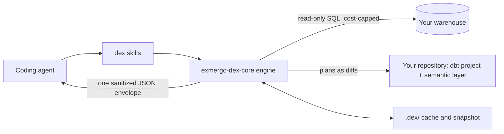

# dex

**Analytics engineering for your coding agent, with the guardrails built into the engine.**

dex is analytics engineering for Claude Code and any agent: data warehouse
exploration, dbt transformation and semantic modeling, and schema-drift
maintenance.

**Built by [Exmergo](https://exmergo.com)** · **Documentation: [docs.exmergo.com/dex](https://docs.exmergo.com/dex)**

[](https://docs.exmergo.com/dex)
[](https://pypi.org/project/exmergo-dex-core/)
[](LICENSE)
[](benchmarks/data-eng-bench/README.md)
[](benchmarks/ade_bench/README.md)
[](https://github.com/exmergo/dex/actions/workflows/ci.yml)

[](https://www.linkedin.com/company/exmergo/)
[](https://x.com/exmergo)
[](https://github.com/exmergo/dex)

## Install

**Any agent** (run in your terminal):

```bash
npx skills add exmergo/dex
```

**Claude Code** (run these inside Claude Code, one at a time):

```
/plugin marketplace add exmergo/exmergo-agent-plugins
```

```
/plugin install dex@exmergo
```

**Codex**:

```bash
npx skills add exmergo/dex --agent codex
```

> [!IMPORTANT]
> **dex needs [`uv`](https://docs.astral.sh/uv/) on your `PATH`.** No agent installs
> it for you. Run `brew install uv` or `pipx install uv`, or see the
> [uv installation docs](https://docs.astral.sh/uv/getting-started/installation/)
> for other platforms. `uv` supplies Python and the engine.

In Claude Code the skills appear as `/dex:explore`, `/dex:transform`, and
`/dex:maintain` and trigger on matching intent. Update later with
`/plugin marketplace update exmergo`. Codex also gets a native plugin, with no MCP
server needed. Any other agent can be pointed at [`AGENTS.md`](AGENTS.md).

Run dex from your project directory, so it finds your `.dex/config.yml` and keeps
its cache next to your project. dex needs an agent with a local shell, so it does
not run in claude.ai chat.

> [!TIP]
> **Skip the first-run wait.** The first command installs the engine, which takes
> tens of seconds on a cold `uv` cache. Ask your agent to warm dex once after
> installing, or run the command below in a CI or container build step. Add
> `--connector snowflake` (or any connector) to warm one before a project exists.

```bash
uv run --no-project --script skills/<skill>/scripts/run.py --warm
```

What you get:

- **Explore** a warehouse you have never seen. Ranked inventory, column profiles built from aggregates, PII flags, verified joins, and an ER diagram.
- **Transform** your dbt project and semantic layer. Models, tests, docs, and metrics arrive as reviewable plans and build only on a dev target.
- **Maintain** it as the world changes. Schema, volume, grain, and metric-definition drift, each with a proposed fix.

Read-only against your data. Cost quoted before any spend. Every change is a diff
you review. Works in Claude Code, Codex, or any agent that loads Agent Skills.

## Why

> *Most deadly errors arise from obsolete assumptions.*
>
> Frank Herbert, *Children of Dune*

A general coding agent is a good SQL author and a poor analytics engineer. It:

- re-learns the schema every session,
- has no strategy for a warehouse with thousands of tables,
- is blind to what a query costs,
- will happily pull personal data into its context,
- does not treat a dbt project or a semantic layer as an object to keep coherent over time.

dex owns exactly that loop, and enforces its rules in the engine rather than in a prompt.

## Try it in three commands

No warehouse, no credentials, no cloud account, no network.

```bash
pip install "exmergo-dex-core[duckdb]"
dex demo
dex explore map
```

`dex demo` writes a small e-commerce DuckDB warehouse (`dex_demo.duckdb`, 7 tables,
29,512 rows) and a `.dex/config.yml` into the current directory, so every command
after it runs with no flags. It refuses rather than overwrite anything. The data
comes from a pinned seed, so what you see is what is written here.

`explore map` maps all 7 tables, infers 5 joins, flags 6 columns as personal data,
and reports 6 data-quality findings. Every command answers with one JSON envelope.
An excerpt, for one table:

```json
{
  "identifier": "dex_demo.main.order_items",
  "row_count": 14000,
  "grain": null,
  "data_quality": [
    "order_item_id is not unique: 13000 distinct over 14000 rows (1000 rows would have to be removed for it to be unique, so it is unique for 92.9% of rows); joins on it will fan out"
  ]
}
```

### It is broken on purpose

A first run that reports a clean bill of health teaches you nothing, so the demo
ships with real defects. Dig into them:

```bash
dex explore profile order_items products
dex explore relationships --verify
dex explore query "select email from customers"
```

- **A broken grain.** A batch was loaded twice, so `order_item_id` is unique for only 92.9% of rows. dex reports the duplicates and leaves the grain unknown rather than guessing a key.
- **A key that mixes id schemes.** `sku` is `90% numeric, 10% 32-character hexadecimal (md5-shaped)`. Cast it to a number and you silently drop 10% of products.
- **A join that looks right and is not.** `web_events.customer_id` shares a name with the CRM's key, but verification finds 100% of its values have no match.
- **A refusal.** The query firewall will not put `customers.email` into context. `select count(distinct email) from customers` runs, because a statistic is not a value.

There is also a table an interrupted load left empty, two columns whose declared
type contradicts their content, and two designed PII false positives. See the
[`dex demo` reference](https://docs.exmergo.com/dex/cli/demo).

> [!NOTE]
> DuckDB is free and local, so nothing here asks you to confirm a spend. On a
> metered warehouse the same commands return an estimate first and run only once
> you agree to it.

## How it works



The skills are thin. All the logic, and every guardrail, lives in one engine
(`exmergo-dex-core`) behind a [small command contract](https://docs.exmergo.com/dex/reference/command-contract).
Your repository is the source of truth on two independent axes: the transformation
project (dbt) and the semantic layer. The `.dex/` directory is only a cache.

### Explore

Rank what matters, profile selectively, infer and verify joins, answer ad-hoc
questions through a PII-aware query firewall, read and query the semantic layer,
and draw the map as a Mermaid ER diagram. Fully read-only.
[Skill](skills/explore/SKILL.md) · [methodology](https://docs.exmergo.com/dex/concepts/methodology) · [commands](https://docs.exmergo.com/dex/cli/explore)


### Transform

Author and refactor dbt models from staging to marts, with tests and docs, plus the
semantic layer on top. Every change is a stored plan you review, then apply. Builds
run against a dev target only.
[Skill](skills/transform/SKILL.md) · [what dex writes](https://docs.exmergo.com/dex/concepts/dbt-project) · [commands](https://docs.exmergo.com/dex/cli/transform)


### Maintain

Diff the warehouse, the project, and the semantic layer against the last snapshot,
rank the drift by blast radius, and propose the reconciling edits. `maintain verify`
checks a project as it stands, with no baseline needed.
[Skill](skills/maintain/SKILL.md) · [commands](https://docs.exmergo.com/dex/cli/maintain)


### What dex will never do

- **Write to your data.** Warehouse access is read-only, and generated SQL is SELECT-only.
- **Put personal data in your agent's context.** PII is flagged by column, category, and confidence, and never surfaced. Only a human clears a flag. ([PII policy](https://docs.exmergo.com/dex/guardrails/pii-policy))
- **Spend before quoting.** A metered scan returns an estimate and runs only with your confirmation and a budget. ([cost controls](https://docs.exmergo.com/dex/guardrails/cost-controls))
- **Change your project behind your back.** Every edit is a diff, and a human edit made since planning is never overwritten. ([source of truth](https://docs.exmergo.com/dex/concepts/source-of-truth))
- **Build anywhere but dev.** Prod-looking targets are refused outright.

## Connectors

| Connector | Type | Self-hostable | Extra / `--connector` | Cost surfaced as | Credentials from |
| --- | --- | :---: | --- | --- | --- |
|  [**Snowflake**](https://docs.exmergo.com/dex/connectors/snowflake) | Cloud warehouse | ❌ | `snowflake` | Warehouse-seconds, with credits | `connections.toml`, `SNOWFLAKE_*` env, or a dbt profile |
|  [**BigQuery**](https://docs.exmergo.com/dex/connectors/bigquery) | Cloud warehouse | ❌ | `bigquery` | Bytes scanned | Application Default Credentials |
|  [**Databricks**](https://docs.exmergo.com/dex/connectors/databricks) | Cloud warehouse | ❌ | `databricks` | Warehouse-seconds, with DBUs | `databricks auth login`, `DATABRICKS_*` env, or a dbt profile |
|  [**Amazon Redshift**](https://docs.exmergo.com/dex/connectors/redshift) | Cloud warehouse, Serverless-first | ❌ | `redshift` | Compute-seconds, with RPU-hours | The AWS credential chain or `REDSHIFT_*` env |
|  [**ClickHouse**](https://docs.exmergo.com/dex/connectors/clickhouse) | Analytical database | ✅ | `clickhouse` | Compute-seconds on Cloud, database-seconds self-hosted | `CLICKHOUSE_URL`, `CLICKHOUSE_*` env, or a dbt profile |
|  [**Trino**](https://docs.exmergo.com/dex/connectors/trino) | Federated query engine (Trino, Starburst Enterprise, Trino on EMR) | ✅ | `trino` | Cluster-seconds | `TRINO_URL`, `TRINO_*` env, or a dbt profile |
|  [**DuckDB**](https://docs.exmergo.com/dex/connectors/duckdb) | Embedded analytical | ✅ | `duckdb` | Free and local | None, just a file path |
|  [**Postgres**](https://docs.exmergo.com/dex/connectors/postgres) | Operational database | ✅ | `postgres` | Database-seconds | `pg_service.conf`, `DATABASE_URL`, `PG*` env, or a dbt profile |

Credentials are discovered, never asked for, and never enter the agent's context.
Every scan is estimated, confirmed, and capped server-side, and settled spend is
recorded in a local ledger ([cost controls](https://docs.exmergo.com/dex/guardrails/cost-controls)).
Self-hosted databases bill no dollars and are still gated, because an unbounded
scan on a production Postgres primary is a real cost too.

**Coming next:** Starburst Galaxy, Azure Synapse, Microsoft Fabric.

## Semantic layers

The semantic layer is its own axis, chosen once per repository in `.dex/config.yml`.
With Ossie or SLayer, it needs no dbt project at all. ([overview](https://docs.exmergo.com/dex/semantic-layers/overview))

| Semantic layer | Hosted | Queryable | `vendor` / `deployment` | Read through |
| --- | :---: | :---: | --- | --- |
|  **dbt** | ✅ | ✅ | `dbt` / `local` or `dbt_cloud` | MetricFlow locally, run through the dex connector and its cost guard, or the hosted dbt Cloud Semantic Layer API |
|  **[Apache Ossie](https://github.com/apache/ossie)** (incubating) | ❌ | ❌ | `ossie` / `local` | Native documents in the repository, no dbt or MetricFlow in the path |
| **[SLayer](https://github.com/MotleyAI/slayer)** | ❌ | ✅ | `slayer` / `local` | SLayer model files, validated by one pinned release; SLayer renders, dex runs it under the cost guard |

Ossie is catalog-first because the format specifies interchange metadata and no
query runtime, so dex reads, authors, and checks an Ossie layer but refuses a metric
query by name rather than inventing semantics. See the
[Ossie page](https://docs.exmergo.com/dex/semantic-layers/ossie) and the
[Ossie tutorial](https://docs.exmergo.com/dex/guides/ossie-semantic-layer).

**Coming next:** Cube.

## See it on a real project

**[github-repo-analytics](https://github.com/exmergo/github-repo-analytics)** is a template that tracks GitHub traffic, stars, downloads and contributors for your open-source projects, free on GitHub Actions.   
Every model and metric was built and is maintained with dex. Its audit trail (https://github.com/exmergo/github-repo-analytics/blob/main/.dex/review/README.md) holds the raw envelopes, including the drift Dex blocked and the proposals that were rejected.

## Use it as a Python library

The engine is a plain Python package, `exmergo-dex-core`:

```bash
pip install exmergo-dex-core     # or: uv add exmergo-dex-core
```

Drive the same loop from Python instead of parsing CLI output:

```python
from exmergo_dex_core import DexEngine

with DexEngine(connector="duckdb", path="shop.duckdb") as eng:
    mapped = eng.map()                  # a DexCache, not a JSON blob
    rows = eng.query("select status, count(*) from orders group by status")

print(mapped.relationship_count, rows.cells)
```

Every guarantee the CLI makes holds here, because it is the same code. An
unconfirmed billed call raises `ConfirmationRequiredError` carrying the estimate.
By default nothing is written to disk; `DexEngine.from_repo("path/to/repo")` opts in
to a project on disk, the way the CLI does.

For hosts embedding dex:

- **Values-free mode** keeps every table value out of the model's view, aggregates only. ([values-free mode](https://docs.exmergo.com/dex/guardrails/values-free-mode))
- **Per-user credentials**: pass a `ConnectionSource` so each request reaches the warehouse as its own principal.
- **Multi-process lifecycles**: export a plan, verify and apply it elsewhere, and get typed evidence of what a build established. ([host integration](https://docs.exmergo.com/dex/reference/host-integration))
- **Other formats and stores**: plug in a [project format](https://docs.exmergo.com/dex/reference/project-formats) or a [storage backend](https://docs.exmergo.com/dex/reference/storage-backends).

More in the [package README](packages/dex-core/README.md).

## Benchmarks

We run dex on two public analytics-engineering benchmarks and commit every run's
raw per-task results, including the ones that flatter us least.

| Benchmark | Setup | Result | dex ran on | Details |
|---|---|---|---|---|
| **data-eng-bench** (Snowflake, 103 tasks) | dex + Claude Sonnet 5 | **57.3%** resolved, 89.7% of assertions pass | 98% of trials | [README](benchmarks/data-eng-bench/README.md) |
| **ADE-bench** (dbt Labs, 75 tasks) | dex + Claude Sonnet 5 | **76%** resolved, at 2.5x lower cost than Fable 5 | 15 of 75 trials | [README](benchmarks/ade_bench/README.md) |


**How to read these.** Both are single runs, one attempt per task, so small gaps
are noise. On data-eng-bench, 57.3% is statistically indistinguishable from the
56.6% Snowflake published for Sonnet 5: read it as parity, not a win. On ADE-bench,
dex fired on only 15 of 75 trials, so the 76% is mostly a statement about the model.
We report how often dex actually ran next to every score for exactly this reason.

A pass rate also misses what matters most: trust in a diff, cost surfaced before
spend, and sensitive data kept out of context. We optimize for that experience and
treat these scores as guide posts. ([evaluation](https://docs.exmergo.com/dex/reference/evaluation))

## What dex sends where

- **On install**, `uv` downloads the pinned engine (and a Python 3.11+ if you have none) from PyPI or your configured index.
- **Your warehouse** gets read-only SQL, with credentials from your existing credential chain.
- **dbt Cloud** is contacted only if you enable the hosted semantic layer.
- **dbt-core**, when dex runs it, sends dbt Labs its own anonymous usage statistics unless you turn them off. `transform deps` downloads the packages your `packages.yml` declares.
- **Your repository** holds dex's state in `.dex/`. dbt writes its usual `target/` and `logs/`.

> [!IMPORTANT]
> **dex sends nothing to Exmergo.** No telemetry, analytics, license check, or
> update ping. See the [dex privacy policy](https://www.exmergo.com/privacy/dex).

## Further reading

- [Documentation](https://docs.exmergo.com/dex): start here
- [CLI reference](https://docs.exmergo.com/dex/cli/overview): every command and flag
- [Command contract](https://docs.exmergo.com/dex/reference/command-contract) and [`AGENTS.md`](AGENTS.md): how any agent drives the engine
- [Cost controls](https://docs.exmergo.com/dex/guardrails/cost-controls) and [PII policy](https://docs.exmergo.com/dex/guardrails/pii-policy): the two guardrails that cut across everything
- [Configuration](https://docs.exmergo.com/dex/cli/config): read and change `.dex/config.yml` as a confirmed diff
- [Connectors](https://docs.exmergo.com/dex/connectors/duckdb): setup, cost, and read-only enforcement per warehouse
- [Changelog](https://docs.exmergo.com/dex/changelog)
- [`references/`](references/): the same material as Markdown, for agents and offline reading

## Dex Enterprise

Dex Enterprise runs dex as automated workflows in your own CI. It turns tickets into
draft pull requests with `explore` and `transform`, and runs `maintain` on a schedule
to turn drift into draft pull requests for your engineers to review. No Exmergo
service sits in the request path, and everything in this repository stays
Apache-2.0. [Learn more](https://www.exmergo.com/dex/enterprise).

## Community

### Community Integrations

**[dagster-dex](https://github.com/catincloud-labs/dagster-dex)**, maintained by
CatInCloud Labs, lets dex read a Dagster asset graph instead of a dbt project, so
exploration and drift maintenance run natively against your orchestrated assets.

### Connect with the Community

Join the agent-native data/analytics community!

- 🌟 [Star Us on GitHub](https://github.com/exmergo/dex/)
- 👾 [Join Our Discord Community](https://www.exmergo.com/discord)
- 🔗 [Follow Us on LinkedIn](https://www.linkedin.com/company/exmergo/)
- 🐦 [Follow Us on X](https://x.com/exmergo)
- 🔨 [Follow Us on GitHub](https://github.com/exmergo/)

## Contributing

See [CONTRIBUTING.md](CONTRIBUTING.md) for local setup, linting, the pre-commit
hook, and changelog fragments. Every pull request into `main` must pass Lint and
CI, and adds a fragment under [`changelog.d/`](changelog.d/) unless no user can
see the change. Please also read the [code of conduct](CODE_OF_CONDUCT.md).

## License

Apache-2.0. See [LICENSE](LICENSE) and [NOTICE](NOTICE).
