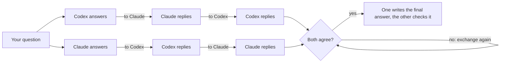
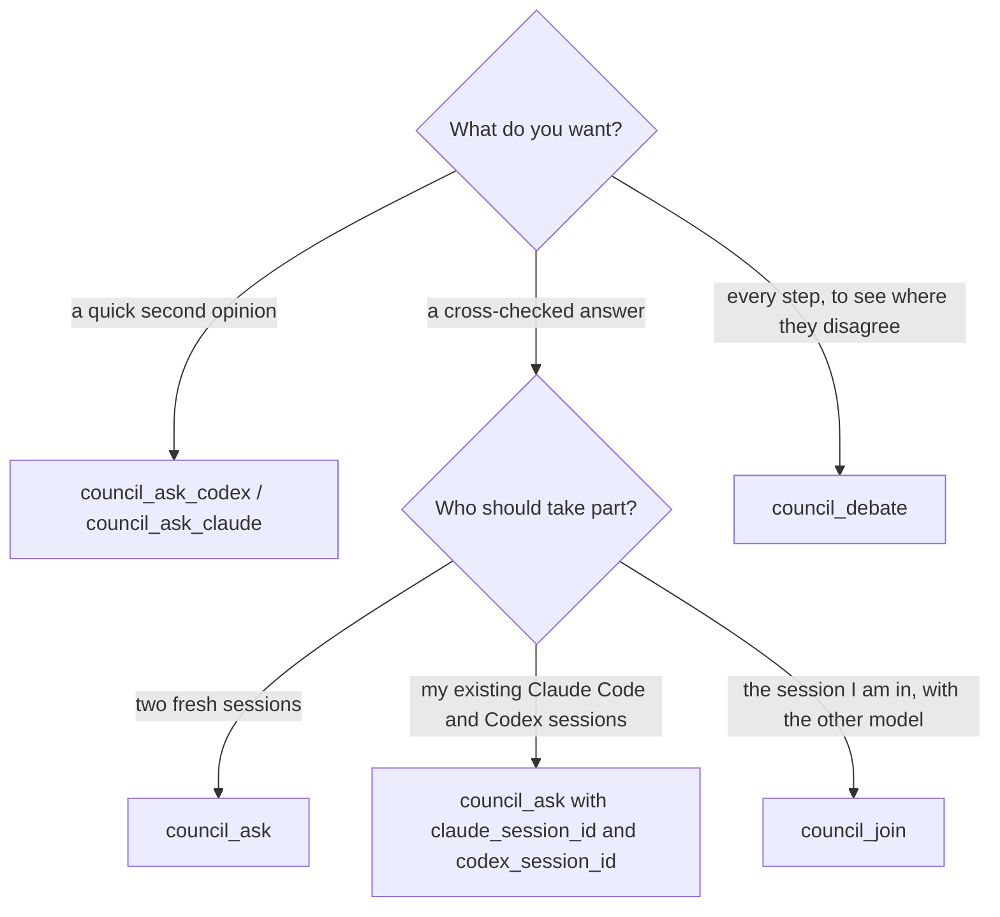
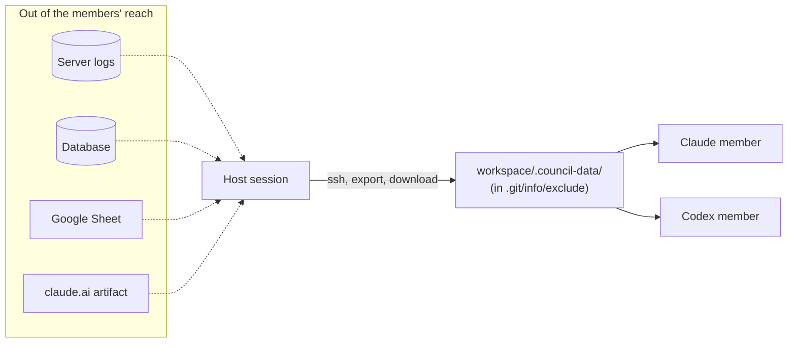

<picture>
  <source media="(prefers-color-scheme: dark)" srcset="assets/banner-dark.svg">
  
</picture>

<p align="center">
  <a href="https://github.com/hamza-aziz-ai/codex-claude-council/actions/workflows/ci.yml"></a>
  <a href="https://www.npmjs.com/package/codex-claude-council"></a>
  <a href="LICENSE"></a>
  
  
</p>
<p align="center">
  <a href="https://smithery.ai/servers/hamza-aziz-ai/codex-claude-council"></a>
  <a href="https://github.com/hashgraph-online/hol-guard"></a>
  <a href="https://tdqs.dev/reports/dbtjn020iu"></a>
  <a href="https://m8ven.ai/mcp/hamza-aziz-ai/codex-claude-council"></a>
  <a href="https://aiagentslisting.com/mcp/codex-claude-council"></a>
  <a href="https://github.com/Appnova-EU-OU/awesome-remote-mcp-servers"></a>
</p>
<p align="center">
  <a href="https://glama.ai/mcp/servers/hamza-aziz-ai/codex-claude-council"></a>
  <a href="https://mcprush.com/to/codex-claude-council-mcp?ref=badge"></a>
</p>
<p align="center">
  <a href="https://aiagentslisting.com/mcp/codex-claude-council"></a>
</p>
<p align="center">
  Also in the <a href="https://registry.modelcontextprotocol.io/v0/servers?search=io.github.hamza-aziz-ai/codex-claude-council">MCP Registry</a>, on <a href="https://smithery.ai/servers/hamza-aziz-ai/codex-claude-council">Smithery</a>, <a href="https://www.npmjs.com/package/codex-claude-council">npm</a>, <a href="https://github.com/hamza-aziz-ai/codex-claude-council/pkgs/container/codex-claude-council">GHCR</a> and <a href="https://hub.docker.com/r/hamzaazizai/codex-claude-council">Docker Hub</a>.
</p>

<h2 align="center">Two AIs. One answer.</h2>

<h3 align="center">Ask <b>ChatGPT</b> (through Codex) and <b>Claude</b> the same question.<br>They discuss with each other, round after round, until they agree on one answer.</h3>

<p align="center">
  In <b>Claude Code</b> · <b>Claude Desktop</b> · <b>Codex</b> · the <b>ChatGPT desktop app</b> · <b>claude.ai</b> and your phone · your <b>terminal</b>, on Windows, macOS and Linux.<br>
  On the plans you already have, or with API keys.
</p>

<p align="center">
  <a href="#get-started"><b>Get started</b></a> ·
  <a href="#use-it"><b>Use it</b></a> ·
  <a href="#how-it-works"><b>How it works</b></a> ·
  <a href="#setups"><b>Setups</b></a> ·
  <a href="#examples-and-best-practices"><b>Guides</b></a> ·
  <a href="#reference"><b>Reference</b></a> ·
  <a href="#troubleshooting"><b>Troubleshooting</b></a>
</p>

<table>
  <tr>
    <td width="50%" valign="top">🔍 <b>Both work in your project, read-only</b><br>They read files, search and run read-only commands such as <code>git log</code> and <code>git diff</code>, but neither can change anything.</td>
    <td width="50%" valign="top">🌐 <b>With the web</b><br>Both check current versions, APIs and docs instead of relying on memory.</td>
  </tr>
  <tr>
    <td valign="top">🔁 <b>With the sessions you choose</b><br>New sessions, your existing Claude Code and Codex sessions (with everything they already know), or the session you are asking from as one of the two members.</td>
    <td valign="top">🧰 <b>With your own setup</b><br>Your skills, plugins, MCP servers and <code>CLAUDE.md</code> / <code>AGENTS.md</code> apply to both. Skills such as <a href="https://github.com/aiwithremy/claude-skills-llm-council">llm-council</a> or <a href="https://github.com/JuliusBrussee/caveman">caveman</a> on request.</td>
  </tr>
  <tr>
    <td valign="top">🔑 <b>Your plans, or API keys</b><br>Your own Codex CLI (signed in with ChatGPT) and Claude Code (signed in with your Claude plan), by default. Or give a side its API key, even with no CLI installed.</td>
    <td valign="top">📱 <b>From anywhere</b><br>On your computer through the plugin, in Claude Desktop through its extension, or online for claude.ai, ChatGPT and your phone, from your computer or a server (Docker).</td>
  </tr>
</table>

<p align="center">
  
  <br><sub>A real council (low effort, the wait cut out): they disagree for two exchanges, then converge on one answer. Recorded with <a href="assets/demo.tape"><code>assets/demo.tape</code></a>.</sub>
</p>

## Get started

**1. Add it where you ask:**

| Where you ask | Add it with | Details |
|---|---|---|
| **Claude Code, Codex** (CLI and IDE extension) | `npx -y codex-claude-council install`, then restart them | [Install](#install) |
| **Claude Desktop** | its extension: open [`codex-claude-council-<version>.mcpb`](https://github.com/hamza-aziz-ai/codex-claude-council/releases/latest), with API keys in its settings if you want | [Claude Desktop extension](#claude-desktop-extension) |
| **ChatGPT desktop app** | **Settings → Plugins → Add → + Add a marketplace**: `https://github.com/hamza-aziz-ai/codex-claude-council.git` | [Or install per app](#or-install-per-app) |
| **claude.ai, ChatGPT on the web, your phone** | `npx -y codex-claude-council serve --tunnel`, or the Docker image on a server, then add the URL as a connector | [Use it online](#use-it-online-claudeai-chatgpt-your-phone) |
| **Cursor, VS Code, Windsurf, any MCP client** | a stdio server: `npx -y codex-claude-council mcp` | [JSON config](#or-install-per-app) |
| **Your terminal** | `npx -y codex-claude-council ask "…"` | [From the terminal](#from-the-terminal) |

**2. Choose how each side runs** (separately for ChatGPT and Claude):

| | Needs | Pays with |
|---|---|---|
| **Its CLI, on your plan** (default) | [Codex CLI](https://developers.openai.com/codex/cli) signed in with ChatGPT / [Claude Code](https://code.claude.com/docs/en/setup) signed in with your Claude plan | your ChatGPT or Claude plan |
| **Its CLI, on an API key** | the CLI, signed in with an API key | per token: [API keys instead of a plan](#api-keys-instead-of-a-plan) |
| **Its API, no CLI** | only an OpenAI or Anthropic API key | per token: [Without the CLIs](#without-the-clis-through-the-apis) |

Mix freely: for example Claude Code on your Claude plan, with ChatGPT through an OpenAI API key. `npx -y codex-claude-council doctor` checks what you have.

**3. Ask**, in a project: *"Ask the council: what does this project do, and what would you improve first?"*

> [!TIP]
> Already in a session of one model? Say *"discuss with my Codex session 019a…"* (in Claude Code) and your session takes part itself, with everything it already knows. See [`council_join`](#take-part-yourself-council_join).

## Use it

Just ask in plain language. The host (the app you are asking in) picks the tool and fills in its inputs:

| You say | What runs |
|---|---|
| "Ask the council: should I use Postgres or MongoDB for this?" | `council_ask`: both answer, then reply to each other until they agree on one final answer |
| "Run a council **debate** on this migration plan." | `council_debate`: the final answer plus both answers, every exchange and the final check |
| "Get **Codex's** second opinion on this function." | `council_ask_codex` (or `council_ask_claude` for Claude alone) |
| "**Discuss with my Codex session 019a…** whether this refactor is safe." (asked in Claude Code) | `council_join`: this session takes part itself; Codex continues session 019a… |
| "Ask the council, continuing **my Claude session 3f2a…** and **my Codex session "auth refactor"**: is my plan sound?" | `council_ask` with `claude_session_id` and `codex_session_id` |
| "Council this with **ChatGPT on gpt-5.6-sol at xhigh** and **Claude on opus at max**: …" | `council_ask` with per-side model and effort |
| "Ask the council and **keep going until they agree**: …" | `council_ask` with `max_rounds: 0` |
| "Ask the council, and let **ChatGPT write the final answer**: …" | `council_ask` with `synthesizer: "codex"` |
| "Ask the council: is **the latest** Next.js release safe to upgrade to for our app?" | `council_ask`: both read the project and search the web |
| "Ask the council **without internet access**: …" | `council_ask` with `web_search: false` |
| "Ask the council, **using the llm-council and caveman skills**: …" | `council_ask` with `skill: "llm-council, caveman"` |

In a project, the host passes its folder as the `workspace`, and the models read what they need themselves: point them at files, functions, the failing test or the error rather than pasting whole files. They cannot see the host's conversation (unless the host takes part itself), so the host states the task and any context that is not in the project.

Apps that show MCP prompts (claude.ai and Claude Desktop, in their **+** menu) also offer three starters: `ask_council`, `second_opinion` and `debate`.

> [!NOTE]
> **Long runs.** A council takes several minutes: two calls for the answers, two per exchange and two for the final answer and its check, all counting against both plans (or keys). Some apps end a tool call after about 60 seconds (Claude Desktop does), so every tool returns within about 50 seconds, with the answer or with "still working", the current step and a `job_id`; the host then calls `council_result` until the answer is ready, while the council keeps running. `council_cancel` stops a job.

## How it works



1. **Answer**: both models answer on their own, without seeing each other.
2. **Exchange**: each model gets the other's latest message (first its answer, then its replies) and replies point by point: what it accepts and how its position changes, where it still disagrees and why, then its current answer and a verdict, `AGREE` or `DISAGREE`. The two replies cross over, and the exchange repeats: a crossed zig-zag that narrows round after round.
3. **Converge**: as soon as both say `AGREE` in the same exchange, one model writes the final answer and the other checks that it matches what they agreed (at most 5 exchanges by default; `max_rounds: 0` for no limit).
4. **No agreement**: if the limit is reached first, the final answer sets out what they agree on and each point still in dispute, with both positions.

Neither model leads the discussion: in every exchange both reply to each other at the same time, and only after they agree does one of them write the final text. Each model keeps its session between questions, so it remembers the discussion and what it has already read, and each prompt carries only what that model has not seen yet.

### Why two models?

One model answers with confidence, right or wrong. Two models that disagree, and must explain why to each other, catch what either misses alone, the way a second reviewer does.

A real run (low effort): *"PostgreSQL or SQLite for a single-server internal tool with about 20 users?"*

| | ChatGPT | Claude |
|---|---|---|
| **Opening answer** | SQLite | PostgreSQL |
| **Exchange 1** | holds: "20 users alone does not establish write contention" | accepts most points and switches to SQLite, but keeps one objection |
| **Exchanges 2–3** | sharpens when PostgreSQL *would* be right | withdraws "multiple app instances" as a reason |
| **Exchange 4** | agrees | agrees |
| **Final check** | rejects the first final text (over the 120-word limit, one unsupported claim); accepts the revision | |

The final answer was sharper than either opening answer: SQLite, with the exact conditions under which to move to PostgreSQL. See the whole discussion as a page: [**open it**](https://htmlpreview.github.io/?https://github.com/hamza-aziz-ai/codex-claude-council/blob/main/docs/examples/postgres-or-sqlite.html) ([source](docs/examples/postgres-or-sqlite.html)) (make your own with `--html`, see [From the terminal](#from-the-terminal)).

### Benchmark

24 programs in which several traps interact (the [hard set](bench/hard.mjs): the event loop across nested promises and timers, class fields, `yield from`, `NULL` in joins, …), each asked *"what exactly does this print?"* and graded against what it really prints. Codex `gpt-6.1-sol` and Claude Sonnet 5.5, both at low effort, fresh sessions, no web search (October 13, 2026):

| | Right answers | Median time per question |
|---|---|---|
| Codex alone | 24 / 24 | 18 s |
| Claude alone | 23 / 24 | 11 s |
| **Council** | **24 / 24** | 59 s |

- **The council caught the one mistake:** on `h-py-dunder` Claude alone printed `V3 V102 V3 …`; the council printed the right `V3 V102 V102 …`, with both models agreeing.
- **It never made things worse:** there is no question the council got wrong that either model got right alone.
- **What it means:** here Codex alone was already perfect, so the council's gain is insurance. You get the better answer without knowing in advance which model will slip, at about 3 to 5 times the time. One miss in 24 is a small sample, not proof.

Every answer is in the [result file](bench/results/2026-10-13-03-15-hard-low.json). [Run it yourself](bench) with your own models and effort.

## Setups

### Requirements

| You need | Install | Sign in |
|---|---|---|
| [Node.js](https://nodejs.org) 20 or newer: runs the small MCP server (not needed for the Claude Desktop extension or Docker) | [nodejs.org](https://nodejs.org) | – |
| For Claude's side on your plan: [Claude Code CLI](https://code.claude.com/docs/en/setup), with a Claude Pro, Max, Team or Enterprise plan | macOS / Linux / WSL: `curl -fsSL https://claude.ai/install.sh \| bash`<br>Windows: `irm https://claude.ai/install.ps1 \| iex` | `claude auth login` |
| For ChatGPT's side on your plan: [Codex CLI](https://developers.openai.com/codex/cli), with a ChatGPT plan | any OS: `npm install -g @openai/codex`<br>macOS: `brew install --cask codex` | `codex login` → *Sign in with ChatGPT* |
| [Git](https://git-scm.com) (recommended) | usually already installed | – |

- **Each side needs its CLI, or its API key** ([Without the CLIs](#without-the-clis-through-the-apis)). Before each council, each side is checked, and nothing is sent until both are ready; the message says what is missing and how to fix it.
- **Git** lets both models look at your project's history, changes and blame, and `skill add` uses it to download a repository's skills.

> [!IMPORTANT]
> **Keep both CLIs up to date.** The council uses recent options: Claude Code's plan mode and `stream-json` output, and Codex's `exec resume` and web search. If a run fails with "unknown option" or "unexpected argument", update the CLI it names: `claude update`, or `npm install -g @openai/codex@latest`.

### Install

For Claude Code and Codex (the CLIs and their IDE extensions). Use one of these:

**macOS / Linux / WSL**

```bash
curl -fsSL https://raw.githubusercontent.com/hamza-aziz-ai/codex-claude-council/main/install.sh | bash
```

**Windows (PowerShell)**

```powershell
irm https://raw.githubusercontent.com/hamza-aziz-ai/codex-claude-council/main/install.ps1 | iex
```

**Any OS with Node.js**

```bash
npx -y codex-claude-council install
```

The installer checks Node.js and both CLIs (and whether each is signed in), then adds this repository's marketplace to Claude Code and Codex and installs the plugin in both (for Claude Code, for your user, so it works in every project). If the plugin is already installed, it updates it instead.

- **Options:** `--only claude|codex` (one app only), `--claude-desktop` (also register the server with Claude Desktop's Chat tab), `--dry-run` (show the commands without running them). With the scripts: `… | bash -s -- --claude-desktop`, or `& ([scriptblock]::Create((irm https://raw.githubusercontent.com/hamza-aziz-ai/codex-claude-council/main/install.ps1))) --claude-desktop`.
- **Afterwards:** fully quit and reopen Claude Code and Codex, check the setup with `npx -y codex-claude-council doctor`, and try it in a project.

#### Update

```bash
npx -y codex-claude-council update               # both apps
npx -y codex-claude-council update --only claude # or --only codex
```

It refreshes the marketplace and updates the plugin in Claude Code and Codex; then fully quit and reopen both. [`CHANGELOG.md`](CHANGELOG.md) lists what changed. In Claude Desktop, plugins update through **Sync automatically** (or **Sync** under **Settings → Plugins**); in the ChatGPT desktop app, under **Settings → Plugins**.

> [!WARNING]
> **Windows:** if Codex fails with *"failed to back up plugin cache entry: Access is denied. (os error 5)"*, a running app still has the plugin's folder open (versions up to 0.5.1 did this). Quit every Codex and Claude session, IDE extension and desktop app, then update again.

#### Or install per app

| App | How |
|---|---|
| **Claude Code** | `claude plugin marketplace add hamza-aziz-ai/codex-claude-council`<br>`claude plugin install codex-claude-council@codex-claude-council --scope user` |
| **Codex** (CLI and IDE extension) | `codex plugin marketplace add hamza-aziz-ai/codex-claude-council`<br>`codex plugin add codex-claude-council@codex-claude-council` |
| **Claude Desktop** (Cowork and Code) | **Settings → Customize → Plugins → + Add → Add marketplace → Add from a repository**, enter `hamza-aziz-ai/codex-claude-council`, turn **Sync automatically** on, click **Sync**, then install **codex-claude-council** |
| **Claude Desktop** (Chat, with the extension) | see [Claude Desktop extension](#claude-desktop-extension); or `npx -y codex-claude-council install --claude-desktop --only claude`, then fully quit and reopen Claude Desktop |
| **ChatGPT desktop app** | **Settings → Plugins → Add → + Add a marketplace**, enter `https://github.com/hamza-aziz-ai/codex-claude-council.git` in **Source**, click **Add marketplace**, then install **codex-claude-council** |
| **Any other MCP client** (Cursor, VS Code, Windsurf, …) | a local (stdio) MCP server with command `npx` and arguments `["-y", "codex-claude-council", "mcp"]` (below). Also in the [MCP Registry](https://registry.modelcontextprotocol.io/v0/servers?search=io.github.hamza-aziz-ai/codex-claude-council) as `io.github.hamza-aziz-ai/codex-claude-council` |

For a client configured with JSON (Cursor's `mcp.json`, Windsurf, Claude Desktop's `claude_desktop_config.json`, …), paste:

```json
{
  "mcpServers": {
    "council": {
      "command": "npx",
      "args": ["-y", "codex-claude-council", "mcp"]
    }
  }
}
```

The council runs on your computer, so keep the app open while you use it.

### Claude Desktop extension

1. Open `codex-claude-council-<version>.mcpb` from the [latest release](https://github.com/hamza-aziz-ai/codex-claude-council/releases/latest) (or **Settings → Extensions → Install Extension…**). It includes everything the server needs.
2. **Optional, for a side without its CLI:** open **Settings → Extensions → Codex–Claude Council → Configure** and enter the partner model's key: an **OpenAI API key** for ChatGPT, an **Anthropic API key** for the Claude side, and a model for each if you like (empty: `gpt-6-astra`, `claude-opus-5-5`). A side with a key runs through its API; a side without one uses its CLI. Claude Desktop keeps the keys masked and passes them only to this server, which never passes them on to the CLIs.
3. Ask: "Ask ChatGPT: …" (one model), "Discuss with ChatGPT whether …" (`council_join`: Claude Desktop itself is the Claude member, so the OpenAI key alone is enough), or "Ask the council: …".

### Use it online: claude.ai, ChatGPT, your phone

Apps on the web and on phones reach MCP servers over HTTPS, from their providers' servers, so they can't start a local one. `serve --tunnel` puts the council's MCP server online from your computer. It needs [cloudflared](https://developers.cloudflare.com/cloudflare-one/connections/connect-networks/downloads/) (Windows: `winget install Cloudflare.cloudflared`, macOS: `brew install cloudflared`) and no Cloudflare account:

```bash
npx -y codex-claude-council serve --tunnel
```

It prints the URL, `https://<random words>.trycloudflare.com/mcp/<token>`. Add it as a custom connector, with no sign-in:

| App | Where |
|---|---|
| **claude.ai** (and the Claude apps on your phone and desktop) | **Settings → Connectors → Add custom connector**: a name, the URL, then **No sign-in** |
| **ChatGPT** | Turn on developer mode (**Settings → Apps → Advanced settings**), then create a connector with the URL |
| **Any other MCP client** | a remote MCP server with the URL (Streamable HTTP) |

- **Keep the URL secret.** The token in it is the only key: anyone with the URL can run the council on your computer, under your plans, and the members can read your files. It is generated on the first start and saved next to your config file (`serve-token`); delete that file for a new one, or set `--token` / `COUNCIL_TOKEN`.
- **Your computer is the server.** It must be on, with `serve` running. Questions about a project need its folder on that computer: name it in the question ("in the project at `~/code/app`").
- **The address changes** each time `serve --tunnel` starts (a quick tunnel); update the connector then, or use a [fixed address](#a-fixed-address-with-your-own-domain).
- **Options:** `--port` (default 8000), `--host` (default `127.0.0.1`). Without `--tunnel`, `serve` prints the local address, `http://127.0.0.1:8000/mcp/<token>`, for your own tunnel or reverse proxy.

#### With Docker Compose, in the background

The whole setup in one container that starts again by itself after a reboot: Node.js, both CLIs, cloudflared and `serve --tunnel`. On a server you control (a VPS or a home server, amd64 or arm64) or on your own computer with Docker Desktop. It is still your council: sign both CLIs in with your own accounts, for your own use. In an empty folder:

```bash
curl -fsSLO https://raw.githubusercontent.com/hamza-aziz-ai/codex-claude-council/main/compose.yaml
# Windows (PowerShell): irm https://raw.githubusercontent.com/hamza-aziz-ai/codex-claude-council/main/compose.yaml -OutFile compose.yaml
docker compose up -d
docker compose exec council codex-claude-council login   # once: sign both CLIs in
docker compose logs council                              # the URL to add as a connector
```

- **`login`** signs in each CLI that isn't signed in yet: for Codex, a code to enter on any device (choose **Sign in with ChatGPT**); for Claude Code, a link to open and a code to paste back. The sign-ins are kept, so this is needed once.
- **Settings go in `.env`** next to `compose.yaml`: `COUNCIL_PROJECTS` (the folder mounted read-only at `/projects`; default `./projects`), `COUNCIL_TOKEN`, a fixed address (below), and API keys ([below](#without-the-clis-through-the-apis)). Keep `.env` to yourself.
- **The `council-home` volume** keeps the sign-ins, config, skills and the token across restarts and new images.
- **Update:** `docker compose pull`, then `docker compose up -d`. The image is `ghcr.io/hamza-aziz-ai/codex-claude-council`, also on Docker Hub as [`hamzaazizai/codex-claude-council`](https://hub.docker.com/r/hamzaazizai/codex-claude-council), tagged `latest` and with each version.
- **`seccomp=unconfined`** (set in `compose.yaml`): Codex's read-only sandbox (bubblewrap) needs user namespaces, which Docker's default seccomp profile blocks. If Codex still reports that bubblewrap can't create a namespace, add `apparmor=unconfined` under `security_opt` too.
- **Without Compose:** `docker run -d --name council --restart unless-stopped --security-opt seccomp=unconfined --env-file .env -v council-home:/home/node -v ~/code:/projects:ro ghcr.io/hamza-aziz-ai/codex-claude-council serve --tunnel`, then `docker exec -it council codex-claude-council login` and `docker logs council`.

#### A fixed address with your own domain

With a [Cloudflare named tunnel](https://developers.cloudflare.com/cloudflare-one/connections/connect-networks/get-started/create-local-tunnel/) on a domain whose DNS is on Cloudflare, the container runs that tunnel itself and the address stays the same. Once, with cloudflared on your computer (this opens Cloudflare in your browser):

```bash
cloudflared tunnel login
cloudflared tunnel create council
cloudflared tunnel route dns council council.example.com
```

Then add the tunnel's token and its address to `.env` (PowerShell; this writes the token to the file without showing it) and start it:

```powershell
Add-Content .env "TUNNEL_TOKEN=$(cloudflared tunnel token council)"
Add-Content .env "COUNCIL_PUBLIC_URL=https://council.example.com"
docker compose up -d
```

`docker compose logs council` then shows `https://council.example.com/mcp/<token>`, the same after every restart. To keep a URL you already use, add its token too: `COUNCIL_TOKEN=<the part after /mcp/>`.

### Plans, API keys or no CLI

#### API keys instead of a plan

To pay per token on one side through its CLI, for example Claude on your Claude plan and Codex on an OpenAI API key, set that side's `auth` to `api_key` in the [config](#configure) (Docker: `COUNCIL_CODEX_AUTH=api_key` or `COUNCIL_CLAUDE_AUTH=api_key` in `.env`):

```json
{ "codex": { "auth": "api_key" } }
```

| Side | How to give it the key |
|---|---|
| **Codex** | `codex login --with-api-key`, then paste it; or set `OPENAI_API_KEY` and run `npx -y codex-claude-council login`, which stores it with Codex |
| **Claude Code** | set `ANTHROPIC_API_KEY`, which Claude Code reads as it is; or `claude auth login --console` |

A side on `subscription` gets no API key at all, so it can't bill an API account by accident; neither CLI ever gets the other side's key. A side on `api_key` still accepts its plan's sign-in.

#### Without the CLIs: through the APIs

An add-on to the CLIs, which stay the default: a side set to `"via": "api"` runs through its provider's API, so its CLI doesn't need to be installed. Claude goes through Anthropic's Messages API and ChatGPT through OpenAI's Responses API, each with its API key, billed per token.

| Side | Set | Key | Model, when none is set |
|---|---|---|---|
| **Codex (ChatGPT)** | `{ "codex": { "via": "api" } }` or `COUNCIL_CODEX_VIA=api` | `OPENAI_API_KEY` | `gpt-6-astra` |
| **Claude** | `{ "claude": { "via": "api" } }` or `COUNCIL_CLAUDE_VIA=api` | `ANTHROPIC_API_KEY` | `claude-opus-5-5` (`opus`, `sonnet`, `haiku` and `fable` name the current ones) |

In the [Claude Desktop extension](#claude-desktop-extension), entering a key in its settings does both. `model` and `effort` work as for the CLIs. The Claude Code and Codex plugins don't include the providers' SDKs: run `npx -y codex-claude-council api-setup` once to add them (npm, Docker and the Claude Desktop extension have them already).

| | Through its CLI | Through its API |
|---|---|---|
| **Your project** | reads files, searches, runs read-only commands (`git log`, `diff`, …) | three read-only tools of the council's own, limited to the project folder: list files, read a file, search; no commands |
| **The web** | the CLI's web search | the provider's web search (and Claude's web fetch) |
| **Memory** | the CLI session | the conversation, kept by the council's server while it runs (OpenAI's side with `store: false`) |
| **Your own sessions** (`…_session_id`, `council_join`'s other side) | continued in place | not possible: they exist only in the CLIs |
| **Your setup** (CLI skills, plugins, MCP servers, `CLAUDE.md` / `AGENTS.md`) | applies | doesn't: a skill you name is sent as text |

It can't change anything either way: an API member has no tool that writes or runs anything.

## Examples and best practices

### Pick the right tool



The host picks the tool from your words. Name the tool if you want to be sure:

| To get | Say | Not |
|---|---|---|
| `council_join` (the session you are in takes part) | "**Discuss with** my Codex session 019a… whether …", "**take part yourself** as Claude, with my Codex session …", or "use **council_join** …" | "council_ask with my Codex session", which starts a separate Claude session instead |
| `council_ask` with your own sessions | "Ask the council, continuing my Claude session … and my Codex session …" | naming the session you are asking from |
| `council_debate` | "Run a council **debate** on …", "show me every step" | – |

### Use it from the desktop apps

**Claude Cowork with a ChatGPT Work conversation.** Conversations in ChatGPT's Work mode are saved as Codex sessions, so the plugin can continue one by its title. In a Cowork conversation, ask: *Discuss with my ChatGPT Work session "Find UAE job platforms": which three job portals should I focus on first, and why?*

- **Cowork is the Claude member**, with everything its project gives it: its folders, instructions, connectors and skills.
- **Codex continues that Work conversation**, read-only, in its own folder, and the council's turns appear there when you reopen it. Close it in the ChatGPT app first.
- **A Cowork conversation can't be continued from outside:** Cowork doesn't save its conversations as Claude Code sessions. Start from Cowork to have it take part.
- **Share the project folder.** If both apps' projects use the same folder on your computer, both models read the same files. Instructions stored only inside an app are not shared: the other model sees the folder's `CLAUDE.md` / `AGENTS.md` instead.

### Give the members what they can't reach

The members are read-only. By default Codex's commands have **no network access**: it can't call an API, query a database, open a Google Sheet or a claude.ai link, and its web search only reaches public pages. Claude's read-only commands can reach the network. Turn on [`network`](#network-for-codexs-commands-network) to let Codex call APIs too. Either way, data behind a login (SSH, databases, private sheets) is best collected by the host first, into the workspace, with the question pointing to it:



- **Copy only what the question needs**, such as the log lines for the calls in question, not whole log folders.
- **Keep the copies out of git:** put them in a folder listed in `.git/info/exclude`, which stays on your machine.
- **Keep secrets out of the question.** The question is saved in both sessions and sent to both providers. Have the host read a connection string from an environment variable instead.

### Write a question that works

The members can't see your conversation with the host: they see only the `question` (at most 12,000 characters) and the workspace. For a long task, split your prompt in two:

```
## Part A — instructions for you (the host), not sent to the other model
1. Collect the data into .council-data/ (see above).
2. Start council_join with me "claude", other_session_id "<id>",
   workspace "<absolute path>", max_rounds 0.
3. When they agree, show me the result and wait for my OK before changing code.

## Part B — the council question (send verbatim)
Goal: <what you want, and what "done" means>.
Data: <each file or folder, and its format>.
Tasks: 1. Measure … 2. Trace the code path (file:line) … 3. Propose the smallest fix as a diff …
Constraints: every claim cites a log line, a file:line or a measured number.
```

- **Say what to measure, not what to find.** If the question states the answer ("p50 is 2.7 s"), the other model tends to confirm it instead of checking. Give earlier findings as a file to open *after* its own measurement.
- **Ask for evidence and for measured results.** "Report the saving as measured; do not round it up to a target" keeps a goal like "save 2 s" from turning into a claim.
- **State the premise as a question, not a fact.** "Measure first; do not assume a fast path exists" lets the models correct a wrong assumption.
- **The members only propose.** They are read-only, so the host applies the agreed change afterwards, then tests and commits it.
- **In Claude Code, `/goal` is limited to 4,000 characters.** Save a long prompt as a file and give `/goal` a short condition: "`/goal Follow every step in /path/task.md in order. Done when: …`".

### Skills, models and effort

- **Several skills at once.** Name them all (`skill: "llm-council, caveman"`, or `--skill llm-council --skill caveman`). Both models get each one's instructions and use each where it fits. With `council_join`, have the host invoke the same skills itself.
- **Use heavy skills once.** llm-council starts five advisors each time it runs. Ask for it once, on the final plan, not on every turn.
- **Model and effort:** anything you don't set comes from the plugin's config (effort `high` by default), then from each CLI's own config. So Codex uses the model in your `~/.codex/config.toml`, but the plugin's `high` effort replaces the effort set there. Ask for `xhigh` or `max` for one question, or set it in the [config](#configure).

## Who takes part

There are three ways to run the two members. The discussion is the same in all of them.

| | Claude member | Codex member | Use it when |
|---|---|---|---|
| **New sessions** (default) | a new Claude Code session | a new Codex session | you want two fresh, independent opinions |
| **Your sessions** | your Claude Code session, continued | your Codex session, continued | both of your sessions already know the work |
| **Take part yourself** | the session you are asking from (if it is Claude Code) | your Codex session, continued, or a new one | you want the session you are in to discuss with the other model |

**New sessions** last as long as your host session: follow-up questions reuse them, so the models remember earlier questions and what they read. A new host session starts new ones too.

### Your sessions

Pass sessions you already have, by id or by name, and the council continues **those sessions in place**, with everything they have read and discussed. The council's turns are added to them, so you see the discussion when you go back.

| Tool | Inputs | Terminal |
|---|---|---|
| `council_ask`, `council_debate` | `claude_session_id`, `codex_session_id` (either or both) | `--claude-session <id\|name>`, `--codex-session <id\|name>` |
| `council_ask_claude`, `council_ask_codex` | `session_id` | `--session <id\|name>` |

| | Claude Code | Codex |
|---|---|---|
| **Id** | `/status` in the session (a UUID), or `claude --resume` | `/status` in the session; also the end of its file name in `~/.codex/sessions/YYYY/MM/DD/rollout-…-<id>.jsonl` |
| **Name** | `/rename <name>` in the session | `/rename <name>` in the session |
| **List** | `claude --resume` | `codex resume` (this folder), `codex resume --all` (every folder) |

- A **name** is looked up where each CLI keeps it: Claude Code in the session's own transcript, Codex in `~/.codex/session_index.jsonl`. If several sessions have that name, the most recently used one is taken. Names are easy to reuse by mistake, so pass the id when it matters which session you get.
- Each session runs in the folder it was started in, which is also the default `workspace`. For the council's turns, both run in plan mode / read-only, whatever mode you used them in.
- **Close those sessions first**, or at least don't type in them while the council runs: two programs writing to one session can mix up its history. Codex refuses a session open elsewhere ("already has an active writer") or one it hasn't saved yet (no message sent in it). Reopen them afterwards (`claude --resume <id>`, `codex resume <id>`) to see the council's turns.
- Don't pass the id of the session you are asking from; to have that session take part, use `council_join`.

### Sessions on another machine

A session on another computer takes part too: write it as **`user@host:session`**, for example `--claude-session hamza@10.152.15.202:fix-order-dialog-bugs`. That member runs **on that machine**, through `ssh`: this plugin's own `codex` / `claude` command, with that machine's CLI and **its sign-in**, in the session's own folder, read-only as here.

- **Needs:** key-based `ssh` from this computer (`ssh -o BatchMode=yes user@host true` must work), and Node.js 20+ and the CLI, signed in, on that machine (Linux or macOS; nvm is found too). Nothing is installed there: `npx` fetches this plugin's version for the call.
- **Its model and effort** come from that machine's config, unless you set them for the call. **Skills:** the council asks that machine which are installed for its CLI; those it loads by name, the others' instructions are sent.
- **It continues the saved session**, not the window it is open in. **Cancelling** stops the council here; a turn already running there finishes there. `ssh` is found on your PATH; set `"ssh": { "command": "<path>" }` in the config to use another.

### Take part yourself: `council_join`

Say your repository has a Claude Code session `abcd` and a Codex session `efgh`, and you are working in `abcd`. Ask there: *"discuss with my Codex session efgh whether we should split the auth module"*.

- **`abcd` itself is the Claude member.** No second Claude session is started. `council_join` hands `abcd` each of Claude's turns; `abcd` writes them in its own conversation, with everything it already knows, and sends each back with `council_turn`.
- **Codex continues `efgh`** in place, read-only (without a session id, a new session). They exchange replies until both agree, and **`abcd` writes the final answer**, which Codex checks.
- It works the other way round too: from a Codex session, that session is the Codex member and Claude continues the Claude Code session you name. In Claude Desktop or claude.ai, the app itself is the Claude member.
- **The host is asked, not forced, to leave files alone**: it keeps its own permissions. Only the other side must be ready (its CLI signed in, or its API key). Each of the host's turns may take up to `skill_timeout_seconds` (default 1800). It needs a host that takes turns, so it is not a terminal command.

## Reference

### What the members can use

| | Claude member (`claude -p`) | Codex member (`codex exec`) | The host, with `council_join` |
|---|---|---|---|
| **Mode** | plan mode | read-only sandbox | its own, unchanged |
| **Your setup** | settings, skills, plugins, MCP servers, `CLAUDE.md`, hooks | `config.toml`: skills, plugins, MCP servers, `AGENTS.md`, rules | everything it already has |
| **Can** | read, search, run read-only commands (`git log`, `diff`, `blame`, `curl`, …), use skills and sub-agents, search the web | read, search, run commands that change nothing, use skills and sub-agents, search the web; with `network`, reach the network from its commands | anything it normally can; asked not to change files |
| **Cannot** | edit, write or run other commands; ask you questions; use this plugin | write anywhere; reach the network from its commands (unless `network` is on); get approval for anything; use this plugin | – |

A member through its API has only its three read-only project tools and web search ([Without the CLIs](#without-the-clis-through-the-apis)). Skill steps that would change something (saving a report, building an index) are skipped. Your MCP servers' tools run in their own processes: plan mode refuses Claude's tools that change things, while Codex follows each server's own approval settings.

### Options

#### Agreement: `max_rounds` and `synthesizer`

| `max_rounds` | What happens |
|---|---|
| omitted | the configured default: **at most 5 exchanges**, stopping as soon as both agree |
| `N` (1 or more) | **at most N exchanges**, stopping as soon as both agree |
| `0` | **no limit**: they exchange until both agree (can take long and use a lot of both plans) |

They have agreed when both end the same exchange with `AGREE`. Then the **synthesizer** writes the final answer and the other model checks that it matches what they agreed; if it does not, the writer revises it once. **Claude** writes it by default (`synthesizer: "codex"` to swap); with `council_join`, the **host** does. If the limit is reached without agreement, the final answer sets out what they agree on and each point still in dispute, marked as not agreed. If a call fails partway (for example a usage limit), you get what was reached and the reason.

#### Web search: `web_search`

Both models can search the web and read pages (on by default). They prefer primary sources such as official docs and release notes, say where a fact came from, and check each other's claims against them. Turn it off with `web_search: false` ("ask the council without internet access"), `--no-web`, or `"web_search": false` in your config. See [Security and privacy](#security-and-privacy) before using it with a sensitive project.

#### Network for Codex's commands: `network`

By default Codex's commands have no network access (its web search still works). Turn on `network` to let them reach the network, for example to call an API, while the disk stays **read-only**: *"ask the council, with network access for Codex: is our API returning the new field yet?"*, `--network`, or `"network": true` in your config.

- **Limit where it can connect** with `"network_domains": ["api.github.com", "*.example.com"]`; with an empty list (the default), any domain is allowed.
- **How:** Codex runs with a permission profile (beta in Codex) instead of its read-only sandbox: the whole disk read-only, the network on.
- **Windows:** HTTPS from `curl.exe`, `Invoke-WebRequest` and `git` fails inside Codex's sandbox, while Python and Node work; Codex is told so. The sandbox also can't read `~/.ssh`.
- **Off by default, for a reason:** a model that can read your files and reach the network could also send them out, for example if a log or web page it reads tries to instruct it (a prompt injection). Use a domain list, and keep `network` off for sensitive projects.

#### Skills: `skill`

Skills are `SKILL.md` folders with a method or style the models can follow. Install a repository's skills once:

```bash
npx -y codex-claude-council skill add https://github.com/aiwithremy/claude-skills-llm-council
npx -y codex-claude-council skill add https://github.com/JuliusBrussee/caveman.git
npx -y codex-claude-council skill list
npx -y codex-claude-council skill remove caveman-stats
```

- `skill add` installs **every skill in a repository**, each with its files; also one folder of a repository (`…/tree/<branch>/<folder>`), a local folder or a `SKILL.md` file. Skills are saved in `~/.codex-claude-council/skills/<name>/`; skills installed for Claude Code or Codex themselves (and their enabled plugins') can be named too. Restart the apps afterwards so the tools list new skills.
- **A skill a member already has is named, not sent:** the member loads it itself. Only the skills it lacks have their instructions sent (for llm-council and graphify, about 61,000 characters down to about 1,100).
- **A skill is used only when you ask for it**: *"ask the council, using the llm-council skill: …"*, or `--skill llm-council`. Both models get its instructions and **decide at which steps it is needed**: a method like llm-council for a real decision, a style like caveman (terse) or ponytail (simplest solution) on every reply. The discussion's rules come first.
- **graphify** needs its graph built first (`pip install graphifyy`, then `graphify .`); the members then read `graphify-out/`. A step with sub-agents can take several minutes, up to `skill_timeout_seconds` (default 1800). Check a third-party skill's license and contents before installing it.

### Tool reference

| Tool | Does | Optional inputs (besides `question`) |
|---|---|---|
| `council_ask` | the full council; returns the agreed answer | `codex_model`, `codex_effort`, `claude_model`, `claude_effort`, `synthesizer`, `max_rounds`, `workspace`, `web_search`, `network`, `skill`, `codex_session_id`, `claude_session_id` |
| `council_debate` | the same; returns JSON with every step and the settings | as `council_ask` |
| `council_ask_codex`, `council_ask_claude` | one model only | `model`, `effort`, `workspace`, `web_search`, `network` (Codex), `skill`, `session_id` |
| `council_join` | the host takes part as one member | `me` (required: `claude` or `codex`), `other_session_id`, `other_model`, `other_effort`, `synthesizer`, `max_rounds`, `workspace`, `web_search`, `network`, `skill` |
| `council_turn` | sends the host's turn (`council_id`, `text`) | – |
| `council_result` | waits for a running job's answer (or, with `council_join`, the host's next turn) | `job_id` |
| `council_cancel` | stops a running job | `job_id` |

- Every tool also returns `structuredContent`: `status` (`done`, `working`, `your_turn` or `stopped`), the `text`, and the `job_id` or `council_id` to use next. The names before 0.11.7 (`debate`, `ask_codex`, `ask_claude`) still work.
- **Prompts:** `ask_council`, `second_opinion` (`model`: `codex` or `claude`) and `debate`. **Resources:** `council://guide` (which tool for what) and `council://config` (the settings in use and the installed skills).
- `workspace`: the absolute path of the project folder. Codex effort: `none`, `minimal`, `low`, `medium`, `high`, `xhigh`. Claude effort: `low`, `medium`, `high`, `xhigh`, `max`. Claude models: an alias (`opus`, `sonnet`, `fable`) or a full name; Codex models: any name your Codex CLI (or the OpenAI API) accepts. Anything left out comes from your [config](#configure).

### From the terminal

```bash
npx -y codex-claude-council ask "Which is faster for 10M rows, A or B?"
npx -y codex-claude-council debate "..." --codex-effort xhigh --claude-model opus
npx -y codex-claude-council ask "..." --max-rounds 0          # until both agree
npx -y codex-claude-council ask "..." --synthesizer codex     # ChatGPT writes the final answer
npx -y codex-claude-council codex "..." --effort low          # Codex only
npx -y codex-claude-council claude "..." --model sonnet       # Claude only
npx -y codex-claude-council ask "..." --workspace ~/code/app  # this project (--no-workspace: none)
npx -y codex-claude-council ask "..." --no-web                # no web search
npx -y codex-claude-council ask "..." --network               # Codex's commands may reach the network
npx -y codex-claude-council ask "..." --skill llm-council,caveman  # with installed skills
npx -y codex-claude-council ask "..." --html council.html     # also save the discussion as a page to share
npx -y codex-claude-council ask "..." --claude-session <uuid> --codex-session <id>  # your sessions
```

Both models work in the git repository you run the command from (if any), unless you pass `--workspace`, `--no-workspace` or a session id. Questions can also be piped on stdin. Other commands: `install`, `update`, `uninstall`, `doctor`, `login`, `api-setup`, `skill`, `config`, `mcp`, `serve`; `--help` lists them all. For a shorter command, `npm install -g codex-claude-council`.

### Configure

```bash
npx -y codex-claude-council config --init
```

This creates `~/.codex-claude-council/config.json`. It is re-read on every call, so edits apply immediately:

```json
{
  "timeout_seconds": 600,
  "skill_timeout_seconds": 1800,
  "tool_wait_seconds": 50,
  "synthesizer": "claude",
  "max_rounds": 5,
  "web_search": true,
  "network": false,
  "network_domains": [],
  "codex":  { "command": null, "model": null, "effort": "high", "auth": "subscription", "via": "cli" },
  "claude": { "command": null, "model": null, "effort": "high", "auth": "subscription", "via": "cli" }
}
```

| Setting | Meaning |
|---|---|
| `timeout_seconds` | limit for each model call |
| `skill_timeout_seconds` | limit for each call when a skill is in use, and for each of the host's turns with `council_join` (default `1800`) |
| `tool_wait_seconds` | how long one tool call waits before returning "still working" and a `job_id` (default `50`); `0` waits until the answer is ready |
| `synthesizer` | which model drafts the final answer: `claude` (default) or `codex` (ChatGPT). Not used by `council_join`, where the host drafts |
| `max_rounds` | exchanges until both agree: `5` (default), `0` for no limit, `null` for one |
| `web_search` | whether the models may search the web and read pages: `true` (default) or `false` |
| `network` / `network_domains` | whether Codex's commands may reach the network, read-only on disk (default `false`), and the only domains then allowed (`[]`: any) |
| `codex.model`, `claude.model` | default model; `null` uses the CLI's own default (or, through the API, `gpt-6-astra` / `claude-opus-5-5`) |
| `codex.effort`, `claude.effort` | default effort |
| `codex.command`, `claude.command` | full path to a CLI if it isn't found automatically |
| `codex.auth`, `claude.auth` | `subscription` (default) or `api_key`: [API keys instead of a plan](#api-keys-instead-of-a-plan). `allow_api_key_auth: true` (before 0.19.0) means both |
| `codex.via`, `claude.via` | `cli` (default) or `api`: [Without the CLIs](#without-the-clis-through-the-apis) |

Environment variables do the same where a config file is awkward (Docker, desktop apps): `COUNCIL_CODEX_VIA` / `COUNCIL_CLAUDE_VIA`, `COUNCIL_CODEX_AUTH` / `COUNCIL_CLAUDE_AUTH`, `COUNCIL_CODEX_MODEL` / `COUNCIL_CLAUDE_MODEL`. Set `COUNCIL_CONFIG` to use a different config file, and `COUNCIL_BANNER=image` or `text` to choose the installer's icon.

## Security and privacy

- **It runs where you run it.** Your question goes to OpenAI and Anthropic through their official CLIs (or, for a side through its API, their APIs), under your own accounts. The plugin has no servers and no telemetry. [PRIVACY.md](PRIVACY.md) has the details.
- **The members cannot change your files.**
  - Codex runs `codex exec` in its **read-only sandbox**, enforced by the operating system, with `approval_policy` set to `never`. Both are set on the command line, which overrides your `config.toml`.
  - Claude Code runs in **plan mode**: it reads, searches and runs commands it knows to be read-only, and every edit, write or other command is refused. Plan mode is Claude Code's own permission guard, not an operating-system sandbox; the only file it may write is its plan file under `~/.claude/plans/`.
  - A member through its API has only read-only tools, which can't leave the project folder, even through a symbolic link.
  - With `council_join`, the host is your own session and keeps its own permissions; it is only asked not to change files.
- **Your own setup applies.** The members run with your skills, plugins, MCP servers, hooks, `CLAUDE.md` / `AGENTS.md` and permission rules. This plugin is switched off inside them, so a member can't start another council. Plan mode refuses Claude's MCP tools that change things, while Codex follows each server's own approval settings.
- **What they read is sent to the model providers**, as when you paste it. Through the CLIs, both can read files outside the project too, as in your normal sessions. Without a `workspace`, they start in an empty folder.
- **Web access.** With a `workspace` and web access, text in the project that tries to instruct the model (a prompt injection) could in principle get it to send project content to a website, for example in a URL it fetches. For sensitive projects, turn web access off.
- **Sessions** are saved by the CLIs like any other; a session you pass by id is continued in place.
- **Over HTTP (`serve`)**, the secret token in the URL is the only key. It listens on this computer only unless you set `--host`; reach it from elsewhere only through HTTPS, and keep the URL as secret as a password.
- **API keys:** by default the API-key environment variables are removed before the CLIs start, so they run on your plans. With `auth` or `via` set, a side gets only its own key, never the other side's, and keys entered in the Claude Desktop extension's settings are never passed to a CLI.
- **The plugin itself** runs with your user permissions: about 3,200 lines of JavaScript in [`src/`](src), with no dependencies except the Anthropic and OpenAI SDKs, which load only for a side through its API.

## Troubleshooting

Run the doctor. It checks Node.js, each side (its CLI and sign-in, or its API key) and your effective config:

```bash
npx -y codex-claude-council doctor
```

- **"The council needs … signed in"**: nothing was sent. The message names each side with a problem and the fix: `codex login` (choose *Sign in with ChatGPT*), `claude auth login`, or an API key.
- **"… CLI not found"**: install the CLI, set `codex.command` / `claude.command` to its full path, or run that side through its API ([Without the CLIs](#without-the-clis-through-the-apis)).
- **"… runs through the … API, but it has no key"**: set `OPENAI_API_KEY` / `ANTHROPIC_API_KEY`, or enter the key in the Claude Desktop extension's settings.
- **"the API mode needs the providers' SDKs"**: run `npx -y codex-claude-council api-setup` once.
- **"usage limit"**: your ChatGPT or Claude plan hit its limit. Wait for the reset or lower the effort.
- **"timed out"**: raise `timeout_seconds` (or `skill_timeout_seconds` with a skill), or lower the effort.
- **"no … session named …"**: check it with `claude --resume` / `codex resume --all`, rename the session with `/rename`, or pass its id from `/status`.
- **"Waiting for the … session"**: another council or question is using that session, which takes one at a time. If it names a `council_join` job waiting for your reply, send it with `council_turn`, or stop that job with `council_cancel`.
- **"… is not waiting for your reply now"** (`council_join`): the other model is still working; the host should call `council_result` with the id.
- **`skill "…" is not installed`**: install it with `skill add`, then restart the app.
- **Tools don't appear**: fully quit and reopen the app after installing. In the desktop apps, check the plugin or extension is installed and enabled.
- **`node` not found by a desktop app on macOS**: GUI apps don't read your shell profile, so Node installed with nvm may be invisible to them. Install Node from nodejs.org or Homebrew, or use the Claude Desktop extension.
- **"unknown option" / "unexpected argument"**: a CLI is too old. Update it: `claude update`, or `npm install -g @openai/codex@latest`.
- **Docker: bubblewrap "can't create a namespace"**: see [`seccomp=unconfined`](#with-docker-compose-in-the-background).
- **Windows: "Access is denied (os error 5)" when installing or updating**: see [Update](#update).

## Uninstall

```bash
npx -y codex-claude-council uninstall
```

This removes the plugin from Claude Code and Codex and the Claude Desktop chat entry, and keeps your config file and installed skills. In the desktop apps, uninstall it under **Settings → Plugins** or **Settings → Extensions**; with Docker, `docker compose down` (add `-v` to delete the sign-ins too).

## Development

```bash
git clone https://github.com/hamza-aziz-ai/codex-claude-council.git
cd codex-claude-council
npm ci
npm test
```

The tests use fake `codex` / `claude` executables and a fake of both APIs, so they make no model calls. CI runs them on Windows, macOS and Linux. To try a local checkout, use its path as the marketplace: `claude plugin marketplace add ./codex-claude-council` or `codex plugin marketplace add ./codex-claude-council`.

## Disclaimer

Not affiliated with, or endorsed by, OpenAI or Anthropic. Codex, ChatGPT, Claude and Claude Code are trademarks of their owners. The OpenAI and Claude logos in the plugin's icon and on shared discussion pages (from [@lobehub/icons](https://github.com/lobehub/lobe-icons)) only identify the two models the plugin runs; the installer draws the icon with [chafa](https://hpjansson.org/chafa/). Your use of each CLI and API is subject to its provider's terms and your plan's limits.

## License

[MIT](LICENSE) © Hamza Aziz
