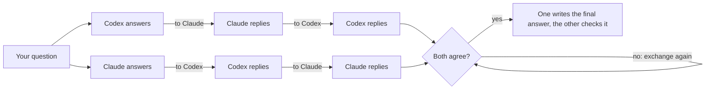
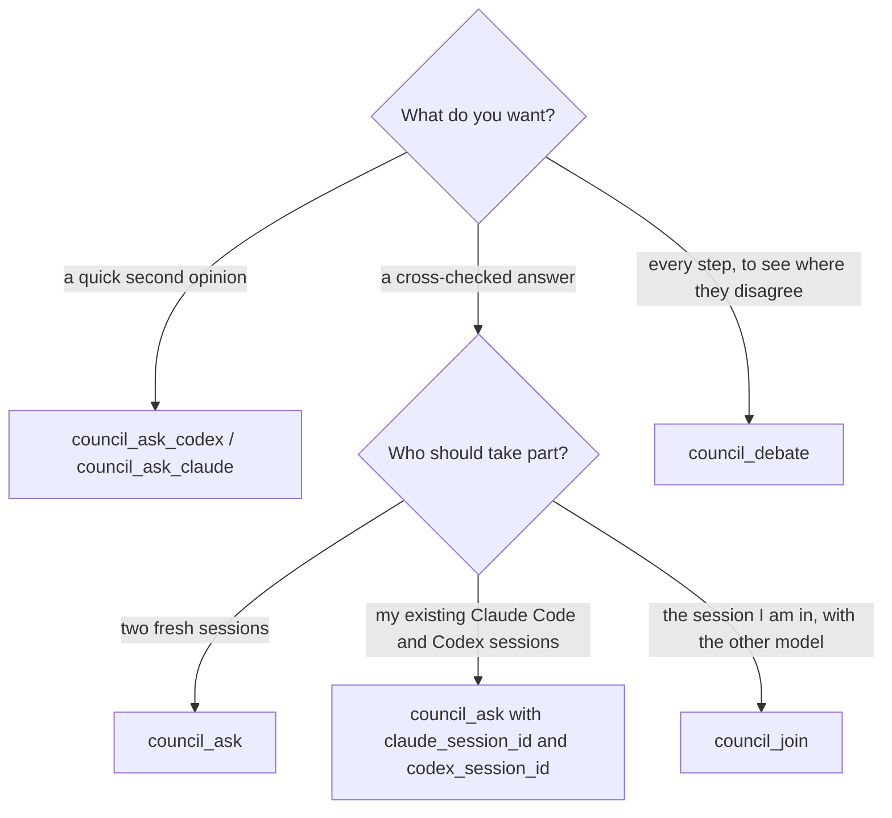
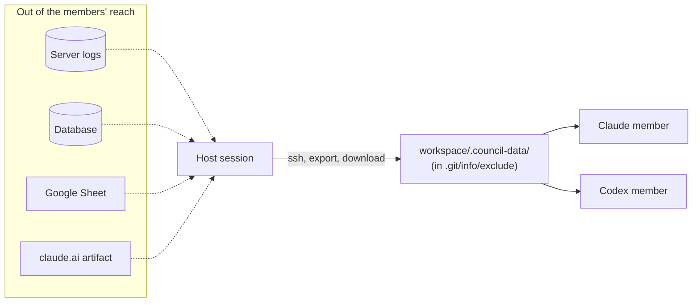

<picture>
  <source media="(prefers-color-scheme: dark)" srcset="assets/banner-dark.svg">
  
</picture>

<p align="center">
  <a href="https://github.com/hamza-aziz-ai/codex-claude-council/actions/workflows/ci.yml"></a>
  <a href="https://www.npmjs.com/package/codex-claude-council"></a>
  <a href="LICENSE"></a>
  
  
</p>
<p align="center">
  <a href="https://smithery.ai/servers/hamza-aziz-ai/codex-claude-council"></a>
  <a href="https://github.com/hashgraph-online/hol-guard"></a>
  <a href="https://tdqs.dev/reports/dbtjn020iu"></a>
  <a href="https://m8ven.ai/mcp/hamza-aziz-ai/codex-claude-council"></a>
</p>
<p align="center">
  <a href="https://glama.ai/mcp/servers/hamza-aziz-ai/codex-claude-council"></a>
  <a href="https://mcprush.com/to/codex-claude-council-mcp?ref=badge"></a>
</p>
<p align="center">
  <a href="https://aiagentslisting.com/mcp/codex-claude-council"></a>
</p>

<h2 align="center">Two AIs. One answer.</h2>

<h3 align="center">Ask <b>ChatGPT</b> (through Codex) and <b>Claude</b> the same question.<br>They discuss with each other, round after round, until they agree on one answer.</h3>

<p align="center">
  Using the subscriptions you already have, in <b>Claude Code</b> · <b>Claude Desktop</b> (Cowork) · <b>Codex</b> · the <b>ChatGPT desktop app</b> · your <b>terminal</b>,<br>
  on Windows, macOS and Linux.
</p>

<p align="center">
  <a href="#quick-start"><b>Quick start</b></a> ·
  <a href="#how-it-works"><b>How it works</b></a> ·
  <a href="#use-it"><b>Use it</b></a> ·
  <a href="#examples-and-best-practices"><b>Examples</b></a> ·
  <a href="#options"><b>Options</b></a> ·
  <a href="#configure"><b>Configure</b></a> ·
  <a href="#troubleshooting"><b>Troubleshooting</b></a>
</p>

<table>
  <tr>
    <td width="50%" valign="top">🔍 <b>Both work in your project, in plan mode</b><br>They read files, search and run read-only commands such as <code>git log</code> and <code>git diff</code>, but neither can change anything.</td>
    <td width="50%" valign="top">🧰 <b>With your own setup</b><br>Your skills, plugins, MCP servers and <code>CLAUDE.md</code> / <code>AGENTS.md</code> apply to both.</td>
  </tr>
  <tr>
    <td valign="top">🔁 <b>With the sessions you choose</b><br>New sessions, your existing Claude Code and Codex sessions (with everything they already know), or the session you are asking from as one of the two members.</td>
    <td valign="top">🌐 <b>With the web</b><br>Both check current versions, APIs and docs instead of relying on memory.</td>
  </tr>
  <tr>
    <td valign="top">🧩 <b>With skills on request</b><br>Such as <a href="https://github.com/aiwithremy/claude-skills-llm-council">llm-council</a>, <a href="https://github.com/JuliusBrussee/caveman">caveman</a>, <a href="https://github.com/DietrichGebert/ponytail">ponytail</a> or <a href="https://github.com/Graphify-Labs/graphify">graphify</a>.</td>
    <td valign="top">🔑 <b>No API keys</b><br>It runs your own Codex CLI (signed in with ChatGPT) and Claude Code CLI (signed in with your Claude plan) on your computer.</td>
  </tr>
</table>

## Quick start

1. **Install** in Claude Code and Codex (this checks Node.js and both CLIs first; other ways under [Install](#install)):
   ```bash
   npx -y codex-claude-council install
   ```
2. **Restart** Claude Code and Codex, so they load the plugin.
3. **Ask**, in a project: *"Ask the council: what does this project do, and what would you improve first?"*

<p align="center">
  
  <br><sub>A real council (low effort, the wait cut out): they disagree for two exchanges, then converge on one answer. Recorded with <a href="assets/demo.tape"><code>assets/demo.tape</code></a>.</sub>
</p>

> [!TIP]
> Already in a session of one model? Say *"discuss with my Codex session 019a…"* (in Claude Code) and your session takes part itself, with everything it already knows. See [`council_join`](#take-part-yourself-council_join).

## Why two models?

One model answers with confidence, right or wrong. Two models that disagree, and must explain why to each other, catch what either misses alone, the way a second reviewer does.

A real run (low effort): *"PostgreSQL or SQLite for a single-server internal tool with about 20 users?"*

| | ChatGPT | Claude |
|---|---|---|
| **Opening answer** | SQLite | PostgreSQL |
| **Exchange 1** | holds: "20 users alone does not establish write contention" | accepts most points and switches to SQLite, but keeps one objection |
| **Exchanges 2–3** | sharpens when PostgreSQL *would* be right | withdraws "multiple app instances" as a reason |
| **Exchange 4** | agrees | agrees |
| **Final check** | rejects the first final text (over the 120-word limit, one unsupported claim); accepts the revision | |

The final answer was sharper than either opening answer: SQLite, with the exact conditions under which to move to PostgreSQL. See the whole discussion as a page: [**open it**](https://htmlpreview.github.io/?https://github.com/hamza-aziz-ai/codex-claude-council/blob/main/docs/examples/postgres-or-sqlite.html) ([source](docs/examples/postgres-or-sqlite.html)) (make your own with `--html`, see [From the terminal](#from-the-terminal)).

### Benchmark

24 programs in which several traps interact (the [hard set](bench/hard.mjs): the event loop across nested promises and timers, class fields, `yield from`, `NULL` in joins, …), each asked *"what exactly does this print?"* and graded against what it really prints. Codex `gpt-6.1-sol` and Claude Sonnet 5.5, both at low effort, fresh sessions, no web search (October 13, 2026):

| | Right answers | Median time per question |
|---|---|---|
| Codex alone | 24 / 24 | 18 s |
| Claude alone | 23 / 24 | 11 s |
| **Council** | **24 / 24** | 59 s |

- **The council caught the one mistake:** on `h-py-dunder` Claude alone printed `V3 V102 V3 …`; the council printed the right `V3 V102 V102 …`, with both models agreeing.
- **It never made things worse:** there is no question the council got wrong that either model got right alone.
- **What it means:** here Codex alone was already perfect, so the council's gain is insurance. You get the better answer without knowing in advance which model will slip, at about 3 to 5 times the time. One miss in 24 is a small sample, not proof.

Every answer is in the [result file](bench/results/2026-10-13-03-15-hard-low.json). [Run it yourself](bench) with your own models and effort.

<details>
<summary><b>Contents</b></summary>

- [Why two models?](#why-two-models)
  - [Benchmark](#benchmark)
- [How it works](#how-it-works)
- [Requirements](#requirements)
- [Install](#install)
- [Use it](#use-it)
- [Examples and best practices](#examples-and-best-practices)
- [Who takes part](#who-takes-part)
- [What the members can use](#what-the-members-can-use)
- [Options](#options)
- [Tool reference](#tool-reference)
- [From the terminal](#from-the-terminal)
- [Configure](#configure)
- [Security and privacy](#security-and-privacy)
- [Troubleshooting](#troubleshooting)

</details>

## How it works



1. **Answer**: both models answer on their own, without seeing each other.
2. **Exchange**: each model gets the other's latest message (first its answer, then its replies) and replies point by point: what it accepts and how its position changes, where it still disagrees and why, then its current answer and a verdict, `AGREE` or `DISAGREE`. The two replies cross over, and the exchange repeats: a crossed zig-zag that narrows round after round.
3. **Converge**: as soon as both say `AGREE` in the same exchange, one model writes the final answer and the other checks that it matches what they agreed (at most 5 exchanges by default; `max_rounds: 0` for no limit).
4. **No agreement**: if the limit is reached first, the final answer sets out what they agree on and each point still in dispute, with both positions.

Neither model leads the discussion: in every exchange both reply to each other at the same time, and only after they agree does one of them write the final text. Each model keeps its session between questions, so it remembers the discussion and what it has already read, and each prompt carries only what that model has not seen yet.

## Requirements

| You need | Install | Sign in |
|---|---|---|
| [Node.js](https://nodejs.org) 20 or newer: runs the small MCP server (no dependencies) | [nodejs.org](https://nodejs.org) | – |
| [Claude Code CLI](https://code.claude.com/docs/en/setup), with a Claude Pro, Max, Team or Enterprise plan | macOS / Linux / WSL: `curl -fsSL https://claude.ai/install.sh \| bash`<br>Windows: `irm https://claude.ai/install.ps1 \| iex` | `claude auth login` |
| [Codex CLI](https://developers.openai.com/codex/cli), with a ChatGPT plan | any OS: `npm install -g @openai/codex`<br>macOS: `brew install --cask codex` | `codex login` → *Sign in with ChatGPT* |
| [Git](https://git-scm.com) (recommended) | usually already installed | – |

- **Both CLIs are required.** The installer checks for them and stops, with these install steps, if either is missing. Before each council, the CLIs it runs are checked for a sign-in, and nothing is sent until they are signed in.
- **Git** lets both models look at your project's history, changes and blame, and `skill add` uses it to download a repository's skills.

> [!IMPORTANT]
> **Keep both CLIs up to date.** The council uses recent options: Claude Code's plan mode and `stream-json` output, and Codex's `exec resume` and web search. If a run fails with "unknown option" or "unexpected argument", update the CLI it names: `claude update`, or `npm install -g @openai/codex@latest`.

## Install

**macOS / Linux / WSL**

```bash
curl -fsSL https://raw.githubusercontent.com/hamza-aziz-ai/codex-claude-council/main/install.sh | bash
```

**Windows (PowerShell)**

```powershell
irm https://raw.githubusercontent.com/hamza-aziz-ai/codex-claude-council/main/install.ps1 | iex
```

**Any OS with Node.js**

```bash
npx -y codex-claude-council install
```

The installer checks Node.js and both CLIs (and whether each is signed in), then adds this repository's marketplace to Claude Code and Codex and installs the plugin in both (for Claude Code, for your user, so it works in every project). If the plugin is already installed, it updates it instead.

**Options:** `--only claude|codex` (one app only; both CLIs are still required), `--claude-desktop` (also register the server with Claude Desktop's Chat tab), `--dry-run` (show the commands without running them). To pass them:

```bash
curl -fsSL https://raw.githubusercontent.com/hamza-aziz-ai/codex-claude-council/main/install.sh | bash -s -- --claude-desktop
```

```powershell
& ([scriptblock]::Create((irm https://raw.githubusercontent.com/hamza-aziz-ai/codex-claude-council/main/install.ps1))) --claude-desktop
```

**Afterwards:**

1. Fully quit and reopen Claude Code and Codex (and Claude Desktop), so they load the plugin.
2. Check the setup: `npx -y codex-claude-council doctor`.
3. Try it in a project: *"Ask the council: what does this project do, and what would you improve first?"*

### Update

```bash
npx -y codex-claude-council update               # both apps
npx -y codex-claude-council update --only claude # or --only codex
npx -y codex-claude-council update --dry-run     # show the commands only
```

It refreshes the marketplace and updates the plugin in Claude Code and Codex; then fully quit and reopen both. Running the installer again does the same. [`CHANGELOG.md`](CHANGELOG.md) lists what changed. In Claude Desktop, updates arrive through **Sync automatically** (or **Sync** under **Settings → Plugins**); in the ChatGPT desktop app, update the plugin under **Settings → Plugins**.

> [!WARNING]
> **Windows:** if Codex fails with *"failed to back up plugin cache entry: Access is denied. (os error 5)"*, a running app still has the plugin's folder open (versions up to 0.5.1 did this). Quit every Codex and Claude session, IDE extension and desktop app, then update again.

### Or install per app

| App | How |
|---|---|
| **Claude Code** | `claude plugin marketplace add hamza-aziz-ai/codex-claude-council`<br>`claude plugin install codex-claude-council@codex-claude-council --scope user` |
| **Codex** (CLI and IDE extension) | `codex plugin marketplace add hamza-aziz-ai/codex-claude-council`<br>`codex plugin add codex-claude-council@codex-claude-council` |
| **Claude Desktop** (Cowork and Code) | **Settings → Customize → Plugins → + Add → Add marketplace → Add from a repository**, enter `hamza-aziz-ai/codex-claude-council`, turn **Sync automatically** on, click **Sync**, then install **codex-claude-council** |
| **Claude Desktop, one-click extension** | Download `codex-claude-council-<version>.mcpb` from the [latest release](https://github.com/hamza-aziz-ai/codex-claude-council/releases/latest) and open it (or **Settings → Extensions → Install Extension…**). It adds the MCP server to Claude Desktop; the Codex and Claude Code CLIs still need to be installed and signed in. |
| **Claude Desktop, Chat tab** | `npx -y codex-claude-council install --claude-desktop --only claude`, then fully quit and reopen Claude Desktop |
| **ChatGPT desktop app** | **Settings → Plugins → Add → + Add a marketplace**, enter `https://github.com/hamza-aziz-ai/codex-claude-council.git` in **Source**, click **Add marketplace**, then install **codex-claude-council** |
| **Any other MCP client** (Cursor, VS Code, Windsurf, …) | Add a local (stdio) MCP server with command `npx` and arguments `["-y", "codex-claude-council", "mcp"]` (config below). It is also listed in the [MCP Registry](https://registry.modelcontextprotocol.io/v0/servers?search=io.github.hamza-aziz-ai/codex-claude-council) as `io.github.hamza-aziz-ai/codex-claude-council` and on [Smithery](https://smithery.ai/servers/hamza-aziz-ai/codex-claude-council) |

For a client configured with JSON (Cursor's `mcp.json`, Windsurf, Claude Desktop's `claude_desktop_config.json`, …), paste:

```json
{
  "mcpServers": {
    "council": {
      "command": "npx",
      "args": ["-y", "codex-claude-council", "mcp"]
    }
  }
}
```

> [!NOTE]
> Keep the desktop app open while you use it: the council runs on your computer through your local CLIs, so both still need to be installed and signed in.

## Use it

Just ask in plain language. The host (the app you are asking in) picks the tool and fills in its inputs:

| You say | What runs |
|---|---|
| "Ask the council: should I use Postgres or MongoDB for this?" | `council_ask`: both answer, then reply to each other until they agree on one final answer |
| "Run a council **debate** on this migration plan." | `council_debate`: the final answer plus both answers, every exchange and the final check |
| "Get **Codex's** second opinion on this function." | `council_ask_codex` (or `council_ask_claude` for Claude alone) |
| "**Discuss with my Codex session 019a…** whether this refactor is safe." (asked in Claude Code) | `council_join`: this session takes part itself; Codex continues session 019a… |
| "Ask the council, continuing **my Claude session 3f2a…** and **my Codex session "auth refactor"**: is my plan sound?" | `council_ask` with `claude_session_id` and `codex_session_id` |
| "Council this with **ChatGPT on gpt-5.6-sol at xhigh** and **Claude on opus at max**: …" | `council_ask` with per-side model and effort |
| "Ask the council and **keep going until they agree**: …" | `council_ask` with `max_rounds: 0` |
| "Ask the council, and let **ChatGPT write the final answer**: …" | `council_ask` with `synthesizer: "codex"` |
| "Ask the council: is **the latest** Next.js release safe to upgrade to for our app?" | `council_ask`: both read the project and search the web |
| "Ask the council **without internet access**: …" | `council_ask` with `web_search: false` |
| "Ask the council, **using the llm-council skill**: rewrite the billing service or refactor it?" | `council_ask` with `skill: "llm-council"` |
| "Ask the council, **using the llm-council and caveman skills**: …" | `council_ask` with `skill: "llm-council, caveman"` |

In a project, the host passes its folder as the `workspace`, and the models read what they need themselves: point them at files, functions, the failing test or the error rather than pasting whole files. They cannot see the host's conversation (unless the host takes part itself), so the host states the task and any context that is not in the project.

> [!NOTE]
> **Long runs.** A council takes several minutes: two CLI calls for the answers, two per exchange and two for the final answer and its check, all counting against both plans' limits. Some apps end a tool call after about 60 seconds (Claude Desktop does), so every tool returns within about 50 seconds, with the answer or with "still working", the current step and a `job_id`; the host then calls `council_result` until the answer is ready, while the council keeps running. `council_cancel` stops a job.

## Examples and best practices

### Pick the right tool



The host picks the tool from your words. Name the tool if you want to be sure:

| To get | Say | Not |
|---|---|---|
| `council_join` (the session you are in takes part) | "**Discuss with** my Codex session 019a… whether …", "**take part yourself** as Claude, with my Codex session …", or "use **council_join** …" | "council_ask with my Codex session", which starts a separate Claude session instead |
| `council_ask` with your own sessions | "Ask the council, continuing my Claude session … and my Codex session …" | naming the session you are asking from |
| `council_debate` | "Run a council **debate** on …", "show me every step" | – |

### Use it from the desktop apps

**Claude Cowork with a ChatGPT Work conversation.** Conversations in ChatGPT's Work mode are saved as Codex sessions, so the plugin can continue one by its title. In a Cowork conversation, ask:

> Discuss with my ChatGPT Work session "Find UAE job platforms": which three job portals should I focus on first, and why?

- **Cowork is the Claude member**, with everything its project gives it: its folders, instructions, connectors and skills.
- **Codex continues that Work conversation**, read-only, in its own folder, and the council's turns appear there when you reopen it. Close it in the ChatGPT app first.
- **A Cowork conversation can't be continued from outside:** Cowork doesn't save its conversations as Claude Code sessions. Start from Cowork to have it take part.
- **Share the project folder.** If both apps' projects use the same folder on your computer, both models read the same files. Instructions stored only inside an app (a Cowork project's instructions, ChatGPT project settings) are not shared: the other model sees the folder's `CLAUDE.md` / `AGENTS.md` instead.

### Give the members what they can't reach

The members run on your computer, read-only. By default Codex's commands have **no network access**: it can't call an API, query a database, open a Google Sheet or open a claude.ai link, and its web search runs on OpenAI's side and only reaches public pages. Claude's read-only commands can reach the network. Turn on [`network`](#network-for-codexs-commands-network) to let Codex call APIs too. Either way, data behind a login (SSH, databases, private sheets) is best collected by the host first, into the workspace, with the question pointing to it:



- **Copy only what the question needs**, such as the log lines for the calls in question, not whole log folders.
- **Keep the copies out of git:** put them in a folder listed in `.git/info/exclude`, which stays on your machine.
- **Keep secrets out of the question.** The question is saved in both sessions and sent to both providers. Have the host read a connection string from an environment variable instead.

### Write a question that works

The members can't see your conversation with the host: they see only the `question` (at most 12,000 characters) and the workspace. For a long task, split your prompt in two:

```
## Part A — instructions for you (the host), not sent to the other model
1. Collect the data into .council-data/ (see above).
2. Start council_join with me "claude", other_session_id "<id>",
   workspace "<absolute path>", max_rounds 0.
3. When they agree, show me the result and wait for my OK before changing code.

## Part B — the council question (send verbatim)
Goal: <what you want, and what "done" means>.
Data: <each file or folder, and its format>.
Tasks: 1. Measure … 2. Trace the code path (file:line) … 3. Propose the smallest fix as a diff …
Constraints: every claim cites a log line, a file:line or a measured number.
```

- **Say what to measure, not what to find.** If the question states the answer ("p50 is 2.7 s"), the other model tends to confirm it instead of checking. Give earlier findings as a file to open *after* its own measurement: "Do not open prior-study.md until you have your own numbers; then compare."
- **Ask for evidence and for measured results.** "Report the saving as measured; do not round it up to a target" keeps a goal like "save 2 s" from turning into a claim.
- **State the premise as a question, not a fact.** "Measure first; do not assume a fast path exists" lets the models correct a wrong assumption.
- **The members only propose.** They are read-only, so the host applies the agreed change afterwards, then tests and commits it.
- **In Claude Code, `/goal` is limited to 4,000 characters.** Save a long prompt as a file and give `/goal` a short condition: "`/goal Follow every step in /path/task.md in order. Done when: …`".

### Skills, models and effort

- **Several skills at once.** Name them all (`skill: "llm-council, caveman"`, or `--skill llm-council --skill caveman`). Both models get each one's instructions and use each where it fits. With `council_join`, have the host invoke the same skills itself.
- **Use heavy skills once.** llm-council starts five advisors each time it runs. Ask for it once, on the final plan, not on every turn.
- **Model and effort:** anything you don't set comes from the plugin's config (effort `high` by default), then from each CLI's own config. So Codex uses the model in your `~/.codex/config.toml`, but the plugin's `high` effort replaces the effort set there. Ask for `xhigh` or `max` for one question, or set it in the [config](#configure).

### Sessions

- **Close a session before the council continues it.** Codex refuses a session that is open in the Codex CLI or app ("already has an active writer"). A session Codex hasn't saved yet (no message sent in it) can't be continued either.
- **Pass the id when it matters which session you get.** Names are easy to reuse; `codex resume` and `/status` show ids.

## Who takes part

There are three ways to run the two members. The discussion is the same in all of them.

| | Claude member | Codex member | Use it when |
|---|---|---|---|
| **New sessions** (default) | a new Claude Code session | a new Codex session | you want two fresh, independent opinions |
| **Your sessions** | your Claude Code session, continued | your Codex session, continued | both of your sessions already know the work |
| **Take part yourself** | the session you are asking from (if it is Claude Code) | your Codex session, continued, or a new one | you want the session you are in to discuss with the other model |

### New sessions

By default each side runs a new Codex / Claude Code session in the `workspace`, which lasts as long as your host session: follow-up questions reuse it, so the models remember earlier questions and what they read. When you start a new host session, the council starts new sessions too.

### Your sessions

Pass sessions you already have, by id or by name, and the council continues **those sessions in place**, with everything they have read and discussed. The council's turns are added to them, so you see the discussion when you go back.

| Tool | Inputs | Terminal |
|---|---|---|
| `council_ask`, `council_debate` | `claude_session_id`, `codex_session_id` (either or both) | `--claude-session <id\|name>`, `--codex-session <id\|name>` |
| `council_ask_claude`, `council_ask_codex` | `session_id` | `--session <id\|name>` |

**Finding a session's id or giving it a name:**

| | Claude Code | Codex |
|---|---|---|
| **Id** | `/status` in the session (a UUID), or `claude --resume` | `/status` in the session; also the end of its file name in `~/.codex/sessions/YYYY/MM/DD/rollout-…-<id>.jsonl` |
| **Name** | `/rename <name>` in the session | `/rename <name>` in the session |
| **List** | `claude --resume` | `codex resume` (this folder), `codex resume --all` (every folder) |

- A **name** is looked up where each CLI keeps it: Claude Code in the session's own transcript, Codex in `~/.codex/session_index.jsonl`. If several sessions have that name, the most recently used one is taken (an exact match before one that differs only in case). A name can contain spaces: `--codex-session "auth refactor"`.
- Names are easy to reuse by mistake, so pass the id when it matters which session you get.
- Each session runs in the folder it was started in, which is also the default `workspace`. Pass a `workspace` to have it work in another folder.
- For the council's turns, both run in plan mode / read-only, whatever mode you used them in.
- **Close those sessions first**, or at least don't type in them while the council runs: two programs writing to one session can mix up its history. Reopen them afterwards (`claude --resume <id>`, `codex resume <id>`) to see the council's turns.
- Don't pass the id of the session you are asking from; to have that session take part, use `council_join`.

### Sessions on another machine

A session on another computer takes part too: write it as **`user@host:session`**, with the session's id or name as there, for example `--claude-session hamza@10.152.15.202:fix-order-dialog-bugs` or *"continuing my Claude session hamza@10.152.15.202:fix-order-dialog-bugs"*. That member runs **on that machine**, through `ssh`: this plugin's own `codex` / `claude` command, with that machine's CLI and **its sign-in** (any account, not necessarily yours here), in the session's own folder, read-only as here.

- **Needs:** key-based `ssh` from this computer (no password prompt: `ssh -o BatchMode=yes user@host true` must work), and Node.js 20+ and the CLI, signed in, on that machine (Linux or macOS). Node.js installed with nvm is found too, even when nvm loads only in `~/.bashrc`. Nothing is installed there: `npx` fetches this plugin's version for the call.
- **Its model and effort** come from that machine's config, unless you set them for the call.
- **Skills** (`skill`): the council asks that machine which of them are installed for its CLI (in the session's folder too), with one `ssh` call; those it loads by name, the others' instructions are sent. If the check fails, every skill's instructions are sent.
- **It continues the saved session**, not the window it is open in: don't type in that session while the council runs, and resume it afterwards to see the council's turns.
- **Cancelling** stops the council here; a turn already running on that machine finishes there.
- `ssh` is found on your PATH; set `"ssh": { "command": "<path>" }` in the config to use another.

### Take part yourself: `council_join`

Say your repository has a Claude Code session `abcd` and a Codex session `efgh`, and you are working in `abcd`. Ask there: *"discuss with my Codex session efgh whether we should split the auth module"*.

- **`abcd` itself is the Claude member.** No second Claude session is started. `council_join` hands `abcd` each of Claude's turns (the same prompts a Claude member gets); `abcd` writes them in its own conversation, with everything it already knows, and sends each back with `council_turn`.
- **Codex continues `efgh`** in place, read-only. Without a session id, Codex starts a new session.
- The steps are the same as `council_ask`: `abcd` and Codex exchange replies until both agree, and the agreed answer lands in `abcd`. **`abcd` writes the final answer** and Codex checks it, unless you name another synthesizer.

It works the other way round too: from a Codex session, `council_join` makes that session the Codex member, and Claude continues the Claude Code session you name (or a new one).

- **The host is asked, not forced, to leave files alone.** The other model is read-only as usual, but the session you are asking from keeps its own permissions.
- Only the other model's CLI must be signed in.
- Each of the host's turns may take up to `skill_timeout_seconds` (default 1800); after that the council stops. `council_cancel` stops it at any time.
- It needs a host that takes turns (Claude Code, Codex, the desktop apps), so it is not a terminal command.

## What the members can use

| | Claude member (`claude -p`) | Codex member (`codex exec`) | The host, with `council_join` |
|---|---|---|---|
| **Mode** | plan mode | read-only sandbox (Codex's command line has no plan mode) | its own, unchanged |
| **Your setup** | settings, skills, plugins, MCP servers, `CLAUDE.md`, hooks | `config.toml`: skills, plugins, MCP servers, `AGENTS.md`, rules | everything it already has |
| **Can** | read, search, run read-only commands (`git log`, `diff`, `blame`, `curl`, …), use skills and sub-agents, search the web | read, search, run commands that change nothing, use skills and sub-agents, search the web; with `network`, reach the network from its commands | anything it normally can; asked not to change files |
| **Cannot** | edit, write or run other commands; ask you questions; use this plugin | write anywhere; reach the network from its commands (unless `network` is on); get approval for anything; use this plugin | – |

Skills that a step would use to change something (saving a report, building an index) have those steps skipped. Your MCP servers' tools run in their own processes: plan mode refuses Claude's tools that change things, while Codex follows each server's own approval settings. See [Security and privacy](#security-and-privacy).

## Options

### Agreement: `max_rounds` and `synthesizer`

| `max_rounds` | What happens |
|---|---|
| omitted | the configured default: **at most 5 exchanges**, stopping as soon as both agree |
| `N` (1 or more) | **at most N exchanges**, stopping as soon as both agree |
| `0` | **no limit**: they exchange until both agree (can take long and use a lot of both plans) |

Each exchange is one reply from each model, sent at the same time, each to the other's latest message. They have agreed when both end the same exchange with `AGREE`. Then the **synthesizer** writes the final answer and the other model checks that it matches what they agreed; if it does not, the writer revises it once.

**Claude** writes the final answer by default; pass `synthesizer: "codex"` (or change it in your config) to swap. With `council_join`, the **host** writes it by default, whichever model it is, since it has the whole context; pass `synthesizer` to have the other model write it instead. The writer only turns an agreement into text: the discussion itself is symmetric.

If the limit is reached without agreement, the synthesizer writes a final answer that sets out what they agree on and each point still in dispute, with both positions; it is marked as not agreed. If a call fails partway (for example a usage limit), you get what was reached and the reason.

### Web search: `web_search`

Both models can search the web and read pages (on by default): Codex with its live web search, Claude with WebSearch and WebFetch. They prefer primary sources such as official docs and release notes, say where a fact came from, and check each other's claims against them. With a `workspace` they combine the two: *"Is our use of the Stripe API in `src/billing` still correct for the current API version?"*

Turn it off with `web_search: false` for one question ("ask the council without internet access"), `--no-web` in the terminal, or `"web_search": false` in your config. See [Security and privacy](#security-and-privacy) before using it with a sensitive project.

### Network for Codex's commands: `network`

By default Codex's commands have no network access (its web search still works). Turn on `network` to let them reach the network, for example to call an API or fetch live data, while the disk stays **read-only**: *"ask the council, with network access for Codex: is our API returning the new field yet?"*, `--network` in the terminal, or `"network": true` in your config. Claude's read-only commands can already reach the network in plan mode.

- **Limit where it can connect** with `"network_domains": ["api.github.com", "*.example.com"]` in your config. With a list, Codex's network proxy blocks every other domain; with an empty list (the default), any domain is allowed.
- **How:** Codex runs with a permission profile instead of its read-only sandbox: the whole disk read-only, the network on. Permission profiles are a beta feature of Codex and may change; checked with Codex CLI 0.160.
- **Windows:** HTTPS from `curl.exe`, `Invoke-WebRequest` and `git` fails inside Codex's sandbox (Windows' own TLS has no credentials for the sandbox account), while Python and Node work; Codex is told so. The sandbox also can't read `~/.ssh`, so SSH logins don't work from Codex there.
- **Off by default, for a reason:** a model that can read your files and reach the network could also send them out, for example if a log or web page it reads tries to instruct it (a prompt injection). Use a domain list, and keep `network` off for sensitive projects.

### Skills: `skill`

Skills are `SKILL.md` folders with a method or style the models can follow. Install a repository's skills once:

```bash
npx -y codex-claude-council skill add https://github.com/aiwithremy/claude-skills-llm-council
npx -y codex-claude-council skill add https://github.com/JuliusBrussee/caveman.git
npx -y codex-claude-council skill add https://github.com/DietrichGebert/ponytail.git
npx -y codex-claude-council skill add https://github.com/Graphify-Labs/graphify.git
npx -y codex-claude-council skill list
npx -y codex-claude-council skill remove caveman-stats
```

- `skill add` clones the repository and installs **every skill in it**, each with its files (references, scripts): caveman brings 20 (`caveman`, `caveman-review`, `caveman-compress`, …), ponytail 6 (`ponytail`, `ponytail-review`, …), graphify and llm-council one each. It also takes one folder of a repository (`…/tree/<branch>/<folder>`), a local folder or a `SKILL.md` file. Without git, it installs a repository's top-level `SKILL.md` only.
- Skills are saved in `~/.codex-claude-council/skills/<name>/`. Skills installed natively for Claude Code (`~/.claude/skills`) or Codex (`~/.codex/skills`, `~/.agents/skills`), and those of their enabled plugins, can be named too. Restart the apps afterwards so the tools list new skills (plugin skills are not listed, but work by name).
- **A skill a member already has is named, not sent.** If the member's own CLI has the skill (in its skills folder, the project's `.claude/skills` or `.agents/skills`, or an enabled plugin), the member is told to load it by name, as it loads any of its skills. Only the skills it lacks have their instructions sent. For llm-council and graphify, both installed for both CLIs here, that cuts the first prompt from about 61,000 characters to about 1,100. The host of a `council_join` always gets the full instructions, since a desktop app may not load the CLI's skills.
- Nothing third-party ships with the plugin: check a skill's license and contents before you install it (llm-council, for example, has no license file).

**A skill is used only when you ask for it**: *"ask the council, using the llm-council skill: …"*, or `--skill llm-council` in the terminal. For several, name them all: *"using the llm-council and caveman skills"*, `skill: "llm-council, caveman"`, or `--skill llm-council --skill caveman`. Both models (and the host, with `council_join`) get its instructions with the question and **decide for themselves at which steps it is needed**, following the skill's own guidance: a method like llm-council for a real decision or disagreement, a style like caveman (terse replies) or ponytail (the simplest solution that works) on every reply. When a model uses a skill, it follows it fully, including sub-agents, which are read-only too. The discussion's rules come first, and each answer comes back in the format its step asks for.

**graphify** builds its knowledge graph by running a Python tool that writes `graphify-out/`, which the members cannot do. Build it yourself first (`pip install graphifyy`, then `graphify .` in the project); the members then read `graphify-out/GRAPH_REPORT.md` and `graph.json`, and Codex can run `graphify query`.

A step that uses a skill with sub-agents can take several minutes and uses much more of both plans; such a call may take up to `skill_timeout_seconds` (default 1800).

## Tool reference

| Tool | Does | Optional inputs (besides `question`) |
|---|---|---|
| `council_ask` | the full council; returns the agreed answer | `codex_model`, `codex_effort`, `claude_model`, `claude_effort`, `synthesizer`, `max_rounds`, `workspace`, `web_search`, `skill`, `codex_session_id`, `claude_session_id` |
| `council_debate` | the same; returns JSON with every step and the settings | as `council_ask` |
| `council_ask_codex`, `council_ask_claude` | one model only | `model`, `effort`, `workspace`, `web_search`, `skill`, `session_id` |
| `council_join` | the host takes part as one member | `me` (required: `claude` or `codex`), `other_session_id`, `other_model`, `other_effort`, `synthesizer`, `max_rounds`, `workspace`, `web_search`, `skill` |
| `council_turn` | sends the host's turn (`council_id`, `text`) | – |
| `council_result` | waits for a running job's answer (or, with `council_join`, the host's next turn) | `job_id` |
| `council_cancel` | stops a running job | `job_id` |

Every tool also returns its result as `structuredContent` (declared in its `outputSchema`): `status` (`done`, `working`, `your_turn` or `stopped`), the `text`, and the `job_id` or `council_id` to use next. The tool names before 0.11.7 (`debate`, `ask_codex`, `ask_claude`) still work.

- `workspace`: the absolute path of the project folder both models work in. In Claude Code and Codex, the plugin's skill tells the host to pass the folder you are working in.
- Codex effort: `none`, `minimal`, `low`, `medium`, `high`, `xhigh`. Claude effort: `low`, `medium`, `high`, `xhigh`, `max`.
- Claude models: an alias (`opus`, `sonnet`, `fable`) or a full model name. Codex models: any name your Codex CLI accepts.
- Anything you leave out comes from your [config](#configure).

## From the terminal

```bash
npx -y codex-claude-council ask "Which is faster for 10M rows, A or B?"
npx -y codex-claude-council debate "..." --codex-effort xhigh --claude-model opus
npx -y codex-claude-council ask "..." --max-rounds 0          # until both agree
npx -y codex-claude-council ask "..." --synthesizer codex     # ChatGPT writes the final answer
npx -y codex-claude-council codex "..." --effort low          # Codex only
npx -y codex-claude-council claude "..." --model sonnet       # Claude only
npx -y codex-claude-council ask "..." --workspace ~/code/app  # this project
npx -y codex-claude-council ask "..." --no-workspace          # no project folder
npx -y codex-claude-council ask "..." --no-web                # no web search
npx -y codex-claude-council ask "..." --network               # Codex's commands may reach the network
npx -y codex-claude-council ask "..." --skill llm-council     # with an installed skill
npx -y codex-claude-council ask "..." --skill llm-council,caveman  # with several
npx -y codex-claude-council ask "..." --html council.html  # also save the discussion as a page to share
npx -y codex-claude-council ask "..." --claude-session <uuid> --codex-session <id>  # your sessions
npx -y codex-claude-council codex "..." --session <id>        # your Codex session
```

In the terminal, both models work in the git repository you run the command from (if any), unless you pass `--workspace`, `--no-workspace` or a session id. Each command is a new pair of sessions for that run, unless you pass session ids. Questions can also be piped on stdin. For a shorter command, install it globally (`npm install -g codex-claude-council`) and use `codex-claude-council ask "..."`.

## Configure

```bash
npx -y codex-claude-council config --init
```

This creates `~/.codex-claude-council/config.json`. It is re-read on every call, so edits apply immediately:

```json
{
  "timeout_seconds": 600,
  "skill_timeout_seconds": 1800,
  "tool_wait_seconds": 50,
  "synthesizer": "claude",
  "max_rounds": 5,
  "web_search": true,
  "network": false,
  "network_domains": [],
  "allow_api_key_auth": false,
  "codex":  { "command": null, "model": null, "effort": "high" },
  "claude": { "command": null, "model": null, "effort": "high" }
}
```

| Setting | Meaning |
|---|---|
| `timeout_seconds` | limit for each CLI call |
| `skill_timeout_seconds` | limit for each CLI call when a skill is in use, and for each of the host's turns with `council_join` (default `1800`) |
| `tool_wait_seconds` | how long one tool call waits before returning "still working" and a `job_id` (default `50`, under the 60-second limit some apps have); `0` waits until the answer is ready |
| `synthesizer` | which model drafts the final answer: `claude` (default) or `codex` (ChatGPT). Not used by `council_join`, where the host drafts |
| `max_rounds` | exchanges until both agree: `5` (default), `0` for no limit, `null` for one |
| `web_search` | whether the models may search the web and read pages: `true` (default) or `false` |
| `network` | whether Codex's commands may reach the network, read-only on disk: `false` (default) or `true` |
| `network_domains` | with `network`, the only domains Codex may connect to, such as `["api.github.com", "*.example.com"]`; `[]` (default) allows any |
| `codex.model`, `claude.model` | default model; `null` uses the CLI's own default |
| `codex.effort`, `claude.effort` | default effort |
| `codex.command`, `claude.command` | full path to a CLI if it isn't found automatically |
| `allow_api_key_auth` | `true` allows CLIs signed in with API keys (billed per token) |

Set `COUNCIL_CONFIG` to use a different config file. The installer shows the plugin's icon in terminals that draw sixel images, which it asks the terminal (so it works over ssh too); set `COUNCIL_BANNER=image` to always show it, or `COUNCIL_BANNER=text` never to.

## Security and privacy

- **Everything runs on your computer.** Your question goes to OpenAI and Anthropic through their official CLIs, under your own accounts.
- **The members cannot change your files.**
  - Codex runs `codex exec` in its **read-only sandbox**, enforced by the operating system, with `approval_policy` set to `never`. Both are set on the command line, which overrides your `config.toml`, so even a config that grants full access stays read-only.
  - Claude Code runs in **plan mode**: it reads, searches and runs commands it knows to be read-only, and every edit, write or other command is refused, since nobody is there to approve it. Plan mode is Claude Code's own permission guard, not an operating-system sandbox; the only file it may write is its plan file under `~/.claude/plans/`.
  - With `council_join`, the host is your own session and keeps its own permissions; it is only asked not to change files.
- **Your own setup applies.** The members run with your skills, plugins, MCP servers, hooks, `CLAUDE.md` / `AGENTS.md` and permission rules. This plugin is switched off inside them, so a member can't start another council. MCP tools run in their own processes: plan mode refuses Claude's tools that change things, while Codex follows each server's own approval settings, so keep that in mind for MCP servers that can change things.
- **What they read is sent to the model providers.** Whatever either model chooses to read goes to OpenAI or Anthropic, as when you paste it. Both can read files outside the project too, as in your normal sessions: Codex's read-only sandbox allows reading the whole disk, and plan mode allows read-only commands anywhere. Without a `workspace`, they start in an empty folder and are told to work from the question.
- **Web access.** Codex's web search runs on OpenAI's side (its sandbox has no network for commands unless you turn on `network`); Claude can search and fetch pages, and its read-only commands can reach the network. With a `workspace` as well, text in the project that tries to instruct the model (a prompt injection) could in principle get it to send project content to a website, for example in a URL it fetches. For sensitive projects, turn web access off.
- **Sessions.** The members' sessions are saved by the CLIs like any other, so they appear in `claude --resume` and `codex resume` for that folder. A session you pass by id is continued in place: the council's turns are added to it.
- **Subscriptions, not API keys.** API-key environment variables are removed before the CLIs start. Codex must be signed in with ChatGPT and Claude Code with a Claude subscription, unless you set `allow_api_key_auth`.
- **Privacy policy:** [PRIVACY.md](PRIVACY.md). The plugin has no servers and no telemetry; what goes to OpenAI and Anthropic goes through their CLIs, under your accounts.
- **The plugin itself** runs with your user permissions: about 1,700 lines of dependency-free JavaScript in [`src/`](src). Read it before installing if you like.

## Troubleshooting

Run the doctor. It checks Node.js, both CLIs, their sign-ins and your effective config:

```bash
npx -y codex-claude-council doctor
```

- **"The council needs … signed in"**: nothing was sent. The message names each CLI with a problem and the fix: `codex login` (choose *Sign in with ChatGPT*) and/or `claude auth login`.
- **"usage limit"**: your ChatGPT or Claude plan hit its limit. Wait for the reset or lower the effort.
- **"timed out"**: raise `timeout_seconds` (or `skill_timeout_seconds` with a skill), or lower the effort.
- **The tool call ended after about 60 seconds**: update to 0.6.2 or later, where every tool returns within about 50 seconds and the host polls `council_result`. If your app has no such limit, `"tool_wait_seconds": 0` waits in one call.
- **"no … session named …"**: no session has that name. Check it with `claude --resume` / `codex resume --all`, rename the session with `/rename`, or pass its id from `/status`.
- **"Waiting for the … session"**: another council or question is using that session; each session takes one at a time, and this one starts when it is free. If the message names a `council_join` job waiting for your reply, that job holds the session until the host answers it (up to `skill_timeout_seconds`, 30 minutes by default): send the reply with `council_turn`, or stop that job with `council_cancel`.
- **"… is not waiting for your reply now"** (`council_join`): the other model is still working; the host should call `council_result` with the id to get its next turn.
- **`skill "…" is not installed`**: install it with `skill add`, then restart the app so the tools list it.
- **Tools don't appear**: fully quit and reopen the app after installing. In the desktop apps, check the plugin is installed and enabled under **Settings → Plugins**.
- **`node` not found by a desktop app on macOS**: GUI apps don't read your shell profile, so Node installed with nvm may be invisible to them. Install Node from nodejs.org or Homebrew.
- **CLI not found**: set `codex.command` / `claude.command` to the full path.
- **"unknown option" / "unexpected argument"**: a CLI is too old. Update it: `claude update`, or `npm install -g @openai/codex@latest`.
- **Windows: "Access is denied (os error 5)" when installing or updating**: see [Update](#update).

## Uninstall

```bash
npx -y codex-claude-council uninstall
```

This removes the plugin from Claude Code and Codex and the Claude Desktop chat entry, and keeps your config file and installed skills. In the desktop apps, uninstall it under **Settings → Plugins**.

## Development

```bash
git clone https://github.com/hamza-aziz-ai/codex-claude-council.git
cd codex-claude-council
npm test
```

The tests use fake `codex` / `claude` executables, so they make no model calls. CI runs them on Windows, macOS and Linux. To try a local checkout, use its path as the marketplace: `claude plugin marketplace add ./codex-claude-council` or `codex plugin marketplace add ./codex-claude-council`.

## Disclaimer

Not affiliated with, or endorsed by, OpenAI or Anthropic. Codex, ChatGPT, Claude and Claude Code are trademarks of their owners. The OpenAI and Claude logos in the plugin's icon and on shared discussion pages (from [@lobehub/icons](https://github.com/lobehub/lobe-icons)) only identify the two CLIs the plugin runs; the installer draws the icon with [chafa](https://hpjansson.org/chafa/). Your use of each CLI is subject to its provider's terms and your plan's limits.

## License

[MIT](LICENSE) © Hamza Aziz
