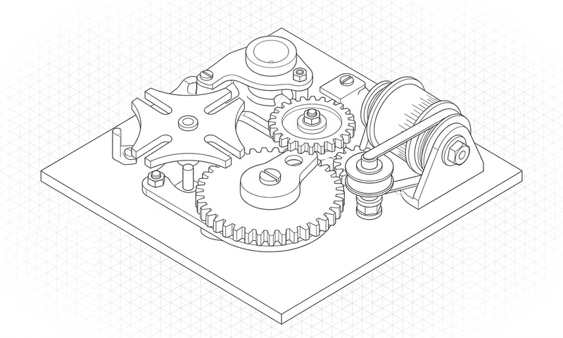

# DESIGN:OS SVG Animation Engine (`design-os-svg-animation`)

**Deterministic vector motion engine, virtual-clock studio player, and 1080p 60fps MP4/WebM launch-video compiler for AI agents.**

Author frame-exact UI walkthroughs, decoupled camera/pointer choreography, and 2:1 axonometric vector animations governed by a 10-gate Anti-Flop verification suite.

**design-os-svg-animation is free** to use and modify. Source-available under PolyForm Shield 1.0.0. Works with Claude Code, Codex, Gemini CLI and Antigravity.

<p align="center">
  
</p>

<p align="center">
  <a href="LICENSE"></a>
  
  <a href="commands/doctor.md"></a>
  <a href="https://jangtrinh.github.io/design-os-svg-animation/"></a>
  <a href="https://buymeacoffee.com/jangtrinh"></a>
</p>

<p align="center">
  <a href="#quickstart">Quickstart</a> · <a href="#what-it-makes">What it makes</a> · <a href="#installation">Install</a> · <a href="#how-it-works">How it works</a> · <a href="#commands--diagnostics">Commands</a> · <a href="#quality-bar--limitations">Limits</a>
</p>

---

## Why this exists

When AI agents generate SVG animations or promo videos freehand, they produce jittery CSS keyframes, drifting cursor tips, fake emoji icons, and non-deterministic frame timing. **`design-os-svg-animation`** enforces a virtual clock (`window.__seekToTime`), decoupled camera/cursor kinematics, authentic Phosphor/SVGL vectors, and a 10-gate Anti-Flop verifier.

| Dimension | Generic AI / Manual Workflow | DESIGN:OS SVG Animation Engine (`DESIGN:OS`) |
| :--- | :--- | :--- |
| **Frame Timing** | Wall-clock `requestAnimationFrame` drift and dropped frames | Exact integer-frame virtual clock (`frame 60 == 1.000000s` at 60fps) |
| **Camera & Cursor Motion** | Dizzying simultaneous camera pans and cursor travel | Strictly decoupled phases (camera settles before pointer travel begins) |
| **Icon & Brand Fidelity** | Raw emojis or hallucinated SVG paths | 100% verified Phosphor/Lucide glyphs and official SVGL brand marks |
| **Click Concentricity** | Cursor tips missing buttons by 15–40px | Mathematically audited concentricity (`Δ <= 1.0px` to ripple center) |
| **Privacy & Telemetry** | Opaque cloud telemetry or unverified third-party APIs | **Zero telemetry** — 100% local execution ([`PRIVACY.md`](PRIVACY.md) audited) |

---

## Quickstart

### 1. Install the plugin or CLI

**In Claude Code:**

```text
/plugin marketplace add jangtrinh/design-os-svg-animation
/plugin install design-os-svg-animation@design-os-svg-animation
```

**Or from your terminal (Codex, Gemini CLI, Antigravity, OpenCode, or standalone CLI):**

```bash
git clone https://github.com/jangtrinh/design-os-svg-animation.git
cd design-os-svg-animation
python3 scripts/anti-flop-gate.py
```

### 2. Ask in plain English

Open your project in your AI coding agent and describe what you need:

> "Create a 60fps SaaS product launch walkthrough with decoupled camera punch-ins, concentric cursor click ripples, and StudioPlayer controls."

> "Compile our SVG motion timeline into a self-contained HTML deliverable and run the 10-gate anti-flop verification audit."

> "Verify that all cursor click hotspots align within <= 1.0px of target interactive bounds across 16:9 and 9:16 safe zones."

### 3. Verify your setup

```bash
python3 scripts/self_check.py
```

---

## What it makes

Every deliverable produced by `design-os-svg-animation` is backed by a deterministic verification gate rather than freehand AI guesswork.

<p align="center">
  <br>
  <sub>Prompt: <code>"Create a 60fps SaaS product launch walkthrough with decoupled camera punch-ins, concentric cursor click ripples, and StudioPlayer controls."</code></sub>
</p>

| Deliverable / Mode | Best for | Output Format | Verification Gate |
| :--- | :--- | :--- | :--- |
| **Universal StudioPlayer HTML** | Self-contained interactive promo player with transport dock and viewport auto-scaler | `Single HTML + JS/CSS runtime` | `Gate 9 Universal Player PASS` |
| **Motion IR & Walkthrough Timeline** | Declarative JSON/JS choreography for camera punches and pointer clicks | `Validated Motion IR JSON` | `Gates 5, 6, 7, 8 PASS` |
| **1080p 60fps 3x `tmix` Showreel Export** | Pure `window.seek(t)` headless capture with 3-subframe shutter motion blur & audio | `MP4 / GIF / Beat Sheet` | `Gate 10 Showreel Anti-Flop PASS` |

### Featured Showreel & Interactive Suites

<p align="center">
  <a href="docs/promo/dc-01-tutorial/dc-01-tutorial-landscape.mp4"></a><br>
  <sub><b>Tutorials built with the engine:</b> <a href="docs/promo/dc-01-tutorial/dc-01-tutorial-landscape.mp4">DC-01 desk robot, 5:34</a> (<a href="docs/promo/dc-01-tutorial/dc-01-tutorial-portrait.mp4">9:16</a>) · <a href="docs/promo/ck-001-tutorial/ck-001-tutorial-landscape.mp4">CK-001 keyboard, 2:57</a> (<a href="docs/promo/ck-001-tutorial/ck-001-tutorial-portrait.mp4">9:16</a>) · <a href="docs/promo/design-os-3d-blender/design-os-3d-blender-promo-landscape.mp4">DESIGN:OS 3D Blender promo, 30 s</a> (<a href="docs/promo/design-os-3d-blender/design-os-3d-blender-promo-portrait.mp4">9:16</a>) · workflow: <a href="docs/tutorial-video-workflow.md">docs/tutorial-video-workflow.md</a></sub>
</p>

<p align="center">
  <a href="docs/promo/origami-cad/origami-cad-promo.mp4"></a><br>
  <sub><b>DESIGN:OS Origami CAD (15s · 120 BPM · 60fps 3x <code>tmix</code> · B&amp;W + 50 Shades of Gray · SF Pro Display)</b> — <a href="docs/promo/origami-cad/origami-cad-promo.mp4">Download 1080p 60fps MP4</a> · <a href="docs/promo/origami-cad/origami-cad-promo.html">Open Pure-Time <code>window.seek(t)</code> HTML</a></sub>
</p>

| Interactive Suite | Live Playground | Cover Preview |
| :--- | :--- | :--- |
| **Grade 1 Math (25 Figures)** | [`docs/playground/math-grade1.html`](docs/playground/math-grade1.html) | [`docs/assets/math-gallery-cover.png`](docs/assets/math-gallery-cover.png) |
| **Physics Mechanics** | [`docs/playground/physics.html`](docs/playground/physics.html) | [`docs/assets/physics-gallery-cover.png`](docs/assets/physics-gallery-cover.png) |
| **Chemistry Reactions** | [`docs/playground/chemistry.html`](docs/playground/chemistry.html) | [`docs/assets/chemistry-gallery-cover.png`](docs/assets/chemistry-gallery-cover.png) |
| **Physical Education Kinematics** | [`docs/playground/pe.html`](docs/playground/pe.html) | [`docs/assets/pe-gallery-cover.png`](docs/assets/pe-gallery-cover.png) |

---

## Installation

Choose the setup that matches your AI coding agent. Every option installs the same canonical skill (`skills/line-art-motion/SKILL.md`) and `/doctor` diagnostic suite.

### Claude Code

Run these two commands inside Claude Code:

```text
/plugin marketplace add jangtrinh/design-os-svg-animation
/plugin install design-os-svg-animation@design-os-svg-animation
```

### OpenAI Codex

Install to your personal Codex skills directory:

```bash
git clone https://github.com/jangtrinh/design-os-svg-animation.git /tmp/design-os-svg-animation
mkdir -p ~/.codex/skills/line-art-motion ~/.codex/prompts
cp -R /tmp/design-os-svg-animation/skills/line-art-motion/* ~/.codex/skills/line-art-motion/
cp /tmp/design-os-svg-animation/prompts/doctor.md ~/.codex/prompts/line-art-motion-doctor.md
rm -rf /tmp/design-os-svg-animation
```

### Gemini CLI & Google Antigravity

```bash
git clone https://github.com/jangtrinh/design-os-svg-animation.git /tmp/design-os-svg-animation
mkdir -p ~/.gemini/skills/line-art-motion
cp -R /tmp/design-os-svg-animation/skills/line-art-motion/* ~/.gemini/skills/line-art-motion/
rm -rf /tmp/design-os-svg-animation
```

### OpenCode, Cursor, Windsurf & Other Agent Harnesses

```bash
git clone https://github.com/jangtrinh/design-os-svg-animation.git /tmp/design-os-svg-animation
mkdir -p ~/.agents/skills/line-art-motion
cp -R /tmp/design-os-svg-animation/skills/line-art-motion/* ~/.agents/skills/line-art-motion/
rm -rf /tmp/design-os-svg-animation
```

<details>
<summary>Verify or uninstall</summary>

**Verify installation:**

```bash
python3 scripts/self_check.py
```

Or run `/doctor` inside Claude Code / Codex to inspect installed skill paths, plugin manifests, and gate health.

**Uninstall:**

```bash
rm -rf ~/.claude/skills/line-art-motion ~/.codex/skills/line-art-motion ~/.gemini/skills/line-art-motion ~/.agents/skills/line-art-motion
```

</details>

---

## Usage & Prompt Cookbook

Once installed, `skills/line-art-motion/SKILL.md` activates automatically when your prompt matches its domain triggers. Browse [`docs/cookbook.md`](docs/cookbook.md) for copy-paste prompt recipes.

**Generate & Scaffold**

```text
"Create a 60fps SaaS product launch walkthrough with decoupled camera punch-ins, concentric cursor click ripples, and StudioPlayer controls."
```

**Audit & Verify**

```text
"Compile our SVG motion timeline into a self-contained HTML deliverable and run the 10-gate anti-flop verification audit."
```

**Export & Automate**

```text
"Verify that all cursor click hotspots align within <= 1.0px of target interactive bounds across 16:9 and 9:16 safe zones."
```

---

## Commands & Diagnostics

| Command | Environment | What it does |
| :--- | :--- | :--- |
| `/doctor` | Claude Code / Codex | Read-only diagnostic check of installed skill paths, plugin manifests, and runtime prerequisites |
| `python3 scripts/self_check.py` | Terminal / CI | Deterministic offline verification of manifests, skill contracts, and governance files |
| `python3 scripts/anti-flop-gate.py` | Terminal / CI | Run all 10 Anti-Flop quality gates (Phosphor icons, SVGL brand marks, hotspot concentricity, 60fps frame determinism) |

---

## How it works

1. **Intent Routing** — Your AI agent matches your request against `skills/line-art-motion/SKILL.md` frontmatter triggers.
2. **Progressive Context Loading** — Only the entry-point `SKILL.md` router loads initially; detailed recipes and scripts load on demand.
3. **Deterministic Execution** — Domain scripts and contracts execute locally with reproducible inputs and outputs.
4. **Gate Verification** — `scripts/self_check.py` and domain verifiers (`python3 scripts/anti-flop-gate.py`) validate the artifact before completion.
5. **Zero-Telemetry Delivery** — Verified files are written directly to your workspace with zero external network calls.

```text
User Prompt / CLI Invocation
            │
            ▼
┌───────────────────────────────────────────────┐
│ skills/line-art-motion/SKILL.md
│ Progressive disclosure router & hard rules    │
└───────────┬───────────────────────────────────┘
            │ loads on demand
            ▼
┌───────────────────────────────────────────────┐
│ python3 scripts/anti-flop-gate.py
│ Deterministic build & contract enforcement    │
└───────────┬───────────────────────────────────┘
            │ verifies
            ▼
┌───────────────────────────────────────────────┐
│ python3 scripts/self_check.py + /doctor       │
│ Zero-telemetry local verification gate        │
└───────────────────────────────────────────────┘
```

### What loads when

`design-os-svg-animation` uses progressive context disclosure so your agent's context window stays fast and focused:

| File | Loaded when |
| :--- | :--- |
| `skills/line-art-motion/SKILL.md` | Always (~100–150 lines) — routing rules, triggers, and execution workflow |
| `docs/cookbook.md` | When selecting multi-step prompt recipes or domain patterns |
| `docs/tutorial-video-workflow.md` | When producing an A-to-Z tutorial video for a DESIGN:OS build (7 steps, owner gates, style v1) |
| `skills/es-tutorial-video/SKILL.md` | When turning a finished build folder into a tutorial video: shared kit `promo/_tutorial-kit/`, `validate.mjs`, `look.mjs`, two owner gates |
| `commands/doctor.md` / `prompts/doctor.md` | Only when running `/doctor` diagnostics |
| `llms.txt` | When indexed by AI answer engines, RAG pipelines, or repo crawlers |

---

## File structure

```text
design-os-svg-animation/
├── .claude-plugin/
│   ├── plugin.json                 # Claude Code plugin manifest
│   └── marketplace.json            # Claude Code marketplace catalog
├── .codex-plugin/
│   └── plugin.json                 # OpenAI Codex plugin & interface manifest
├── .agents/
│   └── plugins/marketplace.json    # Cross-agent local plugin registry
├── .factory-plugin/
│   ├── plugin.json                 # Factory / Droid plugin manifest
│   └── marketplace.json            # Factory marketplace metadata
├── skills/
│   └── line-art-motion/
│       └── SKILL.md                # Canonical agent skill entrypoint
├── commands/
│   └── doctor.md                   # /doctor diagnostic slash command
├── prompts/
│   └── doctor.md                   # Codex diagnostic prompt mirror
├── scripts/
│   └── self_check.py               # Deterministic repository & skill self-check
├── docs/
│   ├── cookbook.md                 # Copy-paste prompt recipes by job
│   └── llms.txt                    # GEO / LLM discovery index
├── PRIVACY.md                      # Zero-telemetry & local-first privacy commitment
├── SECURITY.md                     # Vulnerability disclosure & security policy
├── CONTRIBUTING.md                 # Contribution workflow & verification rules
├── CODE_OF_CONDUCT.md              # Contributor Covenant code of conduct
├── CHANGELOG.md                    # Release history
├── llms.txt                        # Root LLM indexing manifest
├── LICENSE                         # PolyForm Shield 1.0.0
└── README.md
```

---

## Quality bar & Limitations

### It's working if...

- `python3 scripts/self_check.py` prints `ok: design-os-svg-animation self-check passed (line-art-motion)` and exits `0`.
- `python3 scripts/anti-flop-gate.py` passes with zero contract or test regressions.
- Your AI coding agent loads `skills/line-art-motion/SKILL.md` automatically when given any prompt from [`docs/cookbook.md`](docs/cookbook.md).
- Network traffic during execution remains zero (guaranteed by [`PRIVACY.md`](PRIVACY.md)).

### When not to use

- Photorealistic 3D rigid-body simulations or CAD mechanical assemblies (use `design-os-3d-blender`).
- Static packaging dielines and print PDFs (use `design-os-origami`).
- Quick one-line CSS hover transitions that do not require timeline choreography or video export.

---

## DESIGN:OS Ecosystem

`design-os-svg-animation` is one of the 13 source-available engines in the **`DESIGN:OS`** ecosystem:

| Engine | Live Docs | Repository | Layer |
| :--- | :--- | :--- | :--- |
| **DESIGN:OS CLI** | [jangtrinh.github.io/design-os](https://jangtrinh.github.io/design-os/) | [`jangtrinh/design-os`](https://github.com/jangtrinh/design-os) | `cli` |
| **Knowledge Builder** | [jangtrinh.github.io/design-os-knowledge-builder](https://jangtrinh.github.io/design-os-knowledge-builder/) | [`jangtrinh/design-os-knowledge-builder`](https://github.com/jangtrinh/design-os-knowledge-builder) | `compiler` |
| **Figma Plugin & CLI** | [jangtrinh.github.io/design-os-figma-plugin](https://jangtrinh.github.io/design-os-figma-plugin/) | [`jangtrinh/design-os-figma-plugin`](https://github.com/jangtrinh/design-os-figma-plugin) | `plugin` |
| **SVG Animation Engine** | [jangtrinh.github.io/design-os-svg-animation](https://jangtrinh.github.io/design-os-svg-animation/) | [`jangtrinh/design-os-svg-animation`](https://github.com/jangtrinh/design-os-svg-animation) | `engine` |
| **3D Blender Agent** | [jangtrinh.github.io/design-os-3d-blender](https://jangtrinh.github.io/design-os-3d-blender/) | [`jangtrinh/design-os-3d-blender`](https://github.com/jangtrinh/design-os-3d-blender) | `3d / cad` |
| **OPAH ONE Drone** | [jangtrinh.github.io/design-os-drone-showcase](https://jangtrinh.github.io/design-os-drone-showcase/) | [`jangtrinh/design-os-drone-showcase`](https://github.com/jangtrinh/design-os-drone-showcase) | `hardware` |
| **GitHub Pages Engine** | [jangtrinh.github.io/design-os-github-page](https://jangtrinh.github.io/design-os-github-page/) | [`jangtrinh/design-os-github-page`](https://github.com/jangtrinh/design-os-github-page) | `pages` |
| **Apple Design OS** | [jangtrinh.github.io/design-os-apple](https://jangtrinh.github.io/design-os-apple/) | [`jangtrinh/design-os-apple`](https://github.com/jangtrinh/design-os-apple) | `swiftui` |
| **Agent Teacher** | [jangtrinh.github.io/design-os-pedagogy](https://jangtrinh.github.io/design-os-pedagogy/) | [`jangtrinh/design-os-pedagogy`](https://github.com/jangtrinh/design-os-pedagogy) | `pedagogy` |
| **Origami CAD** | [jangtrinh.github.io/design-os-origami](https://jangtrinh.github.io/design-os-origami/) | [`jangtrinh/design-os-origami`](https://github.com/jangtrinh/design-os-origami) | `packaging` |
| **Voice UX Architecture** | [jangtrinh.github.io/design-os-voice-ux](https://jangtrinh.github.io/design-os-voice-ux/) | [`jangtrinh/design-os-voice-ux`](https://github.com/jangtrinh/design-os-voice-ux) | `voice-ai` |
| **Code2Flow** | [jangtrinh.github.io/design-os-code2flow](https://jangtrinh.github.io/design-os-code2flow/) | [`jangtrinh/design-os-code2flow`](https://github.com/jangtrinh/design-os-code2flow) | `ast / audit` |
| **Generative UI** | [jangtrinh.github.io/design-os-generative-ui](https://jangtrinh.github.io/design-os-generative-ui/) | [`jangtrinh/design-os-generative-ui`](https://github.com/jangtrinh/design-os-generative-ui) | `runtime` |

---

## Contributing, Governance & License

- **Contributing**: See [`CONTRIBUTING.md`](CONTRIBUTING.md) for pull request guidelines and verification gates (`python3 scripts/self_check.py`).
- **Code of Conduct**: Governed by [`CODE_OF_CONDUCT.md`](CODE_OF_CONDUCT.md).
- **Security & Privacy**: Zero telemetry — see [`SECURITY.md`](SECURITY.md) and [`PRIVACY.md`](PRIVACY.md).
- **Changelog & LLM Index**: Track releases in [`CHANGELOG.md`](CHANGELOG.md) and machine-readable index in [`llms.txt`](llms.txt).
- **License**: [PolyForm Shield 1.0.0](LICENSE) © [Jang Trinh](https://github.com/jangtrinh). Free to use and modify, including for paid client work; you may not resell it or build a competing product from it.

---

If `design-os-svg-animation` saves you time, a star on GitHub helps other engineers and AI agents find it.

<p align="left">
  <a href="https://buymeacoffee.com/jangtrinh">
    
  </a>
</p>
