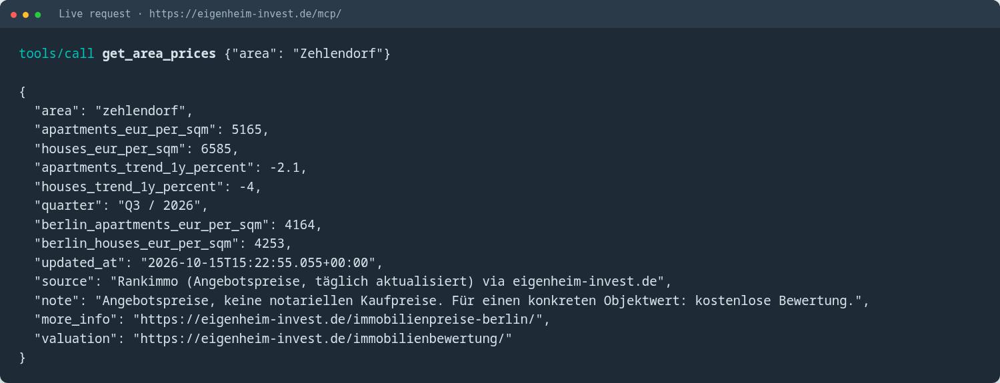

# Eigenheim Invest – Berlin Real Estate Market MCP

> **TL;DR** – A free, public, read-only MCP server with live Berlin property prices (€/m² for apartments and houses), rental yields, 2026 standard land values (Bodenrichtwerte), population forecast 2040, official notary transaction data and current listings from Eigenheim Invest.
>
> - **Endpoint:** `https://eigenheim-invest.de/mcp/` (Streamable HTTP)
> - **Auth:** none – no API key, no login
> - **Works with:** Claude (Desktop, Code, Web), ChatGPT (Apps / Plugins), OpenAI Codex, Cursor, VS Code
> - **MCP Registry ID:** `io.github.magicSEO/eigenheim-mcp` ([official MCP Registry](https://registry.modelcontextprotocol.io/v0/servers/io.github.magicSEO%2Feigenheim-mcp/versions/latest))
> - **Live data page:** [eigenheim-invest.de/immobilienpreise-berlin/](https://eigenheim-invest.de/immobilienpreise-berlin/)


---

## Contents

1. [Quick start](#quick-start) · [Plugins](#plugins)
2. [Screenshots](#screenshots)
3. [What can you ask?](#what-can-you-ask)
4. [Available tools](#available-tools)
5. [Data sources](#data-sources)
6. [Privacy & usage](#privacy--usage)
7. [About](#about)

---

## Quick start

### Claude Code

```bash
claude mcp add --transport http eigenheim https://eigenheim-invest.de/mcp/
```

Or install it as a Claude Code plugin:

```bash
/plugin install eigenheim-market --marketplace magicSEO/eigenheim-mcp
```

### Claude Desktop / Claude.ai

Settings → **Connectors** → **Add custom connector**

- Name: `Eigenheim Invest Market`
- URL: `https://eigenheim-invest.de/mcp/`

### OpenAI Codex CLI

```bash
codex mcp add eigenheim --url https://eigenheim-invest.de/mcp/
```

or in `~/.codex/config.toml`:

```toml
[mcp_servers.eigenheim]
url = "https://eigenheim-invest.de/mcp/"
```

---

## Plugins

This repository is also a ready-to-install plugin for **Claude Code** and **OpenAI Codex**. Both plugins connect to the same read-only MCP server and add the skill `berlin-market-data` (always quote source and date, never invent numbers).

| | Claude Code plugin | Codex plugin |
|---|---|---|
| Manifest | [`.claude-plugin/plugin.json`](./.claude-plugin/plugin.json) | [`.codex-plugin/plugin.json`](./.codex-plugin/plugin.json) |
| Marketplace | [`.claude-plugin/marketplace.json`](./.claude-plugin/marketplace.json) | [awesome-codex-plugins](https://github.com/hashgraph-online/awesome-codex-plugins) (submitted) |
| MCP config | [`.mcp.json`](./.mcp.json) | [`.mcp.json`](./.mcp.json) |
| Skill | [`skills/berlin-market-data`](./skills/berlin-market-data/SKILL.md) | [`skills/berlin-market-data`](./skills/berlin-market-data/SKILL.md) |

### Claude Code plugin

```bash
/plugin marketplace add magicSEO/eigenheim-mcp
/plugin install eigenheim-market@eigenheim-invest
```

### Codex plugin

Install from the [awesome-codex-plugins](https://github.com/hashgraph-online/awesome-codex-plugins) marketplace once listed, or clone this repository and add it as a local plugin in Codex. Quality check: HOL AI Plugin Scanner 3.49.0 – **100/100, no findings**.

Security policy: [`SECURITY.md`](./SECURITY.md)

### ChatGPT (Apps / Plugins)

> Custom GPTs retire on 11 Dec 2026. This server is MCP-native, so it works as a ChatGPT app (plugin) without any extra API. Submission to the ChatGPT app directory: see [`chatgpt-app/SUBMISSION.md`](./chatgpt-app/SUBMISSION.md).

1. Settings → **Apps** (or **Plugins**) → **Advanced settings** → enable **Developer mode**.
2. **Create app**:
   - Name: `Eigenheim Invest Market`
   - MCP Server URL: `https://eigenheim-invest.de/mcp/`
   - Authentication: **No authentication**
3. In a new chat, select the app via **+ → Developer mode** and ask your question.

### Cursor (`.cursor/mcp.json`)

```json
{
  "mcpServers": {
    "eigenheim": { "url": "https://eigenheim-invest.de/mcp/" }
  }
}
```

### VS Code (`.vscode/mcp.json`)

```json
{
  "servers": {
    "eigenheim": { "type": "http", "url": "https://eigenheim-invest.de/mcp/" }
  }
}
```

> Tip: Use the URL **with** trailing slash (`/mcp/`). Without it the server redirects, which some clients do not follow.

---

## Screenshots

Real responses from the live server (captured 16 Oct 2026):

| Prices | Rental yield | Land values |
|---|---|---|
|  |  |  |
| `get_area_prices` Zehlendorf | `calculate_rental_yield` Steglitz | `get_bodenrichtwerte` Dahlem |

---

## What can you ask?

Ask in **English or German** – the assistant picks the right tool.

### Prices & trends
- *"What is the average price per m² for apartments and houses in Zehlendorf compared to Berlin?"*
- *„Was kostet ein Quadratmeter in Prenzlauer Berg aktuell?"*
- *"Which Berlin neighbourhood is the most expensive for apartments right now?"*

### Rental yield & investment
- *"Calculate the gross rental yield and price multiplier for an apartment in Steglitz."*
- *„Lohnt sich eine Wohnung in Neukölln als Kapitalanlage? Rechne mit 5.000 €/m² und 14 € Miete."*

### Land values (Bodenrichtwerte 2026)
- *"What are the 2026 standard land values in Dahlem and Nikolassee?"*
- *„Wie hoch ist der Bodenrichtwert in Wannsee?"*

### Market & demographics
- *"How many notarised property sales were there in Berlin in H1 2026?"*
- *"Which Berlin localities have the highest and lowest apartment prices right now?"*
- *„Welche Bezirke wachsen laut Senatsprognose bis 2040 am stärksten?"*

### Listings
- *"Are there houses for sale in Berlin Southwest or Falkensee?"*
- *„Zeig mir Wohnungen unter 600.000 € mit mindestens 3 Zimmern."*

### Guides
- *"What are the closing costs (Kaufnebenkosten) when buying in Berlin?"*
- *„Was muss ich beim Verkauf einer geerbten Immobilie beachten?"*

---

## Available tools

| Tool | What it returns | Inputs |
|---|---|---|
| `get_area_prices` | Current €/m² for apartments & houses, trend, Berlin comparison | `area` |
| `get_market_overview` | Berlin-wide KPIs: prices, rents, notary transactions + price ranking of all 32 localities | – |
| `calculate_rental_yield` | Gross yield & price multiplier | `area` or own `price_per_sqm` / `rent_per_sqm` |
| `get_bodenrichtwerte` | 2026 land values for 96 Berlin localities | `query` (optional) |
| `get_population_forecast` | Population forecast 2024–2040 per district | – |
| `search_properties` | Current **active** listings (no street addresses) | type, location, price, rooms, area, limit |
| `get_property_details` | Public exposé details + link | `slug` |
| `search_guides` | Editorial guides with links | `query`, `limit` |

All tools are **read-only**. Every answer includes source, date and a link to the matching page on eigenheim-invest.de.

---

## Data sources

- **Asking prices:** Rankimmo, updated daily (offer data, not notarised prices)
- **Rents:** IBB Wohnungsmarktbericht 2025
- **Population forecast:** Senatsverwaltung Berlin, Bevölkerungsprognose 2024–2040
- **Notary transactions:** Gutachterausschuss Berlin, market report H1 2026
- **Land values:** Bodenrichtwerte 2026
- **Listings:** Eigenheim Invest (current active offers)

Methodology: [eigenheim-invest.de/immobilienpreise-berlin/#datenquellen](https://eigenheim-invest.de/immobilienpreise-berlin/#datenquellen)

---

## Privacy & usage

- No API key, no tracking of prompts, no personal data.
- Listings show only public marketing information – no exact addresses, no seller data.
- Free for personal and commercial use. Please cite *Eigenheim Invest* with a link when publishing figures.
- Values are market indicators, not a valuation. For a property-specific value use the [free valuation](https://eigenheim-invest.de/immobilienbewertung/).

---

## About

**Eigenheim Invest** is a real estate agency for Berlin Southwest and the surrounding Brandenburg area (Zehlendorf, Dahlem, Nikolassee, Schlachtensee, Wannsee, Kladow, Falkensee, Teltow, Stahnsdorf, Kleinmachnow, Michendorf).

- Website: [eigenheim-invest.de](https://eigenheim-invest.de/)
- **Berlin property prices by district:** [eigenheim-invest.de/immobilienpreise-berlin/](https://eigenheim-invest.de/immobilienpreise-berlin/)
- Free valuation: [eigenheim-invest.de/immobilienbewertung/](https://eigenheim-invest.de/immobilienbewertung/)
- Contact: info@eigenheim-invest.de

## License

Plugin and configuration files: [MIT](./LICENSE). Documentation and market data: CC BY 4.0 (attribution: Eigenheim Invest). Data remains property of the respective sources.
