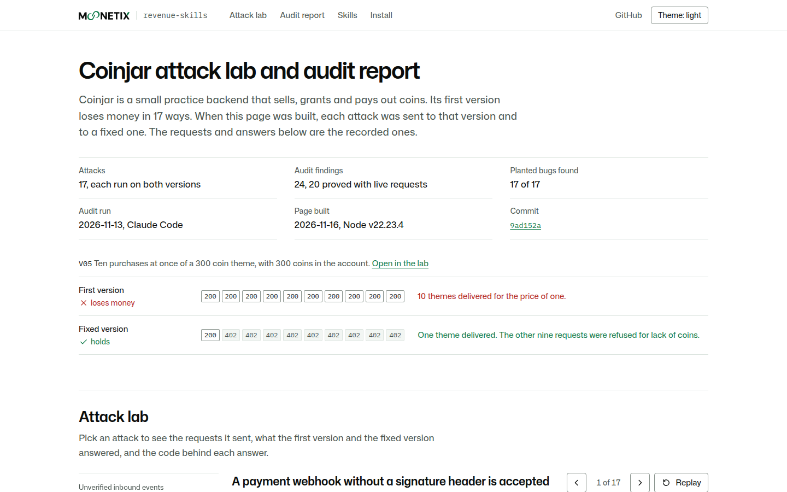

# revenue-skills

**Agent skills that find and fix the bugs that cost your app money: a money-path audit where every finding carries a proof, and skills that build webhooks, ledgers, credits, subscriptions, refunds, referrals and payouts correctly.**

[](https://github.com/moonetix/revenue-skills/actions/workflows/ci.yml)
[](LICENSE)
[](https://agentskills.io)
[](#pick-by-situation)
[](package.json)

[](https://moonetix.github.io/revenue-skills/)

**[Open the live demo](https://moonetix.github.io/revenue-skills/)**: one attack for every bug planted in a practice app, each sent to the broken and to the fixed version, and the full report an agent wrote with the audit skill.

They work with Claude Code, Codex, Cursor, Gemini CLI, GitHub Copilot, OpenCode, Goose, Amp and any other agent that reads the [Agent Skills](https://agentskills.io) format.

## What it catches

Each of these looks fine in a demo and costs money in production:

- **A provider retries a webhook,** and the user is credited three times for one payment.
- **A webhook skips the signature check when the header is missing,** and anyone can post a "paid" event for an order they never paid.
- **Ten purchases arrive at the same moment** against a balance that covers one, and all ten are delivered.
- **A refund or a chargeback leaves the credits in the account,** so the buyer keeps what they got and the money is gone.
- **A payout call times out and the code marks it failed,** returns the coins, and the user cashes out again while the first payment arrives.
- **A referral bonus is paid at sign-up,** and one person collects it a hundred times with throwaway accounts.

## Try it in a minute

Install all eleven skills with the [skills installer](https://github.com/vercel-labs/skills). It asks which agents to install into, and needs Node 22.20 or newer; the scripts inside the skills run on Node 20 or newer.

```bash
npx skills add moonetix/revenue-skills
```

Add `--skill money-audit` for one skill only, or `--list` to see them first. Then ask, in the project you want checked:

> Audit this project for ways users could get free credits or be paid twice.

The audit writes a report with a file, a line, the quoted code and a proof for every finding. The start of the [example audit](examples/coinjar-audit/REPORT.md) of the practice app in this repository:

> **24 findings:** 11 critical, 6 high, 6 medium, 1 low.
>
> | ID | Severity | Class | Finding | Where | Proof |
> | --- | --- | --- | --- | --- | --- |
> | MA-01 | critical | Unverified inbound events | A Paylane webhook sent without a signature header is accepted and credits the order | `routes/webhooks.mjs:8` | probe |
> | MA-07 | critical | Races on a balance | Parallel purchases all succeed and the balance is charged for one | `routes/wallet.mjs:18` | probe |
> | MA-13 | critical | Refunds and reversals | Refund and dispute events from Paylane are acknowledged and the coins stay | `routes/webhooks.mjs:17` | probe |

And from the proof of MA-01:

> With the header dropped it answered 200 and the balance rose from 0 to 500 for an order nobody paid.

Other ways to install, and the folder where each agent reads skills in a project (copying a folder under [`skills/`](skills/) there works too):

| Agent | Other ways to install | Skills folder in a project |
| --- | --- | --- |
| Claude Code | `/plugin marketplace add moonetix/revenue-skills`, then `/plugin install revenue-skills@revenue-skills` | `.claude/skills/` |
| Codex | `codex plugin marketplace add moonetix/revenue-skills`, then pick it under `/plugins` | `.agents/skills/` |
| Cursor | | `.agents/skills/` |
| Gemini CLI | `gemini extensions install https://github.com/moonetix/revenue-skills` | `.agents/skills/` |
| GitHub Copilot | | `.agents/skills/` |
| OpenCode | | `.agents/skills/` |
| Goose | | `.goose/skills/` |
| Amp | | `.agents/skills/` |

The [installer's agent list](https://github.com/vercel-labs/skills/blob/main/docs/agents.md) has the other agents and the global folders. The `plugin` branch holds only the plugin files (the Agent Plugins and Claude Code manifests, the skills and the icon), rebuilt from each release tag by [a workflow](.github/workflows/plugin-branch.yml); `/plugin marketplace add moonetix/revenue-skills@plugin` installs from it.

## Pick by situation

The agent picks the skill from its description. If it does not, name the skill in the prompt. Builder skills that write code show their core pattern in Next.js, Express, Django, Laravel and Rails and end with tests and probe commands; `design-reward-economy` ends with its economy check.

| Your situation | Skill | Prompt to start with |
| --- | --- | --- |
| I sell credits in an AI app | [`add-usage-credits`](skills/add-usage-credits/) | `Charge credits for every AI request: hold the most it can cost before the model call, charge what the provider reports after it, and never charge twice for a retry or a cut stream.` |
| I take payments with Stripe, Paddle or Lemon Squeezy | [`build-webhook-endpoint`](skills/build-webhook-endpoint/), then [`handle-refunds-and-reversals`](skills/handle-refunds-and-reversals/) | `Add the Stripe webhook that credits paid orders exactly once, then make refunds and disputes take the credits back.` |
| I sell subscriptions with Stripe, the App Store or Google Play | [`add-subscriptions`](skills/add-subscriptions/) | `Add our monthly Pro plan with Stripe Billing: access only while it is paid, a few days of grace when a renewal fails, access until the period end after a cancel, the monthly credits once per paid month, and a job that checks our data against Stripe.` |
| I sell in-app purchases on Apple or Google | [`build-webhook-endpoint`](skills/build-webhook-endpoint/), then [`handle-refunds-and-reversals`](skills/handle-refunds-and-reversals/) | `Grant App Store and Google Play purchases from their server notifications, and take them back on refunds and revocations.` |
| I pay users out | [`add-payouts`](skills/add-payouts/) | `Add cash-outs that can never pay twice, with a minimum, daily limits and a hold on new earnings.` |
| I run a rewards app or an offerwall | [`add-offerwall`](skills/add-offerwall/), [`design-reward-economy`](skills/design-reward-economy/) | `Add an offerwall with a postback that credits each conversion once and handles reversals, then check that our coin rate and bonuses do not lose money.` |
| I want referrals | [`add-referral-program`](skills/add-referral-program/) | `Add a referral program that pays only after the friend's first purchase and cannot be farmed with second accounts.` |
| I give sign-up bonuses or trials | [`guard-signups`](skills/guard-signups/) | `Give new accounts a welcome bonus and a free trial without letting duplicate and throwaway accounts farm them.` |
| Every feature writes the balance column directly | [`build-ledger`](skills/build-ledger/) | `Move every balance change onto a ledger with a history per user and a reconciliation check.` |
| Audit my existing code | [`money-audit`](skills/money-audit/) | `Audit this project for ways users could get free credits or be paid twice.` |

## Measured

**The builder skills, in trials.** A fresh coding agent got a starter app and a plain request, once with the one skill installed and once without it. An automated checker then attacked what it built. Each cell is one agent run (Claude Code, one non-interactive session), and each gave the same result in three checker runs.

| Skill | Checks | Opus 5.5, with skill | Opus 5.5, without | Sonnet 5.5, with skill | Sonnet 5.5, without |
| --- | --- | --- | --- | --- | --- |
| `add-offerwall` | 14 | 14/14 | 3/14 | 13/14 | 2/14 |
| `handle-refunds-and-reversals` | 15 | 15/15 | 12/15 | 15/15 | 12/15 |
| `add-referral-program` | 12 | 12/12 | 10/12 | 12/12 | 10/12 |
| `add-payouts` | 16 | 13/16, after a skill fix 16/16 | 16/16 | 16/16 | 14/16 |
| `build-webhook-endpoint` | 20 | 20/20 | 19/20 | 20/20 | 19/20 |
| `build-ledger` | 12 | 12/12 | 12/12 | 12/12 | 11/12 |
| `guard-signups` | 14 | 14/14 [1] | 13/14 [2] | 14/14 [1] | 13/14 [2] |
| `add-usage-credits` | 10 | 10/10 | 10/10 | 10/10 | 10/10 |
| `design-reward-economy` | 8 | 8/8 | [3] | 8/8 | [3] |
| `add-subscriptions` | 21 | 21/21 | 21/21 [4] | 21/21 | 21/21 [4] |

What went wrong without the skill:

- `add-offerwall`: neither agent found the network's postback format, both guessed the hash, and every genuine postback was refused.
- `handle-refunds-and-reversals`: a reversal naming another user was ignored, so the account that got the credit kept it; Opus rounded each partial refund up, Sonnet answered an early reversal with 404 so the late credit still paid, and kept a referral bonus after the qualifying purchase was refunded.
- `add-referral-program`: buy, refund, buy paid the referral bonus again each time, and an unknown code blocked the sign-up.
- `add-payouts` (Sonnet): after a provider error or timeout, a manual resolve waited and then refunded instead of repeating the request with the same key.
- `build-webhook-endpoint`: the app started without its signing secret.
- `build-ledger` (Sonnet): ten parallel purchases against a balance that covered two all went through, leaving the balance at -1200.

[1] Once its newly required secret was supplied: with the skill, both agents made a keyed-hash secret mandatory and flagged it as a deploy step, so the app did not start with the task's environment alone. [2] Plus tags were stripped on every domain; stricter than the check, not a money loss, and providers' own pages disagree about consumer Outlook.com. [3] Not comparable: the checker reads `config/economy.json` in the format of the skill's check script, and without the skill each agent wrote its own format. [4] The subscription task spells out every rule, from the grace period to an immediate cancel, and points at the Stripe API docs, so both models met it without the skill too: this trial shows the skill does no harm, not that it helps.

With the skill, Sonnet refused an offerwall postback with a fractional reward (13/14); the skill now says to round it down once. Opus's first `add-payouts` run added a waiting window that blocked a manual resolve; the skill was fixed and a second run passed. One run per cell: another run, agent or model can do better or worse. The checks cover what can be seen from outside the app, and each trial's `RUBRIC.md` lists the rules left to code review. The starter apps were written for this repository ([details](trials/README.md#results)).

**The audit, on two codebases.** One `money-audit` run on each, with Claude Fable 5.2 in Claude Code, on the skill as it was before 1.0.0 (2026-11-13 and 2026-11-14):

| Target | Result |
| --- | --- |
| [`playground/vulnerable/`](playground/vulnerable/), the practice app | All 17 planted bugs found, each matched to a different finding. 24 findings, all accepted by the validator: 20 proved with probe requests, 4 with code traces. 23 point at a planted bug; the other is a real weakness the key does not list. [The report](examples/coinjar-audit/). |
| [referral-engine](https://github.com/moonetix/referral-engine) v1.0.0, a published library | Three ways for a payout to exceed the balance, one high and two medium, all fixed in 1.0.1 through [pull request #1](https://github.com/moonetix/referral-engine/pull/1). [The run](examples/referral-engine-audit/). |

The practice app was written for this repository alongside the skill references, and during its run one probe example in a reference still showed a bypass that matches a planted bug (1.1.0 removed it): read it as an end to end check, not as a benchmark on unfamiliar code. referral-engine is a library by the same maintainer: one library, one run. `npm run check:example` checks both audits again. Results vary with the agent and the model.

## How it works

**The audit** hunts ten classes of money bugs one at a time, each with a [reference](skills/money-audit/references/) of code shapes, proofs and false alarms. **The validator** checks the findings before anything is reported: each quoted snippet is at the file and line it names, every proof is filled in, and all ten classes are accounted for. It does not rerun a proof. When a finding cites code that is not there:

```console
$ node skills/money-audit/scripts/validate-findings.mjs money-audit/findings.json --root .
error: finding MA-03 location: snippet not found at routes/webhooks.mjs:20. The text is at line 8.
error: finding MA-07: proof.result must say what the run showed
error: coverage: class "payout-controls" is not accounted for

INVALID: 3 problems. Fix the report, do not delete the check.
```

**The probe** replays, races and tampers with requests against an app on your own machine and reports how a balance moved. Ten purchases at once in the practice app, against an account that can afford one:

```console
$ node skills/money-audit/scripts/probe.mjs race spend.json --parallel 10 --observe me.json
{
  "probe": "race",
  "request": "POST http://127.0.0.1:3000/api/spend",
  "edits": [],
  "sent": 10,
  "statuses": {
    "200": 10
  },
  "samples": [
    {
      "status": 200,
      "body": "{\"item\":\"theme\",\"balance\":0}"
    }
  ],
  "ms": 38,
  "observed": {
    "path": "balance",
    "before": 300,
    "after": 0,
    "delta": -300
  }
}
```

All ten succeeded and the balance fell by the price of one. [proving-findings.md](skills/money-audit/references/proving-findings.md#what-the-probe-cannot-do) lists what the probe cannot do.

## The practice app and the trials

[`playground/`](playground/) holds Coinjar, a small backend that sells, grants, moves and pays out coins: [`vulnerable/`](playground/vulnerable/) loses money in 17 ways and [`fixed/`](playground/fixed/) closes all of them. [`test/playground.test.mjs`](test/playground.test.mjs) runs one exploit per bug against both on every commit. To score your own agent's audit, copy `playground/vulnerable/` out of the repository, audit the copy, then:

```bash
node playground/score.mjs path/to/copy/money-audit/findings.json
```

[`trials/`](trials/) has one trial per builder skill: a starter app, the request and a checker that attacks the result. The [trials README](trials/README.md) and the [playground README](playground/README.md) have the steps.

## Safety and privacy

- The audit reads code and probes only an app running on your machine. It changes application code only when you ask for fixes.
- The probe refuses any target that is not a loopback address unless you name the host with `--allow-host`, sends at most 20 requests in sequence or 50 at once, and does not follow redirects.
- The probe edits and reads JSON only, with no cookie jar, forms or CSRF tokens, so some proofs need a test in your project instead.
- Findings never contain secret values, only where a secret is and what it opens.
- Nothing in the skills uploads code or results. Your agent sends what it reads to its own model provider, as it does for any task. The skills tell the agent to read a provider's current documentation where a scheme can change.
- Test only systems you own or are authorized to test.

## Contributing

```bash
npm test && npm run validate && npm run trials:validate && npm run check:example
```

Node 22.13 or newer, nothing to install. [CONTRIBUTING.md](CONTRIBUTING.md) explains how to improve a skill, add a trial or add a bug to the practice app; [AGENTS.md](AGENTS.md) has the rules and the layout. If the audit missed a bug you have seen in the wild, [tell us the shape of it](https://github.com/moonetix/revenue-skills/issues/new?template=missed-bug.yml). To report a vulnerability, see [SECURITY.md](SECURITY.md).

## About

Maintained by Moonetix. Moonetix is an affiliate network: [moonetix.com](https://moonetix.com).

## License

MIT, with no account and no service behind it. See [LICENSE](LICENSE).
