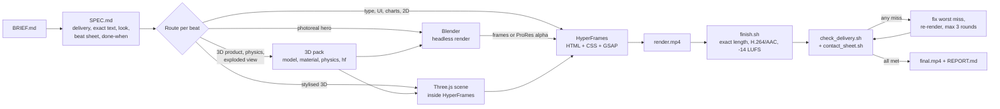
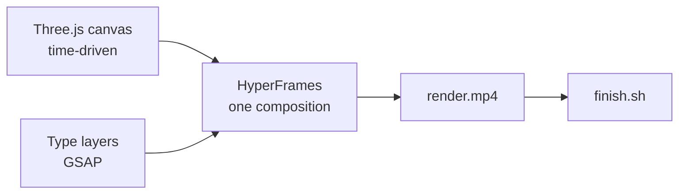

# Pipelines: how the tools connect

Read this when a brief needs more than one tool, or when you are choosing between routes. Every route ends the same way: one master file, `scripts/finish.sh`, `scripts/check_delivery.sh`, stills you have looked at, and `REPORT.md`.

## The architecture

HyperFrames is the spine: it is the one place where layers meet on a single timeline. Other tools produce layers (a Blender clip, a Three.js canvas, an image sequence, a sound bed) and HyperFrames composes them. ffmpeg only finishes, joins and measures.

## Choosing a route, beat by beat

Route each beat of the beat sheet on its own, not the whole video. A 15 s product film is often three routes: a HyperFrames title, a 3D-pack physics shot and a Blender hero frame.

| The beat needs | Route | Cost on a laptop |
|---|---|---|
| Words, layouts, lower thirds, UI mock, counters, charts | HyperFrames only | seconds per draft |
| Abstract 3D: particles, planets, shapes, flying camera | Three.js template in HyperFrames | seconds to a minute |
| A product or object that falls, stacks, explodes into parts, turns | 3D pack (`hf` route) | about a minute |
| Glass, metal, soft shadows, a beauty shot | 3D pack `blender` route, or the Blender template | a minute or more per second of video |
| A logo or icon that becomes 3D | 3D pack `model` (extrude) + `material` + `reveal` | about a minute |
| Real footage, screen recordings | `<video>` layer in HyperFrames; trim and normalise with ffmpeg first | seconds |
| Captions from a voiceover | HyperFrames caption layer timed to the audio | seconds |
| Real footage with several cuts, a voice-over and music | edit pack: FilmCraft cut, SoundCraft mix, HyperFrames titles on top | a minute or two |
| A thumbnail or title card, an SVG lower third or logo | edit pack: PhotoCraft or VectorCraft | seconds |

When the 3D pack is not installed (`scripts/detect_3d.sh` says `not installed`), use the Three.js template for 3D beats and say in REPORT.md that physics and exploded views were animated by hand.

## Pipeline recipes

### 1. Kinetic type (one tool)

`SPEC.md` -> HyperFrames composition -> draft render (2-3 s) -> look -> full render -> `finish.sh` -> checks.
Use for titles, quotes, launch cards, explainers made of words. Example: `examples/01-kinetic-type`.

### 2. Type over 3D (two layers, one timeline)

The 3D scene is a pure function of time `t` that HyperFrames seeks. Type sits in HTML above the canvas, so it stays sharp and spell-checkable. Example: `examples/02-threejs-orbit`.

### 3. Physics product shot (3D pack)

Bake physics once, replay it by lookup: every worker sees the same frame for the same `t`. Snapshot first. A camera that frames the fall instead of the landing zone is the most common miss, and a snapshot shows it in seconds. Example: `examples/04-3d-product`.

### 4. Photoreal hero inside a motion graphic

Render the hero in Blender to PNG frames or ProRes 4444 with alpha, then use it as a `<video>` or image-sequence layer in HyperFrames with type and graphics on top. Keep Blender for the shots that need it: a 3 s hero inside a 12 s HyperFrames film is a normal mix. Example: `examples/03-blender-product`.

### 5. Long or multi-scene films

Split the beat sheet into scenes of 5-20 s, one HyperFrames sub-composition each, rendered separately. Join with ffmpeg (`references/ffmpeg.md`, concat with matching codecs), then put one continuous sound bed over the joined file in `finish.sh --audio`. One bed across the film sounds finished; a fade at every scene join sounds like a slideshow.

## Methods that make the result better

- **Spec first, then pixels.** The done-when list is what the self-check measures. Vague brief lines become measurable lines in SPEC.md before any code.
- **Draft small, look, then scale.** Render 2-3 s at draft quality, view the stills, then build the rest. A wrong font or a cut-off word costs seconds to find in a draft and minutes in a final.
- **Time is the only input.** No wall clock, no unseeded random, no network while rendering. Same `t`, same pixels, so parallel renders and re-renders match.
- **One hero moment per film.** Put it in the beat sheet with a time. Everything else supports it.
- **Look at frames, not logs.** A render that finished is not a video that is right. Pull stills at every beat start, the hero moment and the last second, and view them.
- **Fix the worst miss first,** then re-check everything, because fixes move other things.
- **Layer, don't bake text into 3D.** Type in HTML over a 3D layer stays sharp, exact and easy to change.

## Where to go deeper

- `references/hyperframes.md`: composition rules, commands, sub-compositions
- `references/threejs.md`: time-driven 3D inside HyperFrames
- `references/blender.md`: headless Blender
- `references/ffmpeg.md`: finishing, joining, loudness
- `references/ecosystem.md`: other open-source motion tools, when they beat these, and how to bring their output in
- `3d/README-3D.md`: the 3D pack, its components, shot JSON and the brief-to-shot mapping
